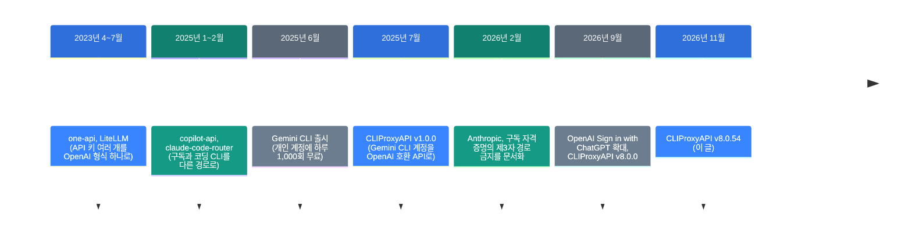
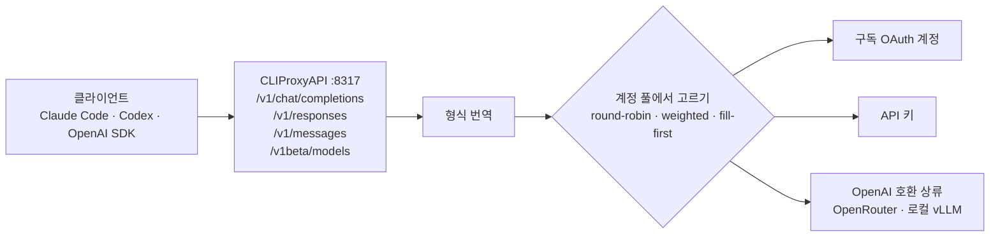

![[cliproxyapi.mp4]]

[원문](https://github.com/router-for-me/CLIProxyAPI) · [레포](https://github.com/router-for-me/CLIProxyAPI) · [English](https://neocello-ku.github.io/trends/cliproxyapi)

## 요약

CLIProxyAPI는 코딩 도구의 구독 계정을 API 주소 하나로 묶는 Go 서버입니다. 대상은 Claude Code, Codex, Gemini CLI 같은 도구입니다. 2025년 7월에 나왔고 2026년 11월 4일 v8.0.54까지 916번 릴리스했습니다. GitHub 별은 5만 7천 개가 넘습니다.

흐름에서 보면 2023년의 "API 키 게이트웨이"가 "구독 계정 게이트웨이"로 옮겨 간 결과입니다. 그 사이 Anthropic은 이 방식을 약관으로 막았고 OpenAI는 공식 경로를 열었습니다.

결론부터 말하면 기법은 새롭지 않습니다. 새로운 것은 공급사 7곳의 구독 로그인을 한 서버에 묶은 제품과 운영 규모입니다. 용어가 낯설면, 아래 '처음이라면' 섹션부터 읽으세요.

## 흐름 속 위치: 왜 지금 이 이야기인가

코딩 에이전트를 월 구독으로 쓰는 사람이 많습니다. 구독은 API 종량 요금보다 싸게 느껴집니다. 그래서 "구독 할당량을 API처럼 쓰자"는 도구가 계속 나왔습니다.



이 글은 마지막 단계에 있습니다. 처음에는 Gemini CLI 하나를 감쌌습니다. 지금은 공급사 7곳의 계정을 받습니다. Anthropic, OpenAI, Google, xAI, Kimi, Meta, Devin입니다.

이 블로그의 지난 글과도 이어집니다. 2026-10-07 글은 에이전트 바깥 구조를 다뤘습니다. 제목은 「코딩 에이전트 11개를 소스로 뜯어본 논문: 하네스가 무엇인가」입니다. 2026-10-29 글 「Reason Network」는 에이전트 사이 통로를 다뤘습니다. 이 글은 에이전트와 모델 사이의 통로를 다룹니다.

### 이 기술은 무엇이 새로운가

| 무엇 | 새로운 정도 | 이유 |
| --- | --- | --- |
| 프로토콜 번역 프록시 (기법) | 낮음 | one-api(2023-04)와 LiteLLM(2023-07)이 이미 한 방식입니다. |
| 구독 계정을 API로, 여러 계정 돌려 쓰기 (제품) | 중간 | 공급사 7곳을 한 서버에 묶었습니다. 발상은 copilot-api가 먼저 했고, 약관과 부딪힙니다. |
| 계정 풀 라우팅·재시도·세션 고정 (인프라) | 중간 | 라운드 로빈, 가중치, 세션 고정, 쿨다운이 설정 파일 하나에 있습니다. 위에 얹은 앱이 30개 안팎입니다. |

정리하면 이것은 새 발명이 아닙니다. 오래된 게이트웨이 기법을 구독 계정에 맞춰 제품으로 만든 것입니다. 하루 약 1.9개꼴의 릴리스 속도와 생태계 크기가 눈에 띕니다.

## 처음이라면: 이게 무슨 이야기인가요

### 멀티탭과 변환 플러그

해외여행을 가면 변환 플러그를 챙깁니다. 나라마다 콘센트 모양이 달라서입니다. 멀티탭을 끼우면 기기 여러 개를 한 콘센트에 꽂습니다.

CLIProxyAPI는 AI 모델용 변환 플러그이자 멀티탭입니다. 프로그램은 익숙한 모양(OpenAI 형식)으로 요청을 보냅니다. 이 서버가 그 요청을 Claude, Gemini 같은 다른 모양으로 바꿔 보냅니다.

### 구독과 API는 다른 표입니다

놀이공원의 자유이용권과 놀이기구별 표를 떠올려 보세요. 구독은 자유이용권입니다. 정해진 사람이 정해진 문(공식 앱)으로 들어갑니다. API는 쓴 만큼 내는 표입니다. 어떤 프로그램에서 써도 됩니다.

이 도구는 자유이용권을 다른 문에서도 쓰게 합니다. 그래서 편하지만 놀이공원 규칙과 부딪힐 수 있습니다.

### 왜 좋은가

- 프로그램을 고치지 않고 모델을 바꿉니다. 주소 하나만 바꾸면 됩니다.
- 계정이나 키가 여러 개면 한 곳이 막혀도 다른 곳으로 넘어갑니다.
- API 키, 로컬 모델, 구독 계정을 한 주소 뒤에 둡니다.

### 이런 곳에 씁니다

- Claude Code 화면을 그대로 두고 뒤의 모델만 바꾸기
- OpenAI 형식만 지원하는 앱에서 Gemini나 Claude 쓰기
- 내 서버의 로컬 모델과 API 모델을 같은 주소로 부르기

### 이 글에 나오는 이름들

| 용어 | 쉬운 뜻 |
| --- | --- |
| 프록시 (중계 서버) | 요청을 받아 다른 곳으로 대신 보내는 서버. |
| 게이트웨이 | 여러 모델 앞에 선 프록시. 주소 하나로 여러 모델을 부릅니다. |
| OAuth | 비밀번호 대신 "로그인 허락"을 받아 토큰을 얻는 방식. 구독 계정 로그인이 이것입니다. |
| API 키 | 쓴 만큼 돈을 내는 개발자용 열쇠. |
| 라운드 로빈 | 계정을 차례대로 돌아가며 쓰는 방식. |
| 위장 (cloak) | 요청 헤더를 공식 앱과 같게 꾸미는 기능. |
| Sign in with ChatGPT (SIWC) | OpenAI가 공식으로 연 경로. 제3자 앱이 ChatGPT 구독 할당량을 씁니다. |

## 동작 방식

클라이언트는 평소처럼 API를 부릅니다. 주소만 CLIProxyAPI(기본 포트 8317)로 바꿉니다. 서버는 받은 형식을 공급사 형식으로 바꾸고 계정 풀에서 하나를 고릅니다.



실패하면 다른 계정으로 다시 보냅니다. 기본값은 추가 3라운드입니다. 대상 상태 코드는 403, 408, 429, 500, 502, 503, 504입니다. `session-affinity`를 켜면 한 세션이 한 계정에 묶입니다. 기본값은 꺼짐입니다.

### 위장 기능을 알고 쓰세요

설정 파일은 Claude 위장을 기본으로 켭니다. 설정 주석은 이것을 Claude Code CLI 위장과 시스템 프롬프트 교체라고 적었습니다. Claude Code가 아닌 클라이언트의 요청을 Claude Code처럼 꾸밉니다.

기본 User-Agent는 `claude-cli/2.1.280 (external, cli)`입니다. Codex 쪽도 공식 Codex 헤더를 기본으로 넣습니다. 반대로 SIWC 경로는 `CLIProxyAPI`라는 이름을 밝힙니다.

## 준비물

| 항목 | 요구 사항 |
| --- | --- |
| GPU | 필요 없음. 추론을 하지 않는 중계 서버입니다. README에 하드웨어 항목은 없습니다. |
| 운영체제 | macOS, Linux, Windows, FreeBSD (amd64, aarch64 릴리스) |
| 빌드할 때 | Go 1.26 이상 (go.mod 기준) |
| 계정 | 쓸 공급사의 API 키, 또는 구독 계정 |

README에는 설치 명령이 없습니다. 아래 명령은 공식 가이드(help.router-for.me) Quick Start에서 옮겼습니다.

## 설치하고 실행하기

### 1단계. 설치하세요

macOS라면 Homebrew를 쓰세요.

```bash
brew install cliproxyapi
brew services start cliproxyapi
```

Docker라면 설정 파일과 인증 폴더를 연결하세요.

```bash
docker run --rm -p 8317:8317 -v /path/to/your/config.yaml:/CLIProxyAPI/config.yaml -v /path/to/your/auth-dir:/root/.cli-proxy-api -v /path/to/your/plugins-dir:/CLIProxyAPI/plugins eceasy/cli-proxy-api:latest
```

소스에서 빌드하려면 아래 명령을 쓰세요.

```bash
git clone https://github.com/router-for-me/CLIProxyAPI.git
cd CLIProxyAPI
go build -o cli-proxy-api ./cmd/server
```

Linux 한 줄 설치 스크립트도 있습니다. 스크립트를 먼저 읽고 실행하세요.

### 2단계. 설정 파일을 만드세요

`config.example.yaml`을 `config.yaml`로 복사하세요. 그다음 아래 두 값을 꼭 바꾸세요.

```yaml
server:
  host: "127.0.0.1"   # 기본값 ""는 모든 네트워크에 열립니다

access:
  api-keys:
    - "내가-만든-긴-키"   # 예시 값 your-api-key-1을 그대로 두지 마세요
```

`host`가 빈 값이면 같은 네트워크의 누구나 접속할 수 있습니다. 예시 키는 누구나 아는 값입니다.

### 3단계. 약관 문제가 없는 상류부터 붙이세요

API 키나 로컬 모델은 약관 문제가 없습니다. 아래는 로컬 vLLM 서버를 붙이는 예입니다. 키 이름은 `config.example.yaml`의 `openai-compatibility` 예시를 따랐습니다.

```yaml
api-keys:
  openai-compatibility:
    - name: "local-vllm"
      base-url: "http://127.0.0.1:8000/v1"
      keys:
        - api-key: "local"
      models:
        - name: "Qwen/Qwen3-8B"
          alias: "local-qwen"
```

### 4단계. 서버를 켜고 확인하세요

```bash
./cli-proxy-api --config config.yaml
curl -H "Authorization: Bearer 내가-만든-긴-키" http://127.0.0.1:8317/v1/models
```

모델 목록에 `local-qwen`이 보이면 됩니다. 클라이언트 키는 `Authorization: Bearer`, `X-Api-Key`, `X-Goog-Api-Key` 헤더로 받습니다.

### 구독 계정을 붙일 때

로그인 플래그는 `cmd/server/main.go`에 있습니다. 공식 가이드에는 없습니다.

```bash
./cli-proxy-api --codex-login
./cli-proxy-api --claude-login
./cli-proxy-api --no-browser --codex-login
```

`--no-browser`는 브라우저를 자동으로 열지 않습니다. 원격 서버에서 쓰세요. 인증 파일은 `~/.cli-proxy-api`에 저장됩니다. 이 단계 전에 아래 팩트체크를 먼저 읽으세요.

## 팩트체크

| 주장 | 확인 결과 | 판정 |
| --- | --- | --- |
| "Gemini, GPT, Grok, Claude를 무료로 API처럼" (GitHub 설명문) | 무료 API가 아닙니다. 내가 낸 구독의 할당량을 씁니다. Claude는 유료 구독이 있어야 합니다. | 근거 없음 (과장) |
| OpenAI·Gemini·Claude 호환 클라이언트에서 쓴다 | `/v1/chat/completions`, `/v1/responses`, `/v1/messages`, `/v1beta/models` 경로가 코드에 있습니다. | 일치 |
| 여러 계정 라운드 로빈 부하 분산 | 라운드 로빈(기본), 가중치, fill-first가 있습니다. 재시도와 쿨다운 기본값도 있습니다. | 일치 |
| Claude Code OAuth 지원 | `--claude-login`이 있습니다. 하지만 Anthropic은 제3자가 구독 자격 증명으로 요청을 중계하는 것을 금지합니다. 기본 설정은 Claude Code로 위장합니다. | 조건부 (기술은 됨, 약관 위반) |
| "API 키가 필요 없다" (README의 연동 앱 소개) | 맞습니다. 다만 계정 영구 정지 사례가 이 레포 이슈와 Google 포럼에 있습니다. 정지 비율은 공개 자료가 없습니다. | 조건부 (계정 위험) |
| Codex(ChatGPT) OAuth 지원 | OpenAI가 2026-09-29 SIWC로 공식 경로를 열었습니다. CLIProxyAPI는 `--siwc-bind`로 이 경로를 씁니다. 기본 Codex OAuth 경로는 공식 Codex 헤더를 넣습니다. | 조건부 (SIWC 경로만 공식) |

Anthropic 문서의 문장은 분명합니다. 제3자 개발자는 구독 자격 증명으로 사용자 요청을 중계할 수 없습니다. 대상은 Free, Pro, Max, Ultra 요금제입니다. 이 제한은 2026년 1월 9일 기술 차단으로 시작했습니다. 2월 19일 문서로 적혔습니다.

Google 쪽 공식 문서는 이 도구 이름을 따로 적지 않았습니다. 다만 Antigravity와 Gemini CLI 계정의 정지 사례가 여럿 있습니다. 사유는 "제3자 소프트웨어 로그인"이었습니다. 이의 제기에 답이 없었다는 글도 있습니다.

OpenAI는 방향이 다릅니다. 2026년 7월 29일 베타를 거쳐 9월 29일 DevDay에서 SIWC를 넓혔습니다. 사용량은 내 구독 할당량에서 나갑니다. 한 분석 글은 이 경로를 아직 미리보기 단계로 봅니다.

릴리스 수는 직접 셌습니다. 100개씩 9쪽과 16개, 모두 916개입니다. 2025-07-02부터 2026-11-04까지 490일이라 하루 약 1.87개입니다. 속도·처리량 벤치마크는 README에도, 독립 측정에도 없습니다.

## 언제 무엇을 쓰나

| 상황 | 쓸 방법 |
| --- | --- |
| 회사나 팀에서 쓴다 | API 키 경로만. 구독 OAuth는 쓰지 않습니다. |
| 로컬 모델과 API 모델을 한 주소로 | `openai-compatibility`로 상류 등록 |
| Claude 구독을 다른 도구에서 | 쓰지 않습니다. Anthropic 약관이 금지합니다. |
| ChatGPT 구독을 다른 도구에서 | SIWC 경로(`--siwc-bind`)를 씁니다. |
| 게이트웨이 기능만 필요하다 | LiteLLM이나 new-api도 후보입니다. 구독 위장 기능이 없습니다. |
| 네트워크에 공개한다 | `host`, 클라이언트 키, TLS를 먼저 설정합니다. |

## 출처

- [CLIProxyAPI GitHub 저장소](https://github.com/router-for-me/CLIProxyAPI)
- [CLIProxyAPI 공식 가이드: Quick Start](https://help.router-for.me/introduction/quick-start.html)
- [CLIProxyAPI v8.0.54 릴리스 (2026-11-04)](https://github.com/router-for-me/CLIProxyAPI/releases/tag/v8.0.54)
- [Claude Code 문서: Legal and compliance](https://code.claude.com/docs/en/legal-and-compliance)
- [The Register: Anthropic clarifies ban on third-party harnesses (2026-02-20)](https://www.theregister.com/2026/02/20/anthropic_clarifies_ban_third_party_claude_access)
- [CLIProxyAPI 이슈 #1803: 계정 정지 사례](https://github.com/router-for-me/CLIProxyAPI/issues/1803)
- [CLIProxyAPI 토론 #4500: Gemini OAuth 정지 위험](https://github.com/router-for-me/CLIProxyAPI/discussions/4500)
- [Google AI 개발자 포럼: Antigravity·Gemini CLI 403 정지](https://discuss.ai.google.dev/t/account-suspended-403-tos-on-antigravity-gemini-cli-appeal-submitted-seeking-escalation/141157)
- [The New Stack: Sign in with ChatGPT](https://thenewstack.io/sign-in-with-chatgpt/)
- [OpenAI DevDay 2026 recap](https://openai.com/index/devday-2026-recap/)
- [LiteLLM](https://github.com/BerriAI/litellm)
- [one-api](https://github.com/songquanpeng/one-api)
- [copilot-api](https://github.com/ericc-ch/copilot-api)
- [claude-code-router](https://github.com/musistudio/claude-code-router)

## 이어지는 글

- [[trends/harness-engineering|코딩 에이전트 11개를 소스로 뜯어본 논문: 하네스가 무엇인가]]
- [[trends/reason-network|Reason Network: 팀원들의 코딩 에이전트끼리 직접 말하게 하기]]

