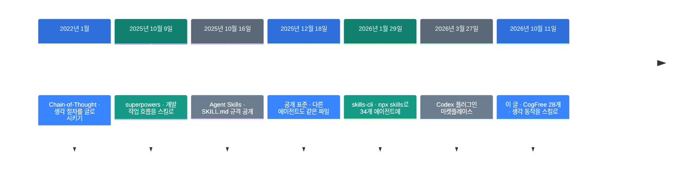
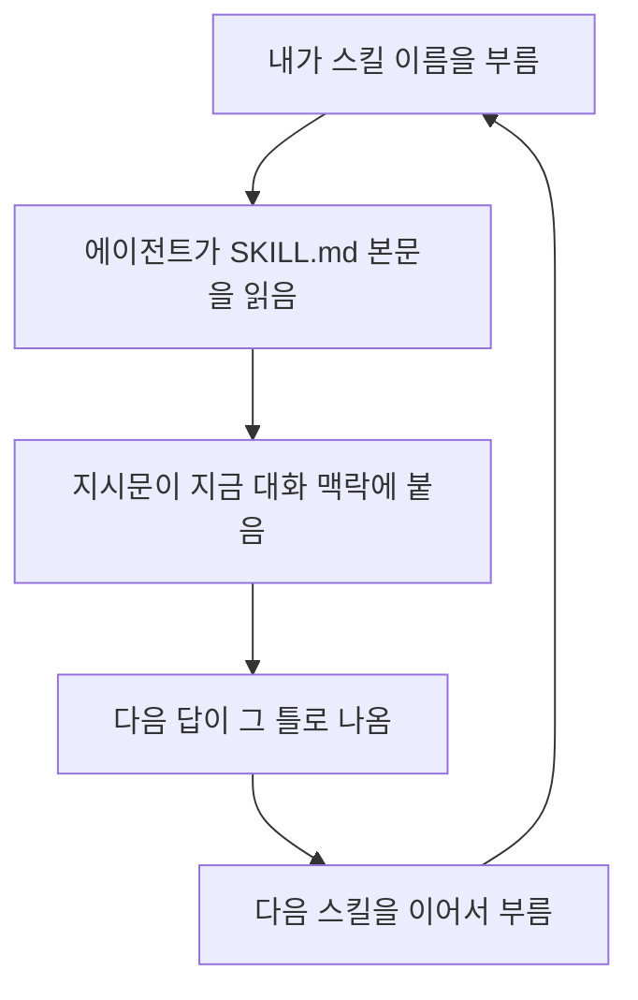

![[cogfree.mp4]]

[원문](https://x.com/junjiechou1122/status/2109255504287711258) · [레포](https://github.com/Humanive/cogfree) · [English](https://neocello-ku.github.io/trends/cogfree)

## 요약

2026년 10월 11일, CogFree가 인지 스킬 28개로 늘었습니다. 생각하는 동작마다 이름을 붙여 파일 한 장씩 만든 묶음입니다.

흐름으로 보면, 에이전트 스킬이 작업 절차에서 대화 방식으로 번지는 장면입니다. 지난 1년간 스킬은 "코드를 어떻게 짜는가"를 담았습니다. 이 묶음은 "대화를 어떻게 끌고 가는가"를 담습니다.

결론부터 말하면, 새 기법은 없습니다. 28개를 다 합쳐도 419단어, 5,682바이트입니다. 값은 길이가 아니라 분류에 있습니다. 용어가 낯설면, 아래 "처음이라면" 섹션부터 읽으세요.

## 흐름 속 위치: 왜 지금 이 이야기인가

스킬이라는 형식은 2025년 10월에 생겼습니다. Anthropic이 `SKILL.md` 한 장으로 지시문을 싣는 규격을 냈습니다.

그 뒤 1년 동안 스킬 모음은 거의 작업 절차였습니다. 계획 세우기, 디버깅, 코드 검토 같은 것입니다. 가장 널리 쓰인 obra/superpowers가 그 자리를 잡았습니다.

CogFree는 겨냥점이 다릅니다. 코드가 아니라 대화를 다룹니다.



앞 단계들이 형식과 배포 통로를 만들었습니다. CogFree는 그 통로에 다른 내용을 실었습니다.

같은 흐름의 지난 글이 둘 있습니다. [코딩 에이전트 11개를 소스로 뜯어본 논문](https://neocello-ku.github.io/trends/harness-engineering)(2026년 10월 7일 글)은 스킬을 하네스의 "확장" 칸에 넣었습니다. CogFree는 그 칸에 꽂는 가장 가벼운 부품입니다.

[조사하는 AI 만들기](https://neocello-ku.github.io/trends/research-engineering)(2026년 10월 7일 글)는 증거 원장을 설계의 중심에 뒀습니다. CogFree의 `verify`와 `assumptions`는 그 일을 장치 없이 말로만 합니다. 가벼운 대신 기록이 남지 않습니다.

### 이 묶음은 무엇이 새로운가

| 무엇 | 새로운 정도 | 이유 |
| --- | --- | --- |
| 프롬프트 기법 | 낮음 | 새 기법이 없습니다. `reconstruct`도 "없던 세계에서 다시 만들어 보기"라는 오래된 교수법을 두 문장으로 옮긴 것입니다. |
| 28개 분류 (제품) | 중간 | 생각 동작에 이름을 붙여 6갈래로 묶은 것이 알맹이입니다. 호스트 4곳에 맞춘 배포도 8일 만에 갖췄습니다. |
| 배포 구조 (인프라) | 낮음 | 실행 코드가 0줄입니다. `SKILL.md` 표준을 그대로 쓰고, `packages/`는 같은 파일의 사본입니다. |

새것은 발명이 아니라 목록입니다. 흩어진 말버릇에 이름과 자리를 준 것입니다.

## 처음이라면: 이게 무슨 이야기인가요

### 운동 동작 이름을 떠올려 보세요

헬스장에서 "가슴 운동 좀 하자"고 하면 할 일이 흐릿합니다. "벤치프레스 10회 3세트"라고 하면 정해집니다.

동작에 이름이 붙어 있으면 한마디로 통합니다. 매번 자세를 설명하지 않아도 됩니다.

CogFree는 생각하는 동작에 이 이름표를 붙입니다. "좀 정리해 줘" 대신 `compress`라고 부릅니다.

### 왜 좋은가

- 한 단어로 부릅니다. 긴 지시문을 매번 적지 않습니다.
- 목록이 메뉴판이 됩니다. 다음에 무엇을 시킬지 고를 수 있습니다.
- 파일이라서 옮겨집니다. 같은 지시문을 팀이 같이 씁니다.

### 이런 곳에 씁니다

- 긴 대화가 엉켰을 때 `state`로 지금 상태를 꺼냅니다.
- 결론이 마음에 들 때 `challenge`로 반론을 먼저 받습니다.
- 대화를 접기 전에 `checkpoint`로 이어 붙일 지점을 남깁니다.

### 이 글에 나오는 이름들

| 용어 | 쉬운 뜻 |
| --- | --- |
| 스킬 | 지시문을 담은 폴더. `SKILL.md` 한 장이 중심입니다. |
| 프런트매터 | 파일 맨 위의 `---` 사이 구역. 이름과 설명을 적습니다. |
| 플러그인 | 스킬과 명령을 묶어 한 번에 설치하는 꾸러미입니다. |
| 마켓플레이스 | 플러그인 목록을 담은 저장소. 설치할 곳을 알려 줍니다. |
| 하네스 | 모델을 감싸서 에이전트로 만드는 런타임입니다. |
| Pi | 확장으로 꾸미는 터미널 코딩 에이전트입니다. |
| npx skills | 스킬을 에이전트 34곳에 설치하는 명령줄 도구입니다. |

## 동작 방식

스킬 한 장은 두 부분입니다. 프런트매터에 이름과 설명, 그 아래에 지시문입니다.

`reconstruct` 전문은 이게 전부입니다.

```markdown
---
name: reconstruct
description: Learn a concept by reconstructing why it had to be invented.
---

Start from the world before this concept existed.

Reconstruct the observations, gaps, and constraints that made it
necessary, and derive the concept as if it had not yet been invented.
```

에이전트는 평소에 `description` 줄만 들고 있습니다. 이름이 불리면 그때 본문을 읽습니다.



28개는 6갈래로 나뉩니다. 대화의 어느 지점에서 쓰는지가 기준입니다.

| 갈래 | 개수 | 스킬 |
| --- | --- | --- |
| Understand (알아듣기) | 4 | `restate` `clarify` `grill` `reconstruct` |
| Inspect (들여다보기) | 6 | `state` `unknowns` `assumptions` `open` `timeline` `diff` |
| Transform (바꿔 보기) | 7 | `abstract` `ground` `compress` `reframe` `compare` `synthesize` `transfer` |
| Evaluate (따져 보기) | 4 | `challenge` `prediction` `test` `verify` |
| Continue (이어 가기) | 3 | `branch` `anchor` `checkpoint` |
| Execute (실행하기) | 4 | `next` `prioritize` `act` `delegate` |

크기를 숫자로 보면 이렇습니다. 스킬 하나는 평균 203바이트, 본문 15단어입니다. 가장 짧은 `restate`는 5단어, 가장 긴 `delegate`는 35단어입니다.

레포 전체에 실행 코드가 없습니다. 파일을 호스트별 폴더로 복사하는 9줄짜리 셸 스크립트 하나가 전부입니다.

## 준비물·실행

준비물은 스킬을 읽는 에이전트 하나뿐입니다. 설치 경로는 네 가지입니다.

Claude Code에서는 두 줄입니다.

```text
/plugin marketplace add Humanive/cogfree
/plugin install cogfree@cogfree
```

Codex에서는 터미널에서 실행합니다.

```bash
codex plugin marketplace add Humanive/cogfree
codex plugin add cogfree@cogfree
```

Pi에서는 한 줄입니다.

```bash
pi install git:github.com/Humanive/cogfree
```

에이전트를 가리지 않으려면 `npx skills`를 쓰세요. 34개 에이전트에 같은 명령으로 들어갑니다.

```bash
npx skills add Humanive/cogfree
```

28개가 다 필요하지는 않습니다. 하나만 넣으려면 `--skill`을 붙이세요.

```bash
npx skills add Humanive/cogfree --skill restate
```

설치한 뒤에는 대화 중에 이름을 부릅니다. 예를 들어 긴 설계 토론 끝에 이렇게 씁니다.

```text
challenge
```

GPU도, 파이썬 환경도 필요 없습니다. 토큰 비용만 조금 늘어납니다. 본문 419단어는 전부 합쳐도 약 600토큰이고, 한 번에 한 개만 읽힙니다.

## 팩트체크

| 주장 | 확인 결과 | 판정 |
| --- | --- | --- |
| 이제 인지 스킬 28개 | 맞습니다. 폴더 28개를 셌습니다. 10월 11일 커밋이 9개를 더해 19개에서 28개가 됐습니다. | 일치 |
| 작고 조립할 수 있는 스킬 | 작은 것은 맞습니다. 평균 203바이트입니다. 조립은 사람이 차례로 부르는 방식입니다. 스킬끼리 엮는 장치는 없습니다. | 조건부 |
| 생각·학습·탐색을 돕도록 설계 | 설계 의도입니다. 레포에 평가도, 예제 대화도, 사용 전후 비교도 없습니다. | 조건부 |
| reconstruct는 왜 발명됐는지 재구성시킨다 | 맞습니다. 게시물 문장과 `SKILL.md` 두 문장이 거의 같습니다. | 일치 |
| 배우기에 훨씬 재미있는 방법 | 글쓴이 의견입니다. 이 방식을 잰 자료를 찾지 못했습니다. | 조건부 |
| (암묵) 에이전트 4곳에 설치된다 | Claude, Pi, npx 세 곳은 구조가 맞습니다. Codex는 확인하지 못했습니다. | 조건부 |

Codex만 따로 적어 둡니다. OpenAI 공식 문서는 마켓플레이스 파일을 `.agents/plugins/marketplace.json`에 두라고 적습니다. CogFree는 `.codex-plugin/marketplace.json`에 뒀습니다.

문서에 나온 명령은 `codex plugin marketplace add`와 CLI 안의 `/plugins` 창입니다. README가 적은 `codex plugin add cogfree@cogfree`는 문서에서 찾지 못했습니다. 틀렸다고 단정할 근거도 없어서, 판정은 "확인 못 함"으로 둡니다.

### 같은 시기 독립 측정

효과를 잰 자료가 CogFree에는 없습니다. 스킬 일반을 잰 벤치마크는 있습니다.

SkillsBench는 과제 87개, 영역 8개, 모델·하네스 조합 18개로 쟀습니다. 2026년 6월 14일 자 논문입니다.

- 고른 스킬을 붙이면 통과율이 33.9%에서 50.5%로 올랐습니다.
- 짧은 스킬이 +19.0%포인트, 긴 문서형은 +0.7%포인트였습니다.
- 한 과제에 4개 이상 붙이면 +10.1%포인트로 떨어졌습니다.
- 87개 중 13개는 점수가 내려갔습니다. 가장 큰 하락은 -7.4%포인트입니다.

CogFree는 짧은 쪽 극단에 있습니다. "너무 짧아서 소용없다"는 반론은 이 측정이 받쳐 주지 않습니다.

다만 이 숫자를 CogFree 효과로 옮기면 안 됩니다. SkillsBench가 잰 것은 답이 정해진 과제의 통과율입니다. 대화를 어떻게 끌고 가는가는 이 벤치마크가 재지 않습니다.

레포 상태도 같이 봐야 합니다. 별 6개, 포크 0개, 릴리스 0개입니다. 레포는 10월 3일에 생겼습니다. 널리 쓰인다는 증거는 아직 없습니다.

## 언제 무엇을 쓰나

| 상황 | 방법 |
| --- | --- |
| 긴 지시를 던졌는데 어긋날 것 같다 | `restate`로 의도를 먼저 되짚습니다 |
| 질문이 막연하다 | `clarify`로 가장 중요한 질문 하나만 받습니다 |
| 개념을 외우지 말고 이해하고 싶다 | `reconstruct`로 발명 과정을 다시 밟습니다 |
| 대화가 길어져 지금 위치를 잃었다 | `state`로 현재 상태를 꺼냅니다 |
| 결론이 무엇에 기대는지 모르겠다 | `assumptions`로 전제를 꺼냅니다 |
| 결론이 너무 마음에 든다 | `challenge`로 반론과 실패 사례를 받습니다 |
| 주장에 숫자가 섞여 있다 | `verify`로 근거를 대조합니다 |
| 설명이 추상적이다 | `ground`로 구체적인 예로 내립니다 |
| 논의가 두 갈래로 갈렸다 | `compare`로 나란히 놓습니다 |
| 오늘은 여기까지 한다 | `checkpoint`로 이어 붙일 지점을 남깁니다 |
| 말만 길어지고 실행이 없다 | `act`로 다음 행동 하나로 좁힙니다 |
| 다른 에이전트에게 넘긴다 | `delegate`로 검증 조건까지 적은 지시서를 만듭니다 |
| 과제 하나에 스킬을 여러 개 붙이고 싶다 | 3개 안쪽으로 둡니다. 4개부터 효과가 줄었습니다 |

## 출처

- [Humanive/cogfree (GitHub)](https://github.com/Humanive/cogfree)
- [원 게시물 (@junjiechou1122, 2026-10-11)](https://x.com/junjiechou1122/status/2109255504287711258)
- [Agent Skills 문서 (Anthropic)](https://code.claude.com/docs/en/skills)
- [SkillsBench: Benchmarking How Well Agent Skills Work Across Diverse Tasks (arXiv:2602.12670)](https://arxiv.org/abs/2602.12670)
- [Codex 플러그인 패키징 문서 (OpenAI)](https://developers.openai.com/codex/plugins/build)
- [skills-cli (npx skills)](https://github.com/antfu/skills-cli)

## 이어지는 글

- [[trends/harness-engineering|코딩 에이전트 11개를 소스로 뜯어본 논문: 하네스가 무엇인가]]
- [[trends/research-engineering|조사하는 AI 만들기: 증거 원장을 중심에 두는 설계]]

