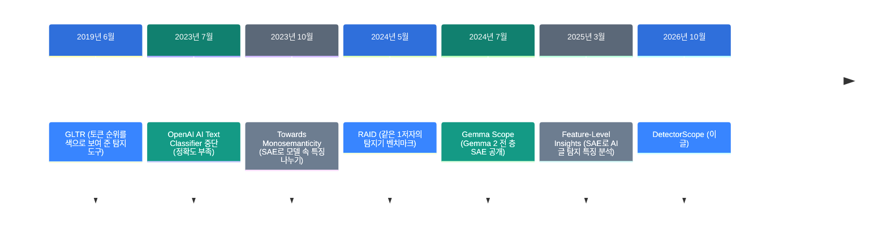
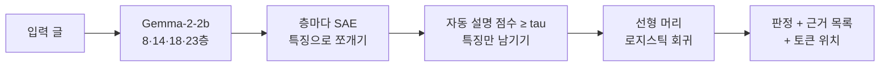

![[detectorscope.mp4]]

[원문](https://github.com/google-deepmind/detectorscope) · [레포](https://github.com/google-deepmind/detectorscope) · [English](https://neocello-ku.github.io/trends/detectorscope)

## 요약

2026년 10월, Google DeepMind와 펜실베이니아대가 DetectorScope를 공개했습니다. AI 글 탐지기가 판정과 함께 근거 목록을 돌려줍니다. 어떤 표현이 글을 AI 쪽으로 밀었는지, 그 표현이 어디 있는지 보여 줍니다.

흐름으로 보면, "믿어 달라"던 탐지기가 "근거를 확인하라"로 넘어가는 한 걸음입니다. 다만 같은 재료로 AI 글을 가르는 연구는 2025년 3월에 이미 나왔습니다.

결론은 이렇습니다. 기법은 새롭지 않고, 바로 쓰는 묶음이 새롭습니다. 기본 설정은 분야 안 정확도가 블랙박스보다 약 11점 낮습니다.

용어가 낯설면, 아래 '처음이라면' 섹션부터 읽으세요.

## 흐름 속 위치: 왜 지금 이 이야기인가

AI 글 탐지기는 오래전부터 신뢰 문제를 안고 있었습니다. 점수 하나만 주고 이유는 말하지 않았기 때문입니다. 사람이 쓴 글을 AI 글로 잘못 판정해도, 왜 그랬는지 따질 방법이 없었습니다.



DetectorScope는 마지막 단계에 있습니다. 앞선 단계들이 부품을 하나씩 만들었습니다. 탐지기, 벤치마크, 모델 속을 읽는 도구가 그 부품입니다.

OpenAI는 2023년 1월에 AI 글 분류기를 냈다가 7월에 접었습니다. 정확도가 낮았기 때문입니다. 그 뒤 학습 없이 토큰 확률만 읽는 방식이 나왔습니다. DetectGPT, Fast-DetectGPT, Binoculars가 그 예입니다. 이 레포는 이것들을 비교군으로 둡니다.

토큰 확률을 읽는다는 점은 지난 글과 이어집니다. 그 글은 "로컬 LLM에게 글 대신 답을 고르게 하기: SGLang 점수 방식"(2026-10-06)입니다. 그 글도 같은 신호를 썼습니다. 그 글은 확률로 답을 골랐고, 이 탐지기들은 확률로 글쓴이를 가립니다.

### 이 기술은 무엇이 새로운가

| 무엇 | 새로운 정도 | 이유 |
| --- | --- | --- |
| SAE 특징으로 탐지 (기법) | 낮음 | 2025년 3월 논문이 같은 Gemma-2-2b로 이미 했습니다. 새 것은 설명 점수 문턱 tau입니다. |
| 근거 목록 탐지기 (제품) | 중간 | pip 한 줄로 판정, 근거, 위치가 나옵니다. 다만 연구용이고 개인 판정에 쓰면 안 됩니다. |
| 변환 파이프라인 (인프라) | 중간 | 내 탐지기를 같은 방식으로 바꾸는 단계를 모두 공개했습니다. 설명 단계는 Gemini API 키가 필요합니다. |

정리하면, DetectorScope는 새 발명이 아닙니다. "SAE로 탐지기 들여다보기"를 검증 문턱과 함께 바로 쓰는 도구로 묶었습니다.

## 처음이라면: 이게 무슨 이야기인가요

### 채점표가 있는 심사위원

글쓰기 대회 심사위원 두 명을 떠올려 보세요. 첫 번째 심사위원은 "72점"이라고만 말합니다. 두 번째 심사위원은 채점표를 보여 줍니다.

채점표에는 항목과 점수가 적혀 있습니다. 예를 들면 "상투적 도입부 +5", "반복 표현 +3", "구어체 말버릇 -2"입니다. 항목마다 글의 어느 문장인지 형광펜도 칠해 줍니다.

기존 AI 글 탐지기는 첫 번째 심사위원입니다. DetectorScope는 탐지기를 두 번째 심사위원으로 바꿉니다.

### 채점 항목은 어디서 오나요

채점 항목을 사람이 미리 정하지 않습니다. 언어 모델이 글을 읽을 때 속에서 켜지는 신호를 모읍니다. 이 신호를 사람이 읽을 수 있는 작은 단위로 쪼갭니다. 이 단위를 **특징**이라고 부릅니다.

그다음 다른 AI가 특징마다 이름을 붙입니다. 예를 들면 "about을 전치사로 쓴 곳"입니다. 이름이 실제로 맞는지 시험해서 점수를 매깁니다. 점수가 기준보다 낮은 특징은 채점표에서 뺍니다.

### 왜 좋은가

- 판정을 따질 수 있습니다. 어떤 표현 때문에 AI로 봤는지 목록이 나옵니다.
- 탐지기의 잘못된 버릇이 보입니다. 문체가 아니라 데이터 형식을 배운 특징도 드러납니다.
- 쉬운 설명과 높은 정확도 사이에서 직접 고를 수 있습니다.

### 이런 곳에 씁니다

- 탐지기 연구: 탐지기가 무엇을 근거로 판정하는지 감사합니다.
- 모델 비교: 어떤 생성 모델이 어떤 말버릇을 갖는지 봅니다.
- 내 글 점검: 내가 쓴 영어 글에서 AI처럼 읽히는 표현을 찾습니다.

### 이 글에 나오는 이름들

| 용어 | 쉬운 뜻 |
| --- | --- |
| 탐지기 | 글이 사람 글인지 AI 글인지 판정하는 모델. |
| 블랙박스 | 결과만 주고 이유를 보여 주지 않는 모델. |
| 잔차 흐름 | 언어 모델 안에서 층과 층 사이를 흐르는 숫자 묶음. |
| SAE (희소 오토인코더) | 잔차 흐름을 사람이 읽을 수 있는 특징 수만 개로 쪼개는 작은 모델. |
| 특징 | SAE가 찾은 신호 하나. 예: "반복되는 구절". |
| 자동 설명 점수 | 특징의 이름이 실제로 켜지는 곳을 얼마나 잘 맞히는지 나타내는 점수. 0~1. |
| tau | 채점표에 남길 특징의 자동 설명 점수 하한. 기본값 0.85. |
| 머리 (head) | 특징 점수를 모아 최종 판정을 내리는 마지막 층. 기본은 로지스틱 회귀. |
| 로짓 | 판정 직전의 점수. 높을수록 AI 쪽입니다. |
| F1 | 탐지 정확도 지표. 1에 가까울수록 좋습니다. |
| 분야 안 / 분야 밖 | 학습한 데이터와 비슷한 글 / 다른 종류의 글. |

## 동작 방식

DetectorScope는 언어 모델 Gemma-2-2b에서 신호를 꺼냅니다. 꺼내는 곳은 8, 14, 18, 23층입니다. 층마다 SAE가 신호를 특징으로 쪼갭니다. tau를 넘은 특징만 머리로 갑니다.



머리가 선형이라서 판정 점수는 항목별 점수의 합입니다. 식으로 쓰면 `logit == bias + sum(importances)`입니다. importance는 그 특징을 끄면 로짓이 얼마나 떨어지는지입니다. 양수는 AI 쪽, 음수는 사람 쪽입니다.

### 세 가지 설정

논문은 블랙박스를 얼마나 고치는지에 따라 세 설정을 비교합니다. 공개 탐지기는 세 설정을 Hugging Face 브랜치로 나눠 둡니다.

| 설정 | 언어 모델 | SAE |
| --- | --- | --- |
| ft-model-sae | 탐지용으로 미세조정한 Gemma-2-2b | 그 모델에 맞춰 다시 학습 |
| ft-sae | 원래 Gemma-2-2b | 탐지 데이터로 다시 학습 |
| base-sae | 원래 Gemma-2-2b | Gemma Scope 그대로 |

### tau 다이얼

tau를 올리면 이름이 잘 맞는 특징만 남습니다. 근거는 읽기 쉬워지지만 정확도가 떨어집니다. tau를 내리면 이름이 느슨한 특징도 들어옵니다. 정확도는 오르지만 근거가 흐려집니다.

README 그림을 보면, 대부분 tau 0.8까지는 정확도가 거의 유지됩니다. 0.85를 넘으면 급히 떨어지고, 0.9 이후로는 무너집니다. 기본값 0.85는 이 낭떠러지 바로 앞입니다.

## 준비물

| 항목 | 요구 사항 |
| --- | --- |
| Python | 3.10 이상 |
| 필수 패키지 | torch 2.6 이상, transformers 4.57 이상 (pip가 함께 설치) |
| GPU | 필수 아님. 추론 하드웨어 요구 사항은 README에 없습니다. |
| 메모리 | 약 12GB 추정 (언어 모델 fp32 10.46GB + SAE 1.21GB) |
| 디스크 | 탐지기 하나당 약 11.8GB |

메모리 추정은 Hugging Face 파일 크기로 계산했습니다. Gemma-2-2b는 약 26억 파라미터이고, 4바이트씩이면 약 10.4GB입니다. CUDA가 없으면 CPU로 돕니다. 맥 GPU(MPS) 분기는 코드에 없습니다.

## 실행

### 1단계. 설치하세요

```bash
python -m venv .venv && source .venv/bin/activate
pip install detectorscope
```

### 2단계. 탐지기를 불러 글 하나를 판정하세요

```py
from detectorscope import AuditableDetector

detector = AuditableDetector.from_pretrained(
  "liamdugan/detector-scope"
)
output = detector(
  "Like I said, this is about accuracy, about speed, and about cost."
)
print(output)
```

처음 실행할 때 약 11.8GB를 내려받습니다. README의 출력 예는 다음과 같습니다.

```
Detection(label='ai', p_ai=0.88, features=[
  Feature(importance=+0.23, description='the word about used as a preposition'),
  Feature(importance=+0.14, description='repeated phrases or sequences in text'),
  Feature(importance=-0.05, description='conversational filler phrase like i said'),
  ...])
```

### 3단계. 근거가 켜진 위치를 보세요

```py
output = detector(text, return_highlights=True)
output.tokens                   # the text as tokens
output.features[0].highlights   # [(token index, activation), ...]
```

### 4단계. tau를 바꿔 비교하세요

```py
output = detector(text, tau=0.50)   # more features, higher accuracy
output = detector(text, tau=0.95)   # the few best-described features
detector.heads                      # every (head, tau) pair the repo holds
```

브랜치마다 tau 20단계의 머리가 모두 들어 있습니다. 그래서 tau를 바꿔도 다시 내려받지 않습니다. `head="xgboost"`를 주면 같은 tau에서 XGBoost 머리를 씁니다.

### 다른 탐지기를 쓰려면

| 하고 싶은 일 | Hugging Face id 또는 인자 |
| --- | --- |
| 여러 분야의 글 판정 (기본) | `liamdugan/detector-scope` |
| ML 논문 심사평, GPT-4o 판별 | `liamdugan/detector-scope-peer-review-gpt4o` |
| ML 논문 심사평, Llama 판별 | `liamdugan/detector-scope-peer-review-llama` |
| Gemma Scope SAE 그대로 쓰는 설정 | `revision="base-sae"` |
| 메모리 줄이기 | `torch_dtype="bfloat16"` (코드에 있음, README에는 없음) |

`detector-scope`에는 `ft-sae` 브랜치가 따로 없습니다. 이 레포는 main이 곧 ft-sae입니다. 심사평 두 레포는 main이 ft-model-sae이고, `ft-sae` 브랜치가 따로 있습니다.

### 내 탐지기를 바꾸려면

소스에서 설치하세요.

```bash
git clone https://github.com/google-deepmind/detectorscope && cd detectorscope
pip install -e ".[all]"
```

단계는 `python -m detectorscope.<stage>`로 돌립니다. 순서는 `finetune`, `train_sae`, `data.extract`, `data.process`, `autointerpret`, 머리 학습, `evaluate`입니다. README에 따르면 0~2단계는 GPU가 필요하고, 나머지는 CPU로 됩니다. `autointerpret`는 Gemini를 부르므로 `GEMINI_API_KEY`가 필요합니다.

## 팩트체크

이 레포에는 소개 게시물이 없습니다. 그래서 README와 Hugging Face 카드의 주장, 그리고 같은 주 기사의 숫자를 확인했습니다. 그림에서 읽은 값은 눈으로 읽은 근삿값입니다(±0.02).

| 주장 | 확인 결과 | 판정 |
| --- | --- | --- |
| 모든 예측이 검증된 특징의 합이다 (README) | 선형 머리라 합이 맞습니다. "검증"은 자동 설명 점수가 tau 이상이라는 뜻입니다. tau 0.00이면 모든 특징이 들어갑니다. | 일치 (기본 tau 기준) |
| 해석 가능하게 바꿔도 성능 손해가 작다 (README) | 기본 탐지기 F1은 COLING dev 0.867입니다. 신경망 기준선 0.98보다 약 11점 낮습니다. 분야 밖에서는 기준선과 비슷합니다. | 조건부 |
| FT-Model+SAE는 tau 0.7 이상에서도 기준선과 맞먹는다 (README 그림 설명) | COLING에서 tau 0.8까지만 맞습니다. RAID에서는 모든 tau에서 약 0.60~0.67로, 기준선 0.75보다 낮습니다. | 과장 |
| 분야 안 96.8 대 98.0, 분야 밖 92.2 대 75.2 (Crypto Briefing, 10월 22일) | 낮은 tau의 값이고, 두 숫자는 서로 다른 설정입니다. 기본 탐지기는 분야 밖 test에서 0.751로 기준선과 같습니다. | 조건부 |
| tau를 바꿔도 다시 내려받지 않는다 (README) | main 브랜치에 logreg 20개, xgboost 20개 머리 파일이 있습니다. | 일치 |
| 언어 모델을 함께 담아 라이선스 게이트가 없다 (README) | 게이트는 없습니다. 다만 Gemma 이용 약관은 그대로 적용됩니다. | 일치 (약관 적용) |
| 특징이 AI 글의 언어적 "티"에 대응한다 (논문 초록) | 사람 쪽 상위 특징에 "url 0의 숫자 0", "과학 글의 줄바꿈"이 있습니다. 일부는 문체가 아니라 데이터 형식입니다. | 조건부 |

### 숫자 다시 보기: 기본 설정 F1

공개 기본 탐지기(`detector-scope`, tau 0.85)의 F1은 Hugging Face 카드에 있습니다. 신경망 기준선은 기사와 README 그림의 값입니다.

| 데이터 | 기본 탐지기 F1 | 신경망 기준선 F1 | 차이 |
| --- | --- | --- | --- |
| COLING dev (분야 안) | 0.867 | 0.980 | 약 -11점 |
| COLING dev-test (분야 밖) | 0.866 | 약 0.87 | 거의 같음 |
| COLING test (분야 밖) | 0.751 | 0.752 | 거의 같음 |

기사의 "분야 밖 92.2 대 75.2"는 tau를 낮춘 FT-SAE 설정의 값입니다. 이 설정에서는 설명이 느슨한 특징도 판정에 들어갑니다. 근거를 읽기 쉬운 기본 설정에서는 분야 밖 우위가 사라집니다.

닫힌 분야는 다릅니다. GPT-4o 심사평 탐지기는 F1 0.998입니다. 그런데 AI 쪽 상위 특징에 "굵은 마크다운 제목 뒤 쌍점"이 있습니다. AI 심사평의 51%에서 켜지고, 사람 심사평에서는 0%입니다.

이것은 약점이자 이 도구의 쓸모입니다. 블랙박스였다면 탐지기가 형식을 배웠다는 사실을 알 수 없었습니다.

같은 시기 독립 측정은 찾지 못했습니다. 공개 2주 안이고, 기사들은 논문 숫자를 옮겼습니다.

### README의 경고

README는 이 탐지기를 연구용 산출물이라고 밝힙니다. 사람이 쓴 글에도 틀린다고 씁니다. 학습 분야 밖의 정확도는 확인되지 않았습니다. 학업 부정, 채용, 출판처럼 개인을 판단하는 근거로 쓰면 안 됩니다.

## 언제 무엇을 쓰나

| 상황 | 방법 |
| --- | --- |
| 탐지기가 무엇을 보는지 알고 싶다 | DetectorScope, tau 0.85 이상 |
| 정확도가 먼저이고 근거는 덜 중요하다 | DetectorScope tau 0.50 이하, 또는 블랙박스 탐지기 |
| 학습 데이터 없이 바로 판정하고 싶다 | Binoculars, Fast-DetectGPT 같은 확률 기반 방식 |
| 내 모델이 쓴 글에 표식을 남기고 싶다 | 워터마크 (예: SynthID Text) |
| 사람 한 명의 글을 판정해야 한다 | 어떤 탐지기도 단독 근거로 쓰지 마세요 |

## 출처

- [GitHub: google-deepmind/detectorscope](https://github.com/google-deepmind/detectorscope)
- [논문: Building Auditable AI Text Detectors with Sparse Autoencoders (arXiv 2610.30006)](https://arxiv.org/abs/2610.30006)
- [Hugging Face: liamdugan/detector-scope](https://huggingface.co/liamdugan/detector-scope)
- [Hugging Face: liamdugan/detector-scope-peer-review-gpt4o](https://huggingface.co/liamdugan/detector-scope-peer-review-gpt4o)
- [데모: Hugging Face Space](https://huggingface.co/spaces/liamdugan/detector-scope-demo)
- [PyPI: detectorscope](https://pypi.org/project/detectorscope/)
- [Crypto Briefing 기사 (2026-10-22)](https://cryptobriefing.com/deepmind-upenn-auditable-ai-text-detectors/)
- [Feature-Level Insights into Artificial Text Detection with Sparse Autoencoders (2025)](https://huggingface.co/papers/2503.03601)
- [Gemma Scope (arXiv 2408.05147)](https://arxiv.org/abs/2408.05147)
- [LessWrong: Initial Experiments Using SAEs to Help Detect AI Generated Text (2024-07-22)](https://www.lesswrong.com/posts/LQBFqyXA5to4iHEBC/initial-experiments-using-saes-to-help-detect-ai-generated)

## 이어지는 글

- [[trends/jev-local|로컬 LLM에게 글 대신 답을 고르게 하기]]

