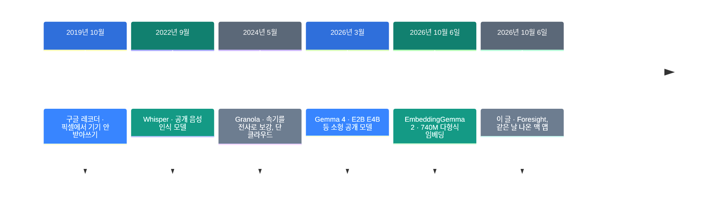
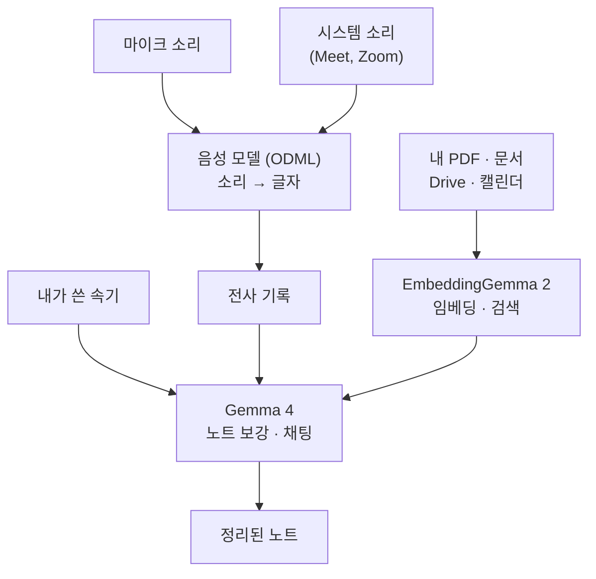

![[foresight.mp4]]

[원문](https://x.com/Saboo_Shubham_/status/2108799974024880199) · [English](https://neocello-ku.github.io/trends/foresight)

## 요약

2026년 10월 6일, 구글이 맥용 회의 노트 앱 Foresight를 공개했습니다. 받아쓰기와 노트 정리를 맥 안에서만 합니다. 무료이고 계정도 필요 없습니다.

흐름으로 보면 새 발명이 아닙니다. Granola가 2024년에 낸 방식을 클라우드 없이 다시 만든 것입니다.

결론부터 적겠습니다. 기법은 낡았고, 구글이 자사 온디바이스 모델로 맥 앱을 직접 낸 점이 새롭습니다. 그리고 지금은 영어만 받아씁니다. 용어가 낯설면, 아래 "처음이라면" 섹션부터 읽으세요.

## 흐름 속 위치: 왜 지금 이 이야기인가

회의 받아쓰기는 지난 2년 동안 클라우드의 일이었습니다. 소리를 서버로 보내야 정리가 됐습니다. 회사 회의록이 밖으로 나가는 것이 늘 걸림돌이었습니다.

작은 모델이 노트북에서 돌기 시작하면서 이 전제가 흔들렸습니다. Foresight는 그 변화를 구글이 직접 제품으로 보인 사례입니다.



Foresight는 마지막 줄에 있습니다. EmbeddingGemma 2와 **같은 날** 나왔습니다. 모델만 푸는 대신, 그 모델을 쓴 앱을 함께 보인 셈입니다.

이 아카이브의 지난 글이 그 모델을 다룹니다.

- [EmbeddingGemma 2: 글·그림·소리·영상을 한 벡터로](/ko/trends/embeddinggemma-2) (2026-10-07)

Foresight는 그 모델의 첫 소비자 앱입니다.

### 이 기술은 무엇이 새로운가

| 무엇 | 새로운 정도 | 이유 |
| --- | --- | --- |
| 속기 보강 + 로컬 검색 (기법) | 낮음 | Granola가 2024년 5월에 같은 상호작용을 냈습니다. 문서 검색(RAG)도 2020년부터 쓰던 방법입니다. |
| 구글이 직접 낸 무료 맥 앱 (제품) | 높음 | 구글이 자사 온디바이스 모델로 맥 소비자 앱을 직접 배포한 첫 사례입니다. 단 실험용 딱지가 붙어 있습니다. |
| 세 모델을 한 앱에 묶기 (인프라) | 중간 | 음성·생성·임베딩 모델을 한 앱이 함께 돌립니다. 부품은 전부터 있었고, 묶음이 새롭습니다. |

정리하면 이렇습니다. 기법은 2년 전 제품을 따라갔습니다. 바뀐 것은 그 전부가 맥 한 대 안에서 돈다는 점입니다. 다만 받아쓰기 언어가 영어 하나뿐이라, 한국 회의에는 아직 쓸 수 없습니다.

## 처음이라면: 이게 무슨 이야기인가요

### 회의 노트를 적는 두 가지 방식

회의 중에 노트를 적는 방법을 떠올려 보세요. 들리는 말을 전부 받아 적으면 회의에 집중하지 못합니다. 그렇다고 짧게만 적으면 나중에 무슨 뜻인지 모릅니다.

Foresight는 짧게 적는 쪽을 고릅니다. 앱이 소리를 따로 받아 적고 있습니다. 회의가 끝나면, 내 짧은 메모를 그 기록으로 채워 줍니다.

예를 들어 내가 "예산 → 다음 주"라고만 적었다고 합시다. 앱은 전사 기록에서 예산 이야기를 찾습니다. 그리고 "예산안은 다음 주 화요일까지 재무팀에 보냅니다"로 펴 줍니다.

### 로컬이 무슨 뜻인가요

보통 AI 서비스는 내 글과 소리를 회사 서버로 보냅니다. 거기서 계산하고 결과만 돌려받습니다. 이것을 클라우드라고 부릅니다.

로컬은 그 계산을 내 기계가 합니다. 모델 파일을 내 디스크에 내려받고, 내 칩이 돌립니다. 소리와 노트가 맥 밖으로 나가지 않습니다.

### 왜 좋은가

- 회의 소리와 회의록이 외부 서버로 가지 않습니다.
- 인터넷이 없어도 받아쓰기와 노트 정리가 됩니다.
- 구독료가 없습니다. 모델이 내 기계에서 돌기 때문입니다.

### 이런 곳에 씁니다

- 고객 정보가 들어간 회의의 기록 남기기
- 비행기나 지하철처럼 연결이 끊긴 곳에서 녹음 정리
- 내 PDF와 문서를 읽혀 두고 질문해서 찾기

### 이 글에 나오는 이름들

| 용어 | 쉬운 뜻 |
| --- | --- |
| 전사 | 소리를 글자로 받아 적은 기록. 영어로 transcript. |
| 온디바이스 | 서버가 아니라 내 기기에서 모델을 돌리는 방식. |
| 임베딩 | 글이나 그림을 숫자 목록으로 바꾼 것. 뜻이 가까우면 숫자도 가깝습니다. |
| RAG | 내 문서에서 관련 대목을 먼저 찾아 모델에게 붙여 주는 방법. |
| EmbeddingGemma 2 | 구글의 740M 임베딩 모델. 이 앱에서 검색을 맡습니다. |
| Gemma 4 | 구글의 소형 공개 모델 계열. 이 앱에서 노트 보강과 채팅을 맡습니다. |
| Apple Silicon | 애플이 만든 맥용 칩. M1부터 M5까지가 여기 듭니다. |

## 동작 방식

Foresight 안에서는 모델 **세 개**가 각자 다른 일을 합니다. 게시물은 EmbeddingGemma 2 하나만 말했지만, 실제로는 분업입니다.



소리는 두 갈래로 들어옵니다. 마이크가 방 안의 말을 받고, 시스템 소리가 화상 회의의 상대 목소리를 받습니다.

받아쓰기는 구글의 비공개 음성 라이브러리가 합니다. 이 부분이 뒤에 나올 언어 문제의 원인입니다.

## 준비물과 실행

### 준비물

| 항목 | 값 |
| --- | --- |
| 칩 | Apple Silicon 필수. Intel 맥은 안 됩니다. |
| macOS 최소 버전 | 공식 페이지에 없음 |
| RAM | 공식 페이지에 없음 |
| 디스크 | 공식 페이지에 없음. 첫 실행 내려받기는 아래 참고 |
| 값 | 무료. 계정 없이 시작합니다. |

구글은 저장 공간과 메모리 요구 사항을 적지 않았습니다. "가볍게 돌고 배터리를 적게 쓴다"는 문구만 있습니다.

### 설치

CLI가 없습니다. 내려받아서 여는 보통 맥 앱입니다. App Store에는 없습니다.

1. Safari나 Chrome으로 제품 페이지를 여세요.
2. 맥용 앱을 내려받으세요.
3. 앱을 처음 열고 모델 내려받기를 기다리세요.
4. 마이크와 화면 녹음 권한을 허용하세요.

```
https://developers.google.com/edge/foresight
```

### 첫 실행에 얼마나 받나

보도마다 숫자가 다릅니다. heise는 "800MB 이상"이라고 적었습니다. 직접 재 본 블로그는 앱 153MB에 언어 모델 3.41GB를 더해 약 4.2GB를 봤습니다.

같은 글은 녹음 버튼을 누르기까지 약 8분 30초가 걸렸다고 적습니다. 빠른 회선 기준입니다.

## 팩트체크

원 게시물은 이렇게 적었습니다.

> Google just dropped a free AI notetaker app for Mac.
> Every premium feature works without any subscription.
> 100% free and fully local, powered by Embedding Gemma 2.

| 주장 | 확인 결과 | 판정 |
| --- | --- | --- |
| 구글이 맥용 무료 AI 노트 앱을 냈다 | 맞습니다. 2026-10-06 공개, 무료, 계정 없이 씁니다. 단 실험용 딱지가 있고 Apple Silicon 전용입니다. | 조건부 일치 |
| 유료 기능이 전부 구독 없이 된다 | 근거가 없습니다. 구글은 경쟁 제품과 기능을 대조한 적이 없습니다. 오히려 화자 구분이 없고, 영어 외 받아쓰기가 안 됩니다. | 근거 없음 |
| 100% 무료이고 완전히 로컬이다 | 추론은 로컬이 맞습니다. 네트워크를 지켜본 글에서 소리와 전사가 나간 흔적이 없었습니다. 단 Drive·캘린더 가져오기, 웹 검색, 비식별 사용 데이터는 네트워크를 씁니다. | 과장 |
| EmbeddingGemma 2가 돌린다 | 부분만 맞습니다. 모델이 셋입니다. 받아쓰기는 비공개 ODML 음성 모델, 노트 보강은 Gemma 4, 검색만 EmbeddingGemma 2입니다. | 과장 |
| 어떤 언어든 받아쓴다 | 아닙니다. 아래 "한국어" 항목에서 따로 봅니다. | 근거 없음 |

### 한국어는 지금 안 됩니다

이 글에서 가장 중요한 대목입니다. 근거가 둘이고, 서로 독립입니다.

첫째, 역분석 레포 `foresight-zh`가 앱을 뜯어봤습니다. 받아쓰기 모델이 영어 전용이라고 적습니다. 더 나아가 화면을 그리는 층이 전사문에서 `[^\x20-\x7E\n\r]`을 지웁니다. 쉽게 말해 ASCII가 아닌 글자를 전부 버립니다. 한글은 전부 여기 걸립니다.

둘째, 직접 써 본 블로그의 결과가 이와 들어맞습니다. 프랑스어 "épisode"가 "pisode"로 나왔습니다. 악센트 글자만 사라진 것입니다. 아랍어는 아예 실패했습니다.

두 근거를 합치면 결론은 하나입니다. 한국어 회의를 녹음하면 전사가 통째로 빕니다. 전사가 비면 노트 보강도, 회의 요약도 나오지 않습니다.

### 그 밖에 확인한 것

| 항목 | 확인 결과 |
| --- | --- |
| 기본 생성 모델 | 보도는 Gemma 4 E4B라고 적습니다. 역분석 레포는 E2B라고 적습니다. 맥이 없어 직접 확인하지 못했습니다. |
| 화자 구분 | 없습니다. 모든 줄이 "나" 아니면 "그 외"입니다. |
| 스피커 사용 시 | 상대 목소리가 두 번 적힙니다. 시스템 소리와 마이크가 같은 말을 받습니다. |
| 종료 후 재실행 | 4시간마다 도는 백그라운드 작업이 앱을 다시 띄웁니다. 공식 설명이 없습니다. |

## 언제 무엇을 쓰나

| 상황 | 방법 |
| --- | --- |
| 영어 회의, 소리를 밖에 못 보냄 | Foresight. 지금 목적에 가장 맞습니다. |
| 한국어 회의 | 아직 다른 도구를 쓰세요. Whisper 계열 로컬 모델이 한국어를 받습니다. |
| 누가 말했는지 구분이 필요함 | 다른 도구. Foresight에는 화자 구분이 없습니다. |
| 소리를 클라우드에 보내도 됨 | Granola 같은 기존 제품이 기능이 더 많습니다. |
| 맥이 Intel이거나 윈도우 | 쓸 수 없습니다. |
| 내 문서에 질문하고 싶음 | Foresight의 로컬 검색. 문서는 영어·한국어 모두 읽힙니다. |

마지막 줄을 덧붙입니다. 받아쓰기만 영어 전용이고, 문서 검색은 다릅니다. EmbeddingGemma 2는 100개 넘는 언어를 다룹니다.

## 출처

- [원 게시물 (Shubham Saboo, 2026-10-10)](https://x.com/Saboo_Shubham_/status/2108799974024880199)
- [제품 페이지](https://developers.google.com/edge/foresight)
- [Gemma 공식 릴리스 기록](https://ai.google.dev/gemma/docs/releases)
- [9to5Google 보도 (2026-10-06)](https://9to5google.com/2026/10/06/google-ai-edge-foresight/)
- [heise 보도](https://www.heise.de/en/news/Google-s-macOS-app-Local-AI-to-capture-notes-and-work-with-files-11479591.html)
- [역분석 레포 foresight-zh](https://github.com/michaelpersonal/foresight-zh)
- [직접 써 본 글 (talat.app)](https://talat.app/blog/google-ai-edge-foresight)
- [Granola 발표 (2024-05-22)](https://techcrunch.com/2024/05/22/granola-debuts-an-ai-notepad-for-meetings)

## 이어지는 글

- [[trends/embeddinggemma-2|EmbeddingGemma 2: 글·그림·소리·영상을 한 벡터로]]
- [[trends/open-dot|Open Dot: OpenAI Dots를 내 맥에서 돌리기]]
- [[trends/strata|Strata: 125B 모델을 게임용 PC에서]]

