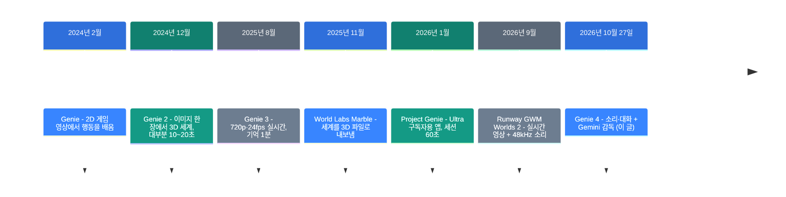
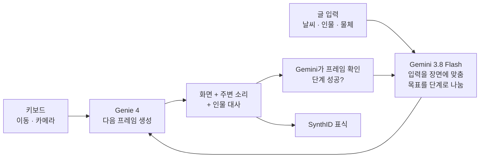

![[genie-4.mp4]]

[원문](https://deepmind.google/blog/genie-4-a-new-generation-of-world-simulation/) · [English](https://neocello-ku.github.io/trends/genie-4)

## 요약

2026년 10월 27일, Google DeepMind가 월드 모델 Genie 4를 발표했습니다. 키보드로 돌아다니는 동안 화면, 소리, 인물의 대화를 실시간으로 만듭니다.

흐름으로 보면, Genie 3의 실시간 세계에 소리와 대화를 더하고 Gemini를 감독으로 붙인 자리입니다. 기법은 중간 정도로 새롭고, 제품은 아직 없습니다. 지금은 신뢰 테스터만 씁니다.

용어가 낯설면, 아래 "처음이라면" 섹션부터 읽으세요.

## 흐름 속 위치: 왜 지금 이 이야기인가

월드 모델은 2026년 가을에 갑자기 붐볐습니다. 9월 3일 Runway가 소리까지 내는 실시간 월드 모델을 먼저 내놓았습니다. Genie 4를 다룬 TechCrunch 기사는 인수 소식도 함께 적었습니다. World Labs와 Decart입니다.

Genie 4는 이 경쟁 한복판에 나왔습니다. 구글은 화질 경쟁보다 "Gemini가 계획하고 Genie가 그린다"는 구조를 앞세웠습니다.



이 글은 일곱 번째 단계에 있습니다. 소리는 경쟁사가 두 달 먼저 냈습니다. Genie 4가 새로 내건 것은 대화하는 인물과 언어 모델 감독입니다.

### 이 기술은 무엇이 새로운가

| 무엇 | 새로운 정도 | 이유 |
| --- | --- | --- |
| 실시간 생성 + 소리 + 대화 (기법) | 중간 | 실시간 조종은 Genie 3에, 실시간 소리는 Runway에 먼저 있었습니다. 대화하는 인물과 Gemini 감독 루프가 새롭습니다. 구조와 수치는 공개하지 않았습니다. |
| 쓸 수 있는 서비스 (제품) | 낮음 | 신뢰 테스터에게만 열렸습니다. Ultra·API는 "곧"이고 날짜와 가격이 없습니다. |
| Gemini 계열과 한 루프 (인프라) | 중간 | Gemini Omni, Gemini 3.8 Flash, Gemini 4 Argon이 각자 역할을 맡습니다. 로봇 시험 환경으로 가는 길을 보였습니다. |

Genie 4는 새 발명이라기보다 방향 선언입니다. 언어 모델이 줄거리를 짜고 영상 모델이 화면을 그리는 "하이브리드 월드 모델"을 공식 목표로 걸었습니다.

지난 글과도 이어집니다. [image-blaster](/trends/image-blaster)(2026-10-06)는 사진 한 장을 3D 공간으로 바꿨습니다. World Labs Marble을 썼습니다. 그 길은 세계를 파일로 남깁니다. Genie 4는 파일 없이 화면만 계속 그립니다.

[LongCat-Video-Avatar 1.5](/trends/longcat-avatar-15)(2026-10-06)는 말하는 사람 영상을 만들었습니다. 음성에 입과 몸을 맞춥니다. Genie 4는 그런 인물을 세계 안에 넣고 실시간으로 말하게 합니다.

## 처음이라면: 이게 무슨 이야기인가요

### 월드 모델은 '즉석 연극 무대'입니다

즉석 연극을 떠올려 보세요. 관객이 "비가 와요!"라고 외치면, 배우들이 바로 우산을 펴고 대사를 바꿉니다. 대본은 없고, 무대는 그 자리에서 계속 이어집니다.

월드 모델은 이 일을 화면으로 합니다. 키를 누르면 다음 장면을 그립니다. 글로 "비가 온다"고 쓰면 다음 장면부터 비가 내립니다.

게임 엔진은 미리 만든 3D 파일과 규칙으로 화면을 계산합니다. 월드 모델에는 그런 파일이 없습니다. 지금까지의 장면과 입력만 보고 다음 프레임을 추측해 그립니다.

### 이번에 무대에 소리와 감독이 생겼습니다

Genie 3까지는 무성 영화였습니다. Genie 4는 바람 소리, 음악, 인물의 대사를 화면과 함께 만듭니다.

무대 뒤에는 감독도 섰습니다. Gemini가 장면을 지켜보며 줄거리를 단계로 나눕니다. 각 단계가 화면에서 실제로 일어났는지 확인합니다.

### 좋은 점 3가지

- 미리 만들 파일이 없습니다. 글 한 줄이나 사진 한 장으로 시작합니다.
- 도중에 바꿀 수 있습니다. 날씨, 카메라, 인물을 글로 바꿉니다.
- 같은 장면을 여러 번 다시 해 볼 수 있습니다. 매번 조금씩 다르게 나옵니다.

### 이런 곳에 씁니다

- 영화 촬영 전에 장면을 미리 걸어 보며 카메라 각도를 고르기
- 게임 엔진 코드를 쓰기 전에 분위기와 조작감 시제품 만들기
- 로봇을 실제로 움직이기 전에 상상 속 환경에서 작업 순서 시험하기

### 이 글에 나오는 이름들

| 용어 | 쉬운 뜻 |
| --- | --- |
| 월드 모델 | 입력을 받아 다음 장면을 예측해 그리는 모델. 여기서는 화면과 소리를 만듭니다. |
| 프레임 | 영상의 한 장. 24fps는 1초에 24장입니다. |
| 실시간 | 사용자가 기다리지 않을 만큼 빠르게 다음 프레임이 나오는 것. |
| 일관성 | 돌아갔다 와도 같은 물체가 같은 자리에 있는 성질. |
| 물체 영속성 | 화면 밖으로 나간 물체가 사라지지 않고 남는 성질. |
| 신뢰 테스터 | 정식 출시 전에 먼저 써 보는 소수의 초대 사용자. |
| Project Genie | 구글의 월드 모델 웹 앱. 2026년 1월에 Genie 3로 열렸습니다. |
| Gemini Omni | 이미지·소리·글로 영상을 만드는 Gemini 모델. 여기서는 겉모습과 움직임을 현실에 맞춥니다. |
| SynthID | 사람 눈에 안 보이게 넣는 구글의 AI 생성물 표식. |

## 동작 방식

블로그가 밝힌 구조는 두 겹입니다. Genie 4가 화면과 소리를 그리고, Gemini가 바깥에서 계획하고 확인합니다. 모델 내부 구조는 공개하지 않았습니다.



Gemini는 사용자가 아무것도 입력하지 않을 때도 장면을 이어 갑니다. 사용자가 끼어들면 계획을 그 자리에서 고칩니다.

로봇 실험에서는 Gemini 4 Argon이 감독을 맡았습니다. Argon이 "체커 두기"를 단계로 나누고, 단계마다 글 자막으로 Genie 4에 넣었습니다. 화면 속 Apptronik Apollo 휴머노이드가 그 단계대로 움직였습니다.

### Genie 3와 무엇이 달라졌나

| 항목 | Genie 3 (2025-08) | Genie 4 (2026-10) |
| --- | --- | --- |
| 해상도·속도 | 720p, 24fps | 공개하지 않음 |
| 일관 시간 | 몇 분, 시각 기억 최대 1분 | 블로그는 "짧은 세션", 모델 페이지는 "몇 분" |
| 소리 | 없음 | 주변 소리, 음악, 대화 |
| 글로 바꾸기 | 날씨, 물체, 인물 | 같음 + Gemini가 입력을 장면에 맞춤 |
| 감독 | 없음 | Gemini가 단계 계획과 프레임 확인 |
| 공개 범위 | 소수 연구자·창작자 | 신뢰 테스터 |

## 준비물과 실행

### 준비물

| 항목 | 요구 사항 |
| --- | --- |
| 장비 | 클라우드 서비스입니다. 내 GPU에서 돌릴 가중치가 없습니다. |
| 접근 | 지금은 신뢰 테스터만 씁니다. |
| 다음 순서 | Project Genie의 Google AI Ultra 구독자, Gemini API·AI Studio 조기 접근 파트너 |
| 출시일·가격 | 1차 출처에 없음. TechCrunch만 "몇 주 안"이라고 적었습니다. |
| 설치 명령어 | 없음. SDK와 API 문서가 아직 없습니다. |

### 1단계. 대기자 명단에 이름을 올리세요

발표 글 위쪽의 대기자 명단 링크를 누르세요. 링크 글자는 "Join the Genie 4 waitlist"입니다. Project Genie용 명단입니다.

2026년 1월 출시 때 Project Genie는 미국의 18세 이상 Ultra 구독자만 썼습니다. 지금 조건이 바뀌었는지는 확인하지 못했습니다.

### 2단계. 프롬프트를 두 칸으로 나눠 쓰세요

공식 프롬프트 가이드(Genie 3 기준)는 환경과 캐릭터를 나눠 쓰라고 합니다. Genie 4 데모도 같은 두 칸을 씁니다.

```text
Environment: A rainy night market street, wet asphalt reflecting
neon signs, steam rising from food stalls, light crowd.
Character: First-person view of a delivery rider on a scooter,
handlebars at the bottom of the frame.
```

짧고 직접적인 문장을 쓰세요. 장면이 어둡다면 그렇게 적으세요. 인물이 어떻게 움직이는지 적으세요.

### 3단계. 돌아다니며 글로 사건을 넣으세요

키보드로 이동하고 카메라를 돌리세요. 도중에 "비가 그친다"처럼 한 문장을 넣으세요.

길게 돌아다니면 세부가 흔들릴 수 있습니다. 같은 장면을 짧게 여러 번 다시 해 보세요.

## 팩트체크

| 블로그의 주장 | 확인 결과 | 판정 |
| --- | --- | --- |
| 전례 없는 사실감 | 수치·벤치마크가 없습니다. 데모 영상만 있습니다 | 근거 없음 |
| 실시간 상호작용 | 해상도·fps·지연을 1차 출처 어디에도 적지 않았습니다 | 조건부 |
| 우리의 첫 실시간 소리 생성 월드 모델 | 구글 안에서는 맞습니다. Runway가 9월 3일에 먼저 냈습니다 | 일치 |
| 일관된 장면 2분, 이전의 2배 (기사) | 1차 출처에 숫자가 없습니다. 60초는 앱의 세션 상한입니다 | 조건부 |
| 공기역학·충돌을 시뮬레이션 | 데모뿐입니다. 같은 글이 복잡한 물리를 한계로 적었습니다 | 조건부 |
| Gemini가 루프 안에서 단계를 검증 | 구조 설명만 있습니다. 성공률 수치가 없습니다 | 조건부 |
| Ultra·API에 곧 출시 | 날짜와 가격이 없습니다. 지금은 신뢰 테스터만 씁니다 | 조건부 |
| 모든 영상·소리에 SynthID | 약속입니다. 공개 출력이 없어 아직 확인할 수 없습니다 | 조건부 |

### "2배"를 다시 계산해 봅니다

2분은 120초입니다. Project Genie 세션 상한 60초의 정확히 2배입니다. 즉 "2배"의 기준은 모델이 아니라 앱의 제한입니다.

Genie 3 블로그는 이미 "몇 분 동안 대체로 일관"이라고 적었습니다. 모델끼리 비교하면 늘었다고 말할 근거가 없습니다.

### 독립 측정은 아직 없습니다

같은 시기 독립 벤치마크나 실사용 후기를 찾지 못했습니다. 신뢰 테스터만 쓸 수 있기 때문입니다. Runway GWM Worlds 2의 720p·24fps·48kHz도 회사 발표값입니다.

### 블로그가 스스로 밝힌 한계

- 오래 돌리면 세부와 물체 위치가 흔들립니다.
- 프롬프트를 여러 번 고치거나 장면을 많이 돌아다녀도 흔들립니다.
- 소리 정확도, 읽을 수 있는 글자, 공간 정확도는 아직 연구 중입니다.

## 언제 무엇을 쓰나

| 상황 | 쓸 방법 |
| --- | --- |
| 장면 분위기를 빨리 걸어 보고 싶다 | Genie 4 (출시 후). 짧은 세션을 여러 번 |
| 지금 당장 써 봐야 한다 | Project Genie (Genie 3, Ultra 구독) 또는 Runway GWM Worlds 2 신청 |
| 결과를 3D 파일로 남겨 엔진에 넣어야 한다 | World Labs Marble 같은 3D 생성 도구 |
| 치수와 위치가 정확해야 한다 | 게임 엔진·시뮬레이터. 월드 모델은 공간 정확도를 보장하지 않습니다 |
| 내 GPU에서 돌려야 한다 | Genie 4는 안 됩니다. 공개 가중치 모델을 찾아야 합니다 |

## 출처

- [Google DeepMind 공식 블로그: Genie 4 (2026-10-27)](https://deepmind.google/blog/genie-4-a-new-generation-of-world-simulation/)
- [Google 블로그: Introducing Genie 4](https://blog.google/innovation-and-ai/models-and-research/google-deepmind/introducing-genie-4/)
- [DeepMind 모델 페이지: Genie](https://deepmind.google/models/genie/)
- [Genie 프롬프트 가이드](https://deepmind.google/models/genie/prompt-guide/)
- [Genie 3 블로그 (2025-08-05)](https://deepmind.google/blog/genie-3-a-new-frontier-for-world-models/)
- [Project Genie 발표 (2026-01-29)](https://blog.google/innovation-and-ai/models-and-research/google-deepmind/project-genie/)
- [TechCrunch: Genie 4 기사 (2026-10-27)](https://techcrunch.com/2026/10/27/googles-genie-4-world-model-adds-audio-more-realistic-worlds-and-real-time-steering/)
- [Runway: GWM Worlds 2 발표 (2026-09-03)](https://x.com/runwayml/status/2095540014645920040)
- [위키백과: Genie (AI model)](https://en.wikipedia.org/wiki/Genie_(AI_model))

## 이어지는 글

- [[trends/image-blaster|image-blaster: 사진 한 장을 3D 공간으로]]
- [[trends/longcat-avatar-15|LongCat-Video-Avatar 1.5: 사진 한 장과 음성으로 말하는 영상]]

