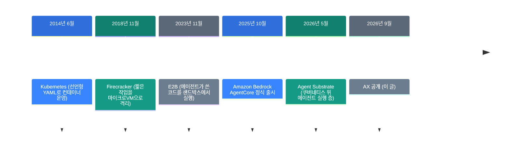
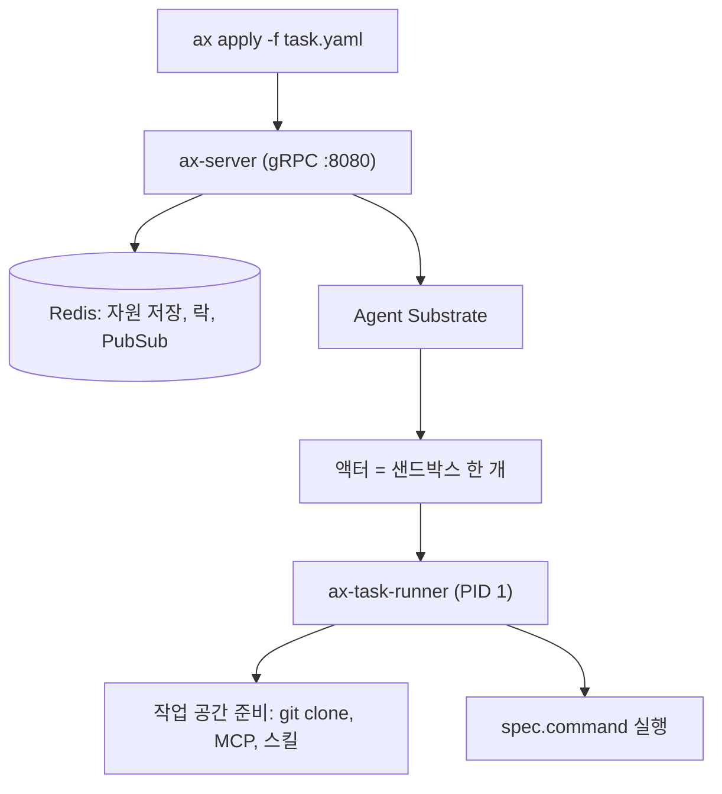

![[google-ax.mp4]]

[원문](https://github.com/google/ax) · [레포](https://github.com/google/ax) · [English](https://neocello-ku.github.io/trends/google-ax)

## 요약

2026년 9월, 구글이 AX를 공개했습니다. AX는 에이전트 작업을 쿠버네티스 매니페스트처럼 선언하는 오케스트레이터입니다. 9월 20일 Hacker News 1위에 올랐고, 10월 17일 기준 별이 13,867개입니다.

흐름으로 보면, 에이전트를 "앱"이 아니라 **운영해야 할 워크로드**로 다루려는 시도입니다. 결론부터 말하면 기법은 새롭지 않습니다. 쿠버네티스가 2014년에 한 일을 에이전트 모양으로 다시 포장했습니다.

용어가 낯설면, 아래 "처음이라면" 섹션부터 읽으세요.

## 흐름 속 위치: 왜 지금 이 이야기인가

에이전트를 만드는 이야기는 많았습니다. 이제 질문이 바뀌었습니다. **만든 에이전트를 수천 개씩 어디서 돌릴 것인가**입니다.

에이전트는 기존 워크로드와 다릅니다. 웹 서버처럼 상태가 없지도 않고, 배치 작업처럼 한 번 돌고 끝나지도 않습니다. 상태를 쌓고, 남의 코드를 실행하고, 아무도 안 보면 루프를 돌며 돈을 씁니다.



AX는 여섯 번째 단계입니다. 앞의 다섯 단계는 "격리해서 돌리는 법"을 만들었습니다. AX는 그 위에 "무엇을 돌릴지 적는 법"을 얹습니다.

지난 글과도 이어집니다. 「코딩 에이전트 11개를 소스로 뜯어본 논문」(2026-10-07)은 모델 **안쪽** 루프를 다뤘습니다. AX는 그 루프를 격리해서 대량으로 돌리는 **바깥** 층입니다. AX v0.1.0 릴리스 노트도 "하네스와 에이전트를 위한 분산 런타임"이라고 적습니다.

「OpenAI dots」(2026-10-06)는 상시 대기 에이전트를 요금제에 넣었습니다. 같은 문제를 AX는 다르게 풉니다. 쉬는 작업을 체크포인트로 멈추고, 필요할 때 깨웁니다.

### 이 기술은 무엇이 새로운가

| 무엇 | 새로운 정도 | 이유 |
| --- | --- | --- |
| 선언형 운영 (기법) | 낮음 | 쿠버네티스가 2014년에 한 일입니다. 새 알고리즘이 없습니다. |
| 세 개로 줄인 기본 요소 (제품) | 중간 | Task·Workspace·Model 설계는 분명합니다. 다만 클러스터가 먼저 있어야 씁니다. |
| Redis 상태 저장 (인프라) | 중간 | etcd를 피한 선택은 뚜렷합니다. 밀도 성능은 Agent Substrate가 냅니다. |

정리하면, AX는 새 발명이 아닙니다. 구글이 에이전트 실행 층의 공개 규격 자리를 먼저 잡으려는 움직임입니다.

## 처음이라면: 이게 무슨 이야기인가요

### 에이전트는 손님방이 필요합니다

AI 에이전트에게 일을 시킨다고 생각해 보세요. 에이전트는 코드를 받아서 고치고, 명령어를 실행하고, 인터넷에 요청을 보냅니다.

이 일을 내 컴퓨터에서 바로 시키면 위험합니다. 에이전트가 엉뚱한 파일을 지울 수 있습니다. 그래서 **따로 방을 만들어 주고** 그 안에서만 움직이게 합니다. 이 방을 샌드박스라고 부릅니다.

문제는 방이 하나가 아니라는 점입니다. 에이전트 500개를 돌리려면 방 500개가 필요합니다. 방마다 누가 들어갔는지, 지금 일하는지 쉬는지 관리해야 합니다.

### 호텔 지배인에 비유하면

AX는 호텔 지배인입니다. 손님(에이전트)이 오면 방을 배정하고, 방에 필요한 짐을 미리 넣어 둡니다.

- **Task(작업)** = 방 하나. 손님 한 명이 묵습니다. 방 크기(CPU·메모리)를 정합니다.
- **Workspace(작업 공간)** = 방에 미리 넣어 두는 짐. 코드 저장소, 쓸 수 있는 도구 목록입니다.
- **Model(모델)** = 어느 AI를 쓸지 적은 쪽지. 열쇠(API 키)는 금고에서 꺼내 씁니다.

손님이 낮잠을 자면 지배인이 방을 접어서 창고에 넣습니다(`ax suspend`). 다시 오면 펼쳐 줍니다(`ax resume`). 그 사이 방값은 안 나갑니다.

### 왜 좋은가

- 설정이 YAML 파일에 남습니다. 사람 머릿속이나 쉘 기록에 흩어지지 않습니다.
- 같은 작업 공간을 여러 작업이 나눠 씁니다. git 클론을 매번 다시 하지 않습니다.
- 쉬는 작업을 멈춰서 서버 자원을 돌려받습니다.

### 이런 곳에 씁니다

- 레포 수백 개에 같은 수정을 거는 일괄 작업
- 고객마다 격리된 환경이 필요한 코딩 에이전트 서비스
- 남이 쓴 코드를 믿지 않고 실행해야 하는 평가 파이프라인

### 이 글에 나오는 이름들

| 용어 | 쉬운 뜻 |
| --- | --- |
| 샌드박스 | 에이전트를 가둬 두고 실행하는 격리된 방. |
| 매니페스트 | 무엇을 어떻게 띄울지 적은 YAML 파일. |
| 쿠버네티스 | 컨테이너를 여러 서버에 나눠 돌려 주는 운영 도구. |
| Agent Substrate | AX 아래에서 실제로 방을 만들고 접는 층. 구글이 2026년 5월에 공개했습니다. |
| 액터 | Substrate가 다루는 단위. 상태를 가진 채 멈췄다 깨어납니다. |
| MCP | 에이전트가 바깥 도구를 부르는 공통 규격. |
| 아테스페이스(atespace) | AX 자원을 나누는 칸. 쿠버네티스 네임스페이스와 비슷합니다. |
| 체크포인트 | 지금 상태를 그대로 저장해 둔 것. |

## 동작 방식

제어 평면은 세 조각입니다. `ax`는 내 노트북의 명령 도구, `ax-server`는 클러스터 안의 gRPC 서버, `ax-task-runner`는 작업 컨테이너 안의 1번 프로세스입니다.



여기서 눈여겨볼 선택이 하나 있습니다. AX는 상태를 쿠버네티스 CRD로 두지 않습니다. Redis에 둡니다.

설계 문서가 이유를 밝힙니다. 짧게 살다 죽는 작업 수백만 개를 etcd에 넣으면 저장 한계와 쓰기 속도에 걸립니다. 그래서 etcd를 비켜 가고, 분산 락을 걸어 Substrate와 직접 상태를 맞춥니다.

작업 컨테이너 안에서는 `ax-task-runner`가 1번 프로세스로 뜹니다. 순서는 이렇습니다.

1. Task와 묶인 Workspace 명세를 읽습니다.
2. 80번 포트에 프로브를, `127.0.0.1:8099`에 메타데이터 서버를 엽니다.
3. 작업 공간을 깝니다. git 레포를 클론하고, 스킬 경로를 만듭니다.
4. `spec.command`를 자식 프로세스로 띄우고 지켜봅니다.

명령이 끝나도 러너는 살아 있습니다. 그래서 명령이 죽은 뒤에도 `ax ssh`로 안을 들여다볼 수 있습니다.

## 준비물과 실행

### 준비물

| 항목 | 요구 사항 |
| --- | --- |
| 클러스터 | 쿠버네티스 클러스터 1개 |
| 실행 층 | Agent Substrate (`ate-system` 네임스페이스) |
| 도구 | Go, `kubectl`, `ko`, 컨테이너 레지스트리 |
| 모델 키 | Gemini API 키를 담은 쿠버네티스 시크릿 |
| 하드웨어 | README에 없습니다. 노드 사양·개수 수치가 문서에 없습니다. |

작업 하나의 자원은 예제에 있습니다. requests는 `cpu 500m`·`memory 1Gi`, limits는 `cpu 2`·`memory 4Gi`입니다. 권장값이 아니라 예제 값입니다.

### 1단계. Agent Substrate가 떠 있는지 확인하세요

```bash
kubectl get svc api -n ate-system
```

AX는 `api.ate-system.svc.cluster.local:443`에서 Substrate를 찾습니다. 이것이 없으면 다음 단계가 의미 없습니다.

### 2단계. CLI를 설치하세요

```bash
go install github.com/google/ax/cmd/ax@latest
```

`ax` 바이너리가 `$(go env GOPATH)/bin`에 들어갑니다. 그 경로가 `PATH`에 있어야 합니다.

### 3단계. 제어 평면을 배포하세요

```bash
make deploy AX_IMAGE_REPO=<your-registry>
```

Redis를 먼저 띄우고, `ko`로 제어 평면 이미지를 빌드해 올립니다. 모두 `ax-system` 네임스페이스에 들어갑니다.

### 4단계. 작업을 선언하세요

```yaml
apiVersion: ax.io/v1alpha1
kind: Workspace
metadata:
  name: golang
spec:
  git:
    - repo: https://github.com/golang/go.git
      branch: "my-fix"
---
apiVersion: ax.io/v1alpha1
kind: Task
metadata:
  name: test
spec:
  workspaces:
    - name: golang
      goal: "Ensure that Go tool chain is available and is built from source"
  debug: true
```

`debug: true`를 켜야 `ax ssh`가 붙습니다. 기본값은 꺼짐입니다. 켜면 샌드박스 안에서 임의 프로세스 실행과 파일 접근이 열립니다.

### 5단계. 적용하고 지켜보세요

```bash
ax apply -f task.yaml
ax get tasks
ax watch task test
ax ssh test -- ls -al /workspace
```

`ax watch`는 상태와 조건 변화를 실시간으로 흘려 줍니다. 조건은 두 개입니다. `WorkspaceReady`는 작업 공간 준비가 끝났을 때, `Ready`는 거기에 더해 작업이 돌고 있을 때 참이 됩니다. 기다릴 때는 `Ready`를 보세요.

### 6단계. 멈추고 다시 켜세요

```bash
ax suspend task test
ax resume task test
```

멈추면 `Ready`가 거짓이 되고 이유에 `TaskSuspended`가 붙습니다. 체크포인트 자체는 Agent Substrate 액터가 합니다.

## 팩트체크

| 주장 | 확인 결과 | 판정 |
| --- | --- | --- |
| 클러스터 하나에서 에이전트 작업 수십억 개 (README) | 레포에 벤치마크도 측정 스크립트도 없습니다. 밀도 숫자는 Agent Substrate 쪽에서 나옵니다. | 근거 없음 |
| 쿠버네티스를 써 봤다면 익숙하다 (README) | `apply`·`get`·`describe`·`watch`·`delete`가 실제로 있습니다. `--context`로 kubectl 컨텍스트를 따릅니다. | 일치 |
| 세 요소가 "돈이 새는 루프"까지 선언적으로 처리한다 (README) | `TaskSpec`에 토큰·시간 예산 필드가 없습니다. CPU·메모리 한도만 있습니다. 예산과 승인 정책은 로드맵 항목입니다. | 과장 |
| 기본 요소는 Task·Workspace·Gateway·Model 네 개 (InfoQ 기사) | 레포 상수는 세 개입니다. `Gateway`는 코드에도 문서에도 없습니다. | 근거 없음 |
| 어떤 LLM이든 Model 자원으로 설정한다 (README) | 공급자가 `google`일 때만 동작합니다. 다른 값은 `unsupported provider` 오류입니다. | 과장 |
| 한 명령으로 적용한다 (README) | 적용은 한 명령이 맞습니다. 그 앞에 클러스터·Substrate·`ko`·레지스트리·제어 평면 배포가 필요합니다. | 조건부 |
| 48시간 만에 개발자 15만 명 등록 (일부 2차 기사) | 확인할 수 없습니다. GitHub에 "등록" 지표가 없습니다. | 근거 없음 |
| 멈춘 자리에서 이어서 돌린다 (README) | `SuspendTask`·`ResumeTask` RPC가 있습니다. 체크포인트는 Substrate가 합니다. | 일치 |

공개된 관심 지표는 두 가지입니다. 별은 13,867개(2026-10-17)입니다. Hacker News 점수는 666점, 댓글은 300개였습니다(2026-09-20).

주의할 점도 둘 있습니다. README 맨 위에 "안정 릴리스 전에 파괴적 변경이 있을 것"이라는 경고가 있습니다. 그리고 `goal` 필드에는 삭제를 검토한다는 주석이 코드에 붙어 있습니다.

## 언제 무엇을 쓰나

| 상황 | 쓸 방법 |
| --- | --- |
| 에이전트 수백 개를 내 클러스터에서 격리해 돌린다 | AX (쿠버네티스 + Agent Substrate 필요) |
| 클러스터를 직접 굴리고 싶지 않다 | Amazon Bedrock AgentCore 같은 관리형 런타임 |
| 코드 조각 하나만 안전하게 실행한다 | E2B 같은 샌드박스 서비스 |
| 서버 한 대에서 에이전트 몇 개만 돌린다 | 컨테이너와 쉘 스크립트로 충분합니다 |
| 에이전트 안쪽 루프를 설계한다 | AX가 아니라 하네스 쪽 이야기입니다 |

## 출처

- [google/ax GitHub 저장소](https://github.com/google/ax)
- [AX 설계 문서 (DESIGN.md)](https://github.com/google/ax/blob/main/DESIGN.md)
- [AX 핵심 개념 문서](https://github.com/google/ax/blob/main/docs/concepts.md)
- [AX 샌드박스 문서](https://github.com/google/ax/blob/main/docs/sandbox.md)
- [AX 로드맵](https://github.com/google/ax/blob/main/docs/roadmap.md)
- [InfoQ: Google Open-Sources AX (2026-09-22)](https://www.infoq.com/news/2026/09/google-ax-orchestrator/)
- [구글 클라우드 블로그: Agent Sandbox on GKE and Agent Substrate (2026-05-21)](https://cloud.google.com/blog/products/containers-kubernetes/bringing-you-agent-sandbox-on-gke-and-agent-substrate)
- [AWS: Amazon Bedrock AgentCore 정식 출시 (2025-10-13)](https://aws.amazon.com/about-aws/whats-new/2025/10/amazon-bedrock-agentcore-available)

## 이어지는 글

- [[trends/harness-engineering|코딩 에이전트 11개를 소스로 뜯어본 논문: 하네스가 무엇인가]]
- [[trends/openai-dots|OpenAI dots: 상시 대기 에이전트가 요금제에 들어왔습니다]]
- [[trends/buzz|Buzz: 사람과 AI 에이전트가 같은 방에서 일하는 작업 공간]]

