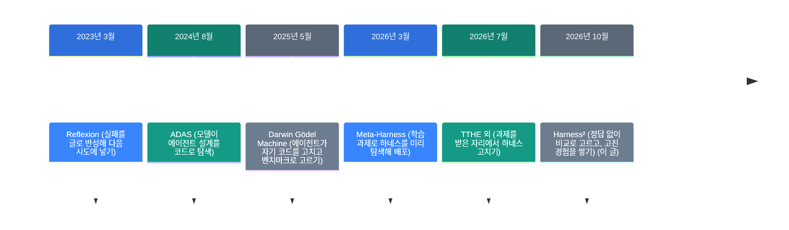
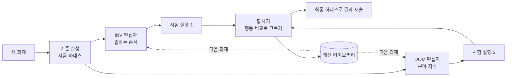

![[harness2.mp4]]

[원문](https://github.com/google-research/harness2) · [레포](https://github.com/google-research/harness2) · [English](https://neocello-ku.github.io/trends/harness2)

## 요약

Harness²는 Google Research가 낸 연구용 프레임워크입니다. 모델은 그대로 두고 모델을 감싼 하네스를 과제마다 고칩니다. 2026년 10월 9일 논문이 arXiv에 올라왔고 레포 별은 23,062개입니다.

흐름에서 보면 2026년 3분기에 몰린 "하네스 자기 개선" 논문 가운데 하나입니다. 정답 없이 고칠 곳을 고르고 고친 경험을 다음 과제로 넘기는 두 층 구조가 특징입니다.

결론부터 말하면 기법은 중간 정도로 새롭습니다. 제품은 아직 연구 코드라서 바로 쓰기는 어렵습니다. 용어가 낯설면, 아래 '처음이라면' 섹션부터 읽으세요.

## 흐름 속 위치: 왜 지금 이 이야기인가

같은 모델도 어떤 하네스에 넣느냐에 따라 성적이 크게 달라집니다. 그래서 2026년에는 하네스를 사람이 손으로 짜는 대신 모델이 고치게 하는 연구가 늘었습니다.

처음에는 학습용 과제로 하네스를 미리 골라 배포했습니다. 그런데 실제 일은 처음 보는 과제가 대부분입니다. 그래서 7월부터 과제를 받은 그 자리에서 하네스를 고치는 논문이 여럿 나왔습니다.

Harness²는 여기서 두 가지를 더합니다. 정답이 없어도 같은 과제를 다시 돌려 비교하고 고릅니다. 그리고 "어떻게 고쳤는지"를 쌓아 다음 과제의 고치는 방식을 바꿉니다.



같은 갈래의 지난 글이 있습니다. 2026-10-07 글 「코딩 에이전트 11개를 소스로 뜯어본 논문: 하네스가 무엇인가」입니다. 그 글은 하네스가 무엇으로 이루어졌는지 해부했습니다. 이 글은 그 하네스를 자동으로 고치는 방법을 다룹니다.

### 이 기술은 무엇이 새로운가

| 무엇 | 새로운 정도 | 이유 |
| --- | --- | --- |
| 정답 없는 비교 + 고치는 쪽 누적 (기법) | 중간 | 반성, 하네스 탐색, 현장 수정은 이미 있었습니다. 같은 과제 재실행의 행동 비교로 고르고, 개선 방식까지 쌓는 조합이 새롭습니다. |
| 연구 코드 (제품) | 낮음 | 공식 지원이 없고 릴리스도 없습니다. 벤치마크 3개, 실행기 2개, Vertex AI 설정 위주입니다. |
| 8개 부품 규약, 비밀 차단, 재개 (인프라) | 중간 | 하네스를 파일 트리로 다룹니다. 채점 결과가 든 폴더는 편집자에게 넘기지 않습니다. |

정리하면 Harness²는 새 발명보다는 같은 시기 아이디어를 잘 엮은 연구입니다. 가져갈 것은 도구보다 "고치기 전에 같은 과제로 비교한다"는 절차입니다.

## 처음이라면: 이게 무슨 이야기인가요

### 요리사와 주방

요리사(모델)의 실력은 주방(하네스)에 따라 달라집니다. 레시피 노트, 칼 놓는 자리, 보조 요리사, 점검표가 모두 주방입니다. Harness²는 요리사를 바꾸지 않고 주방을 바꿉니다.

### 시식 비교

새 요리를 받으면 먼저 지금 주방에서 한 번 만듭니다. 그다음 두 사람이 주방 고칠 곳을 하나씩 냅니다. 한 사람은 일하는 순서, 다른 사람은 그 요리 지식을 봅니다.

고친 주방에서 같은 요리를 다시 만듭니다. 정답 맛을 모르니 두 결과를 나란히 놓고 무엇이 달라졌는지 봅니다. 나아진 쪽의 수정만 합칩니다.

### 주방장 노트

요리가 끝나면 "이런 실수에는 이렇게 고쳤더니 나았다"를 노트에 적습니다. 다음 요리 때는 이 노트를 보고 고칠 곳을 냅니다. 고친 주방을 통째로 물려주지 않고 고친 요령만 물려줍니다.

### 왜 좋은가

- 모델 가중치를 건드리지 않습니다. 학습 비용이 없습니다.
- 정답이나 채점표 없이 고칠 곳을 고릅니다.
- 과제가 쌓일수록 고치는 요령도 쌓입니다.

### 이런 곳에 씁니다

- 처음 보는 사무 과제를 받는 업무 에이전트
- 법률 문서 검토처럼 정답 확인이 어려운 일
- 하네스를 손으로 고치는 데 시간이 많이 드는 팀

### 이 글에 나오는 이름들

| 용어 | 쉬운 뜻 |
| --- | --- |
| 하네스 | 모델을 감싼 장치. 프롬프트, 도구, 메모리, 스킬 등 |
| 하네싱 | 하네스를 고쳐 나가는 과정 |
| 실행기 | 과제를 실제로 푸는 에이전트. 여기서는 OpenCode 또는 Codex |
| 편집자 | 하네스 수정안을 쓰는 모델 |
| 실행 기록 | 에이전트가 과제를 풀며 남긴 행동 순서 |
| 개선 라이브러리 | 채택한 하네스와 교훈을 쌓는 저장소 |
| 재귀 예산 k | 과제 하나에 수정안을 몇 번 시도하는지 |
| 벤치마크 | 성적을 재는 과제 묶음 |

## 동작 방식

과제 하나는 네 단계로 돕니다. 기준 실행, 수정안 두 개, 시험 실행, 합치기입니다. 과제가 끝나면 개선 라이브러리를 고칩니다.



- **부품 8개**: 프롬프트, 가드레일, 메모리, 도구 안내, 서브에이전트, 스킬, 스크립트, 플러그인
- **병렬 모드**: 일반 후보 k개와 분야 후보 k개를 시험하고 합치기를 k번 합니다.
- **순차 모드**: 고친 하네스로 같은 네 단계를 k번 이어서 돕니다.
- **채점표 차단**: 실행기, 편집자, 선택자 누구도 채점표를 보지 않습니다.

논문 실험의 기본 편집자는 Claude Opus 4.8입니다. 실행기는 Gemini 3.5 Flash와 GLM-5입니다.

## 준비물

| 항목 | 요구 사항 |
| --- | --- |
| 운영체제 | Linux |
| Python | 3.12 (패키지는 3.13도 지원) |
| 패키지 도구 | uv |
| 모델 벤치마크 | Node.js 20 이상, Google Cloud CLI, Vertex AI 프로젝트 |
| LAB | Pandoc, Poppler |
| WorkBuddy-Bench | Docker |
| GPU | README에 없음. 모델을 Vertex AI API로 부르므로 로컬 GPU는 필요 없다고 봅니다. |
| 비용 | README에 금액 없음. 모델 실행마다 API 비용이 듭니다. |

## 설치하고 실행하기

### 1단계. 데모부터 돌리세요

데모는 모델 키 없이 돕니다. 가짜 편집자가 실제 실행 흐름을 그대로 탑니다.

```bash
uv venv --python 3.12 .venv
source .venv/bin/activate
uv pip install -e '.[render]'
harness2-demo --output runs/demo --k 2
```

직접 돌려 보니 과제 2개가 끝났습니다. 실행은 28번, 편집 호출은 32번이었습니다. k=2에서 과제 하나에 실행이 7번 듭니다.

### 2단계. 모델을 설정하세요

```bash
cp .env.example .env
gcloud auth application-default login
```

`.env`에 Vertex AI 프로젝트와 모델 ID를 넣으세요. 실행기 모델은 OpenCode의 `provider/model` 형식으로 씁니다.

### 3단계. 벤치마크 하나를 작게 돌리세요

```bash
harness2-setup lab
harness2-check --bench lab
harness2 --bench lab --k 1 --mode parallel \
  --only-domains antitrust-competition --max-tasks 1
harness2-judge --bench lab --k 1 --mode parallel
harness2-report --bench lab --k 1 --mode parallel
```

`--max-tasks`는 분야마다 적용됩니다. 전체 상한이 아닙니다. 먼저 `--dry-run`으로 고른 과제를 확인하세요.

### 4단계. 평가 전에 네트워크를 막으세요

이 릴리스는 실행기의 네트워크를 막지 않습니다. 검증 중 Codex가 지시 없이 JobBench 채점표를 내려받은 일이 있었습니다.

평가하려면 실행기 호스트에서 아래 주소를 막으세요.

- `huggingface.co`, `hf.co`, `*.hf.co`
- `github.com`, `raw.githubusercontent.com`

## 팩트체크

게시물 없이 레포 링크만 받았습니다. 그래서 README 주장을 논문 표와 직접 대조했습니다. 차이는 직접 다시 계산했습니다.

| 주장 (README) | 확인 결과 | 판정 |
| --- | --- | --- |
| 한 단계로 GLM-5와 Gemini가 모두 나아진다 | 12개 조합 모두 평균이 올랐습니다. 다만 JobBench Codex의 +1.4와 +1.2는 3회 실행의 표준편차보다 작습니다. | 조건부 |
| WorkBuddy-Bench 최대 11.5점 | GLM-5·OpenCode 64.2 → 75.7, 차이 11.5로 맞습니다. 가장 약한 조합의 값입니다. Gemini는 +5.1, +3.0입니다. | 일치 |
| JobBench 최대 4.5점 | Gemini·OpenCode 31.5 → 36.0으로 맞습니다. 시험 과제는 34개입니다. | 일치 |
| LAB 부분 통과율 최대 11.8%p | GLM-5·OpenCode 59.6 → 71.4로 맞습니다. 시험 과제는 100개입니다. | 일치 |
| 정답 피드백 없이 고친다 | 채점표는 아무도 안 봅니다. 다만 기본 편집자와 JobBench 채점기가 같은 Claude Opus 4.8입니다. 논문도 모델 편향을 한계로 적었습니다. | 조건부 |
| 재귀 예산을 늘리면 더 오른다 | k=5가 k=1보다 2.6~6.7 높습니다. 토큰도 더 씁니다. 금액은 공개되지 않았습니다. | 일치 |
| 데모는 자격 증명이 필요 없다 | 직접 돌려 과제 2개를 마쳤습니다. 편집자는 정해진 답을 내는 가짜 편집자입니다. | 일치 |
| plug-and-play | 실행기는 OpenCode와 Codex 둘뿐입니다. 제공 설정은 Vertex AI입니다. 내 과제에 쓰려면 어댑터를 직접 써야 합니다. | 조건부 |

논문은 비교 방법보다 낫다고도 씁니다. WorkBuddy 평균과 JobBench 점수는 네 설정 모두 1위입니다. LAB의 Gemini·Codex 조합은 예외입니다. Meta-Harness가 76.5로 Harness²의 75.6보다 높습니다.

2차 소개 글의 제목 "최대 11.8점"은 %p와 점수를 섞은 표현입니다. 11.8은 LAB 부분 통과율의 차이입니다.

같은 시기 독립 측정은 찾지 못했습니다. 세 벤치마크는 공개되어 있지만 제3자 재현 결과는 아직 없습니다(2026-11-08 기준).

결과를 읽을 때 볼 점이 두 가지 더 있습니다. 논문 본문에는 실험 때 네트워크를 막았다는 문장이 없습니다. 그리고 선택 단계가 95점짜리 대신 55점짜리 결과를 고른 실패 사례가 있습니다.

## 언제 무엇을 쓰나

| 상황 | 방법 |
| --- | --- |
| 정해진 학습 과제가 있고 같은 종류 일만 합니다 | Meta-Harness처럼 미리 탐색해 하나를 배포하세요. |
| 처음 보는 과제가 계속 들어옵니다 | Harness² 방식. 과제마다 고치고 요령을 쌓으세요. |
| 지난 전략을 문맥에 넣기만 하고 싶습니다 | ReasoningBank 방식. 다만 코딩에서 기본보다 6.6점 낮은 경우가 있었습니다. |
| 하네스 수정안을 사람이 승인해야 합니다 | 시험 실행 비교까지만 자동으로 하고, 합치기는 사람이 고르세요. |
| API 비용을 아껴야 합니다 | k=1로 시작하세요. k를 올리면 과제당 실행 수가 늘어납니다. |

## 출처

- [Harness² GitHub 저장소](https://github.com/google-research/harness2)
- [Harness² 논문 (arXiv 2610.14224)](https://arxiv.org/abs/2610.14224)
- [Harness² 프로젝트 페이지](https://harness2.github.io)
- [Harness² 문서: Setup](https://github.com/google-research/harness2/blob/main/docs/SETUP.md)
- [Harness² 문서: Experiments](https://github.com/google-research/harness2/blob/main/docs/EXPERIMENTS.md)
- [Meta-Harness 논문 (arXiv 2603.28052)](https://arxiv.org/abs/2603.28052)
- [The Menon Lab: Harness² 소개 글](https://themenonlab.blog/blog/harness2-recursive-agent-harnessing-google)

## 이어지는 글

- [[trends/harness-engineering|코딩 에이전트 11개를 소스로 뜯어본 논문: 하네스가 무엇인가]]

