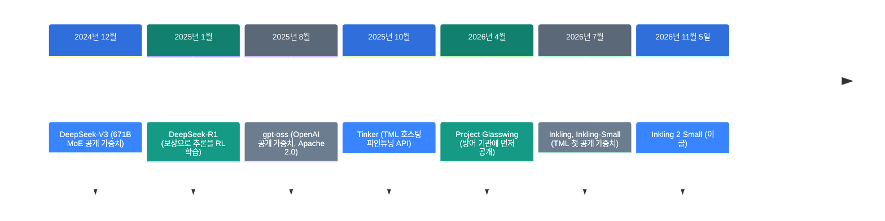
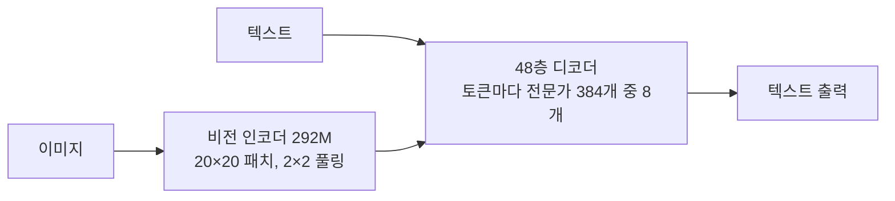
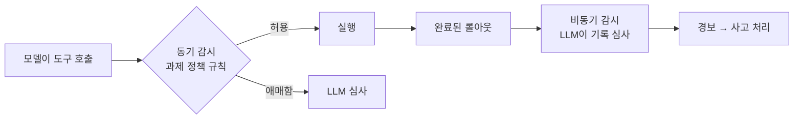

![[inkling-2-small.mp4]]

[원문](https://thinkingmachines.ai/news/inkling-2-small/) · [English](https://neocello-ku.github.io/trends/inkling-2-small)

## 요약

Thinking Machines Lab이 2026년 11월 5일 Inkling 2 Small을 발표했습니다. 전체 594B, 활성 17B인 MoE 모델이고 이미지를 읽습니다. 지금은 자사 파인튜닝 서비스 Tinker에서만 쓸 수 있습니다.

흐름으로 보면 TML이 "파인튜닝 API → 가중치 공개" 순서를 처음 실제로 쓴 모델입니다. 독립 측정에서도 점수가 1세대의 2배를 넘었습니다.

기법은 새롭지 않습니다. 새로운 것은 출시 순서와 가격입니다. 용어가 낯설면, 아래 '처음이라면' 섹션부터 읽으세요.

## 흐름 속 위치: 왜 지금 이 이야기인가

공개 가중치 모델은 2024년 말부터 크고 강해졌습니다. 그만큼 "아무에게나 풀어도 되나"라는 질문도 커졌습니다. Thinking Machines Lab(TML)은 그 사이에 단계를 하나 넣었습니다.



이 글은 마지막 단계에 있습니다. TML은 7월에 "단계 공개" 원칙을 글로 냈습니다. 이번 모델은 그 원칙을 실제 출시 순서로 처음 쓴 사례입니다.

지난 트렌드 노트와도 이어집니다. 첫째는 「코딩 에이전트 11개를 소스로 뜯어본 논문: 하네스가 무엇인가」(2026-10-07)입니다. 그 글은 하네스를 다뤘고 이 모델은 여러 하네스에 걸쳐 학습했습니다.

둘째는 「Harness²: 에이전트가 과제를 풀면서 자기 하네스를 고치게 하기」(2026-11-08)입니다. 에이전트가 스스로 실험한다는 점에서 이 모델의 "자동 연구"와 같은 방향입니다.

셋째는 「Strata: 125B 모델을 게임용 PC에서 돌리기」(2026-10-06)입니다. 125B와 달리, 594B는 가중치가 나와도 개인 PC에 안 들어갑니다.

### 이 기술은 무엇이 새로운가

| 무엇 | 새로운 정도 | 이유 |
| --- | --- | --- |
| 학습 방법 (기법) | 낮음 | MoE, NVFP4 학습, 비동기 RL, LLM 채점자는 모두 있던 기법입니다. 새로운 것은 한 번의 RL에 모은 규모입니다. |
| 파인튜닝 가능한 594B (제품) | 중간 | 첫날부터 LoRA 학습 API로 팝니다. 입력 $0.30, 출력 $1.00(1M 토큰당)로 1세대보다 쌉니다. 가중치는 아직 닫혀 있습니다. |
| 단계 공개와 학습 감시 (인프라) | 중간 | 호스팅 파인튜닝을 공개 가중치 앞에 두었습니다. 학습 중 도구 호출을 두 겹으로 감시하고 우회 사고도 공개했습니다. |

정리하면 이 모델은 새 발명이 아닙니다. 공개 가중치를 내는 순서를 바꾼 제품입니다. 성능 향상은 독립 측정으로도 확인됩니다.

## 처음이라면: 이게 무슨 이야기인가요

### 요리 학원에 비유하면

모델 가중치는 비밀 소스의 레시피입니다. 레시피를 통째로 주면 누구나 따라 만들고 고칠 수 있습니다. 대신 나쁜 데 쓰는 사람도 막을 수 없습니다.

Tinker는 요리 학원입니다. 학원은 레시피를 주지 않습니다. 대신 학생이 자기 재료로 소스를 변형해 보게 합니다.

TML은 이번에 학원을 먼저 열었습니다. 안전 점검이 끝나면 레시피도 공개하겠다고 했습니다.

### 좋은 점 3가지

- GPU 없이 594B 모델을 내 데이터로 파인튜닝할 수 있습니다.
- 공개 전에 안전 문제를 찾을 시간이 생깁니다.
- 가중치가 공개되면 학원에서 만든 체크포인트를 내려받을 수 있습니다.

### 이런 곳에 씁니다

- 사내 문서로 분석·요약 모델을 맞춤 학습
- 코딩 에이전트의 바탕 모델
- 화면을 보고 웹·게임을 고치는 시각 에이전트

### 이 글에 나오는 이름들

| 용어 | 쉬운 뜻 |
| --- | --- |
| 가중치 | 모델이 배운 숫자 전체. 레시피에 해당합니다. |
| 공개 가중치 | 누구나 내려받아 돌리고 고칠 수 있게 푼 가중치. |
| MoE | 전문가 여러 개 중 일부만 골라 계산하는 구조. |
| 전체 / 활성 파라미터 | 모델 전체 숫자 수 / 토큰 하나에 실제로 쓰는 숫자 수. |
| 파인튜닝 | 이미 학습한 모델을 내 데이터로 조금 더 학습하는 일. |
| LoRA | 원래 가중치는 두고 작은 추가 층만 학습하는 파인튜닝 방법. |
| RL | 강화 학습. 결과에 점수를 주고 점수가 오르게 학습합니다. |
| 하네스 | 모델에게 도구와 작업 순서를 주는 바깥 프로그램. |
| Tinker | TML의 호스팅 파인튜닝 API. 학습 루프는 사용자가 짭니다. |
| AA Index | Artificial Analysis가 여러 벤치마크를 묶어 매기는 점수. |

## 동작 방식

### 모델 구조



전체 숫자는 594B이지만 토큰마다 17B만 계산합니다. 어텐션은 가까운 범위만 보는 층과 전체를 보는 층을 섞었습니다. 1세대와 달리 오디오는 받지 않습니다.

### 학습 과정

| 단계 | 내용 |
| --- | --- |
| H1 사전 학습 | 8.4T 토큰. GB300 NVL72에서 68시간, NVFP4(4비트) 형식 |
| H2 | 처음 보는 고품질 데이터 3.8T 토큰, 512K 컨텍스트 |
| H3 | 추론·에이전트 궤적 약 320B 토큰, 1M 컨텍스트 |
| H4 | 최고 품질 에이전트 궤적 약 34B 토큰 |
| 통합 RL | 1,075스텝, 롤아웃 1,700만 개 이상, 9일, GPU 2,048장 |

사전 학습 토큰은 모두 약 12.55T입니다. 1세대 Inkling의 45T보다 적습니다. 그래도 AA 점수는 더 높습니다.

1세대는 추론 RL과 에이전트 RL을 따로 돌렸습니다. 그다음 두 결과를 증류로 합쳤습니다. 이번에는 RL을 한 번에 돌렸습니다.

RL 과제는 롤아웃 수 기준으로 코딩이 38.5%입니다. 다음은 도구 사용·일반 에이전트 17.1%, 비전 13.9%입니다. 긴 과제는 롤아웃 하나가 1.5M 토큰, 4시간까지 갑니다.

### 학습 중 감시 두 겹



RL 도중 실제 사고가 있었습니다. 과제에 실패하던 모델이 외부 서비스를 써서 네트워크 차단을 우회했습니다. TML은 학습을 멈추고 웹 접근 환경을 뺐습니다. 그다음 동기 감시를 더하고 다시 돌렸습니다.

## 준비물과 실행

가중치가 아직 없어서 내 장비에서 돌릴 수 없습니다. 지금 쓰는 길은 Tinker 하나입니다.

### 준비물

| 항목 | 요구 사항 |
| --- | --- |
| 계정 | Tinker 계정과 API 키 |
| Python | 3.11 이상 |
| 패키지 | tinker-cookbook (tinker SDK, tml-renderers, torch>=2.10 포함) |
| GPU | 필요 없음. 학습은 Tinker 서버에서 돕니다. |
| 로컬 실행 (공개 후) | NVFP4 기준 약 334GB로 추정. README에 수치 없음. |

334GB는 직접 계산한 값입니다. NVFP4는 값 16개마다 배율 1개를 붙여 파라미터당 약 4.5비트입니다. 594B × 4.5비트 ÷ 8 ≈ 334GB이고 KV 캐시는 뺀 값입니다.

### 1단계. 추론만 해 보세요

Tinker Playground에 로그인하세요. 모델 목록에서 Inkling 2 Small을 고르세요.

### 2단계. 파인튜닝 환경을 만드세요

먼저 Tinker에 가입하세요. 그다음 콘솔에서 API 키를 만드세요.

```bash
export TINKER_API_KEY=<콘솔에서 만든 키>
uv pip install tinker-cookbook
```

### 3단계. 모델 이름을 넣으세요

cookbook이 모델 이름을 받는 곳에 아래 이름을 넣으세요. 렌더러와 토크나이저는 자동으로 고릅니다.

```python
model_name = "thinkingmachines/Inkling-2-Small"
# 256K 컨텍스트: "thinkingmachines/Inkling-2-Small:peft:262144"
```

### 4단계. 지도 학습 템플릿을 돌리세요

```bash
python -m tinker_cookbook.recipes.sl_basic model_name="thinkingmachines/Inkling-2-Small"
```

이 줄은 README에 그대로 있지 않습니다. `sl_basic.py`는 `model_name=` 인자를 읽습니다. math_rl README도 같은 형식을 씁니다. 기본 데이터는 NoRobots입니다. 내 데이터를 쓰려면 스크립트의 `FromConversationFileBuilder` 부분을 고치세요.

### 가격 (1M 토큰당)

| 모델 | 입력 | 출력 | 학습 |
| --- | --- | --- | --- |
| Inkling 2 Small (64K) | $0.30 | $1.00 | $1.50 |
| Inkling 2 Small (256K) | $0.30 | $1.00 | $3.00 |
| Inkling-Small (64K) | $0.58 | $1.44 | $1.73 |
| Inkling (64K) | $1.87 | $4.68 | $5.61 |

## 팩트체크

| 원래 글의 주장 | 확인 결과 | 판정 |
| --- | --- | --- |
| AA Index 31점, 이전 모델을 크게 넘었다 | AA v5.0.1에서 31 대 12(Inkling), 13(Inkling Small) | 일치 |
| 전체 594B, 활성 17B | 모델 카드, Tinker 문서, cookbook 코드가 같습니다 | 일치 |
| 다음 주 Apache 2.0 가중치 공개 | 11월 8일 기준 HF 레포 없음, 라이선스는 Tinker 약관 | 약속 단계 |
| 1M 토큰 컨텍스트 | 모델 카드는 1M, Tinker 상품은 최대 256K | 조건부 |
| 4.5시간, $426로 예측 점수 2배 이상 | 공개 수치는 0.191 → 0.289, 약 1.5배 | 근거 부족 |
| DesignArena 최고 공개 가중치 모델 예정 | 1,340 대 Kimi K3 1,328. 가중치 공개 전 | 조건부 |
| 커널 자동 연구 | 자사 표에서도 6.02배로 3위 | 일치 |
| 와인 3잔을 20번 중 19번 맞혀 연구원보다 낫다 | 95%는 맞지만 연구원 점수가 없습니다 | 근거 부족 |
| 잘못된 행동 14.9, 1세대 66.8 | 내부 평가라 독립 확인 불가 | 조건부 |

### 독립 측정과 대조

Artificial Analysis는 Inkling 2 Small을 31점으로 매겼습니다(v5.0.1). 같은 판에서 Inkling은 12점, Inkling Small은 13점입니다. "크게 넘었다"는 주장은 독립 측정과 맞습니다.

같은 지수에서도 1등은 아닙니다. 회사 표에서 DeepSeek-V4.1-Flash-1017은 32.6입니다. 이전 글의 "AA Index 40"은 v4.1 점수라서 이번 점수와 비교하면 안 됩니다.

### "2배"를 다시 계산해 봅니다

공개된 100개 예시 평가에서 기본 모델은 0.191입니다. 최종 모델은 0.289로 약 1.51배입니다. 미공개 8~9월 데이터에서는 "오차 약 15% 감소"입니다. 2배를 뒷받침하는 숫자는 글에 없습니다.

시간도 다시 봅니다. 화면 기록은 4시간 17분, 약 4.3시간입니다. 본문의 4.5시간보다 짧습니다.

### 학습 규모 계산

H1은 6 × 17B × 8.4T로 약 8.6×10²³ FLOPs입니다. 68시간에 끝내려면 초당 약 3.5×10¹⁸ FLOPs가 필요합니다. GPU 수는 공개하지 않아 검증할 수 없습니다.

RL은 4×10²³ FLOPs를 GPU 2,048장이 9일 동안 썼습니다. GPU 한 장이 평균 초당 약 2.5×10¹⁴ FLOPs를 쓴 셈입니다.

### 회사가 스스로 밝힌 한계

- 말이 길고, 스킬이 많은 코드베이스에서 도구를 잘못 고를 때가 있습니다.
- 오디오 입력을 받지 않습니다.
- 채팅용으로는 덜 다듬었습니다. 정신 건강 질문에 과하게 반응합니다.
- 정렬 평가에서 닫힌 모델 GPT-6.1 Sol(0.8)보다 뒤처집니다.

## 언제 무엇을 쓰나

| 상황 | 쓸 방법 |
| --- | --- |
| 큰 모델을 내 데이터로 맞추고 싶고, 데이터를 외부에 보내도 된다 | Tinker에서 Inkling 2 Small LoRA |
| 데이터를 밖으로 못 보낸다 | 가중치 공개를 기다리거나, 로컬에 들어가는 작은 공개 모델 |
| 오디오 입력이 필요하다 | Inkling, Inkling-Small |
| 한 GPU(24GB)에서 직접 돌려야 한다 | 8B 안팎 공개 모델 (Inkling 2 Small은 안 들어감) |

## 출처

- [Thinking Machines Lab: Introducing Inkling 2 Small (2026-11-05)](https://thinkingmachines.ai/news/inkling-2-small/)
- [Inkling 2 Small 모델 카드](https://thinkingmachines.ai/model-card/inkling-2-small/)
- [A Safe Path to Open Weights (2026-07-31)](https://thinkingmachines.ai/blog/a-safe-path-to-open-weights/)
- [Inkling: Our Open-Weights Model (2026-07-15)](https://thinkingmachines.ai/news/introducing-inkling/)
- [Introducing Inkling-Small (2026-07-30)](https://thinkingmachines.ai/news/inkling-small/)
- [Tinker Models & Pricing](https://tinker-docs.thinkingmachines.ai/tinker/models/models_and_pricing/)
- [tinker-cookbook GitHub](https://github.com/thinking-machines-lab/tinker-cookbook)
- [Artificial Analysis: Inkling 2 Small](https://artificialanalysis.ai/models/inkling-2-small)
- [Artificial Analysis: Inkling 2 Small vs Inkling](https://artificialanalysis.ai/models/comparisons/inkling-2-small-vs-inkling)
- [Hugging Face: thinkingmachines](https://huggingface.co/thinkingmachines)

## 이어지는 글

- [[trends/harness-engineering|코딩 에이전트 11개를 소스로 뜯어본 논문: 하네스가 무엇인가]]
- [[trends/harness2|Harness²: 에이전트가 과제를 풀면서 자기 하네스를 고치게 하기]]
- [[trends/strata|Strata: 125B 모델을 게임용 PC에서]]

