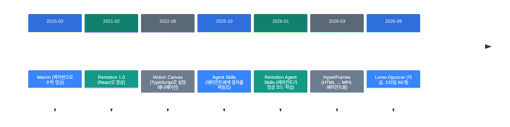
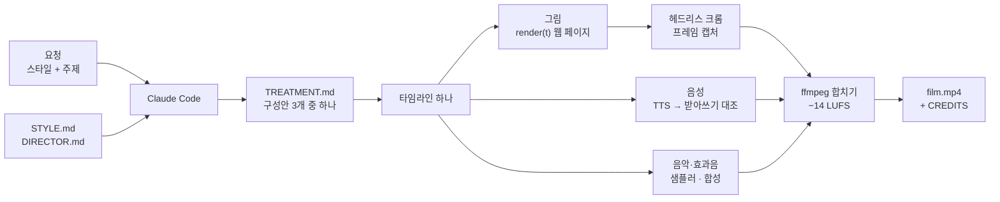

![[lemo-opuscar.mp4]]

[원문](https://github.com/lemomo-ai/lemo-opuscar) · [레포](https://github.com/lemomo-ai/lemo-opuscar) · [English](https://neocello-ku.github.io/trends/lemo-opuscar)

## 요약

Lemo-Opuscar는 Claude Code가 코드만으로 짧은 영화를 만들게 하는 스타일 묶음입니다. 스타일 66개마다 지침 한 장과 데모 영화 소스가 들어 있습니다. 2026년 9월 26일에 나왔고 6주 만에 GitHub 별 1만 3천 개를 넘었습니다.

흐름으로 보면 Manim과 Remotion이 연 "코드로 그리는 영상" 갈래의 최신 단계입니다. 2026년에는 코딩 에이전트가 그 코드를 대신 쓰기 시작했습니다. 이 레포는 그 위에 미술과 연출 지침을 얹었습니다.

결론부터 말하면 렌더링 기법은 새롭지 않습니다. 새로운 쪽은 스타일과 연출을 문서로 굳혀 에이전트에게 넘긴 제품입니다. 용어가 낯설면, 아래 '처음이라면' 섹션부터 읽으세요.

## 흐름 속 위치: 왜 지금 이 이야기인가

AI 영상은 두 갈래로 갑니다. 한 갈래는 영상 모델이 픽셀을 직접 그립니다. 다른 갈래는 사람이나 에이전트가 코드를 쓰고 컴퓨터가 그 코드를 프레임으로 찍습니다.

두 번째 갈래는 오래되었습니다. 바뀐 점은 코드를 쓰는 쪽입니다. 2026년부터 코딩 에이전트가 영상 코드를 대신 씁니다.



Lemo-Opuscar는 마지막 단계에 있습니다. Claude Opus 5.5가 2026년 9월 22일에 나왔고 이 레포는 나흘 뒤에 열렸습니다. 레포는 스타일을 Opus 5.5에 맞춰 조율했다고 밝힙니다.

이 흐름은 지난 트렌드 노트와 이어집니다. 첫째는 「Genie 4」(2026-10-29)입니다. Genie 4는 모델이 픽셀을 그리는 갈래이고 Lemo-Opuscar는 그 반대편입니다.

「LongCat-Video-Avatar 1.5」(2026-05-21)도 모델 갈래입니다. 「CogFree」(2026-10-11)는 생각하는 동작을 스킬 파일로 쪼갰습니다. Lemo-Opuscar도 스타일 하나를 STYLE.md 한 장에 담습니다.

### 이 기술은 무엇이 새로운가

| 무엇 | 새로운 정도 | 이유 |
| --- | --- | --- |
| 웹 페이지 → 프레임 캡처 → ffmpeg (기법) | 낮음 | Remotion(2021)과 HyperFrames(2026-03)가 같은 방식입니다. |
| 스타일 66개 + 연출 지침 묶음 (제품) | 중간 | API 사용법이 아니라 미술·연출 규칙을 줍니다. 다른 모델과 비교한 결과는 없습니다. |
| 타임라인 하나로 그림·음성·음악 맞추기 (인프라) | 중간 | 음성 받아쓰기 대조와 자막 읽기 시간 검사가 있습니다. 새 규격은 아닙니다. |

정리하면 Lemo-Opuscar는 새 발명이 아니라 오래된 기법의 제품화입니다. 볼 만한 점은 렌더 엔진이 아니라 지침 문서입니다. "어떻게 그리나"보다 "무엇을 어떤 규칙으로 그리나"를 문서로 넘깁니다.

## 처음이라면: 이게 무슨 이야기인가요

### 화가 대신 악보를 건네기

그림을 원하는 사람에게 두 가지 길이 있습니다. 하나는 화가에게 "이런 그림"이라고 말하고 결과를 기다리는 길입니다. 다른 하나는 "몇 초에 어디에 무슨 색을 칠하라"는 악보를 써서 기계에게 연주시키는 길입니다.

영상 모델은 첫 번째 길입니다. 결과가 빠르지만 같은 부탁에도 매번 다른 그림이 나옵니다. 코드로 그리는 영상은 두 번째 길입니다. 같은 악보는 언제 돌려도 같은 영상을 냅니다.

Lemo-Opuscar는 그 악보를 AI 에이전트가 쓰게 합니다. 그리고 "수채화풍 악보는 이렇게 쓴다" 같은 작곡 규칙을 66개 미리 줍니다.

### 왜 좋은가

- 같은 코드는 같은 영상을 냅니다. 한 장면만 고쳐 다시 찍을 수 있습니다.
- 숫자와 글자가 정확합니다. 데이터와 지도를 코드로 그리기 때문입니다.
- 영상 모델 사용료와 GPU 서버가 필요 없습니다. 대신 에이전트 토큰이 듭니다.

### 이런 곳에 씁니다

- 데이터나 과정을 설명하는 30초~2분 영상
- 제품 소개, 발표용 짧은 영상
- 브랜드 색과 글꼴을 지키는 반복 영상 (내 스타일로 저장)

### 이 글에 나오는 이름들

| 용어 | 쉬운 뜻 |
| --- | --- |
| 코딩 에이전트 | 코드를 쓰고 실행까지 하는 AI. 여기서는 Claude Code. |
| 스킬·플러그인 | 에이전트에게 일하는 절차를 파일로 주는 묶음. |
| STYLE.md | 스타일 하나의 불변 규칙. 질감, 색, 글꼴, 움직임, 카메라, 소리. |
| 렌더링 | 코드를 실제 화면 프레임으로 찍어 내는 일. |
| 헤드리스 브라우저 | 화면 없이 도는 크롬. 웹 페이지를 프레임으로 찍습니다. |
| TTS | 글을 읽어 주는 음성 합성. 기본은 Kokoro입니다. |
| LUFS | 소리 크기 단위. 완성 영상은 약 −14 LUFS로 맞춥니다. |

## 동작 방식

영상 하나는 웹 페이지 하나입니다. 페이지는 시각 `t`를 받으면 그 순간의 그림을 그리는 함수 `render(t)`를 가집니다. 타임라인 하나가 그림, 음성, 음악, 효과음, 자막을 함께 움직입니다.



에이전트는 데모를 보기 전에 자기 구성안부터 씁니다. 데모의 이야기를 베끼지 않기 위해서입니다. 납품 전에는 데모와 6가지 항목을 비교해 4가지 이상 달라야 합니다.

납품 전 검사도 정해져 있습니다.

| 검사 | 내용 |
| --- | --- |
| 화면 글자 | 글자마다 읽을 시간이 충분한지 `readcheck.mjs`로 봅니다. |
| 음성 | TTS 결과를 받아쓰기로 다시 읽어 대본과 맞춥니다. |
| 소리 크기 | 약 −14 LUFS. 검은 프레임이 없는지 봅니다. |
| 수정 횟수 | 검사에서 나온 문제는 한 번에 고치고, 한 번 더 확인합니다. |

## 준비물·실행

| 항목 | 요구 사항 |
| --- | --- |
| 에이전트 | Claude Code. 스타일은 Opus 5.5에 맞춰져 있습니다. |
| 시스템 도구 | Node 20 이상, ffmpeg 7 이상, Python 3.11 이상 또는 uv |
| 운영체제 | macOS(Apple silicon)에서 개발했습니다. Linux는 "될 것"이라고만 씁니다. Windows는 Git Bash나 WSL. |
| GPU | 3D·셰이더 스타일에는 GPU가 좋다고 씁니다. 사양 숫자는 README에 없습니다. |
| 디스크 | 기본 약 350MB. 음성을 더하면 약 0.55GB와 Whisper 모델이 더 듭니다. |
| 시간 | README는 한 편에 30~60분이라고 씁니다. 토큰 양은 숫자가 없습니다. |

### 1단계. ffmpeg 버전을 확인하세요

```bash
ffmpeg -version
```

Ubuntu 24.04라면 기본 ffmpeg 6.1은 너무 오래되었습니다. 이 경우에는 정적 빌드를 받으세요.

### 2단계. 플러그인을 설치하세요

```sh
claude plugin marketplace add lemomo-ai/lemo-opuscar
claude plugin install lemo-opuscar@lemolab
```

처음 쓸 때 지침과 도구를 `~/lemo-opuscar`에 받습니다. 영화 프로젝트는 시작한 폴더에 생깁니다.

### 3단계. 원하는 영화를 한 줄로 말하세요

README의 예시는 이렇습니다.

```text
Make a 45-second film in the watercolor style about the coffee farm my family runs. Warm female narrator.
```

스타일 이름은 [스타일 목록](https://github.com/lemomo-ai/lemo-opuscar/blob/main/styles/README.md)에서 고르세요. 뭘 할지 모르겠으면 `/lemo-opuscar:lemo-opuscar`만 입력하세요.

### 4단계. 처음 질문 한 번에 답하세요

에이전트는 처음에 한 번만 묻습니다. 주제에서 정하지 못한 것, 내 음성·음악 자료가 있는지, 스토리보드를 먼저 볼지 묻습니다.

### 5단계. 결과물을 확인하세요

프로젝트 폴더에 아래 파일이 생깁니다.

- `<name>.mp4`와 `poster.jpg`
- `<name>.srt` (내레이션이 있을 때)
- `TREATMENT.md` (구성안)
- `CREDITS` (외부 에셋과 라이선스)
- 소스와 `build.sh` (명령 하나로 다시 만들기)

`CREDITS`를 꼭 읽으세요. 영화 속 자료의 책임은 만든 사람에게 있습니다.

### 6단계. 내 스타일로 저장하세요 (선택)

```text
I want to change the Ukiyo-e style into my own version.
```

이렇게 말하면 에이전트가 질문을 하나씩 던지며 바꿀 점을 정합니다. 마음에 들면 `~/lemo-my-styles/<name>/`에 저장됩니다.

## 팩트체크

게시물이 없어서 README의 주장을 코드와 파일로 대조했습니다.

| 주장 (README) | 확인 결과 | 판정 |
| --- | --- | --- |
| 바로 쓸 스타일 66개 | `styles/` 폴더가 66개이고, 모두 STYLE.md와 데모 소스가 있습니다. | 일치 |
| 영상 생성도, 스톡 영상도 없다 | 영상 모델 호출은 코드에 없습니다. 다만 8개 스타일은 공공 기록 영상을 잘라 씁니다. | 조건부 |
| 모든 프레임을 Opus 5.5가 코드로 썼다 | 66개 데모 소스는 있습니다. "Opus 5.5가 썼다"는 작성자의 말이고 기록은 없습니다. | 조건부 |
| 음악은 무료 샘플 라이브러리로 만든 창작곡 | 샘플러 코드와 악기 라이브러리 5종을 받는 스크립트가 있습니다. | 일치 |
| 음성은 TTS 내레이션 | 기본은 오프라인 Kokoro입니다. 데모 6편은 온라인 TTS라 CC BY에서 빠집니다. | 일치 |
| 한 편에 30~60분, 토큰은 꽤 든다 | 측정 기록이나 토큰 수가 레포에 없습니다. | 근거 없음 |
| Opus 5.5에 맞췄고, 다른 모델은 못 따라 할 수 있다 | 다른 모델과 비교한 결과가 없습니다. 경고로 받아들이세요. | 조건부 |
| OPUSCAR 98: 2D 77 · 2.5D 4 · 3D 17 | 데이터 파일의 98개와 맞습니다. 다만 81개는 화면에 2.5초씩만 나옵니다. | 일치 |
| 코드 MIT, 데모 영화 CC BY 4.0 | LICENSE는 MIT입니다. 외부 에셋은 각 CREDITS를 따릅니다. | 일치 |

### "스톡 영상 없음"을 자세히 보면

그림 쪽에는 영상 모델이 없습니다. Canvas, WebGL, three.js 코드가 프레임을 그립니다. 하지만 Edit & Documentary 8개는 기록 영상을 잘라 씁니다.

그 영상은 미국 국립기록원(NARA) 같은 퍼블릭 도메인 자료입니다. 3D 데모는 Poly Haven의 CC0 모델과 조명 파일을 씁니다. 그래서 "유료 스톡 라이브러리 없음"이 정확한 말입니다.

### OPUSCAR 98을 다시 계산하면

2D 77 + 2.5D 4 + 3D 17 = 98로 맞습니다. 스타일별 화면 시간을 더하면 아래와 같습니다.

- 81개 × 2.5초 = 202.5초
- 10개 × 5초 = 50초
- 4개 × 3.33초 = 13.3초
- 3개 × 6.67초 = 20초

합은 약 286초, 4분 46초입니다. 6분 31초 영화에서 스타일 하나는 대부분 2.5초 나옵니다. 이 98개는 `styles/`의 66개와 별개이고, 프레임 한 장과 스타일 프롬프트만 공개합니다.

### 같은 시기 독립 측정

코드 렌더링 영상의 품질을 비교한 공개 벤치마크는 찾지 못했습니다. Remotion Agent Skills, HyperFrames와 같은 주제로 비교한 자료도 없습니다. 품질은 갤러리의 데모 영화로만 판단할 수 있습니다.

## 언제 무엇을 쓰나

| 상황 | 방법 |
| --- | --- |
| 스타일이 분명한 짧은 영화가 필요하다 | Lemo-Opuscar에서 스타일을 고릅니다. |
| React로 앱처럼 영상을 짜고 싶다 | Remotion과 Remotion Agent Skills를 씁니다. |
| HTML·CSS로 짜고, 라이선스 걱정을 줄이고 싶다 | HyperFrames(Apache-2.0)를 씁니다. |
| 수식·도형 위주 설명 영상 | Manim을 씁니다. |
| 사진처럼 실감 나는 장면이 필요하다 | 영상 생성 모델을 씁니다. 코드 렌더링으로는 어렵습니다. |
| Claude 말고 다른 모델로 돌린다 | 결과를 먼저 짧게 시험합니다. 레포가 품질을 보장하지 않습니다. |

## 출처

- Lemo-Opuscar 레포: https://github.com/lemomo-ai/lemo-opuscar
- 갤러리: https://lemomo-ai.github.io/lemo-opuscar/
- Manim: https://github.com/3b1b/manim
- Remotion v1.0.0 릴리스: https://github.com/remotion-dev/remotion/releases/tag/v1.0.0
- Motion Canvas: https://github.com/motion-canvas/motion-canvas
- Remotion Agent Skills: https://github.com/remotion-dev/skills
- HyperFrames: https://github.com/heygen-com/hyperframes
- Claude Opus 5.5 출시 기사: https://technews.tw/2026/09/23/anthropic-upgrades-claude-with-new-opus-5-5-model/

## 이어지는 글

- [[trends/genie-4|Genie 4: 소리 내고 말하는 세계를 실시간으로 그리는 모델]]
- [[trends/longcat-avatar-15|LongCat-Video-Avatar 1.5: 사진 한 장과 음성으로 말하는 영상]]
- [[trends/cogfree|CogFree: 생각하는 동작 28가지를 스킬로 쪼개기]]

