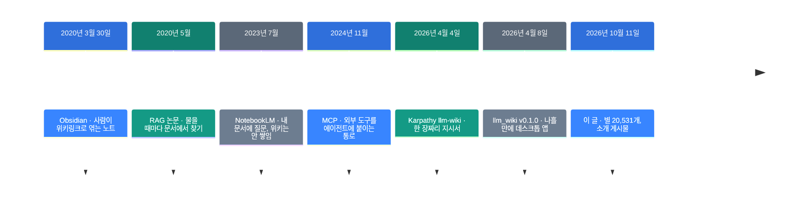
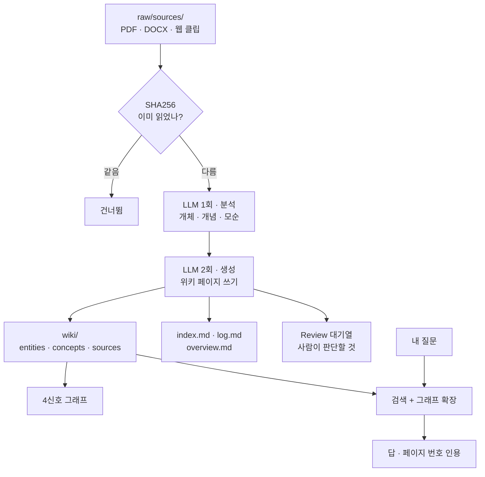

![[llm-wiki.mp4]]

[원문](https://x.com/trendtech33566/status/2109412212431565299) · [레포](https://github.com/nashsu/llm_wiki) · [English](https://neocello-ku.github.io/trends/llm-wiki)

## 요약

내 문서를 읽고 LLM이 마크다운 위키를 쌓아 주는 데스크톱 앱입니다. 일본어 소개 게시물이 2026년 10월 11일에 이 앱을 알렸습니다.

흐름으로 보면 Karpathy가 4월 4일에 올린 한 장짜리 지시서의 구현입니다. 레포는 그 나흘 뒤에 생겼습니다.

결론부터 적겠습니다. 기법은 새롭지 않고, 지시서를 설치형 앱으로 옮긴 점이 새롭습니다. 그리고 지금 막 나온 것도 아닙니다. 6개월 된 프로젝트입니다. 용어가 낯설면, 아래 "처음이라면" 섹션부터 읽으세요.

## 흐름 속 위치: 왜 지금 이 이야기인가

내 문서에 질문하는 방식은 지난 5년 동안 RAG였습니다. 물을 때마다 문서에서 관련 토막을 찾아 답을 만듭니다. 답이 끝나면 아무것도 남지 않습니다.

다섯 문서를 엮어야 하는 질문을 또 하면, 모델은 그 엮는 일을 처음부터 다시 합니다. 쌓이지 않는다는 점이 이 방식의 약점이었습니다.

2026년 4월 4일, Karpathy가 다른 순서를 적은 gist를 올렸습니다. 답할 때 찾지 말고, 자료가 들어올 때 미리 위키를 고쳐 두자는 내용입니다.



LLM Wiki는 마지막에서 두 번째 줄에서 시작했습니다. gist가 올라온 지 **나흘 만에** 첫 릴리스가 나왔습니다.

### 같은 지시서에서 세 가지가 나왔습니다

한 주 안에 서로 다른 구현이 셋 나왔습니다. 2026년 10월 12일에 GitHub API로 확인한 숫자입니다.

| 구현 | 생성일 | 별 | 형태 |
| --- | --- | --- | --- |
| lucasastorian/llmwiki | 2026-04-04 | 1,681 | 웹 앱 + MCP 서버 |
| Astro-Han/karpathy-llm-wiki | 2026-04-05 | 2,472 | 에이전트 스킬 하나 |
| **nashsu/llm_wiki** | 2026-04-08 | **20,531** | 데스크톱 앱 |

별 수가 10배 넘게 벌어졌습니다. 가장 늦게 시작한 쪽이 가장 많이 받았습니다. 차이는 형태입니다. 설치해서 창을 여는 앱만 터미널을 안 쓰는 사람에게 닿았습니다.

다만 별 수는 인기 숫자입니다. 품질 숫자가 아닙니다.

### 이 아카이브의 지난 글과 이어지는 곳

- [조사하는 AI 만들기: 증거 원장을 중심에 두는 설계](/ko/trends/research-engineering) (2026-10-07)
- [EmbeddingGemma 2: 글·그림·소리·영상을 한 벡터로](/ko/trends/embeddinggemma-2) (2026-10-07)
- [Foresight: 구글이 낸 맥용 회의 노트 앱](/ko/trends/foresight) (2026-10-12)

첫 글의 증거 원장과 이 앱의 출처 추적은 같은 생각입니다. 둘째 글의 모델은 이 앱의 벡터 검색에 꽂을 수 있습니다. 셋째 글은 내 자료를 내 기계에서 찾는 같은 흐름입니다.

### 이 기술은 무엇이 새로운가

| 무엇 | 새로운 정도 | 이유 |
| --- | --- | --- |
| 위키 누적·링크·단계 분할 (기법) | 낮음 | 전부 기존 기법입니다. 패턴 자체도 나흘 전 gist가 적었습니다. |
| 복붙 지시서를 설치형 앱으로 (제품) | 높음 | 6개월에 릴리스 61번, 별 20,531개. 창 세 칸과 설정 화면을 갖췄습니다. |
| 위키를 다른 에이전트에 여는 통로 (인프라) | 중간 | 로컬 HTTP API와 MCP 서버를 붙였습니다. 부품인 MCP는 2024년 것입니다. |

정리하면 이렇습니다. 새 발명이 아니라 나흘 된 패턴의 빠른 제품화입니다. 볼 것은 기법이 아니라 속도와 형태입니다. 같은 글을 읽은 셋 중 앱을 만든 쪽만 20,531개를 받았습니다.

## 처음이라면: 이게 무슨 이야기인가요

### 도서관 사서와 복사기

자료를 모아 두고 질문하는 방법에는 두 가지가 있습니다.

첫째는 복사기입니다. 질문을 받을 때마다 서가로 달려가 관련 쪽을 복사해 옵니다. 그 복사본을 읽고 답합니다. 답이 끝나면 복사본을 버립니다. 내일 비슷한 질문이 오면 또 달려갑니다. RAG가 이 방식입니다.

둘째는 사서입니다. 새 책이 들어오면 그 자리에서 읽습니다. 그리고 색인 카드를 고칩니다. 저자 카드, 주제 카드, 이미 있던 카드와 어긋나는 대목까지 적어 둡니다. 질문이 오면 이미 정리된 카드를 봅니다.

LLM Wiki는 사서 쪽입니다. 자료를 넣는 순간 일이 끝나 있습니다.

### 왜 좋은가

- 자료가 늘수록 위키가 두꺼워집니다. 물어본 적이 없어도 정리돼 있습니다.
- 자료끼리 어긋나는 대목을 수집할 때 찾아 적어 둡니다.
- 결과가 보통 마크다운 폴더라 Obsidian으로 바로 열립니다.

### 이런 곳에 씁니다

- 몇 주에 걸쳐 논문 수십 편을 읽는 조사
- 읽은 책의 인물과 줄거리를 쌓아 가는 독서 노트
- 회의록·고객 통화 기록을 모아 두는 팀 위키

### 이 글에 나오는 이름들

| 용어 | 쉬운 뜻 |
| --- | --- |
| RAG | 물을 때마다 문서에서 관련 토막을 찾아 모델에게 붙여 주는 방법. |
| 수집 (ingest) | 자료 한 개를 읽혀서 위키 페이지로 만드는 동작. |
| 위키링크 | `[[이름]]` 모양의 링크. 마크다운 노트끼리 잇습니다. |
| frontmatter | 마크다운 파일 맨 위의 YAML 머리말. 출처 목록이 여기 들어갑니다. |
| 임베딩 | 글을 숫자 목록으로 바꾼 것. 뜻이 가까우면 숫자도 가깝습니다. |
| Louvain | 그래프에서 무리를 자동으로 찾는 알고리즘. |
| MCP | 외부 도구를 에이전트에 붙이는 규약. 2024년 11월에 나왔습니다. |
| Tauri | Rust로 데스크톱 앱을 만드는 틀. 이 앱의 바탕입니다. |

## 동작 방식

자료 하나를 넣으면 LLM을 **두 번** 부릅니다. 한 번에 읽고 쓰게 하지 않습니다.



세 층으로 나뉩니다. `raw/sources/`는 원본이고 앱이 고치지 않습니다. `wiki/`는 LLM이 전부 씁니다. `purpose.md`와 `schema.md`는 규칙입니다.

읽은 자료는 SHA256으로 기억합니다. 안 바뀐 파일은 다시 부르지 않아서 토큰이 덜 듭니다.

### 질문할 때 거치는 길

| 단계 | 하는 일 |
| --- | --- |
| 1 | 낱말 검색. 한국어·중국어는 2글자씩 쪼갭니다. 제목이 맞으면 10점을 더합니다. |
| 1.5 | 벡터 검색. 선택 사항이고 기본값은 꺼짐입니다. |
| 2 | 그래프 확장. 검색 결과를 씨앗으로 2단계까지 이웃을 모읍니다. |
| 3 | 예산 배분. 위키 60%, 대화 기록 20%, 색인 5%, 지시문 15%. |
| 4 | 문맥 조립. 페이지에 번호를 붙이고 `[1]` 모양으로 인용하게 합니다. |

4신호 관련도는 이렇게 매깁니다. 같은 출처를 공유하면 ×4.0, 직접 링크는 ×3.0입니다. 이웃을 공유하면 ×1.5, 같은 타입이면 ×1.0입니다.

## 준비물과 실행

### 준비물

| 항목 | 값 |
| --- | --- |
| 운영체제 | macOS(Apple Silicon), Windows, Linux |
| RAM · 디스크 | README에 없음 |
| 앱 설치 | 사전 빌드 파일이 있어서 빌드 도구가 필요 없습니다 |
| 소스 빌드 | Node.js 20+, Rust 1.88+, protoc |
| LLM | 외부 API 키 또는 로컬 Ollama. 둘 중 하나는 있어야 합니다 |
| 라이선스 | GNU GPL v3.0 |

앱은 Tauri라 가볍습니다. 실제 부담은 LLM 쪽입니다. 자료 한 개마다 호출이 두 번 가므로, 외부 API를 쓰면 요금이 자료 수에 비례합니다.

### 설치

사전 빌드 파일을 받는 길이 가장 짧습니다.

1. Releases 페이지를 여세요.
2. 내 운영체제에 맞는 파일을 받으세요.
3. 앱을 열고 새 프로젝트를 만드세요.
4. Settings에서 LLM 제공자와 모델을 고르세요.
5. Sources 탭에서 문서를 넣으세요.

```
https://github.com/nashsu/llm_wiki/releases
```

소스에서 빌드하려면 README의 명령을 그대로 쓰세요.

```bash
git clone https://github.com/nashsu/llm_wiki.git
cd llm_wiki
npm install
npm --prefix mcp-server ci && npm run mcp:build
npm run tauri build
```

### API 키 없이 돌리는 길

README의 제공자 목록에는 없지만, 코드에는 CLI 제공자가 둘 더 있습니다. `src/components/settings/llm-presets.ts`에 "Claude Code CLI (local)" 프리셋이 있습니다. 설명문이 `Uses the local 'claude' binary — no API key needed`입니다.

`src/lib/has-usable-llm.ts`의 `PROVIDERS_WITHOUT_KEY`에 네 개가 들어 있습니다.

```
ollama · custom · claude-code · codex-cli
```

이미 Claude Code나 Codex를 쓰고 있으면 키를 따로 안 사도 됩니다. 다만 README에 적혀 있지 않은 길입니다. 쓰기 전에 Settings에서 연결 시험을 돌려 보세요.

### 다른 에이전트에 위키를 열기

앱이 `http://127.0.0.1:19828`에 JSON API를 엽니다. 토큰으로 막고 127.0.0.1만 받습니다. Settings → API + MCP에서 켜고 토큰을 만듭니다.

| 경로 | 하는 일 |
| --- | --- |
| `GET /api/v1/projects` | 프로젝트 목록 |
| `POST /api/v1/projects/{id}/search` | 낱말 + 벡터 하이브리드 검색 |
| `GET /api/v1/projects/{id}/graph` | 위키링크 그래프 |
| `GET /api/v1/projects/{id}/reviews` | 사람 판단 대기 항목 |
| `POST /api/v1/projects/{id}/sources/rescan` | 소스 폴더 다시 읽기 |

MCP 서버도 같은 API를 부릅니다. 에이전트 스킬은 별도 레포에 있습니다.

```bash
npx skills add https://github.com/nashsu/llm_wiki_skill.git --skill llm-wiki
```

## 팩트체크

원 게시물은 이렇게 적었습니다.

> LLM Wiki、⭐️約2万。手持ちの資料からAIが自動でWikiを育てるデスクトップアプリ。
> ・PDFやOffice文書、Web記事をWiki化 ・関連する知識をリンクでつなぐ
> ・資料の追加や変更を検知して更新 ・元の資料をたどりながら質問できる

| 주장 | 확인 결과 | 판정 |
| --- | --- | --- |
| 별 약 2만 개 | 20,531개입니다. 2026년 10월 12일 GitHub API 값입니다. | 일치 |
| AI가 자동으로 위키를 키우는 데스크톱 앱 | 맞습니다. Tauri v2 앱이고, 두 단계 수집이 페이지를 쓰고 고칩니다. | 일치 |
| PDF·오피스 문서·웹 기사를 위키로 | 맞습니다. PDF, DOCX, PPTX, XLSX, EPUB/MOBI, 크롬 클리퍼를 받습니다. | 일치 |
| 관련 지식을 링크로 이음 | 맞습니다. 위키링크에 4신호 관련도와 Louvain 군집을 더했습니다. | 일치 |
| 자료 추가·변경을 감지해 갱신 | 폴더 감시와 SHA256 캐시가 있습니다. 단 설정에서 켜야 하고, 감시 대상은 `raw/sources/` 하나입니다. | 조건부 일치 |
| 원 자료를 따라가며 질문 | 맞습니다. 모든 페이지 frontmatter에 `sources: []`가 붙고, 원문만 읽는 모드가 있습니다. | 일치 |
| (읽히는 뜻) 지금 막 나온 것 | 아닙니다. 레포는 2026년 4월 8일에 생겼습니다. 최신 릴리스는 9월 28일이고 그 뒤로 조용합니다. | 새 소식 아님 |

### README가 자기 자신과 어긋나는 곳

게시물이 아니라 README를 따로 봤습니다. 네 줄이 코드·레포와 맞지 않습니다.

| README 문장 | 코드·레포에서 확인한 것 | 판정 |
| --- | --- | --- |
| 벡터 검색으로 recall이 58.2%에서 71.4%로 | 벤치마크 코드도, 질의 집합도, 측정 방법도 레포에 없습니다. | 근거 없음 |
| 두 단계 수집이 품질을 크게 올린다 | 한 단계와 비교한 결과가 레포에 없습니다. | 근거 없음 |
| 인터페이스는 영어 + 중국어 | `src/i18n/`에 en, zh, it, ru 네 개가 있습니다. 한국어는 없습니다. | README가 옛 내용 |
| 제공자는 OpenAI·Anthropic·Google·Ollama·Custom | 코드의 제공자는 아홉 개입니다. azure, minimax, claude-code, codex-cli가 더 있습니다. | README가 적게 적음 |

마지막 줄은 사용자에게 유리한 방향의 오차입니다. 나머지 둘은 수치를 믿지 말라는 뜻입니다.

### 한국어는 어디까지 되나

갈라서 봐야 합니다. 세 층이 서로 다릅니다.

- **화면 글자**: 안 됩니다. `src/i18n/`에 한국어 파일이 없습니다.
- **문서 읽기**: 됩니다. 검색이 중국어·일본어·한국어를 2글자씩 쪼갭니다.
- **위키 생성 언어**: README는 영어와 중국어만 적습니다. 모델에게 한국어로 쓰게 하는 설정은 문서에 없습니다.

한국어 README는 있습니다. 앱 화면과는 별개입니다.

## 언제 무엇을 쓰나

| 상황 | 방법 |
| --- | --- |
| 몇 달에 걸쳐 한 주제를 파고듦 | LLM Wiki. 쌓이는 쪽이 유리합니다. |
| 문서 열 개를 오늘 한 번만 읽음 | NotebookLM 같은 RAG. 위키를 쌓을 이유가 없습니다. |
| 터미널이 편하고 앱을 안 깔고 싶음 | Karpathy gist 또는 에이전트 스킬 구현. |
| 자료를 밖에 못 보냄 | LLM Wiki + Ollama. 모델까지 내 기계에 둡니다. |
| 화면이 한국어여야 함 | 지금은 못 씁니다. 영어 화면만 있습니다. |
| 이미 Obsidian 볼트가 있음 | LLM Wiki. 결과 폴더가 볼트로 바로 열립니다. |
| 사내 제품에 코드를 넣고 싶음 | 먼저 GPL v3 조건을 확인하세요. |

## 출처

- [원 게시물 (2026-10-11)](https://x.com/trendtech33566/status/2109412212431565299)
- [레포 nashsu/llm_wiki](https://github.com/nashsu/llm_wiki)
- [Karpathy gist llm-wiki.md (2026-04-04)](https://gist.github.com/karpathy/442a6bf555914893e9891c11519de94f)
- [에이전트 스킬 레포](https://github.com/nashsu/llm_wiki_skill)
- [같은 시기 구현 lucasastorian/llmwiki](https://github.com/lucasastorian/llmwiki)
- [같은 시기 구현 Astro-Han/karpathy-llm-wiki](https://github.com/Astro-Han/karpathy-llm-wiki)
- [RAG 논문 (2020-05)](https://arxiv.org/abs/2005.11401)
- [Obsidian 공개일 근거](https://en.wikipedia.org/wiki/Obsidian_(software))

## 이어지는 글

- [[trends/research-engineering|조사하는 AI 만들기: 증거 원장을 중심에 두는 설계]]
- [[trends/embeddinggemma-2|EmbeddingGemma 2: 글·그림·소리·영상을 한 벡터로]]
- [[trends/foresight|Foresight: 구글이 낸 맥용 회의 노트 앱, 소리가 기기를 안 떠납니다]]

