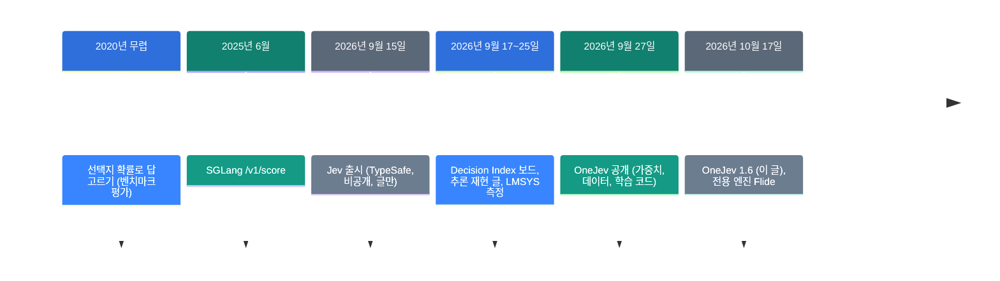
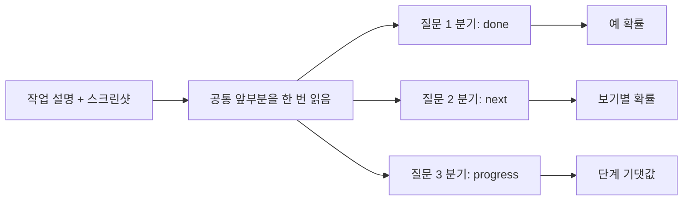

![[onejev.mp4]]

[원문](https://github.com/OmniJev/OneJev) · [레포](https://github.com/OmniJev/OneJev) · [English](https://neocello-ku.github.io/trends/onejev)

## 요약

OneJev는 화면, 사진, 영상, 글을 보고 정해진 질문에 확률로 답하는 공개 모델입니다. 비공개 Jev가 연 "고르기만 하는 모델"을 공개 가중치와 멀티모달로 옮긴 프로젝트입니다. 기법은 새롭지 않고 제품과 추론 서버 쪽이 중간 정도로 새롭습니다.

독립 리더보드에서 확률의 정확도는 좋았습니다. 하지만 처음 보는 영역의 점수는 README 숫자보다 크게 낮았습니다. 용어가 낯설면, 아래 '처음이라면' 섹션부터 읽으세요.

## 흐름 속 위치: 왜 지금 이 이야기인가

2026년 9월 15일, TypeSafe가 글을 쓰지 않고 답만 고르는 모델 Jev를 냈습니다. Jev는 가중치가 비공개이고 글만 읽습니다. 그 뒤 두 달 동안 같은 일을 하는 공개 모델이 쏟아졌습니다.

지난 노트 [로컬 LLM에게 글 대신 답을 고르게 하기](/trends/jev-local) (2026-10-06)는 그 첫 흐름을 다뤘습니다. 그 글은 Jev의 추론 방식만 재현했습니다. 학습한 가중치와 확률 보정은 빠져 있었습니다. OneJev는 바로 그 빠진 부분을 공개합니다.



이 글은 다섯째와 여섯째 단계입니다. 추론 방식을 흉내 내던 단계에서, 학습한 모델을 공개하는 단계로 넘어왔습니다.

### 이 기술은 무엇이 새로운가

| 무엇 | 새로운 정도 | 이유 |
| --- | --- | --- |
| 라벨 확률 + Brier 손실 + 온도 보정 (기법) | 낮음 | 셋 다 오래된 방법입니다 (1950년, 2017년, 2020년 무렵). |
| 공개 멀티모달 결정 모델 4종 (제품) | 중간 | Jev는 글만 읽습니다. 화면·영상을 읽고 학습 코드까지 연 것이 새롭습니다. 다만 공개 결정 모델은 이미 많습니다. |
| 분기 추론 + 호환 서버 (인프라) | 중간 | 공통 앞부분을 한 번만 읽고 질문마다 갈라집니다. Jev와 같은 API 형식이라 기존 SDK를 그대로 씁니다. |

정리하면, OneJev는 새 발명이 아닙니다. Jev가 연 범주를 공개 가중치로 옮긴 제품화입니다.

## 처음이라면: 이게 무슨 이야기인가요

### 결정 모델은 객관식 시험만 보는 학생입니다

ChatGPT 같은 모델은 서술형 시험을 봅니다. 질문을 받으면 문장으로 답을 씁니다. 결정 모델은 객관식만 봅니다. 답을 쓰지 않고 보기마다 자신 있는 정도를 숫자로 말합니다.

예를 들어 "송장을 냈나요?"라고 물으면 결정 모델은 "예 92%"라고 답합니다. "다음에 무엇을 하나요?"라고 물을 수도 있습니다. 그러면 "누르기 70%, 입력 20%, 스크롤 8%, 멈춤 2%"라고 답합니다.

### 확률이 정직해야 쓸모가 있습니다

모델이 "90% 확신"이라고 말한 문제를 100개 모았다고 생각해 보세요. 정직한 모델이면 그중 약 90개가 맞습니다. 이것을 **보정**이라고 부릅니다. 보정이 좋으면, "85% 넘으면 자동 처리" 같은 기준을 믿고 쓸 수 있습니다.

### 왜 좋은가

- 빠릅니다. 글을 쓰지 않으므로 모델을 한두 번만 실행합니다.
- 답이 항상 보기 안에 있습니다. 엉뚱한 문장이 나오지 않습니다.
- 확신의 정도가 숫자로 나옵니다. 사람에게 넘길 기준을 코드로 정할 수 있습니다.

### 이런 곳에 씁니다

- 화면을 보고 컴퓨터 사용 에이전트의 작업이 끝났는지 판단하기
- 사진을 보고 올려도 되는 사진인지 거르기
- 영상을 보고 지금 어느 단계인지 고르기

### 이 글에 나오는 이름들

| 용어 | 쉬운 뜻 |
| --- | --- |
| 결정 모델 | 글을 쓰지 않고 정해진 보기마다 확률만 돌려주는 모델. |
| Jev | TypeSafe의 비공개 결정 모델. 글만 읽습니다. |
| System One API | Jev가 쓰는 요청 형식. OneJev 서버도 같은 형식을 받습니다. |
| 보정 | 모델이 말한 확률과 실제로 맞은 비율이 같아지게 하는 일. |
| ECE | 보정 오차. 말한 확률과 실제 정답률의 평균 차이. 낮을수록 좋습니다. |
| forward | 모델에 입력을 한 번 통과시키는 계산. |
| 미세 조정 | 이미 학습된 모델을 내 데이터로 조금 더 학습시키는 일. |
| GGUF | llama.cpp가 읽는 모델 파일 형식. 맥과 CPU에서도 돌립니다. |
| Decision Index | 결정 모델을 같은 문제로 채점하는 공개 리더보드. |

## 동작 방식

OneJev는 Qwen 모델을 미세 조정한 것입니다. 질문 종류는 세 가지입니다.

| 질문 종류 | 무엇을 돌려주나 | 예 |
| --- | --- | --- |
| `noul` | "예"일 확률 하나 | 송장을 냈나? → 0.92 |
| `choice` | 보기마다 확률 (보기 최대 255개) | 다음 동작 → 누르기 0.70 … |
| `score` | 단계의 기댓값 (단계 2~10개) | 진행 정도 → 2.4 / 3 |

질문이 여러 개이면 화면과 작업 설명은 한 번만 읽습니다. 그다음 질문마다 갈라져서 답 자리의 확률만 읽습니다.



질문이 하나이면 forward 1번으로 끝납니다. 여러 개이면 공통 앞부분 1번과 분기 묶음 1번입니다. 토큰은 하나도 생성하지 않습니다.

학습은 Qwen3.5-0.8B, 4B, 9B와 Qwen3.8-27B를 바탕으로 했습니다. 비전 부분은 고정하고 1 epoch 학습했습니다. 손실은 교차 엔트로피에 Brier 점수를 더했습니다. Brier 점수는 확률 예보를 채점하는 오래된 방법입니다.

## 준비물

| 항목 | 요구 사항 |
| --- | --- |
| GPU | README에 메모리 요구량이 없습니다. 아래 추정을 보세요. |
| Flide 경로 | NVIDIA GPU. 글, 이미지, 영상 모두 됩니다. |
| llama.cpp 경로 | GGUF 파일. 글과 이미지만 됩니다. 맥에서도 됩니다. |
| Python | 3.10 이상 (qev), 예시는 3.12 |

메모리 추정은 bf16 가중치만 센 값입니다. 파라미터 수에 2바이트를 곱했습니다.

0.8B는 약 1.7GB, 4B는 약 9.1GB입니다. 9B는 약 18.8GB, 27B는 약 54.7GB입니다. 이미지와 캐시 메모리는 따로 더 듭니다.

## 실행

### 1단계. 서버를 켜세요 (NVIDIA GPU)

```bash
uv venv -p 3.12 && source .venv/bin/activate
uv pip install flide torchvision
flide serve --model OmniJev/OneJev1.6-0.8B --port 8000
```

처음 실행하면 모델을 내려받습니다. 서버는 포트 8000에서 기다립니다.

### 1단계 (맥 또는 GGUF). llama.cpp로 서버를 켜세요

llama.cpp를 먼저 설치하세요. 맥에서는 `brew install llama.cpp`를 쓰세요.

```bash
pip install git+https://github.com/OmniJev/OneJev.git
qev serve --gguf mradermacher/OneJev1.6-0.8B-GGUF:Q8_0 --port 8000
```

이 경로는 영상을 받지 않습니다. 영상이 필요하면 Flide 경로를 쓰세요.

### 2단계. 스크린샷 한 장으로 질문하세요

다른 터미널을 여세요. `screenshot.png`를 준비하세요. 그다음 아래 명령을 실행하세요.

```bash
IMG=$(base64 -w0 screenshot.png)
curl http://localhost:8000/v1/systemone -H "Content-Type: application/json" -d @- <<EOF
{
  "state": {"task": "Pay the open invoice from ACME", "screen": "<image:1>"},
  "media": [{"type": "image", "data": "data:image/png;base64,$IMG"}],
  "questions": {
    "done": {"type": "noul", "instructions": "The invoice has been paid"},
    "next": {"type": "choice", "instructions": "What should the agent do next?",
             "criteria": {"click": "click an element", "type": "type text", "scroll": "scroll", "stop": "stop"}},
    "progress": {"type": "score", "instructions": "How far along is the task?",
                 "criteria": ["not started", "halfway", "almost done", "done"]}
  }
}
EOF
```

`answers.done.noul`은 "예"일 확률입니다. `answers.next.probabilities`는 보기마다 확률입니다. `answers.progress.score`는 단계의 기댓값입니다.

### 3단계 (선택). 내 데이터로 다시 학습하세요

```bash
pip install -e ".[train]"
hf download OmniJev/OneJev-Data sample/sample-100.parquet --repo-type dataset --local-dir data/onejev
python -m train.unpack data/onejev --sample
torchrun --nproc-per-node 4 -m train.sft --config train/configs/onejev_4b_full.yaml
```

이 명령은 레포를 클론한 폴더에서 실행하세요. 4B 예시는 GPU 4장을 씁니다. GPU 수에 맞춰 `--nproc-per-node`를 바꾸세요.

## 팩트체크

| 주장 (README·모델 카드) | 확인 결과 | 판정 |
| --- | --- | --- |
| 0.8B·4B·9B·27B 네 크기 | Hugging Face에 4종이 있습니다. 11월 8일에 31B가 더 나왔지만 README에 없습니다. | 일치 |
| 한 번의 forward로 답한다 | 질문 1개는 1번, 여러 개는 공통 앞부분 1번과 분기 1번입니다. 토큰을 생성하지 않습니다. | 일치 |
| 보정된 확률 | 레포에는 보정 수치가 없습니다. 독립 보드의 ECE는 4B 0.025, Jev 1.14는 0.080입니다. | 일치 (독립 측정) |
| 공개 Decision Index 4B 62.01 | 보드 원자료의 공개 부분은 61.95입니다. 네 크기 모두 차이가 0.07 이하입니다. | 일치 |
| 1.5보다 +6.1, +7.1, +6.3, +5.8 | 직접 계산하면 6.11, 7.12, 6.28, 5.85입니다. | 일치 |
| 체급 1위 (0.8B·4B·9B) | 10월 16일 공개 부분 기준입니다. 11월 12일 원자료로 다시 세면 공개 부분 17위, 9위, 9위입니다. | 조건부 |
| H200에서 4B 64ms, 질문당 10.4ms | 104ms ÷ 10 = 10.4ms로 계산이 맞습니다. 자기 측정이고, 독립 측정과 작업이 다릅니다. | 일치 (자기 측정) |
| 학습 데이터 공개 | 94,707문항으로 95.5%가 맞습니다. 단 첫 판의 학습분입니다. 1.6은 약 44만 문항으로 학습했습니다. | 조건부 |

README의 리더보드 그림은 공개 부분 점수만 보여 줍니다. 보드의 대표 점수는 전체 점수입니다.

전체 점수는 비공개 문항으로만 계산합니다. 같은 기술 60%와 새 영역 40%를 섞습니다.

전체 점수로 보면 그림이 달라집니다. 4B는 공개 61.95에서 전체 48.88로 내려갑니다. 같은 보드에서 Jev 1.14의 전체 점수는 60.24입니다.

| 모델 | 공개 부분 | 전체 점수 | 새 영역 원점수 | ECE |
| --- | --- | --- | --- | --- |
| OneJev1.6-0.8B | 48.76 | 29.58 | 9.28 | 0.035 |
| OneJev1.6-4B | 61.95 | 48.88 | 29.56 | 0.025 |
| OneJev1.6-9B | 65.30 | 53.05 | 36.66 | 0.022 |
| OneJev1.6-27B | 69.55 | 61.46 | 46.79 | 0.027 |
| Jev 1.14 (참고) | 60.70 | 60.24 | 48.26 | 0.080 |

출처는 Decision Index 보드 원자료입니다 (2026-11-12 생성, 모델 300개). 독립 측정을 요약하면 이렇습니다. 확률은 정직하지만 처음 보는 영역의 정답률은 낮습니다.

모델 카드는 공개 결정 데이터셋의 학습 분할을 썼다고 밝힙니다. 그래서 공개 벤치마크에 강할 수 있습니다. 이것은 추정이고 원인은 확인하지 않았습니다.

README의 다른 벤치마크 표는 약점도 숨기지 않습니다. DecisionBench hard에서 Qwen3.8-27B 생각 모드는 91.7입니다. 같은 문제에서 OneJev1.6-27B는 74.3입니다.

## 언제 무엇을 쓰나

| 상황 | 쓸 방법 |
| --- | --- |
| 화면·사진·영상을 보고 정해진 답을 고른다 | OneJev (Flide 경로) |
| 맥에서 글과 이미지만 판단한다 | OneJev GGUF (llama.cpp 경로) |
| 처음 보는 영역이고 정답률이 중요하다 | 더 큰 결정 모델이나 생각 모드 LLM. 먼저 내 데이터로 정답률을 재세요. |
| 글만 읽고, 모델 호스팅을 맡기고 싶다 | Jev (비공개 API) |
| 답을 미리 알 수 없다 | 일반 생성 LLM |

## 출처

- [OmniJev/OneJev GitHub 저장소](https://github.com/OmniJev/OneJev)
- [OneJev 1.6 Hugging Face 컬렉션](https://huggingface.co/collections/OmniJev/onejev16)
- [OneJev1.6-4B 모델 카드](https://huggingface.co/OmniJev/OneJev1.6-4B)
- [OneJev-Data 데이터셋](https://huggingface.co/datasets/OmniJev/OneJev-Data)
- [Flide 추론 엔진](https://github.com/OmniJev/Flide)
- [Flide 논문 (arXiv 2610.42148)](https://arxiv.org/abs/2610.42148)
- [Decision Index 보드 (multimodalart)](https://huggingface.co/spaces/multimodalart/jev-decision-index)
- [7 Best AI Decision Models in 2026 (Pinggy, 2026-10-19)](https://pinggy.io/blog/best_ai_decision_models/)
- [지난 노트: 로컬 LLM에게 글 대신 답을 고르게 하기](/trends/jev-local)

## 이어지는 글

- [[trends/jev-local|로컬 LLM에게 글 대신 답을 고르게 하기]]

