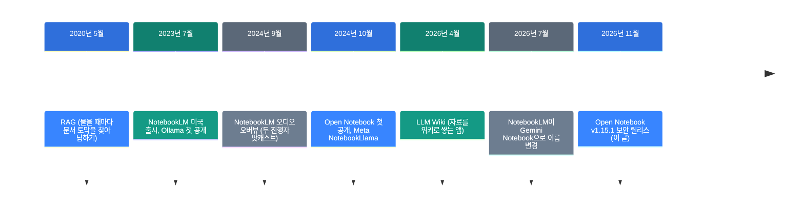
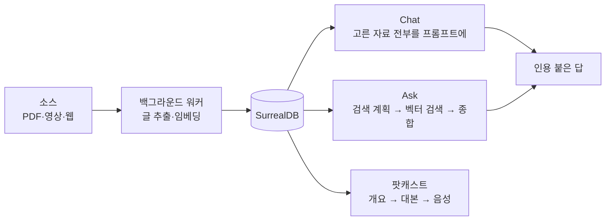

![[open-notebook.mp4]]

[원문](https://github.com/lfnovo/open-notebook) · [레포](https://github.com/lfnovo/open-notebook) · [English](https://neocello-ku.github.io/trends/open-notebook)

## 요약

Open Notebook은 구글 NotebookLM을 내 서버에서 돌리는 오픈소스 앱입니다. 2024년 10월에 나왔고 2026년 11월 4일 v1.15.1 보안 릴리스를 냈습니다. GitHub 별은 41,740개입니다.

흐름에서 보면 구글이 오디오 오버뷰를 낸 지 6주 뒤에 나온 대안입니다. 그 뒤 2년 동안 공급사 24곳을 붙인 자체 호스팅 노트북으로 자랐습니다.

결론부터 말하면 기법은 새롭지 않습니다. 구글 제품의 기능 묶음을 내 장비와 내 모델로 옮긴 제품 형태가 새롭습니다. 용어가 낯설면, 아래 '처음이라면' 섹션부터 읽으세요.

## 흐름 속 위치: 왜 지금 이 이야기인가

이 레포는 새것이 아닙니다. 2년 된 프로젝트입니다. 지금 볼 이유는 두 가지입니다.

첫째, 비교 대상이 바뀌었습니다. 구글은 2026년 7월 16일 NotebookLM 이름을 Gemini Notebook으로 바꿨습니다. 노트북마다 코드를 실행하는 클라우드 컴퓨터도 붙였습니다.

둘째, Open Notebook이 다듬기 단계에 들어갔습니다. 2026년 11월 v1.15.1에서 보안 구멍을 막고 문서를 코드 기준으로 다시 썼습니다. 문서는 약 6,200줄에서 약 1,450줄로 줄었습니다.



이 글은 마지막 단계에 있습니다. 같은 갈래의 지난 글은 2026-10-12 글 「LLM Wiki」입니다. 그 앱은 자료를 위키로 쌓습니다. Open Notebook은 자료에 묻고 팟캐스트를 만듭니다.

2026-10-12 글 「Foresight: 구글이 낸 맥용 회의 노트 앱」도 이어집니다. 그 글의 주제는 소리가 기기를 떠나지 않는 처리였습니다. 인용 붙은 답은 2026-10-07 글 「조사하는 AI 만들기」에서 다뤘습니다.

### 이 기술은 무엇이 새로운가

| 무엇 | 새로운 정도 | 이유 |
| --- | --- | --- |
| RAG, 대본 → 음성 팟캐스트 (기법) | 낮음 | 모두 2020~2024년에 있던 기법입니다. |
| 자체 호스팅 노트북 (제품) | 중간 | NotebookLM 기능을 내 서버로 옮기고 공급사 24곳을 붙였습니다. 개념은 구글 것입니다. |
| 공급사 추상화, REST API (인프라) | 중간 | 모든 기능을 API로 엽니다. 부품은 기존 것입니다. |

정리하면 Open Notebook은 새 발명이 아닙니다. 구글 제품을 오픈소스로 다시 짠 것이고 그 갈래에서 가장 많이 쓰이는 구현입니다.

## 처음이라면: 이게 무슨 이야기인가요

### 내 자료만 읽은 조교

시험 범위 자료를 조교에게 맡긴다고 생각해 보세요. 조교는 그 자료만 읽습니다. 질문하면 자료에서 답을 찾고 어느 자료에서 왔는지 알려 줍니다.

NotebookLM이 이 조교입니다. 다만 자료가 구글 서버로 갑니다. 조교의 머리도 구글 모델로 정해져 있습니다.

Open Notebook은 같은 조교를 내 컴퓨터에 둡니다. 조교의 머리(모델)도 내가 고릅니다. 내 컴퓨터의 모델을 고르면 자료가 밖으로 나가지 않습니다.

### 자료를 라디오 대담으로

조교는 자료를 대담 방송으로도 바꿉니다. 진행자 1~4명이 자료 내용을 주고받습니다. 출퇴근길에 귀로 복습할 때 씁니다.

### 왜 좋은가

- 자료가 어디에 있는지 내가 정합니다.
- 모델을 바꿀 수 있습니다. 비싼 일은 API, 반복 일은 로컬 모델에 맡깁니다.
- 모든 기능을 REST API로 부를 수 있습니다. 다른 프로그램이 자료를 넣고 질문합니다.

### 이런 곳에 씁니다

- 사내 문서처럼 밖으로 보내면 안 되는 자료 읽기
- 논문 여러 편을 한 노트북에 넣고 비교하기
- 강의 자료를 팟캐스트로 바꿔 듣기

### 이 글에 나오는 이름들

| 용어 | 쉬운 뜻 |
| --- | --- |
| 노트북 | 한 주제의 자료와 메모를 묶는 상자 |
| 소스 | 노트북에 넣은 자료 하나. PDF, 영상, 웹 페이지 등 |
| 인사이트 | 소스에서 모델이 뽑은 요약·메모 |
| 임베딩 | 글을 숫자 목록으로 바꾼 것. 뜻이 비슷하면 숫자도 가깝습니다. |
| 벡터 검색 | 임베딩끼리 거리를 재서 비슷한 토막을 찾는 검색 |
| RAG | 질문할 때 자료에서 토막을 찾아 모델에게 함께 주는 방식 |
| 공급사 | 모델을 빌려주는 곳. OpenAI, Anthropic, 내 컴퓨터의 Ollama 등 |
| Ollama | 내 컴퓨터에서 모델을 서버로 띄우는 프로그램 |
| 자체 호스팅 | 남의 서버 대신 내 서버에서 돌리기 |
| MCP | AI 도우미에 외부 도구를 붙이는 규격 |

## 동작 방식

질문하는 길은 둘입니다. Chat은 고른 자료를 통째로 읽습니다. Ask는 자료 전체에서 토막을 찾아 읽습니다.



- **Chat**: 검색 단계가 없습니다. 고른 자료를 매번 전부 넣습니다. 약 105,000토큰을 넘으면 큰 문맥 모델로 바뀝니다.
- **Ask**: 세 단계입니다. 모델이 검색을 최대 5개 계획합니다. 검색마다 상위 10개 토막으로 부분 답을 씁니다. 마지막 모델이 부분 답을 합칩니다.
- **팟캐스트**: 개요를 쓰고 화자 설정으로 대본을 쓰고 화자마다 음성 모델로 읽습니다.

Ask는 임베딩 모델이 있어야 합니다. Chat은 자료를 통째로 넣어서 자료가 많으면 비용이 커집니다.

## 준비물

| 항목 | 요구 사항 |
| --- | --- |
| Docker | Docker Desktop(macOS, Windows) 또는 Docker Engine + Compose 플러그인(Linux) |
| 모델 | 공급사 API 키 하나, 또는 Ollama 같은 로컬 모델 서버 |
| 메모리 | README에 없음. 로컬 빠른 시작 문서는 RAM 8GB 이상을 요구합니다. |
| GPU | 필수 아님. Docker 안의 Ollama가 NVIDIA GPU를 쓰려면 NVIDIA Container Toolkit이 필요합니다. |

로컬 모델의 크기는 문서에 있습니다. qwen3는 약 5GB입니다. A5000(24GB)이면 qwen3와 임베딩 모델이 함께 들어갑니다. 이 판단은 문서 수치로 한 추정입니다.

## 설치하고 실행하기

### 1단계. compose 파일을 받으세요

```bash
mkdir open-notebook && cd open-notebook
curl -o docker-compose.yml https://raw.githubusercontent.com/lfnovo/open-notebook/main/docker-compose.yml
```

### 2단계. 암호화 키를 바꾸세요

`docker-compose.yml`에서 아래 줄을 찾으세요.

```yaml
- OPEN_NOTEBOOK_ENCRYPTION_KEY=change-me-to-a-secret-string
```

값을 직접 만든 긴 비밀 문자열로 바꾸세요. 예: `openssl rand -hex 32`. 이 키는 저장한 API 키를 암호화합니다. 잃어버리지 마세요.

### 3단계. 다른 기기가 이 컴퓨터에 닿으면, 포트를 막으세요

기본 설정은 UI(8502)와 API(5055)를 모든 네트워크에 엽니다. 비밀번호도 없습니다. 서버나 공용 네트워크라면 둘 중 하나를 하세요.

- 포트 줄을 `"127.0.0.1:8502:8502"`, `"127.0.0.1:5055:5055"`로 바꾸세요.
- `environment:`에 `- OPEN_NOTEBOOK_PASSWORD=your-password`를 넣으세요.

### 4단계. 서비스를 켜세요

```bash
docker compose up -d
```

약 30초 뒤 http://localhost:8502 를 여세요.

### 5단계. 모델을 연결하세요

1. 사이드바의 **Models**(Manage 아래)를 여세요.
2. 공급사를 찾아 **Add Configuration**을 누르세요.
3. 이름과 API 키를 넣으세요.
4. **Test**를 눌러 연결을 확인하세요.
5. **Language** 모델 하나와 **Embedding** 모델 하나를 추가하세요.
6. **Auto-assign Defaults**를 누르세요.

Ollama는 키 대신 **Base URL**을 넣습니다. Anthropic과 Groq에는 임베딩 모델이 없습니다. 이 둘을 쓰면 임베딩은 다른 공급사로 붙이세요.

### 모두 로컬로 돌릴 때

같은 폴더에 `docker-compose.override.yml`을 만들고 Ollama 서비스를 넣으세요.

```yaml
services:
  ollama:
    image: ollama/ollama:latest
    volumes:
      - ./ollama_models:/root/.ollama
    restart: always
```

서비스를 켠 뒤 모델 두 개를 받으세요.

```bash
docker compose up -d
docker compose exec ollama ollama pull qwen3
docker compose exec ollama ollama pull nomic-embed-text
```

Ollama의 Base URL은 `http://ollama:11434`입니다. `localhost`를 쓰면 연결되지 않습니다.

Ollama의 기본 문맥 길이는 8192토큰입니다. 자료를 통째로 넣으려면 **Context Window**를 늘리세요.

팟캐스트와 받아쓰기는 Ollama로 할 수 없습니다. 이것까지 로컬로 하려면 OpenAI 호환 음성 서버를 따로 붙이세요.

## 팩트체크

게시물 없이 레포 링크만 받았습니다. 그래서 README가 내세우는 주장을 확인했습니다. 날짜와 수치는 2026년 11월 8일 기준입니다.

| 주장 (README) | 확인 결과 | 판정 |
| --- | --- | --- |
| 공급사 20곳 이상 | README 표에 24곳이 있습니다. LLM 21곳, 임베딩 12곳, 받아쓰기 10곳, 음성 12곳입니다. | 일치 |
| 100% 로컬 | 로컬 모델을 고를 때만 맞습니다. Ollama와 oMLX는 채팅·임베딩만 합니다. 음성은 별도 서버가 필요합니다. | 조건부 |
| 데이터는 내 통제 아래 | 기본 설정은 포트를 모든 네트워크에 열고 비밀번호가 없습니다. README도 이 점을 경고합니다. | 조건부 |
| 팟캐스트 1~4명, NotebookLM은 2명뿐 | 1~4명은 맞습니다. NotebookLM은 2025년 9월 형식을 4종으로 늘렸습니다. 진행자 수는 공식 확인을 못 했습니다. | 조건부 |
| NotebookLM은 API가 없다 | NotebookLM Enterprise에는 API가 있습니다. 오디오 오버뷰 생성도 됩니다. 개인 계정 노트북에만 API가 없습니다. | 과장 |
| 답이 출처를 인용한다 | 맞습니다. 다만 인용은 항목 단위입니다. 쪽 번호나 구절은 없습니다. | 조건부 |
| MCP로 Claude Desktop과 연동 | 문서는 있습니다. MCP 서버는 제3자 패키지 open-notebook-mcp입니다. 이 레포에 없고 마지막 버전은 2025년 12월 0.3.0입니다. | 조건부 |
| UI 14개 언어 | 맞습니다. 한국어는 없습니다. README의 한국어 링크는 기계 번역입니다. | 일치 |

README 비교표는 아직 "Google Notebook LM"이라고 씁니다. 2026년 7월 이름 변경과 코드 실행 기능은 반영되지 않았습니다.

같은 시기 독립 리뷰도 있습니다. eWeek, Android Authority, DEV가 2026년에 이 앱을 다뤘습니다. 세 글 모두 자체 호스팅 대안으로 소개합니다. 공통 단점은 설치와 관리에 손이 더 간다는 점입니다. 같은 조건의 수치 벤치마크는 찾지 못했습니다.

## 언제 무엇을 쓰나

| 상황 | 방법 |
| --- | --- |
| 자료를 밖으로 보내면 안 됩니다 | Open Notebook + Ollama. 포트를 127.0.0.1로 묶으세요. |
| 설치 없이 바로 쓰고 싶습니다 | Gemini Notebook(옛 NotebookLM) |
| 자료에서 코드를 돌려 분석하고 싶습니다 | Gemini Notebook. Open Notebook에는 코드 실행이 없습니다. |
| 다른 프로그램이 자료를 넣고 물어야 합니다 | Open Notebook REST API(포트 5055) |
| 질문보다 자료를 위키로 쌓고 싶습니다 | LLM Wiki |
| 쪽 단위 인용이 필요합니다 | 두 앱 모두 원문을 열어 직접 확인하세요. Open Notebook 인용은 항목 단위입니다. |

## 출처

- [Open Notebook GitHub 저장소](https://github.com/lfnovo/open-notebook)
- [Open Notebook v1.15.1 릴리스 (2026-11-04)](https://github.com/lfnovo/open-notebook/releases/tag/v1.15.1)
- [Open Notebook 문서: AI Context & RAG](https://github.com/lfnovo/open-notebook/blob/main/docs/2-CORE-CONCEPTS/ai-context-rag.md)
- [Open Notebook 문서: Quick Start - Local & Private](https://github.com/lfnovo/open-notebook/blob/main/docs/0-START-HERE/quick-start-local.md)
- [open-notebook-mcp (PyPI)](https://pypi.org/project/open-notebook-mcp/)
- [Google 블로그: NotebookLM is now Gemini Notebook](https://blog.google/innovation-and-ai/products/gemini-notebook/notebooklm-gemini-notebook/)
- [NotebookLM Enterprise 문서: Manage audio overview (API)](https://docs.cloud.google.com/gemini/enterprise/notebooklm-enterprise/docs/api-audio-overview)
- [9to5Google: NotebookLM Audio Overview 새 형식 (2025-09-02)](https://9to5google.com/2025/09/02/notebooklm-audio-overview-debate/)
- [eWeek: 5 NotebookLM Alternatives Worth Considering in 2026](https://www.eweek.com/news/5-notebooklm-alternatives-2026/)
- [Android Authority: Open Notebook hands-on](https://www.androidauthority.com/notebooklm-alternative-open-notebook-hands-on-3677932/)

## 이어지는 글

- [[trends/llm-wiki|LLM Wiki: 모아 둔 자료를 LLM이 위키로 엮어 줍니다]]
- [[trends/foresight|Foresight: 구글이 낸 맥용 회의 노트 앱, 소리가 기기를 안 떠납니다]]
- [[trends/research-engineering|조사하는 AI 만들기: 증거 원장을 중심에 두는 설계]]

