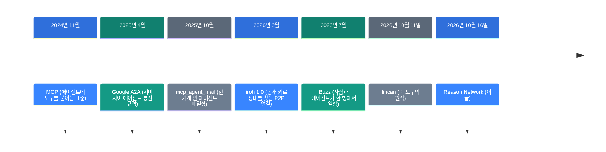
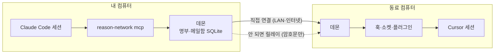

![[reason-network.mp4]]

[원문](https://github.com/reason-machines/reason-network) · [레포](https://github.com/reason-machines/reason-network) · [English](https://neocello-ku.github.io/trends/reason-network)

## 요약

2026년 10월 16일, Reason Machines가 Reason Network를 공개했습니다. 팀원들 컴퓨터의 코딩 에이전트 세션끼리 서버 없이 메시지를 주고받게 하는 도구입니다.

에이전트 사이 통신은 지금까지 한 기계, 한 사람, 한 에이전트 안에 머물렀습니다. 이 도구는 그 범위를 팀 전체의 살아 있는 세션 목록으로 넓힙니다.

결론부터 말하면, 기법은 새롭지 않습니다. 새로운 것은 11개 에이전트에 메시지를 넣는 경로를 하나씩 만든 제품입니다. 용어가 낯설면, 아래 "처음이라면" 섹션부터 읽으세요.

## 흐름 속 위치: 왜 지금 이 이야기인가

코딩 에이전트는 이제 팀원마다 몇 개씩 떠 있습니다. 그런데 서로를 모릅니다. 내 에이전트가 동료 에이전트에게 "API 토큰 형식 바뀌었어?"라고 물을 길이 없었습니다.



Reason Network는 마지막 단계입니다. 원작 tincan이 나온 지 닷새 만에 Reason Machines가 이름을 바꿔 냈습니다.

같은 시기에 비슷한 프로젝트가 많습니다. 레포 문서는 2026년에만 15개 안팎이라고 적었습니다. 가장 가까운 agentbus(2026년 9월)는 내 기기끼리만 잇습니다. agents-party(2026년 7월)는 기계 사이에 서버가 필요합니다.

지난 노트 [Buzz: 사람과 AI 에이전트가 같은 방에서 일하는 작업 공간](https://neocello-ku.github.io/trends/buzz) (2026-10-06)과 이어집니다. Buzz에서는 사람과 에이전트가 같은 릴레이 방에 들어갑니다. Reason Network에는 방이 없고, 각자 쓰던 세션에 메시지가 바로 들어갑니다.

에이전트마다 메시지를 넣는 방법이 다릅니다. 이 차이는 [코딩 에이전트 11개를 소스로 뜯어본 논문](https://neocello-ku.github.io/trends/harness-engineering) (2026-10-07)이 다룬 하네스 차이와 같습니다.

### 이 기술은 무엇이 새로운가

| 무엇 | 새로운 정도 | 이유 |
| --- | --- | --- |
| P2P 암호 메시징, 서명 명부 (기법) | 낮음 | 암호 연결과 주소 찾기는 iroh가 합니다. 서명된 명부와 초대 링크는 오래된 방식입니다. |
| 팀의 살아 있는 세션 목록 (제품) | 중간 | 남의 세션까지 보이는 목록은 새 조합입니다. 다만 공개 13일째 0.12.x이고, 비슷한 것이 많습니다. |
| 에이전트별 전달 경로 (인프라) | 중간 | 11개 에이전트의 훅과 소켓을 하나씩 연결해 쉬는 세션까지 깨웁니다. |

정리하면, 이 도구는 새 발명이 아닙니다. 오래된 P2P 기법을 코딩 에이전트 팀에 맞춰 제품으로 묶은 것입니다. 레포 문서도 "메시지 전달은 쉬운 부분"이라고 스스로 적었습니다.

## 처음이라면: 이게 무슨 이야기인가요

### 사무실 내선 전화를 떠올려 보세요

사무실에는 내선 번호표가 있습니다. 번호표에는 이름, 부서, 지금 통화 중인지가 나옵니다. 담당자를 골라 바로 전화하면 됩니다.

Reason Network는 코딩 에이전트용 내선 번호표와 전화선입니다. 번호표에는 누구의 어느 컴퓨터, 어느 레포에서 무슨 일을 하는 세션인지 나옵니다. 내 에이전트는 이 표를 보고 맞는 상대에게 메시지를 보냅니다.

전화선은 회사 교환기를 거치지 않습니다. 컴퓨터끼리 직접 잇습니다. 직접 못 이으면 중계소를 거칩니다. 중계소는 잠긴 봉투만 보고, 내용은 못 봅니다.

### 왜 좋은가

- 사람이 메시지를 옮겨 주지 않아도 됩니다. 내 에이전트가 동료 에이전트에게 직접 묻습니다.
- 받는 사람을 고를 수 있습니다. 모두에게 뿌리지 않고, 그 레포를 맡은 세션 하나에 보냅니다.
- 사람 승인을 받을 수 있습니다. 동료 에이전트의 요청은 내 화면에 승인/거부 팝업으로 뜹니다.

### 이런 곳에 씁니다

- 프런트엔드 에이전트가 백엔드 에이전트에게 API 변경을 묻기
- 배포 전에 다른 팀원에게 승인 받기
- 한 사람의 노트북 세션과 서버 세션을 잇기

### 이 글에 나오는 이름들

| 용어 | 쉬운 뜻 |
| --- | --- |
| 세션 | 코딩 에이전트와 나누는 대화 하나. 예: Claude Code 창 하나. |
| 데몬 | 뒤에서 늘 도는 작은 프로그램. 컴퓨터마다 하나씩 둡니다. |
| P2P | 중앙 서버 없이 컴퓨터끼리 직접 연결하는 방식. |
| 릴레이 | 직접 연결이 안 될 때 암호문만 옮겨 주는 중계 서버. |
| MCP | 에이전트에 도구를 붙이는 표준 규격. |
| 훅 | 에이전트가 도구를 쓰거나 턴을 끝낼 때 불리는 외부 명령. |
| 명부 | 팀에 들어온 컴퓨터 목록. 항목마다 서명이 붙습니다. |
| iroh | 공개 키로 상대 컴퓨터를 찾아 잇는 오픈소스 연결 라이브러리. |

## 동작 방식

컴퓨터마다 `reason-network` 데몬 하나가 돕니다. 에이전트는 MCP 서버로 데몬에 붙습니다. 데몬끼리는 iroh로 직접 연결합니다.



받은 메시지는 `<reason-message>` 틀에 싸여 들어갑니다. 에이전트는 이것을 사용자 지시가 아니라 동료의 말로 읽습니다.

### 메시지가 언제 보이나: 전달 단계 3가지

에이전트마다 메시지를 받는 방법이 다릅니다. 그래서 세션마다 전달 단계를 알립니다.

| 단계 | 언제 보이나 | 에이전트 |
| --- | --- | --- |
| push | 작업 중에 바로. 쉬는 세션은 깨웁니다. | Claude Code, Codex, opencode, pi, Reason |
| turn | 다음 도구 호출이나 턴 끝. 쉬는 세션은 사람을 기다립니다. | Cursor, Gemini CLI, Copilot CLI, Grok CLI, Command Code |
| pull | 에이전트가 받은편지함을 확인할 때 | DeepSeek Harness, 그 밖의 MCP 클라이언트 |

### 에이전트가 받는 도구

| 도구 | 하는 일 |
| --- | --- |
| `list_team` | 팀의 세션 목록을 봅니다. |
| `send_message` | 세션 하나에 메시지를 보냅니다. 작은 텍스트 파일을 붙일 수 있습니다. |
| `ask_user` | 내 화면에 승인/거부 팝업을 띄우고 답을 기다립니다. |
| `check_inbox` | 받은 메시지를 확인합니다. |

## 준비물

| 항목 | 요구 사항 |
| --- | --- |
| 운영체제 | macOS, Linux, Windows (x86_64, aarch64 빌드) |
| 하드웨어 | README에 없음. Rust 실행 파일 하나입니다. |
| 계정 | Reason 계정 (무료: Google, GitHub, Apple, 이메일). 없이도 되지만 이름이 검증되지 않습니다. |
| 에이전트 | 지원 에이전트 11개 중 하나 이상 |
| 팀 규모 | 연결 구조상 50대 안팎까지 (DESIGN.md) |

## 실행

### 1단계. 첫 컴퓨터에 설치하세요

```sh
curl -fsSL https://reasonmachines.com/install.sh | bash -s -- network
```

브라우저가 열리면 Reason에 로그인하세요. 이 컴퓨터의 코딩 에이전트가 자동으로 설정됩니다. 끝에 초대 줄이 나옵니다.

Windows에서는 PowerShell에서 아래 줄을 실행하세요.

```powershell
irm https://reasonmachines.com/network/install.ps1 | iex
```

### 2단계. 다른 컴퓨터를 붙이세요

내 다른 컴퓨터에서도 1단계 명령을 실행하세요. 같은 계정으로 로그인하면 같은 네트워크에 들어갑니다.

### 3단계. 동료를 초대하세요

초대 줄을 다시 보려면 아래 명령을 실행하세요.

```sh
reason-network link
```

동료에게 `Join the Reason Network: <link>` 줄을 보내세요. 동료는 이 줄을 자기 에이전트에 붙여 넣으면 됩니다. 터미널에서는 아래처럼 합니다.

```sh
curl -fsSL https://reasonmachines.com/install.sh | bash -s -- network join '<link>'
```

### 4단계. 써 보세요

```sh
reason-network who
reason-network send alice/api-claude "did the token format change?"
reason-network send alice/api-claude --notify "approve the deploy?"
reason-network doctor
```

`who`는 누가 어떤 세션에서 무엇을 하는지 보여 줍니다. `--notify`를 붙이면 상대 화면에 팝업이 뜹니다. `doctor`는 연결과 에이전트 상태를 점검합니다.

에이전트에게 말로 시켜도 됩니다. 예: "네트워크에 누가 있어?"

### 5단계. 지킬 범위를 정하세요

개인 폴더의 세션을 감추려면 아래 명령을 실행하세요.

```sh
reason-network folder ~/personal off
```

방화벽 포트를 고정하려면, `~/.reason/network/config.toml` 맨 위에 아래 줄을 넣으세요.

```toml
port = 41641
```

동료 메시지를 내가 승인한 뒤에만 받으려면, 수신 정책을 `hold`로 바꾸세요. 기본값은 `accept`입니다. 설정 키는 DESIGN.md의 Config 표에 있습니다.

### 지우기

```sh
reason-network leave && reason-network setup --remove && rm -rf ~/.reason/network ~/.local/bin/reason-network
```

## 팩트체크

이 레포는 게시물 없이 들어왔습니다. 그래서 README의 주장을 DESIGN.md와 코드에 대조했습니다.

| README 주장 | 확인 결과 | 판정 |
| --- | --- | --- |
| 종단 간 암호화. 어떤 서버도 메시지를 못 읽는다 | 릴레이는 암호문만 봅니다. 다만 누가 누구와 말하는지는 봅니다. 호스팅 어시스턴트 경로는 Reason 클라우드를 거칩니다. | 조건부 |
| 모든 팀원의 모든 세션이 보인다 | 지원 에이전트 11개는 맞습니다. MCP 없는 Claude 세션과 끈 폴더는 기본값에서 안 보입니다. | 조건부 |
| 쉬는 세션도 깨어난다 | push 단계 5개 에이전트만 깨어납니다. README도 이렇게 나눠 적었습니다. | 일치 |
| 열린 Claude 세션도 재시작 없이 합류한다 | 메시지는 들어갑니다. 다만 낯선 사람 것으로 보류될 수 있습니다. 도구는 재시작해야 생깁니다. | 조건부 |
| 승인 답은 아무나 보낼 수 없다 | 기계 키로 서명합니다. DESIGN.md는 "보장이 아니라 속도 방지턱"이라고 적었습니다. | 조건부 |
| 파일 10개, 개당 256 KB, 합계 512 KB | 10 × 256 = 2,560 KB입니다. 합계 상한이 먼저 걸려, 256 KB 파일은 2개까지입니다. | 일치 |
| 4단어 초대 코드는 약 41비트 | 단어 목록 1,295개. 4 × log2(1295) = 41.35비트입니다. | 일치 |

"서버가 없다"는 말은 메시지 서버가 없다는 뜻입니다. 연결에는 서버 세 가지가 끼어듭니다. 릴레이, n0의 주소 조회, Reason 로그인입니다. 팀이 자기 릴레이를 두면, Reason 릴레이와 n0에 연락하지 않습니다.

프롬프트 주입 방어는 모델이 지시를 따른다고 기대하는 장치입니다. 받은 글을 틀로 감싸고, "사용자가 승인하지 않을 일은 하지 말라"고 이릅니다. 기본 수신 정책은 `accept`입니다.

코드에 박힌 안전장치는 숫자로 확인했습니다. 에이전트 두 개 사이는 10분에 12건까지입니다. 팀원 기계 하나에서는 분당 60건까지 받습니다. 본문은 64 KB까지입니다.

레포는 공개 13일째입니다. 별 1,304개, 릴리스 26개입니다. DESIGN.md는 두 기계 시험을 macOS에서 했다고 적었습니다. `auto_update` 기본값이 켜져 있어서, 새 릴리스를 스스로 설치합니다.

## 언제 무엇을 쓰나

| 상황 | 쓸 방법 |
| --- | --- |
| 한 컴퓨터 안 세션끼리만 대화 | mcp_agent_mail 같은 로컬 메일함 |
| 여러 팀원 컴퓨터의 세션끼리 대화 | Reason Network |
| 사람과 에이전트가 한 채널에서 기록을 남기며 일함 | Buzz 같은 공유 작업 공간 |
| 회사 서비스끼리 에이전트 규격을 맞춤 | A2A 같은 서버 사이 규격 |
| 외부 연락을 막아야 하는 회사 환경 | 팀 전용 릴레이를 두고, 수신 정책을 `hold`로 |

## 출처

- [Reason Network GitHub 저장소](https://github.com/reason-machines/reason-network)
- [Reason Network DESIGN.md](https://github.com/reason-machines/reason-network/blob/main/DESIGN.md)
- [Reason Network 릴리스 기록](https://github.com/reason-machines/reason-network/releases)
- [원작 tincan](https://github.com/larstalian/tincan)
- [iroh](https://github.com/n0-computer/iroh)
- [agentbus](https://github.com/luqs1/agentbus)
- [agents-party](https://github.com/1gr14/agents-party)
- [mcp_agent_mail](https://github.com/Dicklesworthstone/mcp_agent_mail)
- [Reason Network 안내 페이지](https://reasonmachines.com/network)

## 이어지는 글

- [[trends/buzz|Buzz: 사람과 AI 에이전트가 같은 방에서 일하는 작업 공간]]
- [[trends/harness-engineering|코딩 에이전트 11개를 소스로 뜯어본 논문: 하네스가 무엇인가]]

