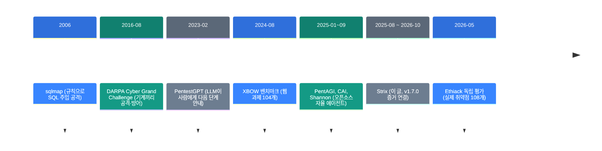
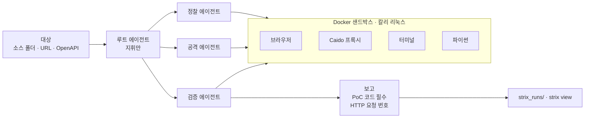

![[strix.mp4]]

[원문](https://github.com/usestrix/strix) · [레포](https://github.com/usestrix/strix) · [English](https://neocello-ku.github.io/trends/strix)

## 요약

Strix는 LLM 에이전트 여러 개가 내 앱을 실제로 공격해 보는 오픈소스 CLI입니다. 공격 코드(PoC)가 붙은 발견만 보고서에 올립니다. 2025년 8월에 나왔고 2026년 10월 v1.7.0까지 왔습니다.

흐름으로 보면 규칙 기반 스캐너와 LLM 조수 다음에 온 "자율 공격 에이전트" 갈래입니다. 같은 갈래에 PentAGI, CAI, Shannon이 있습니다. GitHub 별은 Strix가 7만 4천 개로 가장 많습니다.

결론부터 말하면 기법은 새롭지 않습니다. 새로운 쪽은 설치·CI·증거 규칙을 한 CLI에 묶은 제품입니다. 용어가 낯설면, 아래 '처음이라면' 섹션부터 읽으세요.

## 흐름 속 위치: 왜 지금 이 이야기인가

코딩 에이전트가 코드를 빠르게 쓰면서 보안 검토가 병목이 되었습니다. 사람 침투 테스트는 몇 주가 걸리고 비쌉니다. 그래서 "공격도 에이전트에게 시키자"는 도구가 2025년부터 쏟아졌습니다.



Strix는 여섯 번째 단계에 있습니다. 2025년 6월, 상용 도구 XBOW가 HackerOne 미국 순위 1위를 발표했습니다. 그 뒤 오픈소스 쪽에서 같은 일을 하는 도구가 잇달아 나왔습니다.

이 흐름은 지난 트렌드 노트와도 이어집니다. 지난 노트 「조사하는 AI 만들기: 증거 원장을 중심에 두는 설계」(2026-10-07)가 있습니다. 이 글은 주장마다 증거를 묶으라고 했습니다. Strix v1.7.0도 발견마다 HTTP 요청 번호를 증거로 붙이게 했습니다.

「코딩 에이전트 11개를 소스로 뜯어본 논문」(2026-10-07)은 에이전트의 하네스를 다뤘습니다. Strix는 그 하네스를 보안 공격용으로 짠 사례입니다. 「CLIProxyAPI」(2026-11-04)에서 ChatGPT 구독 로그인을 봤습니다. 같은 로그인이 Strix v1.4.0에 들어갔습니다.

### 이 기술은 무엇이 새로운가

| 무엇 | 새로운 정도 | 이유 |
| --- | --- | --- |
| LLM + 보안 도구 + 하위 에이전트 (기법) | 낮음 | PentestGPT(2023)와 PentAGI(2025-01)가 먼저 했습니다. |
| 설치 한 줄, CI, 로컬 뷰어 묶음 (제품) | 중간 | 쓰기 쉬운 묶음입니다. 다만 Shannon도 비슷한 묶음을 냅니다. |
| 샌드박스, 증거 연결 보고, 예산 상한 (인프라) | 중간 | 칼리 리눅스 이미지와 Caido 프록시 번호를 묶었습니다. 새 규격은 아닙니다. |

정리하면 Strix는 새 발명이 아니라 오래된 기법의 제품화입니다. 볼 만한 점은 1년 사이 증거 규칙을 점점 엄격하게 만든 과정입니다.

## 처음이라면: 이게 무슨 이야기인가요

### 도둑을 고용해 우리 집을 털어 보게 하기

집 보안을 점검하는 방법은 두 가지입니다. 하나는 점검표를 들고 창문과 자물쇠를 하나씩 보는 방법입니다. 다른 하나는 허락받은 전문가가 실제로 문을 열어 보는 방법입니다.

점검표 방법은 빠르지만 "이 자물쇠는 약해 보입니다" 같은 추측이 많습니다. 실제로 열어 보는 방법은 느리지만 열린 문은 확실한 문제입니다. 이렇게 허락받고 실제로 공격해 보는 일을 **침투 테스트**라고 부릅니다.

Strix는 실제로 열어 보는 쪽을 AI 에이전트에게 맡깁니다. 에이전트는 연 문마다 "이렇게 열었다"는 기록을 보고서에 붙입니다.

### 왜 좋은가

- 추측 대신 증거가 남습니다. 발견마다 공격 코드가 붙습니다.
- 사람이 몇 주 걸리는 일을 몇 분에서 몇 시간에 돌립니다.
- PR마다 자동으로 돌려 바뀐 코드만 검사할 수 있습니다.

### 이런 곳에 씁니다

- 배포 전 내 웹앱의 보안 점검
- PR마다 도는 CI 보안 검사
- 버그 바운티 조사 준비

### 이 글에 나오는 이름들

| 용어 | 쉬운 뜻 |
| --- | --- |
| 침투 테스트 | 허락받고 실제로 공격해 약점을 찾는 점검. |
| PoC | 개념 증명. 약점이 진짜임을 보이는 공격 코드나 요청. |
| 오탐 | 문제가 아닌데 문제라고 보고한 것. |
| 재현율 | 실제 약점 중에서 찾아낸 비율. |
| 정밀도 | 보고한 것 중에서 진짜 약점인 비율. |
| 샌드박스 | 공격 도구를 가둬 두는 격리된 실행 공간. Strix는 Docker를 씁니다. |
| 화이트박스·블랙박스 | 소스 코드를 보고 테스트하면 화이트박스, 안 보면 블랙박스. |
| XBEN | XBOW가 낸 웹 보안 과제 104개 벤치마크. |

## 동작 방식

루트 에이전트는 직접 공격하지 않고 지휘만 합니다. 정찰, 공격, 검증을 하위 에이전트에게 나눠 줍니다. 모든 도구는 Docker 샌드박스 안에서 돕니다.



보고 도구에는 규칙이 있습니다. PoC 코드가 비어 있으면 보고를 거부합니다. v1.7.0부터 프록시로 확인한 발견은 프록시 요청 번호를 붙여야 합니다.

스캔 모드는 세 가지입니다.

| 모드 | 걸리는 시간 (문서 기준) | 쓰는 곳 |
| --- | --- | --- |
| quick | 수 분 | PR마다 |
| standard | 30분~1시간 | 주간 점검 |
| deep (기본값) | 1~4시간 | 큰 릴리스 전 |

## 준비물·실행

> 허락받은 대상에만 쓰세요. Strix는 대상을 실제로 공격합니다. 내 시스템이나 서면 허락을 받은 시스템에만 돌리세요.

| 항목 | 요구 사항 |
| --- | --- |
| Docker | 실행 중이어야 합니다. 샌드박스 이미지는 약 3.8GB입니다 (v1.3.0 기준). |
| LLM | API 키 하나. GPU 요구 사항은 README에 없습니다. |
| 로컬 모델 | 가능하지만 문서는 70B 미만 모델이 버거워한다고 경고합니다. |
| 비용 | 토큰 비용은 내가 냅니다. 벤치마크는 과제 100개에 약 $337였습니다. |

### 1단계. 설치하세요

```bash
curl -sSL https://strix.ai/install | bash
```

pip로 설치하면 패키지 이름은 `strix-agent`이고 Python 3.12 이상이 필요합니다.

### 2단계. 모델과 키를 정하세요

```bash
export STRIX_LLM="vercel_ai_gateway/zai/glm-5.3"
export LLM_API_KEY="your-api-key"
```

설정은 `~/.strix/cli-config.json`에 저장됩니다. ChatGPT 구독이 있으면 `strix auth login chatgpt`로 API 키 대신 쓸 수 있습니다.

### 3단계. 텔레메트리를 끌지 정하세요

텔레메트리는 기본으로 켜져 있습니다. 끄려면 아래 값을 넣으세요.

```bash
export STRIX_TELEMETRY=0
```

### 4단계. 내 코드로 첫 스캔을 돌리세요

```bash
strix --target ./app-directory
```

처음 실행할 때 샌드박스 이미지를 내려받습니다. 결과는 `strix_runs/<run-name>`에 쌓입니다.

### 5단계. 예산 상한을 거세요

기본 모드인 deep은 1~4시간 돕니다. 처음에는 상한을 거세요.

```bash
strix --target https://example.com --max-budget 25 --max-turns 300
```

예산의 90%에 이르면 하위 에이전트가 먼저 멈춥니다.

### 6단계. 결과를 보세요

```bash
strix view
```

뷰어는 `127.0.0.1`에 뜨고 토큰이 든 링크를 보여 줍니다. 그 링크는 남에게 넘기지 마세요.

### 7단계. CI에 넣으세요 (선택)

```bash
strix -n -t ./ --scan-mode quick
```

`-n`은 화면 없이 돕니다. 취약점이 있으면 0이 아닌 종료 코드로 끝납니다. PR에서는 quick 모드가 바뀐 파일만 봅니다.

## 팩트체크

README의 주장을 코드, 문서, 같은 시기 독립 측정과 대조했습니다.

| 주장 (README) | 확인 결과 | 판정 |
| --- | --- | --- |
| 실제 PoC로 검증해 기존 스캐너 같은 오탐이 없다 | PoC 필수 규칙은 코드에 있습니다. 하지만 독립 평가에서 Strix도 오탐을 냈습니다. | 과장 |
| XBEN 104개 중 100개, 96% | 계산은 맞습니다(96.15%). v0.4.0의 자체 측정이고 독립 재현은 없습니다. | 조건부 |
| 몇 주가 아니라 몇 시간에 침투 테스트 | 문서 기준 quick 수 분, deep 1~4시간입니다. 사람 테스트와 같은 범위인지는 근거가 없습니다. | 조건부 |
| 에이전트 여러 개가 협업한다 | 에이전트 생성·메시지·대기 도구가 코드에 있습니다. | 일치 |
| 무료로 내 컴퓨터에서 돈다 | Apache-2.0입니다. 토큰 비용은 따로 듭니다. | 조건부 |
| 뷰어에서 아무것도 내 컴퓨터를 떠나지 않는다 | 뷰어는 로컬입니다. 하지만 텔레메트리가 기본으로 켜져 있습니다. | 조건부 |
| 자동 수정과 컴플라이언스 보고서 | 원클릭 수정 PR과 SOC 2 보고서는 유료 Cloud·Enterprise 기능입니다. | 조건부 |

### 96%를 다시 계산하면

난이도별 합은 45 + 49 + 6 = 100개입니다. 전체는 45 + 51 + 8 = 104개입니다. 100 ÷ 104 = 96.15%로 README와 맞습니다.

다만 이 숫자는 2025년 11월 v0.4.0의 결과입니다. 벤치마크 설정 예시는 `openai/gpt-5`입니다. XBOW도 이 벤치마크가 업계에서 대부분 풀렸다고 봅니다.

비용은 $337 ÷ 100 = 과제당 약 $3.37입니다. 평균 풀이 시간은 약 19분입니다.

### 같은 시기 독립 측정: Ethiack 논문 (2026-05)

Ethiack 연구진이 Strix, PentAGI, Claude Code를 같은 대상에 돌렸습니다. 대상은 공개 앱 3개, 정답 취약점은 108개입니다. 조건마다 3번씩 돌렸습니다.

| 비교 (둘 다 Claude Sonnet 4.6) | Claude Code 기준 상대 차이 | p값 |
| --- | --- | --- |
| 재현율 | +18.83% | 0.0047 |
| 정밀도 | −14.19% | 0.0445 |
| F1 | +16.79% | 0.0141 |

Strix는 덜 찾지만 찾은 것 중 진짜 비율이 높습니다. "오탐 없음"이 아니라 "오탐이 비교적 적음"이 맞는 말입니다.

논문은 한계도 적었습니다. 3회 반복은 적고 정답 목록이 빠졌을 수 있습니다. 공개 대상이라 학습 데이터 오염도 있을 수 있습니다.

## 언제 무엇을 쓰나

| 상황 | 방법 |
| --- | --- |
| PR마다 빠르게 막고 싶다 | `strix -n -t ./ --scan-mode quick`을 CI에 넣습니다. |
| 큰 릴리스 전 깊게 보고 싶다 | deep 모드에 `--max-budget`을 겁니다. |
| 소스 코드를 보고 공격하는 도구를 비교하고 싶다 | Shannon도 함께 돌려 봅니다. |
| 많이 찾는 것이 중요하다 | 독립 평가 기준으로는 Claude Code가 더 많이 찾았습니다. 중복은 많습니다. |
| 코드가 외부로 나가면 안 된다 | 로컬 모델을 씁니다. 70B 이상이 필요하다는 경고를 감안합니다. |
| 설치 없이 결과만 받고 싶다 | 유료 Strix Cloud를 씁니다. |

## 출처

- Strix 레포 (README, docs/, strix/tools/): https://github.com/usestrix/strix
- Strix 릴리스 기록: https://github.com/usestrix/strix/releases
- Strix XBEN 실행 스크립트: https://github.com/usestrix/benchmarks/tree/main/XBEN
- XBOW 벤치마크: https://github.com/xbow-engineering/validation-benchmarks
- Ethiack 평가 논문: https://arxiv.org/abs/2605.10834
- XBOW HackerOne 1위 발표: https://xbow.com/blog/top-1-how-xbow-did-it/

## 이어지는 글

- [[trends/research-engineering|조사하는 AI 만들기: 증거 원장을 중심에 두는 설계]]
- [[trends/harness-engineering|코딩 에이전트 11개를 소스로 뜯어본 논문: 하네스가 무엇인가]]
- [[trends/cliproxyapi|CLIProxyAPI: 코딩 구독 계정을 API 주소 하나로 묶는 중계 서버]]

