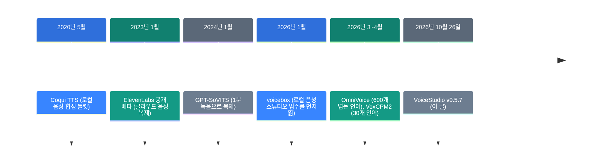
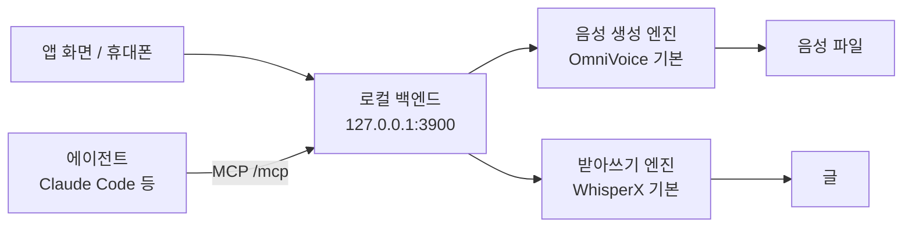

![[voicestudio.mp4]]

[원문](https://github.com/debpalash/VoiceStudio) · [레포](https://github.com/debpalash/VoiceStudio) · [English](https://neocello-ku.github.io/trends/voicestudio)

## 요약

VoiceStudio는 목소리 복제, 영상 더빙, 받아쓰기를 내 컴퓨터에서 하는 공개 앱입니다. 새 모델은 없습니다. OmniVoice 같은 공개 모델을 한 앱에 묶어, ElevenLabs가 하던 일을 로컬로 옮깁니다.

결론은 "오래된 기법의 제품화"입니다. 기법은 새롭지 않고, 제품과 인프라는 중간입니다. 용어가 낯설면, 아래 '처음이라면' 섹션부터 읽으세요.

## 흐름 속 위치: 왜 지금 이 이야기인가

2026년 봄에 공개 음성 모델이 연달아 나왔습니다. 모델이 좋아지자, 이를 앱 하나로 묶는 경쟁이 시작되었습니다. VoiceStudio는 그 경쟁에서 별 92,992개(2026-10-29)를 모은 앱입니다.



지난 노트 [VoxCPM2](/trends/voxcpm2)(2026-10-11)는 모델 하나를 다뤘습니다. VoiceStudio는 그 VoxCPM2를 엔진 하나로 넣은 앱입니다. 소리가 기기를 떠나지 않는 방향은 [Foresight](/trends/foresight)(2026-10-12)와 같습니다.

### 이 기술은 무엇이 새로운가

| 무엇 | 새로운 정도 | 이유 |
| --- | --- | --- |
| 음성 모델 (기법) | 낮음 | 새 모델이 없습니다. OmniVoice, VoxCPM2, Whisper 같은 공개 모델을 묶습니다. |
| 한 앱 묶음 (제품) | 중간 | 같은 범주는 voicebox가 2026년 1월에 먼저 열었습니다. 다른 점은 엔진 29개, 더빙, 휴대폰까지 넓힌 폭입니다. |
| 로컬 API와 MCP (인프라) | 중간 | 에이전트가 목소리를 부를 수 있습니다. 장비에 맞는 모델 크기도 자동으로 고릅니다. 개별 기술은 기존 것입니다. |

정리하면, VoiceStudio는 모델 회사가 아니라 묶음 회사입니다. 강점은 넓이이고, 품질은 고른 모델이 정합니다.

## 처음이라면: 이게 무슨 이야기인가요

### 목소리를 빌려 주는 성우 사무실

성우 사무실을 떠올려 보세요. 사무실에는 성우 여러 명이 있습니다. 대본을 주면 성우가 읽고, 다른 사람 목소리를 흉내 내기도 합니다.

VoiceStudio는 이 사무실을 내 컴퓨터 안에 둡니다. 성우는 공개 음성 모델입니다. 기본 성우는 OmniVoice이고, 모델 관리자에서 다른 성우로 바꿀 수 있습니다.

ElevenLabs 같은 서비스는 이 사무실이 회사 서버에 있습니다. 녹음과 대본이 그 서버로 갑니다. VoiceStudio에서는 둘 다 내 기기에 남습니다.

### 왜 좋은가

- 녹음과 대본이 기기를 떠나지 않습니다. 분석 정보는 동의해야 보냅니다.
- 계정과 API 키가 없습니다. 쓴 만큼 내는 요금도 없습니다.
- 복제, 더빙, 받아쓰기, 오디오북을 한 앱에서 합니다.

### 이런 곳에 씁니다

- 강의 영상을 다른 언어로 더빙하기
- 긴 글을 내 목소리 오디오북으로 만들기
- 회의 녹음을 기기 안에서 받아쓰기

### 이 글에 나오는 이름들

| 용어 | 쉬운 뜻 |
| --- | --- |
| TTS | 글을 소리로 읽어 주는 기술. 음성 합성. |
| 목소리 복제 | 짧은 녹음을 듣고 그 목소리로 새 문장을 말하게 하는 기능. |
| 목소리 설계 | 녹음 없이 "낮은 목소리의 중년 남성"처럼 글로 목소리를 만드는 기능. |
| 받아쓰기 (ASR) | 소리를 글로 바꾸는 기술. |
| 엔진 | 앱 안에서 실제로 말하거나 받아쓰는 모델. |
| GGUF | 모델을 작게 줄여 저장하는 파일 형식. 작은 GPU에서도 돕니다. |
| VRAM | 그래픽카드의 메모리. 모델이 여기에 올라갑니다. |
| MCP | AI 에이전트가 외부 도구를 부르는 공통 규약. |

## 동작 방식



앱과 에이전트가 같은 로컬 백엔드를 부릅니다. 백엔드는 포트 3900에서 기다립니다. 더빙은 받아쓰기, 번역, 음성 생성을 차례로 잇습니다.

엔진은 장비에 맞춰 고릅니다. OmniVoice는 전용 GPU VRAM 6GB 이상을 권장합니다. 그보다 작으면 GGUF 판을 씁니다. Q4_K_M은 약 659MB이고, Q8_0은 약 945MB입니다.

## 준비물·실행

| 항목 | 요구 사항 |
| --- | --- |
| 디스크 | 약 10GB 여유 |
| GPU | 기본 엔진은 VRAM 6GB 이상 권장. 없으면 CPU로 돌고 느립니다. |
| 운영체제 | macOS(Apple Silicon), Windows 10/11, Linux, Docker. 휴대폰은 Preview입니다. |
| 기본 모델 가중치 | 약 2.3GB. 첫 사용 때 받습니다. |

### 1단계. 설치 스크립트를 먼저 읽으세요

README의 설치 명령은 스크립트를 받아서 바로 실행합니다. 실행하기 전에 [설치 스크립트 안내](https://github.com/debpalash/VoiceStudio/blob/main/docs/install/script.md)를 읽으세요.

### 2단계. 앱을 설치하세요

macOS나 Linux라면, 아래 명령을 실행하세요.

```sh
curl -fsSL https://voicestudio.sh/install | sh
```

Windows라면, PowerShell에서 아래 명령을 실행하세요.

```powershell
irm https://voicestudio.sh/install.ps1 | iex
```

스크립트가 싫으면, [최신 릴리스](https://github.com/debpalash/VoiceStudio/releases/latest)에서 설치 파일을 받으세요.

### 3단계. 첫 목소리를 만드세요

1. **Voice cloning** 화면을 여세요.
2. 목소리를 고르거나, 깨끗한 참조 녹음을 넣으세요.
3. 글을 입력하고 생성하세요.

앱은 모델을 받기 전에 먼저 묻습니다. 첫 생성은 모델을 올리느라 느립니다. 속도는 두 번째 생성부터 보세요.

### 서버에서 돌리려면: Docker

GPU 서버가 있으면, Docker 이미지로 띄울 수 있습니다. 먼저 API 키를 만드세요.

```bash
export OMNIVOICE_API_KEY="$(python3 -c 'import secrets; print(secrets.token_urlsafe(32))')"
docker run -d --name omnivoice --gpus all \
  -p 127.0.0.1:3900:3900 \
  -e OMNIVOICE_API_KEY="$OMNIVOICE_API_KEY" \
  -v omnivoice-data:/app/omnivoice_data \
  ghcr.io/debpalash/voicestudio:stable
```

이 명령은 포트를 `127.0.0.1`에만 엽니다. 다른 기기에서 쓰려면, 공식 문서의 리버스 프록시 안내를 따르세요.

### 상업적으로 쓰려면: 모델 라이선스를 확인하세요

앱 코드는 AGPL-3.0이라 상업 이용을 허용합니다. 하지만 기본 OmniVoice 가중치는 CC-BY-NC(비상업)입니다. 모델마다 라이선스가 다르므로, 모델 관리자에서 하나씩 확인하세요.

## 팩트체크

| 주장 | 확인 결과 | 판정 |
| --- | --- | --- |
| 646개 언어로 복제·더빙·받아쓰기 (README) | 646은 OmniVoice 음성 생성의 언어 수입니다. 받아쓰기는 Whisper 계열이고, 문서도 위구르어는 못 받아쓴다고 적습니다. | 과장 |
| 646개 언어의 품질 | 직접 세면 265개 언어가 학습 데이터 10시간 미만입니다. 영어는 206,061시간, 한국어는 8,609시간입니다. | 조건부 |
| 허락 없이 기기 밖으로 안 나감 (README) | 분석은 동의해야 켜집니다. 모델은 받기 전에 묻습니다. 번역에 Google을 고르면 밖으로 나갑니다. | 일치 |
| AGPL이라 상업 이용 가능 (README) | 앱 코드는 맞습니다. 기본 OmniVoice 가중치는 CC-BY-NC입니다. v0.5.7부터 수락 전에는 API가 라이선스 오류를 냅니다. | 조건부 |
| 컴퓨터와 휴대폰에서 돈다 (README) | 휴대폰은 Preview입니다. iPhone은 사이드로드이고, 무료 Apple ID는 7일 뒤 만료됩니다. | 조건부 |
| GPU 없어도 쓸 수 있다 (README) | CPU로 돕니다. 기본 엔진은 VRAM 6GB를 권장하고, 작은 GPU용 GGUF가 있습니다. | 일치 |
| 엔진·하드웨어별 속도 안내 (README) | 벤치마크 표에 검증된 행이 0개입니다. 측정은 M2 16GB 한 대뿐입니다. | 근거 부족 |
| 다른 엔진 수십 개 (README) | 음성 생성 19개, 받아쓰기 10개, 합계 29개 항목입니다. OmniVoice 변형 3개가 들어 있습니다. | 일치 |
| 완전 로컬 ElevenLabs 대안 (레포 설명) | 기능은 겹칩니다. 품질 비교는 레포에 없습니다. 원격 GPU 기능은 v0.5.7에서 유료 Pro로 옮겼습니다. | 근거 없음 |

"646개 언어"는 숫자 자체는 맞습니다. 하지만 이 숫자는 음성 생성 모델 하나의 것입니다. 받아쓰기와 더빙의 원본 언어는 Whisper 계열이 정합니다.

같은 시기 독립 측정과도 대조했습니다. VoxCPM2 노트에 Seed-TTS-eval 영어 WER이 있습니다. Fish S2 0.99, Qwen3-TTS 1.23, VoxCPM2 1.84입니다. 이 표에 OmniVoice는 없습니다.

OmniVoice README의 "RTF 0.025"는 모델 저자의 측정입니다. VoiceStudio 앱에서 같은 값이 나온다는 기록은 없습니다. 품질과 속도는 내 장비에서 직접 재야 합니다.

## 언제 무엇을 쓰나

| 상황 | 쓸 방법 |
| --- | --- |
| 녹음을 밖으로 보낼 수 없다 | VoiceStudio 같은 로컬 앱 |
| 목소리 품질이 가장 중요하고, 클라우드도 괜찮다 | ElevenLabs 같은 클라우드 서비스 |
| 모델 하나만 코드에서 부르면 된다 | 모델 레포를 직접 설치 (예: VoxCPM2) |
| 에이전트가 말하게 하고 싶다 | VoiceStudio MCP 서버 |
| 결과물을 팔 계획이다 | 상업 라이선스가 분명한 모델로 엔진을 바꿈 |

## 출처

- [VoiceStudio GitHub 저장소](https://github.com/debpalash/VoiceStudio)
- [VoiceStudio v0.5.7 릴리스 (2026-10-26)](https://github.com/debpalash/VoiceStudio/releases/tag/v0.5.7)
- [VoiceStudio 라이선스 안내 (LICENSE-NOTICE.md)](https://github.com/debpalash/VoiceStudio/blob/main/LICENSE-NOTICE.md)
- [VoiceStudio 지원 언어 (docs/languages.md)](https://github.com/debpalash/VoiceStudio/blob/main/docs/languages.md)
- [VoiceStudio MCP 문서](https://github.com/debpalash/VoiceStudio/blob/main/docs/mcp.md)
- [VoiceStudio 벤치마크 (docs/benchmarks.md)](https://github.com/debpalash/VoiceStudio/blob/main/docs/benchmarks.md)
- [OmniVoice GitHub 저장소 (k2-fsa)](https://github.com/k2-fsa/OmniVoice)
- [OmniVoice 논문 (arXiv 2604.00688)](https://arxiv.org/abs/2604.00688)
- [voicebox GitHub 저장소](https://github.com/jamiepine/voicebox)
- [GPT-SoVITS GitHub 저장소](https://github.com/RVC-Boss/GPT-SoVITS)
- [Coqui TTS GitHub 저장소](https://github.com/coqui-ai/TTS)

## 이어지는 글

- [[trends/voxcpm2|VoxCPM2: 30개 언어를 48kHz로 말하는 공개 음성 모델]]
- [[trends/foresight|Foresight: 구글이 낸 맥용 회의 노트 앱, 소리가 기기를 안 떠납니다]]

