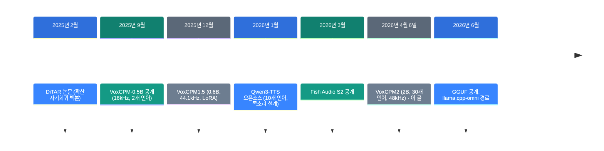
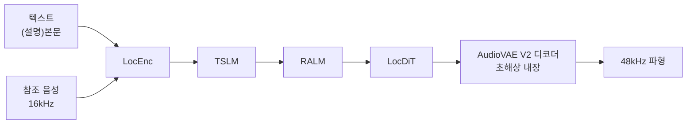

![[voxcpm2.mp4]]

[원문](https://x.com/0xGky/status/2109085321635701002) · [레포](https://github.com/OpenBMB/VoxCPM) · [English](https://neocello-ku.github.io/trends/voxcpm2)

## 요약

VoxCPM2는 글을 음성으로 바꾸는 2B 공개 모델입니다. 30개 언어, 목소리 설계, 음색 복제, 48kHz 출력을 한 묶음에 담았습니다.

흐름에서 보면, 이 모델은 "가장 새로운 것"이 아니라 "가장 넓은 것"입니다. 같은 구조는 2025년 9월 VoxCPM-0.5B에 이미 있었습니다.

결론부터 말하면, 기법은 새롭지 않습니다. 새로운 것은 언어 폭과 라이선스입니다. 용어가 낯설면, 아래 "처음이라면" 섹션부터 읽으세요.

**먼저 짚을 점이 하나 있습니다.** 출처 게시물은 2026년 10월 11일에 올라왔습니다. 하지만 VoxCPM2는 2026년 4월 6일에 나왔습니다. 6개월 된 모델입니다.

## 흐름 속 위치: 왜 지금 이 이야기인가

공개 음성 합성은 2025년부터 "품질 경쟁"에서 "언어 폭 경쟁"으로 옮겨 갔습니다. 영어와 중국어는 이미 여러 모델이 잘 읽습니다. 남은 차이는 그 밖의 언어에서 납니다.



이 글이 다루는 것은 여섯 번째 단계입니다. 게시물은 열 번째 달에 올라왔지만, 모델은 네 번째 달에 나왔습니다.

그사이 레포에 들어온 것은 모델이 아니라 실행 경로입니다. 2026년 4월에 vLLM-Omni 문서가 붙었습니다. 6월에는 GGUF 가중치와 llama.cpp-omni 경로가 생겼습니다. 즉 지금 새로운 것은 "어디서 돌릴 수 있는가"입니다.

지난 글과도 이어집니다. [LongCat-Video-Avatar 1.5](https://neocello-ku.github.io/trends/longcat-avatar-15)(2026-10-06)는 음성을 받아 말하는 영상을 만듭니다. VoxCPM2는 그 앞단에서 음성을 만듭니다. [EmbeddingGemma 2](https://neocello-ku.github.io/trends/embeddinggemma-2)(2026-10-07)는 소리까지 한 벡터로 담는 공개 모델이었습니다. 소리를 다루는 작은 공개 모델이 계속 나오고 있습니다.

### 이 기술은 무엇이 새로운가

| 무엇 | 새로운 정도 | 이유 |
| --- | --- | --- |
| 토크나이저 없는 확산 자기회귀 (기법) | 낮음 | VoxCPM-0.5B가 2025년 9월에 쓰던 구조입니다. 2는 크기와 데이터를 키웠습니다. |
| 30개 언어 + 설계 + 복제 한 묶음 (제품) | 높음 | 크메르어에서 Fish S2가 75.15% CER일 때 VoxCPM2는 2.05%입니다. 언어 폭이 공개 모델 중 가장 넓습니다. |
| 48kHz 출력과 서빙 경로 (인프라) | 중간 | 16kHz 참조를 받아 48kHz를 내보냅니다. 서빙 방식 자체는 기존 것을 옮겼습니다. |

정리하면, 이 모델은 새 발명이 아닙니다. 오래된 기법을 가장 넓은 제품으로 묶은 결과입니다. 목소리 설계를 먼저 공개한 쪽은 2026년 1월의 Qwen3-TTS입니다.

## 처음이라면: 이게 무슨 이야기인가요

### 기계가 말을 만드는 두 가지 길

사람이 목소리를 녹음해 두고 이어 붙이는 방식이 옛날 방법입니다. 지하철 안내 방송을 떠올리면 됩니다. 미리 녹음한 조각을 붙이므로, 녹음에 없는 말은 못 합니다.

요즘 모델은 소리를 직접 만듭니다. 글을 읽고, 그 글에 맞는 소리 파형을 처음부터 그립니다. 그래서 어떤 문장이든 읽을 수 있습니다.

### 토크나이저가 없다는 말

대부분의 음성 모델은 소리를 먼저 번호표로 바꿉니다. 소리 조각마다 사전에서 번호를 찾아 붙입니다. 이 번호표를 만드는 장치가 **토크나이저**입니다.

번호표에는 손해가 있습니다. 사전에 없는 미묘한 떨림은 가장 가까운 번호로 뭉개집니다. 색연필 24색으로 노을을 칠하는 것과 비슷합니다.

VoxCPM2는 번호표를 거치지 않습니다. 소리를 연속된 값으로 바로 다룹니다. 이것이 "토크나이저 없는" 방식입니다.

### 목소리 설계와 목소리 복제

이 모델이 목소리를 얻는 길은 두 가지입니다.

- **목소리 설계**: 녹음 없이 글로 주문합니다. 예를 들어 "차분한 30대 여성 목소리"라고 적습니다.
- **목소리 복제**: 짧은 녹음을 주고 그 음색을 따라 하게 합니다. 녹음의 전사문까지 주면 더 가깝게 따라 합니다.

### 왜 좋은가

- 성우 섭외 없이 30개 언어 음성을 만들 수 있습니다.
- Apache-2.0 라이선스라서 상업 제품에 넣을 수 있습니다.
- 가중치를 받아 내 컴퓨터에서 돌립니다. 문장이 밖으로 나가지 않습니다.

### 이런 곳에 씁니다

- 영상 더빙과 외국어 자막 낭독
- 사내 문서나 브리핑을 소리로 듣기
- 게임이나 앱의 안내 음성 시제품

### 이 글에 나오는 이름들

| 용어 | 쉬운 뜻 |
| --- | --- |
| TTS | 글을 음성으로 바꾸는 기술. |
| 토크나이저 | 소리를 번호표 목록으로 바꾸는 장치. |
| 확산 자기회귀 | 조금씩 잡음을 걷어내며, 앞 조각을 보고 다음 조각을 만드는 방식. |
| 보이스 디자인 | 글로 목소리를 주문하는 기능. |
| RTF | 1초 음성을 만드는 데 걸리는 시간. 0.3이면 1초 음성에 0.3초입니다. |
| WER / CER | 만든 음성을 다시 받아썼을 때의 오류율. 낮을수록 또렷합니다. |
| SIM | 참조 음성과 음색이 얼마나 닮았는지의 점수. 높을수록 닮았습니다. |
| GGUF | C++ 추론 엔진이 읽는 가중치 파일 형식. |
| VRAM | 그래픽 카드의 메모리. |

## 동작 방식

모델은 AudioVAE V2라는 압축 공간 안에서만 일합니다. 네 단계를 거쳐 그 공간의 값을 만들고, 마지막에 파형으로 풉니다.



여기서 눈여겨볼 곳은 마지막 상자입니다. 입력이 16kHz여도 출력은 48kHz입니다. 올려주는 계산이 모델 안에 들어 있습니다. 별도 업샘플러를 붙이지 않습니다.

## 준비물

| 항목 | 요구 사항 |
| --- | --- |
| Python | 3.10 이상 3.13 미만 |
| PyTorch | 2.5.0 이상 |
| CUDA | 12.0 이상 |
| VRAM | 약 8 GB (README 기준) |
| 속도 | RTX 4090에서 RTF 약 0.30 |

A5000 같은 다른 카드의 수치는 README에 없습니다. VRAM 8GB는 24GB 카드에 여유 있게 들어갑니다. 다만 RTX 4090보다 느린 카드라면 RTF는 0.30보다 커집니다.

## 실행하기

### 1단계. 설치하세요

```sh
pip install voxcpm
```

### 2단계. 글로 목소리를 주문하세요

```bash
voxcpm design \
  --text "VoxCPM2 brings studio-quality multilingual speech synthesis." \
  --control "Young female voice, warm and gentle, slightly smiling" \
  --seed 42 \
  --output out.wav
```

`--control`에 목소리 설명을 넣습니다. `--seed`를 고정하면 같은 결과를 다시 얻습니다.

### 3단계. 녹음으로 음색을 복제하세요

```bash
voxcpm clone \
  --text "This is a voice cloning demo." \
  --reference-audio path/to/voice.wav \
  --output out.wav
```

더 가깝게 복제하려면 전사문까지 넣으세요.

```bash
voxcpm clone \
  --text "This is a voice cloning demo." \
  --prompt-audio path/to/voice.wav \
  --prompt-text "reference transcript" \
  --reference-audio path/to/voice.wav \
  --output out.wav
```

### 4단계. 파이썬에서 쓰세요

```python
from voxcpm import VoxCPM
import soundfile as sf

model = VoxCPM.from_pretrained("openbmb/VoxCPM2", load_denoiser=False)

wav = model.generate(
    text="(A young woman, gentle and sweet voice)Hello, welcome to VoxCPM2!",
    cfg_value=2.0,
    inference_timesteps=10,
    seed=42,
)
sf.write("voice_design.wav", wav, model.tts_model.sample_rate)
```

목소리 설명은 괄호로 묶어 문장 앞에 붙입니다. 형식은 `(설명)본문`입니다.

### 5단계. 브라우저에서 확인하세요

```bash
python app.py --port 8808
```

브라우저에서 `http://localhost:8808`을 엽니다. 맥에서는 `--device auto`가 MPS를 씁니다.

## 팩트체크

| 게시물의 주장 | 확인 결과 | 판정 |
| --- | --- | --- |
| 스타 3.8만 | 2026-10-11 API 기준 38,860 | 일치 |
| GitHub 트렌딩 1위 | README는 VoxCPM1.5가 2025년 12월에 1위였다고 적습니다. VoxCPM2의 기록은 없습니다 | 대상이 다름 |
| 해외가 지금 난리 | VoxCPM2 릴리스는 2026-04-06입니다. 게시물은 6개월 뒤입니다 | 시점 오해 |
| 한 줄 설명으로 목소리 합성 | 보이스 디자인 기능으로 확인했습니다 | 일치 |
| 말버릇·속도까지 1:1 복제 | 참조 음성과 전사문을 둘 다 넣어야 합니다. 유사도는 영어 75.3, 중국어 79.5입니다 | 과장 |
| 48kHz 녹음실급 음질 | README에 48kHz 출력과 내장 초해상이 적혀 있습니다 | 일치 |
| Apache 2.0, 상업 이용 자유 | LICENSE 파일이 Apache-2.0입니다 | 일치 |
| 진짜와 가짜를 구분할 수 없다 | 공개 벤치마크에서 1위가 아닙니다 | 과장 |

마지막 줄을 숫자로 봅니다. Seed-TTS-eval 영어 시험의 오류율은 낮을수록 좋습니다.

| 모델 | test-EN WER (%) |
| --- | --- |
| Fish Audio S2 | 0.99 |
| Qwen3-TTS | 1.23 |
| LongCat-Audio-DiT | 1.50 |
| VoxCPM2 | 1.84 |

음색 유사도에서도 LongCat-Audio-DiT가 78.6으로 VoxCPM2의 75.3보다 높습니다. 즉 VoxCPM2는 어느 칸에서도 1위가 아닙니다.

대신 다른 곳에서 차이가 납니다. 저자원 언어입니다. 아래는 레포의 자체 30개 언어 시험 결과입니다.

| 언어 | VoxCPM2 | Fish S2-Pro |
| --- | --- | --- |
| 크메르어 | 2.05% | 75.15% |
| 라오어 | 1.90% | 87.40% |
| 버마어 | 1.42% | 85.27% |

이 표는 자체 측정입니다. 전사는 Gemini 3.1 Flash Lite API로 했습니다. 독립 검증이 아니므로 그대로 믿기는 어렵습니다. 다만 차이의 크기가 커서, 방향은 믿을 만합니다.

한국어 성적은 측정마다 다릅니다. 네 가지를 함께 봅니다.

| 측정 | VoxCPM2 | 가장 좋은 모델 |
| --- | --- | --- |
| 자체 30개 언어 CER | 0.95% | Fish S2-Pro 0.29% |
| CV3-eval ko | 5.69 | Fish Audio S2 2.76 |
| MiniMax-MLS 한국어 WER | 1.962 | Fish S2 1.180 |
| MiniMax-MLS 한국어 SIM | 83.3 | VoxCPM2 (1위) |

한국어 발음 정확도는 중상위입니다. 음색을 닮게 만드는 능력은 비교군 중 1위입니다.

## 언제 무엇을 쓰나

| 상황 | 쓸 방법 |
| --- | --- |
| 영어·중국어만 쓰고 또렷함이 가장 중요하다 | Fish Audio S2 |
| 동남아시아 언어나 저자원 언어가 필요하다 | VoxCPM2 |
| 성우 없이 새 목소리를 만들고 싶다 | VoxCPM2 보이스 디자인 |
| 특정 사람의 음색을 그대로 써야 한다 | VoxCPM2 Ultimate Cloning (전사문 포함) |
| GPU 없이 맥이나 CPU에서 돌려야 한다 | llama.cpp-omni + GGUF 가중치 |
| 여러 요청을 동시에 받아야 한다 | vLLM-Omni 서버 |

Ultimate Cloning은 남의 목소리를 그대로 만듭니다. README도 사칭과 사기에 쓰지 말라고 적어 두었습니다. 만든 음성에는 AI 생성 표시를 붙이세요.

## 출처

- [원래 X 게시물 (2026-10-11)](https://x.com/0xGky/status/2109085321635701002)
- [OpenBMB/VoxCPM GitHub 저장소](https://github.com/OpenBMB/VoxCPM)
- [VoxCPM2 릴리스 2.0.0 (2026-04-06)](https://github.com/OpenBMB/VoxCPM/releases/tag/2.0.0)
- [VoxCPM2 기술 보고서 (arXiv 2606.06928)](https://arxiv.org/abs/2606.06928)
- [VoxCPM 공식 문서](https://voxcpm.readthedocs.io/en/latest/)
- [HuggingFace openbmb/VoxCPM2](https://huggingface.co/openbmb/VoxCPM2)
- [VoxCPM2-GGUF 가중치](https://huggingface.co/DennisHuang648/VoxCPM2-GGUF)
- [llama.cpp-omni 저장소](https://github.com/tc-mb/llama.cpp-omni)
- [vLLM-Omni 저장소](https://github.com/vllm-project/vllm-omni)
- [DiTAR 논문 (arXiv 2502.03930)](https://arxiv.org/abs/2502.03930)

## 이어지는 글

- [[trends/longcat-avatar-15|LongCat-Video-Avatar 1.5: 사진 한 장과 음성으로 말하는 영상]]
- [[trends/embeddinggemma-2|EmbeddingGemma 2: 글·그림·소리·영상을 한 벡터로]]

