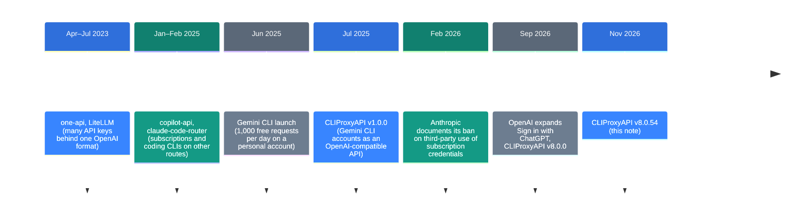
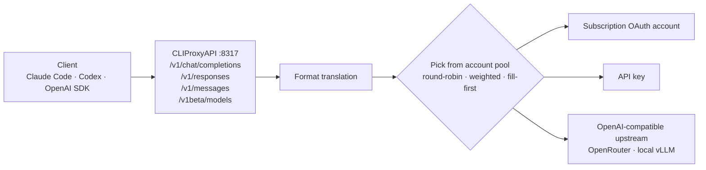

![[cliproxyapi.en.mp4]]

[Source](https://github.com/router-for-me/CLIProxyAPI) · [Repo](https://github.com/router-for-me/CLIProxyAPI) · [한국어](https://neocello-ku.github.io/ko/trends/cliproxyapi)

## Summary

CLIProxyAPI is a Go server that puts coding-tool subscriptions behind one API address. It covers tools such as Claude Code, Codex, and Gemini CLI. It first shipped in July 2025 and reached v8.0.54 on November 4, 2026, after 916 releases. It has more than 57,000 GitHub stars.

In the larger timeline, it moves the 2023 "API key gateway" idea to subscription accounts. Meanwhile, Anthropic banned this pattern in its terms, and OpenAI opened an official path.

The technique is old. The new part is one product that holds subscription logins from seven providers, and the scale it runs at. New to these terms? Start with the 'If you are new' section below.

## Where it fits: why this matters now

Many people pay a monthly subscription for their coding agent. A subscription can feel cheaper than pay-per-token API billing. So tools that "use the subscription quota like an API" keep appearing.



This note sits at the last step. The first version wrapped only Gemini CLI. Today it accepts accounts from seven providers: Anthropic, OpenAI, Google, xAI, Kimi, Meta, and Devin.

It also connects to earlier notes on this blog. The October 7, 2026 note read the source of 11 coding agents to define a harness. The October 29, 2026 note on Reason Network covered the channel between agents. This note covers the channel between an agent and its model.

### What is new here

| What | How new | Why |
| --- | --- | --- |
| Protocol-translating proxy (technique) | Low | one-api (2023-04) and LiteLLM (2023-07) already did this. |
| Subscription accounts as an API, rotating many accounts (product) | Medium | It puts seven providers in one server. copilot-api had the idea first, and it conflicts with provider terms. |
| Account-pool routing, retries, session pinning (infrastructure) | Medium | Round robin, weights, session pinning, and cooldowns live in one config file. About 30 apps build on top of it. |

So it packages an old gateway technique as a product for subscription accounts. What stands out is the release pace, about 1.9 per day, and the size of the ecosystem.

## If you are new: what is this about?

### A travel adapter and a power strip

When you travel abroad, you pack a plug adapter, because each country has a different socket. A power strip then lets several devices share one socket.

CLIProxyAPI is a plug adapter and a power strip for AI models. Your program sends requests in a familiar shape, the OpenAI format. The server converts each request to another shape, such as Claude or Gemini.

### A subscription and an API are different tickets

Think of a theme park. A subscription is a day pass: one named person enters through one gate, the official app. An API key is a pay-per-ride ticket that works in any program.

This tool lets the day pass work at other gates. That is convenient, and it can break the park's rules.

### Why people use it

- You change models without changing your program. You change only one address.
- With several accounts or keys, a blocked one hands off to the next.
- API keys, local models, and subscription accounts share one address.

### Where it is used

- Keep the Claude Code interface and change only the model behind it.
- Use Gemini or Claude from an app that speaks only the OpenAI format.
- Call a local model on your own server and an API model at the same address.

### Terms in this note

| Term | Plain meaning |
| --- | --- |
| Proxy (relay server) | A server that takes a request and sends it somewhere else for you. |
| Gateway | A proxy in front of many models. One address reaches all of them. |
| OAuth | A login that gives a token instead of a password. Subscription logins use it. |
| API key | A developer key that bills you for what you use. |
| Round robin | Using accounts in turn, one after another. |
| Cloaking | A feature that makes request headers look like the official app. |
| Sign in with ChatGPT (SIWC) | OpenAI's official path. Third-party apps use a ChatGPT subscription quota through it. |

## How it works

The client calls the API as usual. Only the address changes to CLIProxyAPI, on default port 8317. The server translates the format and picks one account from the pool.



On failure, it retries with another account. The default is 3 extra rounds. The retry status codes are 403, 408, 429, 500, 502, 503, and 504. With `session-affinity` on, one session stays on one account. It is off by default.

### Know about cloaking before you use it

The config file turns Claude cloaking on by default. Its comment calls this a Claude Code CLI disguise plus a system prompt replacement. It makes requests from clients other than Claude Code look like Claude Code.

The default User-Agent is `claude-cli/2.1.280 (external, cli)`. On the Codex side, it also adds the official Codex headers by default. The SIWC path, by contrast, identifies itself as `CLIProxyAPI`.

## What you need

| Item | Requirement |
| --- | --- |
| GPU | None. It is a relay server and runs no inference. The README has no hardware section. |
| OS | macOS, Linux, Windows, FreeBSD (amd64 and aarch64 releases) |
| To build | Go 1.26 or later (from go.mod) |
| Accounts | An API key for each provider you use, or a subscription account |

The README has no install commands. The commands below come from the Quick Start in the official guide (help.router-for.me).

## Install and run

### Step 1. Install

On macOS, use Homebrew.

```bash
brew install cliproxyapi
brew services start cliproxyapi
```

With Docker, mount the config file and the auth folder.

```bash
docker run --rm -p 8317:8317 -v /path/to/your/config.yaml:/CLIProxyAPI/config.yaml -v /path/to/your/auth-dir:/root/.cli-proxy-api -v /path/to/your/plugins-dir:/CLIProxyAPI/plugins eceasy/cli-proxy-api:latest
```

To build from source, use these commands.

```bash
git clone https://github.com/router-for-me/CLIProxyAPI.git
cd CLIProxyAPI
go build -o cli-proxy-api ./cmd/server
```

There is also a one-line install script for Linux. Read the script before you run it.

### Step 2. Make the config file

Copy `config.example.yaml` to `config.yaml`. Then change these two values.

```yaml
server:
  host: "127.0.0.1"   # the default "" listens on every network

access:
  api-keys:
    - "my-long-random-key"   # do not keep the sample value your-api-key-1
```

If `host` is empty, anyone on the same network can connect. The sample keys are public values.

### Step 3. Start with upstreams that have no terms problem

API keys and local models have no terms problem. The example below adds a local vLLM server. The key names follow the `openai-compatibility` example in `config.example.yaml`.

```yaml
api-keys:
  openai-compatibility:
    - name: "local-vllm"
      base-url: "http://127.0.0.1:8000/v1"
      keys:
        - api-key: "local"
      models:
        - name: "Qwen/Qwen3-8B"
          alias: "local-qwen"
```

### Step 4. Start the server and check it

```bash
./cli-proxy-api --config config.yaml
curl -H "Authorization: Bearer my-long-random-key" http://127.0.0.1:8317/v1/models
```

If the model list shows `local-qwen`, it works. Client keys go in the `Authorization: Bearer`, `X-Api-Key`, or `X-Goog-Api-Key` header.

### If you add subscription accounts

The login flags are in `cmd/server/main.go`. The official guide does not list them.

```bash
./cli-proxy-api --codex-login
./cli-proxy-api --claude-login
./cli-proxy-api --no-browser --codex-login
```

`--no-browser` does not open a browser for you. Use it on a remote server. Auth files go to `~/.cli-proxy-api`. Read the fact check below before this step.

## Fact check

| Claim | What we found | Verdict |
| --- | --- | --- |
| "Free Gemini, GPT, Grok, and Claude models through an API" (GitHub description) | It is not a free API. It uses the quota of a subscription you pay for. Claude needs a paid plan. | No evidence (overstated) |
| Works with OpenAI, Gemini, and Claude compatible clients | The code has the `/v1/chat/completions`, `/v1/responses`, `/v1/messages`, and `/v1beta/models` routes. | Matches |
| Round-robin load balancing across accounts | Round robin (default), weighted, and fill-first exist. Retry and cooldown defaults exist too. | Matches |
| Claude Code OAuth support | `--claude-login` exists. But Anthropic forbids third parties from relaying requests with subscription credentials. The default config cloaks as Claude Code. | Conditional (works, but breaks the terms) |
| "No API keys needed" (README entries for apps built on it) | True. But this repo's issues and Google's forum report permanent account bans. No public data gives a ban rate. | Conditional (account risk) |
| Codex (ChatGPT) OAuth support | OpenAI opened an official path, SIWC, on 2026-09-29. CLIProxyAPI uses it through `--siwc-bind`. The default Codex OAuth path adds the official Codex headers. | Conditional (only the SIWC path is official) |

Anthropic's documentation says third-party developers may not relay user requests with subscription credentials. This covers the Free, Pro, Max, and Ultra plans. Enforcement started with technical blocks on January 9, 2026. Anthropic put the rule in writing on February 19.

Google's official documents do not name this tool. But several users report Antigravity and Gemini CLI account bans. The stated reason was "logging in using third-party software." Some say their appeals got no reply.

OpenAI went the other way. After a beta on July 29, 2026, it expanded SIWC at DevDay on September 29. Usage comes out of your own subscription quota. One analysis still calls this path a preview.

We counted the releases ourselves: 9 pages of 100, plus 16, for 916 in total. From 2025-07-02 to 2026-11-04 is 490 days, so about 1.87 releases per day. Neither the README nor any independent test reports speed or throughput numbers.

## When to use what

| Situation | Approach |
| --- | --- |
| Using it at a company or in a team | API key paths only. Do not use subscription OAuth. |
| One address for local and API models | Register upstreams with `openai-compatibility` |
| Claude subscription in another tool | Do not do it. Anthropic's terms forbid it. |
| ChatGPT subscription in another tool | Use the SIWC path (`--siwc-bind`). |
| You need only gateway features | LiteLLM or new-api are also options. They have no subscription cloaking. |
| You expose it to a network | Set `host`, client keys, and TLS first. |

## Sources

- [CLIProxyAPI GitHub repository](https://github.com/router-for-me/CLIProxyAPI)
- [CLIProxyAPI official guide: Quick Start](https://help.router-for.me/introduction/quick-start.html)
- [CLIProxyAPI v8.0.54 release (2026-11-04)](https://github.com/router-for-me/CLIProxyAPI/releases/tag/v8.0.54)
- [Claude Code docs: Legal and compliance](https://code.claude.com/docs/en/legal-and-compliance)
- [The Register: Anthropic clarifies ban on third-party harnesses (2026-02-20)](https://www.theregister.com/2026/02/20/anthropic_clarifies_ban_third_party_claude_access)
- [CLIProxyAPI issue #1803: account ban report](https://github.com/router-for-me/CLIProxyAPI/issues/1803)
- [CLIProxyAPI discussion #4500: Gemini OAuth ban risk](https://github.com/router-for-me/CLIProxyAPI/discussions/4500)
- [Google AI developer forum: Antigravity and Gemini CLI 403 suspension](https://discuss.ai.google.dev/t/account-suspended-403-tos-on-antigravity-gemini-cli-appeal-submitted-seeking-escalation/141157)
- [The New Stack: Sign in with ChatGPT](https://thenewstack.io/sign-in-with-chatgpt/)
- [OpenAI DevDay 2026 recap](https://openai.com/index/devday-2026-recap/)
- [LiteLLM](https://github.com/BerriAI/litellm)
- [one-api](https://github.com/songquanpeng/one-api)
- [copilot-api](https://github.com/ericc-ch/copilot-api)
- [claude-code-router](https://github.com/musistudio/claude-code-router)

## Related

- [[trends/harness-engineering|Eleven coding agents, read at source level: what a harness is]]
- [[trends/reason-network|Reason Network: Letting Your Team's Coding Agents Talk to Each Other]]

