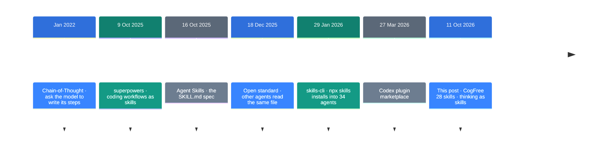
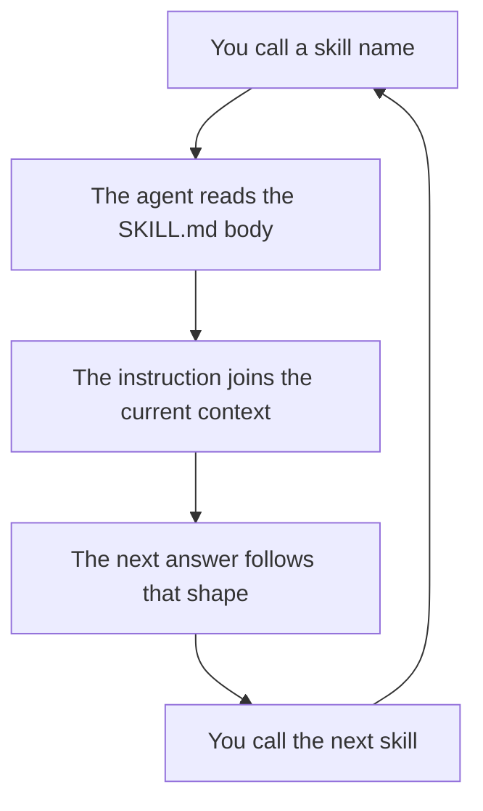

![[cogfree.en.mp4]]

[Source](https://x.com/junjiechou1122/status/2109255504287711258) · [Repo](https://github.com/Humanive/cogfree) · [한국어](https://neocello-ku.github.io/ko/trends/cogfree)

## Summary

On 11 October 2026, CogFree grew to 28 cognitive skills. Each skill names one thinking move and writes it down in a single file.

Seen in context, agent skills are moving from work procedures into conversation habits. For a year, skill collections held coding workflows. This one holds ways to steer a conversation.

The short verdict: there is no new technique here. All 28 skills together come to 419 words and 5,682 bytes. The taxonomy is what carries the value. New to these terms? Start with the "If you are new" section below.

## Where this sits in the flow

The skill format arrived in October 2025. Anthropic published a spec that carries instructions in one `SKILL.md` file.

For the year after that, skill collections were mostly work procedures: planning, debugging, code review. The widest-used collection, obra/superpowers, set that pattern.

CogFree aims somewhere else. It is about how a conversation goes.



The earlier steps built the format and the delivery paths. CogFree puts different cargo in the same pipe.

Two earlier notes connect here. [Eleven coding agents, read at source level](https://neocello-ku.github.io/trends/harness-engineering) (7 October 2026) put skills in the harness box called "extension". CogFree is the lightest part you can plug into that box.

[Building an AI that researches](https://neocello-ku.github.io/trends/research-engineering) (7 October 2026) put an evidence ledger at the centre of the design. The `verify` and `assumptions` skills do that same job with words alone. That is lighter, and it leaves no record.

### What is new here

| What | Novelty | Why |
| --- | --- | --- |
| Prompt technique | Low | No new technique. `reconstruct` moves an old teaching method into two sentences: rebuild the idea from a world without it. |
| The 28-skill taxonomy (product) | Medium | Naming the moves and sorting them into six groups is the work here. Four install paths came together in eight days. |
| Packaging (infrastructure) | Low | Zero lines of executable code. It uses the `SKILL.md` standard as is, and `packages/` holds copies of the same files. |

What is new here is a list. Scattered habits got names and places.

## If you are new: what is this about?

### Think of names for gym movements

"Let us do some chest work" leaves the job vague. "Bench press, 3 sets of 10" settles it.

Once a movement has a name, one phrase carries it. You do not describe the form every time.

CogFree puts that kind of label on thinking moves. Instead of "tidy this up for me", you say `compress`.

### Why it helps

- One word calls it. You do not retype a long instruction.
- The list works as a menu. You can pick what to ask for next.
- It is a file, so it travels. A team can share the same instruction.

### Where people use it

- A long thread has tangled, so `state` pulls out where the thinking stands.
- A conclusion feels too good, so `challenge` asks for counterexamples first.
- The day ends, so `checkpoint` leaves a point to resume from.

### Names in this guide

| Term | Plain meaning |
| --- | --- |
| Skill | A folder that holds an instruction. One `SKILL.md` file sits at its centre. |
| Front matter | The block between `---` lines at the top. It holds the name and description. |
| Plugin | A bundle of skills and commands that installs in one step. |
| Marketplace | A repository that lists plugins and tells the agent where to get them. |
| Harness | The runtime that wraps a model and turns it into an agent. |
| Pi | A terminal coding agent that you shape with extensions. |
| npx skills | A command-line tool that installs skills into 34 agents. |

## How it works

A skill file has two parts. Front matter holds the name and description. The body holds the instruction.

This is `reconstruct` in full.

```markdown
---
name: reconstruct
description: Learn a concept by reconstructing why it had to be invented.
---

Start from the world before this concept existed.

Reconstruct the observations, gaps, and constraints that made it
necessary, and derive the concept as if it had not yet been invented.
```

The agent keeps only the `description` line in view. It reads the body when you call the name.



The 28 skills fall into six groups. The sorting key is where in a conversation you reach for them.

| Group | Count | Skills |
| --- | --- | --- |
| Understand | 4 | `restate` `clarify` `grill` `reconstruct` |
| Inspect | 6 | `state` `unknowns` `assumptions` `open` `timeline` `diff` |
| Transform | 7 | `abstract` `ground` `compress` `reframe` `compare` `synthesize` `transfer` |
| Evaluate | 4 | `challenge` `prediction` `test` `verify` |
| Continue | 3 | `branch` `anchor` `checkpoint` |
| Execute | 4 | `next` `prioritize` `act` `delegate` |

The sizes are small: one skill averages 203 bytes and 15 words of body text. The shortest, `restate`, runs 5 words. The longest, `delegate`, runs 35.

The repository holds no executable code. The only script copies files into the host folders, and it is nine lines long.

## What you need, and how to run it

You need one agent that reads skills. There are four install paths.

In Claude Code, two lines:

```text
/plugin marketplace add Humanive/cogfree
/plugin install cogfree@cogfree
```

In Codex, run these in a terminal:

```bash
codex plugin marketplace add Humanive/cogfree
codex plugin add cogfree@cogfree
```

In Pi, one line:

```bash
pi install git:github.com/Humanive/cogfree
```

To stay agent-agnostic, use `npx skills`. The same command reaches 34 agents.

```bash
npx skills add Humanive/cogfree
```

You do not need all 28. Add `--skill` to install one.

```bash
npx skills add Humanive/cogfree --skill restate
```

After installing, call a name mid-conversation. At the end of a long design thread, you type this:

```text
challenge
```

You need no GPU and no Python environment. The only cost is tokens. All 419 words come to about 600 tokens, and the agent reads one skill at a time.

## Fact check

| Claim | What I found | Verdict |
| --- | --- | --- |
| Now 28 cognitive skills | True. I counted 28 folders. The 11 October commit added nine, taking it from 19 to 28. | Matches |
| Small, composable skills | Small is true, at 203 bytes on average. Composition is you calling them in turn. The repo has no mechanism that chains skills. | Conditional |
| Built to help you think, learn, explore | That is the design intent. The repo has no evaluation, no example transcripts, no before-and-after comparison. | Conditional |
| reconstruct derives why a concept was invented | True. The post and the two sentences in `SKILL.md` say nearly the same thing. | Matches |
| A more interesting way to learn | The author's opinion. I found no measurement of this method. | Conditional |
| (Implied) It installs into four agents | The Claude, Pi and npx layouts check out. Codex I could not confirm. | Conditional |

Codex needs its own note. The OpenAI documentation says the marketplace file belongs at `.agents/plugins/marketplace.json`. CogFree keeps it at `.codex-plugin/marketplace.json`.

The documented commands are `codex plugin marketplace add` and the `/plugins` browser inside the CLI. I could not find `codex plugin add cogfree@cogfree` in the docs. I also have no evidence that it fails, so the verdict stays at "could not confirm".

### An independent measurement from the same period

CogFree ships no measurement of its own. A benchmark for skills in general does exist.

SkillsBench covers 87 tasks across 8 domains, over 18 model-and-harness configurations. The paper is dated 14 June 2026.

- Curated skills raised the pass rate from 33.9% to 50.5%.
- Short skills gained 19.0 points. Long prose skills gained 0.7.
- Attaching four or more skills to one task dropped the gain to 10.1 points.
- Of 87 tasks, 13 scored worse. The largest drop was 7.4 points.

CogFree is at the short end of that range. "Too short to be useful" is not a claim this measurement supports.

Do not carry the numbers over as a CogFree result. SkillsBench measures pass rates on tasks with fixed answers. How a conversation goes is not what it measures.

Look at the repository state as well. Six stars, no forks, no releases. The repo was created on 3 October 2026. There is no evidence yet of wide use.

## When to use what

| Situation | Method |
| --- | --- |
| You gave a long instruction and expect drift | `restate` reflects your intent back first |
| The question is vague | `clarify` asks the single most useful question |
| You want to understand, not memorise | `reconstruct` walks the invention again |
| The thread is long and you lost your place | `state` pulls out the current position |
| You cannot see what the conclusion rests on | `assumptions` surfaces the premises |
| The conclusion pleases you too much | `challenge` asks for counterarguments and failure cases |
| Numbers are mixed into the claim | `verify` checks them against evidence |
| The explanation floats | `ground` brings it back to a concrete case |
| The discussion split in two | `compare` puts the options side by side |
| You stop here for today | `checkpoint` leaves a point to resume from |
| Talk grows and nothing ships | `act` narrows it to one next action |
| You hand the work to another agent | `delegate` writes a brief with success conditions |
| You want several skills on one task | Keep it under four. The gain drops from four up |

## Sources

- [Humanive/cogfree (GitHub)](https://github.com/Humanive/cogfree)
- [Original post (@junjiechou1122, 11 October 2026)](https://x.com/junjiechou1122/status/2109255504287711258)
- [Agent Skills documentation (Anthropic)](https://code.claude.com/docs/en/skills)
- [SkillsBench: Benchmarking How Well Agent Skills Work Across Diverse Tasks (arXiv:2602.12670)](https://arxiv.org/abs/2602.12670)
- [Codex plugin packaging documentation (OpenAI)](https://developers.openai.com/codex/plugins/build)
- [skills-cli (npx skills)](https://github.com/antfu/skills-cli)

## Related

- [[trends/harness-engineering|Eleven coding agents, read at source level: what a harness is]]
- [[trends/research-engineering|Building a research machine: put the evidence ledger first]]

