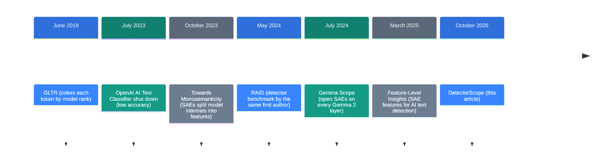
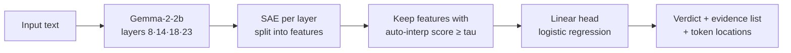

![[detectorscope.en.mp4]]

[Source](https://github.com/google-deepmind/detectorscope) · [Repo](https://github.com/google-deepmind/detectorscope) · [한국어](https://neocello-ku.github.io/ko/trends/detectorscope)

## Summary

In October 2026, Google DeepMind and the University of Pennsylvania released DetectorScope. It is an AI text detector that returns a list of evidence with each verdict. The list names the phrases that pushed the text toward "AI" and shows where they occur.

Detectors have long asked users to trust a score. This one asks them to check the reasons. The core idea is not new, though. A March 2025 paper already separated AI and human text with the same parts.

The technique is old. What is new is a package you can install and run. At the default setting, in-domain accuracy is about 11 points below the black-box detector.

New to these terms? Start with the 'If you are new' section below.

## Where this sits: why the story is happening now

AI text detectors have had a trust problem for years. They gave one score and no reason. When a detector flagged a human writer as AI, nobody could check why.



DetectorScope is the last step. The earlier steps built the parts one at a time: detectors, benchmarks, and tools that read inside a model.

OpenAI released an AI text classifier in January 2023 and shut it down in July. Its accuracy was too low. After that came methods that need no training and read token probabilities only. DetectGPT, Fast-DetectGPT and Binoculars are examples, and this repository uses them as baselines.

Reading token probabilities links to an earlier note, "Make a local LLM pick answers instead of writing text" (2026-10-06). That note used the same signal to pick an answer. These detectors use it to guess who wrote a text.

### What is new here

| What | Novelty | Why |
| --- | --- | --- |
| Detection with SAE features (technique) | Low | A March 2025 paper did this on the same Gemma-2-2b. The new part is the score threshold, tau. |
| Detector with an evidence list (product) | Medium | One pip install gives a verdict, evidence and locations. It is a research artifact, not for judging people. |
| Conversion pipeline (infrastructure) | Medium | Every stage to convert your own detector is public. The description stage needs a Gemini API key. |

DetectorScope takes "look inside the detector with SAEs" and packages it, with a validation threshold, into a tool you can run today.

## If you are new: what is this about

### A judge with a scoring sheet

Think of two judges at a writing contest. The first judge only says "72 points". The second judge shows a scoring sheet.

The sheet lists items and points. For example: "stock opening +5", "repeated phrase +3", "casual filler −2". For each item, the judge also highlights the sentence in the text.

Most AI text detectors are the first judge. DetectorScope turns a detector into the second judge.

### Where the scoring items come from

Nobody writes the items by hand. A language model reads the text, and signals light up inside it. A small model splits those signals into units a person can read. Each unit is a **feature**.

Next, another AI gives each feature a name, such as "the word about used as a preposition". A test then checks whether the name predicts where the feature fires. Features with a low score leave the sheet.

### Why this helps

- You can question a verdict. You get a list of the phrases that made it say "AI".
- You can see bad habits in the detector. Some features pick up data formatting rather than writing style.
- You choose your own trade-off between readable reasons and accuracy.

### Where it fits

- Detector research: audit what a detector bases its verdicts on.
- Model comparison: see which writing habits each generator has.
- Checking your own writing: find phrases in your English text that read as AI.

### Names used in this article

| Term | Plain meaning |
| --- | --- |
| Detector | A model that decides whether a person or an AI wrote a text. |
| Black box | A model that gives a result but no reason. |
| Residual stream | The numbers that flow between layers inside a language model. |
| SAE (sparse autoencoder) | A small model that splits the residual stream into tens of thousands of readable features. |
| Feature | One signal the SAE found. Example: "repeated phrases". |
| Auto-interpretation score | How well a feature's name predicts where the feature fires. From 0 to 1. |
| tau | The lowest auto-interpretation score a feature needs to stay on the sheet. Default 0.85. |
| Head | The last layer that adds feature scores into a verdict. Default is logistic regression. |
| Logit | The score just before the verdict. Higher means more AI-like. |
| F1 | A detection accuracy measure. Closer to 1 is better. |
| In-domain / out-of-domain | Text like the training data / text of a different kind. |

## How it works

DetectorScope reads signals from the language model Gemma-2-2b at layers 8, 14, 18 and 23. At each layer, an SAE splits the signal into features. Only features above tau go to the head.



The head is linear, so the verdict score is the sum of the item scores. As a formula: `logit == bias + sum(importances)`. Importance is how much the logit falls if you silence that feature. Positive values push toward AI, negative toward human.

### Three settings

The paper compares three settings, by how much they change the black box. The released detectors keep the three settings as Hugging Face branches.

| Setting | Language model | SAE |
| --- | --- | --- |
| ft-model-sae | Gemma-2-2b fine-tuned as a detector | Retrained on that model |
| ft-sae | Unmodified Gemma-2-2b | Retrained on detection data |
| base-sae | Unmodified Gemma-2-2b | Gemma Scope as released |

### The tau dial

A higher tau keeps only features whose names fit well. The reasons get easier to read, and accuracy drops. A lower tau lets in features with loose names. Accuracy rises, and the reasons get vague.

In the README figure, accuracy mostly holds up to tau 0.8. Past 0.85 it falls fast, and after 0.9 it collapses. The default of 0.85 sits right at the edge of that drop.

## What you need

| Item | Requirement |
| --- | --- |
| Python | 3.10 or later |
| Core packages | torch 2.6 or later, transformers 4.57 or later (pip installs them) |
| GPU | Not required. The README gives no inference hardware requirement. |
| Memory | About 12 GB, estimated (language model in fp32 10.46 GB + SAE 1.21 GB) |
| Disk | About 11.8 GB per detector |

I estimated memory from the Hugging Face file sizes. Gemma-2-2b has about 2.6 billion parameters, and at 4 bytes each that is about 10.4 GB. Without CUDA the code runs on CPU. The code has no Mac GPU (MPS) path.

## Run it

### Step 1. Install the package

```bash
python -m venv .venv && source .venv/bin/activate
pip install detectorscope
```

### Step 2. Load a detector and check one text

```py
from detectorscope import AuditableDetector

detector = AuditableDetector.from_pretrained(
  "liamdugan/detector-scope"
)
output = detector(
  "Like I said, this is about accuracy, about speed, and about cost."
)
print(output)
```

The first run downloads about 11.8 GB. The README shows this output:

```
Detection(label='ai', p_ai=0.88, features=[
  Feature(importance=+0.23, description='the word about used as a preposition'),
  Feature(importance=+0.14, description='repeated phrases or sequences in text'),
  Feature(importance=-0.05, description='conversational filler phrase like i said'),
  ...])
```

### Step 3. See where the evidence fires

```py
output = detector(text, return_highlights=True)
output.tokens                   # the text as tokens
output.features[0].highlights   # [(token index, activation), ...]
```

### Step 4. Compare tau settings

```py
output = detector(text, tau=0.50)   # more features, higher accuracy
output = detector(text, tau=0.95)   # the few best-described features
detector.heads                      # every (head, tau) pair the repo holds
```

Each branch holds a head for all 20 tau steps. So a new tau downloads nothing. Pass `head="xgboost"` to use the XGBoost head at the same tau.

### To use another detector

| Goal | Hugging Face id or argument |
| --- | --- |
| Open-domain text (default) | `liamdugan/detector-scope` |
| ML paper reviews, GPT-4o vs human | `liamdugan/detector-scope-peer-review-gpt4o` |
| ML paper reviews, Llama vs human | `liamdugan/detector-scope-peer-review-llama` |
| Setting with Gemma Scope SAEs as released | `revision="base-sae"` |
| Less memory | `torch_dtype="bfloat16"` (in the code, not in the README) |

`detector-scope` has no separate `ft-sae` branch. In that repository, main is the ft-sae setting. In the two review repositories, main is ft-model-sae, and `ft-sae` is its own branch.

### To convert your own detector

Install from source.

```bash
git clone https://github.com/google-deepmind/detectorscope && cd detectorscope
pip install -e ".[all]"
```

Each stage runs as `python -m detectorscope.<stage>`. The order is `finetune`, `train_sae`, `data.extract`, `data.process`, `autointerpret`, head training, then `evaluate`. The README says stages 0 to 2 need a GPU, and the rest runs on CPU. `autointerpret` calls Gemini, so it needs `GEMINI_API_KEY`.

## Fact check

This repository came without a launch post. So I checked the claims in the README and the Hugging Face card, plus the numbers in a news article from the same week. Values read from the figure are approximate (±0.02).

| Claim | What I found | Verdict |
| --- | --- | --- |
| Every prediction is a sum of validated features (README) | The head is linear, so the sum holds. "Validated" means an auto-interp score at or above tau. At tau 0.00, every feature goes in. | Matches (at default tau) |
| Making it auditable costs little accuracy (README) | The default detector scores F1 0.867 on COLING dev. That is about 11 points below the neural baseline of 0.98. Out of domain, the two are close. | Conditional |
| FT-Model+SAE matches the baseline even at tau 0.7 and above (README figure caption) | This holds on COLING up to tau 0.8. On RAID it scores about 0.60 to 0.67 at every tau, below the baseline of 0.75. | Overstated |
| 96.8 vs 98.0 in domain, 92.2 vs 75.2 out of domain (Crypto Briefing, 22 October) | These are low-tau values from two different settings. The default detector scores 0.751 on out-of-domain test, the same as the baseline. | Conditional |
| Changing tau downloads nothing (README) | The main branch holds 20 logreg and 20 XGBoost head files. | Matches |
| The language model is bundled, so there is no licence gate (README) | There is no gate. The Gemma Terms of Use still apply. | Matches (terms apply) |
| Features match linguistic "tells" of AI text (paper abstract) | Top human-side features include "the digit 0 in url placeholders" and "newlines in scientific text". Some track data format, not style. | Conditional |

### The numbers again: F1 at the default setting

The Hugging Face card lists F1 for the released default detector (`detector-scope`, tau 0.85). The neural baseline values come from the article and the README figure.

| Data | Default detector F1 | Neural baseline F1 | Gap |
| --- | --- | --- | --- |
| COLING dev (in domain) | 0.867 | 0.980 | about −11 points |
| COLING dev-test (out of domain) | 0.866 | about 0.87 | about the same |
| COLING test (out of domain) | 0.751 | 0.752 | about the same |

The article's "92.2 vs 75.2 out of domain" comes from the FT-SAE setting at low tau. At low tau, features with loose descriptions also feed the verdict. At the readable default, the out-of-domain advantage goes away.

The closed domain is different. The GPT-4o review detector scores F1 0.998. Yet a top AI-side feature is "double colons after bold markdown headers". It fires in 51% of AI reviews and 0% of human reviews.

With a black box, you would never learn that the detector picked up on formatting. The feature list is what exposes it.

I found no independent benchmark from the same period. The release is under two weeks old, and the articles repeat the paper's numbers.

### The README warning

The README calls these detectors research artifacts. It says they make mistakes, including on human text. Their accuracy outside the training domains is not established. They must not be the basis for decisions about individuals, such as academic integrity, hiring or publication.

## When to use what

| Situation | Approach |
| --- | --- |
| You want to know what a detector looks at | DetectorScope, tau 0.85 or higher |
| Accuracy comes first and reasons matter less | DetectorScope at tau 0.50 or lower, or a black-box detector |
| You want a verdict with no training data | Probability-based methods such as Binoculars or Fast-DetectGPT |
| You want to mark text that your own model writes | Watermarking (for example, SynthID Text) |
| You must judge one person's writing | Do not use any detector as the only evidence |

## Sources

- [GitHub: google-deepmind/detectorscope](https://github.com/google-deepmind/detectorscope)
- [Paper: Building Auditable AI Text Detectors with Sparse Autoencoders (arXiv 2610.30006)](https://arxiv.org/abs/2610.30006)
- [Hugging Face: liamdugan/detector-scope](https://huggingface.co/liamdugan/detector-scope)
- [Hugging Face: liamdugan/detector-scope-peer-review-gpt4o](https://huggingface.co/liamdugan/detector-scope-peer-review-gpt4o)
- [Demo: Hugging Face Space](https://huggingface.co/spaces/liamdugan/detector-scope-demo)
- [PyPI: detectorscope](https://pypi.org/project/detectorscope/)
- [Crypto Briefing article (2026-10-22)](https://cryptobriefing.com/deepmind-upenn-auditable-ai-text-detectors/)
- [Feature-Level Insights into Artificial Text Detection with Sparse Autoencoders (2025)](https://huggingface.co/papers/2503.03601)
- [Gemma Scope (arXiv 2408.05147)](https://arxiv.org/abs/2408.05147)
- [LessWrong: Initial Experiments Using SAEs to Help Detect AI Generated Text (2024-07-22)](https://www.lesswrong.com/posts/LQBFqyXA5to4iHEBC/initial-experiments-using-saes-to-help-detect-ai-generated)

## Related

- [[trends/jev-local|Let a local LLM pick an answer instead of writing one]]

