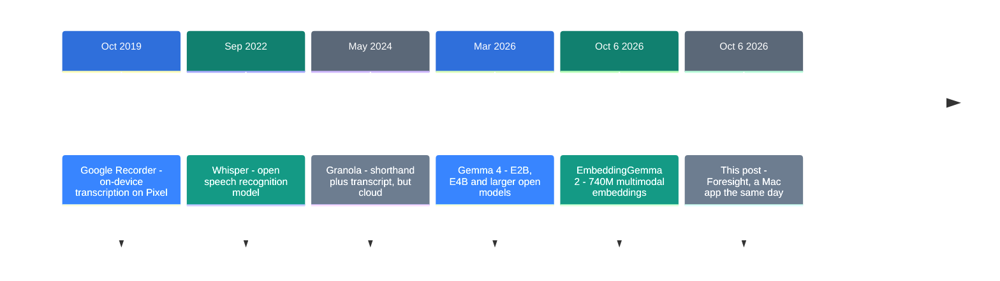
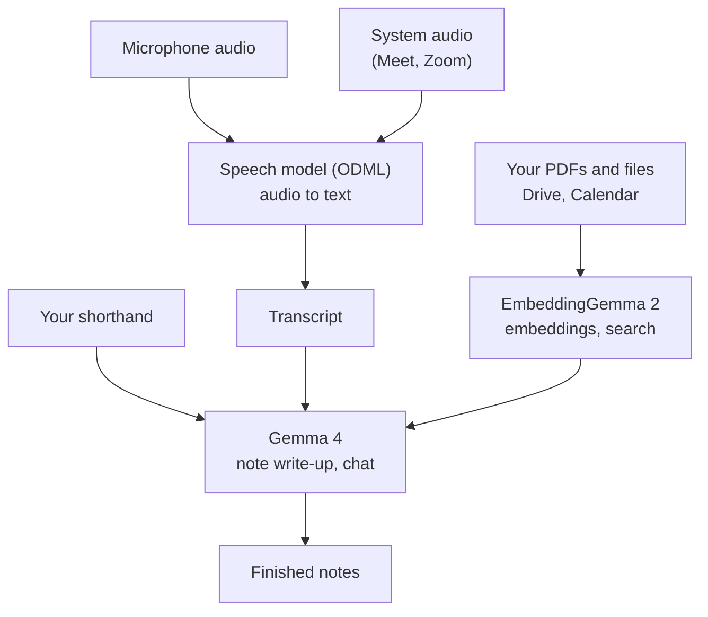

![[foresight.en.mp4]]

[Source](https://x.com/Saboo_Shubham_/status/2108799974024880199) · [한국어](https://neocello-ku.github.io/ko/trends/foresight)

## Summary

On October 6, 2026, Google released Foresight, a meeting note app for Mac. It transcribes and writes up notes on the machine itself. It costs nothing and asks for no account.

Granola shipped the same idea in 2024, running in the cloud.

So the method here is two years old. Google's part is new: a Mac app that runs on its own on-device models. It also transcribes English only for now. New to these terms? Start with the "If you are new" section below.

## Where this sits: why this story now

For two years, meeting transcription belonged to the cloud. Audio had to reach a server before anything came back written up. For a lot of teams, minutes leaving the building was the thing that stopped them.

Then small models started running on laptops. Foresight is Google shipping that change as an app.



Foresight sits on the last line. It arrived on the **same day** as EmbeddingGemma 2. Instead of only publishing a model, Google shipped an app that uses it.

An earlier note in this archive covers that model.

- [EmbeddingGemma 2: text, images, audio and video in one vector](/trends/embeddinggemma-2) (2026-10-07)

Foresight is the first consumer app built on it.

### What is actually new

| What | How new | Why |
| --- | --- | --- |
| Shorthand plus local search (method) | Low | Granola shipped the same interaction in May 2024. Document retrieval (RAG) dates to 2020. |
| A free Mac app from Google (product) | High | This is the first Mac consumer app Google ships on its own on-device models. It carries an experimental label. |
| Three models in one app (infrastructure) | Medium | Speech, generation and embedding models run together. The parts existed before. The bundle is the new piece. |

The method follows a product from two years ago. What changed is that all of it runs inside one Mac. Transcription covers one language, so Korean meetings are out for now.

## If you are new: what is this about

### Two ways to take meeting notes

Think about how you take notes in a meeting. Write down every word and you stop following the discussion. Write only a few words and later you cannot tell what you meant.

Foresight picks the short way. The app writes down the audio in the background. When the meeting ends, it fills your short notes out from that record.

Say you wrote only "budget -> next week". The app finds the budget part of the transcript. It then expands your line into "The budget goes to finance by Tuesday next week".

### What local means

Most AI services send your text and audio to a company server. The work happens there and you get the result back. That is the cloud.

Local means your own machine does the work. Model files land on your disk and your chip runs them. Audio and notes never leave the Mac.

### Why that helps

- Meeting audio and minutes do not go to an outside server.
- Transcription and note writing work with no connection.
- There is no subscription, because the models run on your machine.

### Where people use it

- Keeping records of meetings that contain customer data
- Writing up a recording on a plane or a subway, with no signal
- Loading your own PDFs and documents, then asking questions

### Names in this guide

| Term | Plain meaning |
| --- | --- |
| Transcript | The written record of what was said. |
| On-device | Running the model on your own machine, not on a server. |
| Embedding | A list of numbers that stands for text or an image. Close meanings get close numbers. |
| RAG | Finding the relevant passage in your files first, then handing it to the model. |
| EmbeddingGemma 2 | Google's 740M embedding model. It handles search in this app. |
| Gemma 4 | Google's family of small open models. It writes up notes and answers chat here. |
| Apple Silicon | Apple's own Mac chips, from M1 through M5. |

## How it works

Inside Foresight, **three** models each do a different job. The post named EmbeddingGemma 2 alone, but the work is split.



Audio arrives on two paths. The microphone picks up the room, and system audio picks up the other people on a video call.

Transcription runs on Google's closed speech library. That library is where the language limit comes from.

## What you need, and how to install it

### Requirements

| Item | Value |
| --- | --- |
| Chip | Apple Silicon only. Intel Macs do not work. |
| Minimum macOS | Not on the product page |
| RAM | Not on the product page |
| Disk | Not on the product page. See the download note below |
| Price | Free. No account to get started. |

Google did not publish storage or memory figures. The page says only that it runs light and is easy on the battery.

### Install

There is no CLI. It is an ordinary Mac app you download and open. It is not on the App Store.

1. Open the product page in Safari or Chrome.
2. Download the Mac app.
3. Open it once and wait for the model download.
4. Grant microphone and screen recording permission.

```
https://developers.google.com/edge/foresight
```

### How much the first run downloads

Reports disagree. heise says "more than 800MB". A writer who measured it saw 153MB for the app plus a 3.41GB language model, about 4.2GB in all.

The same writer took about 8 minutes 30 seconds to reach the record button, on a fast connection.

## Fact check

The original post said this.

> Google just dropped a free AI notetaker app for Mac.
> Every premium feature works without any subscription.
> 100% free and fully local, powered by Embedding Gemma 2.

| Claim | What I found | Verdict |
| --- | --- | --- |
| Google shipped a free AI note app for Mac | True. Released 2026-10-06, free, no account. It carries an experimental label and needs Apple Silicon. | True with conditions |
| Every premium feature works without a subscription | No basis. Google never compared features against a rival product. It has no speaker labels and no transcription outside English. | No basis |
| 100% free and fully local | Inference is local. A writer who watched the network saw no audio or transcript leave. Drive and Calendar import, web search and de-identified usage data do use the network. | Overstated |
| EmbeddingGemma 2 powers it | Only in part. There are three models. A closed ODML speech model transcribes, Gemma 4 writes up notes, and EmbeddingGemma 2 handles search. | Overstated |
| It transcribes any language | No. See the Korean section below. | No basis |

### Korean does not work today

Two independent sources point the same way.

First, the reverse-engineering repo `foresight-zh` took the app apart. It reports that the transcription model is English only. It also reports that the UI layer strips `[^\x20-\x7E\n\r]` from transcripts. Every non-ASCII character gets dropped, and all Hangul is non-ASCII.

Second, a hands-on blog matches that finding. French "épisode" came out as "pisode", so only the accented letters vanished. Arabic failed outright.

Record a Korean meeting and the transcript comes out empty. With an empty transcript there is no note write-up and no meeting summary.

### Other things I checked

| Item | What I found |
| --- | --- |
| Default generation model | Press reports say Gemma 4 E4B. The reverse-engineering repo says E2B. I have no Mac, so I could not settle it. |
| Speaker labels | None. Every line is either you or everyone else. |
| On speakerphone | Remote voices appear twice. System audio and the microphone catch the same words. |
| Relaunch after quit | A background job every four hours reopens the app. Google documents nothing about it. |

## When to use what

| Situation | Approach |
| --- | --- |
| English meeting, audio cannot leave | Foresight. It fits this case best today. |
| Korean meeting | Use something else. Whisper-family local models handle Korean. |
| You need to know who spoke | Another tool. Foresight has no speaker labels. |
| Cloud is acceptable | Granola and similar products have more features. |
| Intel Mac or Windows | Not an option. |
| Questions against your own files | Foresight's local search. It reads files in English and Korean alike. |

The English-only limit applies to transcription alone. Document search is a separate path, and EmbeddingGemma 2 covers more than 100 languages.

## Sources

- [Original post (Shubham Saboo, 2026-10-10)](https://x.com/Saboo_Shubham_/status/2108799974024880199)
- [Product page](https://developers.google.com/edge/foresight)
- [Gemma release history](https://ai.google.dev/gemma/docs/releases)
- [9to5Google report (2026-10-06)](https://9to5google.com/2026/10/06/google-ai-edge-foresight/)
- [heise report](https://www.heise.de/en/news/Google-s-macOS-app-Local-AI-to-capture-notes-and-work-with-files-11479591.html)
- [Reverse-engineering repo foresight-zh](https://github.com/michaelpersonal/foresight-zh)
- [Hands-on write-up (talat.app)](https://talat.app/blog/google-ai-edge-foresight)
- [Granola announcement (2024-05-22)](https://techcrunch.com/2024/05/22/granola-debuts-an-ai-notepad-for-meetings)

## Related

- [[trends/embeddinggemma-2|EmbeddingGemma 2: text, images, sound, and video in one vector]]
- [[trends/open-dot|Open Dot: running OpenAI Dots on your own Mac]]
- [[trends/strata|Strata: a 125B model on a gaming PC]]

