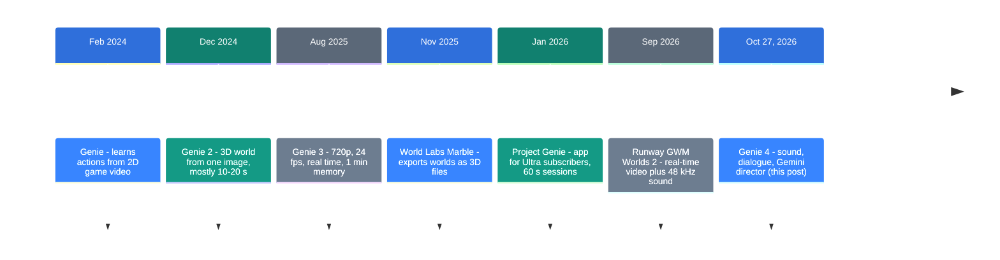
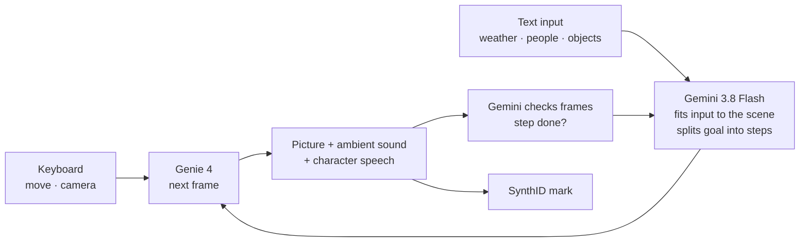

![[genie-4.en.mp4]]

[Source](https://deepmind.google/blog/genie-4-a-new-generation-of-world-simulation/) · [한국어](https://neocello-ku.github.io/ko/trends/genie-4)

## Summary

On October 27, 2026, Google DeepMind announced Genie 4, a world model. As you move with the keyboard, it generates the picture, the sound, and the dialogue of people in the scene in real time.

In the timeline, Genie 4 takes Genie 3's real-time worlds, adds sound and speech, and puts Gemini in the director's chair. The method is moderately new, and there is no product yet. Only trusted testers can use it today.

New to these terms? Start with the 'If you are new' section below.

## Where it fits: why this matters now

World models got crowded in fall 2026. On September 3, Runway released a real-time world model that also generates sound. TechCrunch's Genie 4 story also reported deals around World Labs and Decart.

Genie 4 arrived in the middle of this race. Google's pitch centered on a structure in which Gemini plans and Genie draws.



This post is the seventh step. A competitor shipped real-time sound two months earlier. What Genie 4 adds is characters that talk and a language model that directs.

### What is new here

| What | Novelty | Why |
| --- | --- | --- |
| Real-time generation + sound + dialogue (method) | Medium | Real-time steering was in Genie 3. Real-time sound was in Runway first. Talking characters and the Gemini director loop are new. Google did not publish the architecture or numbers. |
| A service you can use (product) | Low | Only trusted testers have access. Ultra and API access are "coming soon," with no date and no price. |
| One loop with the Gemini family (infrastructure) | Medium | Gemini Omni, Gemini 3.8 Flash, and Gemini 4 Argon each have a role. It shows a path toward robot test environments. |

Genie 4 mostly states a direction. Google named the "hybrid world model" as its goal, where a language model writes the plot and a video model draws the frames.

It also connects to earlier posts. [image-blaster](/trends/image-blaster) (2026-10-06) turned one photo into a 3D space with World Labs Marble. That path leaves a file behind, while Genie 4 keeps drawing the screen and saves no file.

[LongCat-Video-Avatar 1.5](/trends/longcat-avatar-15) (2026-10-06) made video of a person who speaks along with an audio track. Genie 4 puts such people inside a world and lets them talk in real time.

## If you are new: what is this about?

### A world model is an improv stage

Think of improv theater. Someone in the audience shouts "It's raining!" The actors open umbrellas and change their lines at once. There is no script, and the scene keeps going.

A world model does this on a screen. Press a key, and it draws the next scene. Type "it starts to rain," and rain falls from the next frames on.

A game engine computes the screen from prepared 3D files and rules. A world model has no such files. It looks at the scenes so far and your input, and it guesses the next frame.

### This time the stage got sound and a director

Up to Genie 3, the worlds were silent films. Genie 4 makes wind, music, and spoken lines together with the picture.

There is also a director behind the stage. Gemini watches the scene and breaks the plot into steps. It checks whether each step really happened on screen.

### Three good things

- You build nothing first. One line of text or one photo starts a world.
- You can change things mid-run. Weather, camera, and people change with text.
- You can replay the same scene many times. Each run comes out a little different.

### Where people use it

- Walk through a film scene before the shoot and pick camera angles
- Prototype the mood and controls of a game before writing engine code
- Test a task sequence for a robot in an imagined room before the real robot moves

### Names in this post

| Term | Plain meaning |
| --- | --- |
| World model | A model that takes input and predicts and draws the next scene. Here it makes picture and sound. |
| Frame | One image of a video. 24 fps means 24 images per second. |
| Real time | The next frame comes fast enough that the user does not wait. |
| Consistency | When you come back, the same object is in the same place. |
| Object permanence | An object that leaves the screen still exists when you look again. |
| Trusted tester | One of a small group of invited users who try a model before release. |
| Project Genie | Google's world model web app. It opened in January 2026 with Genie 3. |
| Gemini Omni | A Gemini model that makes video from images, sound, and text. Here it keeps looks and motion close to the real world. |
| SynthID | Google's invisible mark for AI-generated content. |

## How it works

The blog describes two layers. Genie 4 draws picture and sound. Gemini plans and checks from outside. Google did not publish the model's internals.



Gemini keeps the scene moving even when the user types nothing. When the user steps in, Gemini changes the plan on the spot.

In a robotics experiment, Gemini 4 Argon took the director role. Argon split "play checkers" into steps and fed each step to Genie 4 as a text caption. On screen, an Apptronik Apollo humanoid moved through those steps.

### What changed from Genie 3

| Item | Genie 3 (2025-08) | Genie 4 (2026-10) |
| --- | --- | --- |
| Resolution and speed | 720p, 24 fps | Not published |
| Consistency | Several minutes, visual memory up to 1 min | Blog: "short sessions." Model page: "a few minutes" |
| Sound | None | Ambient sound, music, dialogue |
| Text edits | Weather, objects, people | Same, plus Gemini fits the input to the scene |
| Director | None | Gemini plans steps and checks frames |
| Access | Small group of researchers and creators | Trusted testers |

## What you need and how to run it

### What you need

| Item | Requirement |
| --- | --- |
| Hardware | It is a cloud service. There are no weights to run on your GPU. |
| Access | Trusted testers only, for now. |
| Next in line | Google AI Ultra subscribers in Project Genie, and early access partners on the Gemini API and AI Studio |
| Launch date and price | Not in primary sources. Only TechCrunch says "in the coming weeks." |
| Install command | None. There is no SDK and no API documentation yet. |

### Step 1. Join the waitlist

Click the waitlist link near the top of the announcement. The link text is "Join the Genie 4 waitlist." The list is for Project Genie.

At its January 2026 launch, Project Genie was open only to Ultra subscribers in the US, age 18 and up. We could not confirm whether these terms have changed.

### Step 2. Write the prompt in two parts

The official prompt guide (written for Genie 3) splits a prompt into environment and character. The Genie 4 demos use the same two parts.

```text
Environment: A rainy night market street, wet asphalt reflecting
neon signs, steam rising from food stalls, light crowd.
Character: First-person view of a delivery rider on a scooter,
handlebars at the bottom of the frame.
```

Write short, direct sentences. Say so if the scene is dark. Say how the character moves.

### Step 3. Move around and add events with text

Move with the keyboard and turn the camera. Partway through, add one sentence such as "the rain stops."

Long runs can make details drift. Replay the same scene in several short runs instead.

## Fact check

| Claim in the blog | What we found | Verdict |
| --- | --- | --- |
| Realism never seen before | No numbers and no benchmark. Only demo videos | No evidence |
| Real-time interactive simulation | No primary source gives resolution, fps, or latency | Conditional |
| Our first real-time world model with native audio | True inside Google. Runway shipped real-time sound first, on September 3 | Matches |
| Consistent scenes for 2 minutes, double the predecessor (news) | No number in primary sources. 60 seconds is the app's session cap | Conditional |
| Simulates aerodynamics and collisions | Demos only. The same post lists complex physics as a limit | Conditional |
| Gemini checks each step inside the loop | Structure only. No success rate | Conditional |
| Coming soon to Ultra and the API | No date and no price. Only trusted testers today | Conditional |
| SynthID on all video and audio | A promise. No public output exists yet to check | Conditional |

### Recomputing "double"

Two minutes is 120 seconds. That is exactly twice Project Genie's 60-second session cap. So the "double" compares against an app limit, not against a model.

The Genie 3 blog already said worlds stay "largely consistent for several minutes." Model to model, there is no evidence of a longer run.

### No independent measurements yet

We found no independent benchmark or hands-on review from the same period. Only trusted testers have access. Runway's 720p, 24 fps, and 48 kHz figures are also company claims.

### Limits the blog states itself

- Long runs make details and object positions drift.
- Many prompt edits or a lot of movement through the scene also cause drift.
- Audio accuracy, legible text, and spatial accuracy are still research problems.

## When to use what

| Situation | What to use |
| --- | --- |
| You want to walk through the mood of a scene quickly | Genie 4 (after launch). Several short sessions |
| You must try something today | Project Genie (Genie 3, Ultra plan) or a Runway GWM Worlds 2 request |
| You need a 3D file for an engine | A 3D generator such as World Labs Marble |
| You need exact sizes and positions | A game engine or simulator. World models do not promise spatial accuracy |
| You must run it on your own GPU | Not Genie 4. Look for an open-weight model |

## Sources

- [Google DeepMind blog: Genie 4 (2026-10-27)](https://deepmind.google/blog/genie-4-a-new-generation-of-world-simulation/)
- [Google blog: Introducing Genie 4](https://blog.google/innovation-and-ai/models-and-research/google-deepmind/introducing-genie-4/)
- [DeepMind model page: Genie](https://deepmind.google/models/genie/)
- [Genie prompt guide](https://deepmind.google/models/genie/prompt-guide/)
- [Genie 3 blog (2025-08-05)](https://deepmind.google/blog/genie-3-a-new-frontier-for-world-models/)
- [Project Genie announcement (2026-01-29)](https://blog.google/innovation-and-ai/models-and-research/google-deepmind/project-genie/)
- [TechCrunch: Genie 4 (2026-10-27)](https://techcrunch.com/2026/10/27/googles-genie-4-world-model-adds-audio-more-realistic-worlds-and-real-time-steering/)
- [Runway: GWM Worlds 2 announcement (2026-09-03)](https://x.com/runwayml/status/2095540014645920040)
- [Wikipedia: Genie (AI model)](https://en.wikipedia.org/wiki/Genie_(AI_model))

## Related

- [[trends/image-blaster|image-blaster: one photo into a 3D space]]
- [[trends/longcat-avatar-15|LongCat-Video-Avatar 1.5: A Talking Video From One Photo]]

