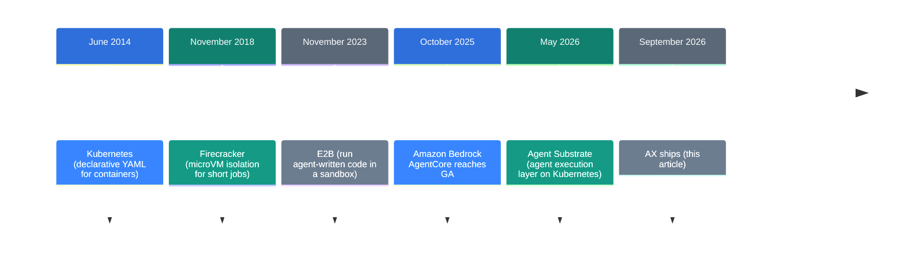
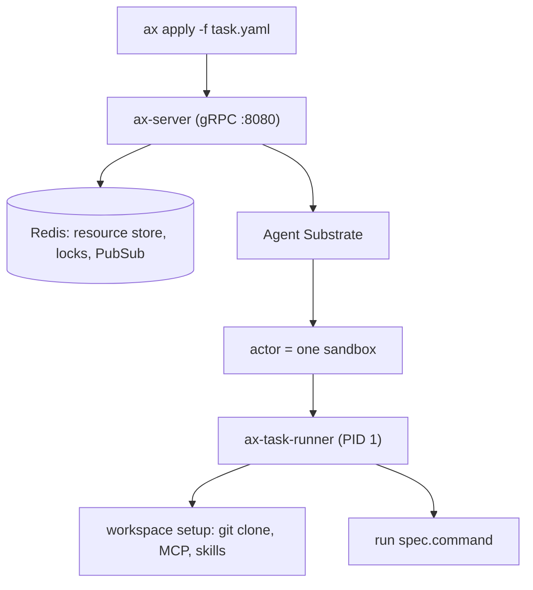

![[google-ax.en.mp4]]

[Source](https://github.com/google/ax) · [Repo](https://github.com/google/ax) · [한국어](https://neocello-ku.github.io/ko/trends/google-ax)

## Summary

In September 2026, Google published AX. AX is an orchestrator that declares agent work the way Kubernetes declares containers. It reached the top of Hacker News on 20 September, and it has 13,867 stars as of 17 October.

Seen against the last decade, AX treats an agent as one more thing you have to operate. The technique underneath is old. AX repackages what Kubernetes did in 2014 into an agent shape.

New to these terms? Start with the "If you are new" section below.

## Where this sits: why the story is happening now

Building agents has been well covered by now. The open question is where you run the thousands of agents you built.

An agent fits neither of the shapes we already operate. A web server keeps no state between requests; an agent accumulates it. A batch job runs once and exits; an agent waits around. Meanwhile it runs code you did not write, and it can spend money in a loop when nobody watches.



AX is the sixth step. The five before it built ways to isolate and run things. AX adds a way to write down what to run.

This ties back to an earlier note. "Eleven coding agents read from source: what a harness is" (2026-10-07) covered the loop inside the model. AX is the outer layer that isolates that loop and runs many copies. The AX v0.1.0 release note says it plainly: a distributed runtime for harnesses and agents.

"OpenAI dots" (2026-10-06) put always-on agents into a subscription. AX answers the same cost question by checkpointing an idle task and waking it later.

### What is new here

| What | Novelty | Why |
| --- | --- | --- |
| Declarative operations (technique) | Low | Kubernetes did this in 2014. There is no new algorithm. |
| Three primitives (product) | Medium | The Task, Workspace, and Model split is clear. You still need a cluster first. |
| State in Redis (infrastructure) | Medium | Avoiding etcd is a clear choice. Agent Substrate produces the density numbers. |

Nothing in AX is new on its own. Google is moving early so the open shape of this layer gets set on its terms.

## If you are new: what is this about

### An agent needs a guest room

Think about giving work to an AI agent. The agent edits code, runs shell commands, and sends requests to the internet.

Letting it do that on your own machine is risky, because the agent can delete the wrong file. So you give it a separate room and keep it there. That room is a sandbox.

One room is not the problem. Five hundred agents need five hundred rooms. You must track who is in each room, and whether they are working or idle.

### The hotel manager picture

AX is the hotel manager. A guest (an agent) arrives, the manager assigns a room, and the luggage is already inside.

- **Task** = one room, for one guest. You set the room size with CPU and memory.
- **Workspace** = the luggage put in ahead of time. Code repositories and the tools the agent may call.
- **Model** = a note that says which AI to call. The key comes from a Kubernetes secret.

When a guest naps, the manager folds the room and stores it (`ax suspend`), then unfolds it on return (`ax resume`). You pay nothing for the room in between.

### Why this helps

- The setup lives in a YAML file. It does not live in somebody's head or shell history.
- Several tasks share one workspace. You do not clone the same repository again and again.
- Idle tasks give their CPU and memory back to the cluster.

### Where you would use it

- Batch edits that apply the same change across hundreds of repositories
- A coding agent service where each customer needs an isolated environment
- Evaluation pipelines that must run code nobody has reviewed

### Names in this article

| Term | Plain meaning |
| --- | --- |
| Sandbox | An isolated room where an agent runs. |
| Manifest | A YAML file that says what to start and how. |
| Kubernetes | The tool that runs containers across many servers. |
| Agent Substrate | The layer below AX that makes and folds the rooms. Google published it in May 2026. |
| Actor | The unit Substrate manages. It keeps state while it sleeps and wakes. |
| MCP | A common protocol an agent uses to call outside tools. |
| Atespace | The partition that scopes AX resources, like a Kubernetes namespace. |
| Checkpoint | A saved copy of the current state. |

## How it works

The control plane has three parts. `ax` is the CLI on your laptop. `ax-server` is the gRPC server in the cluster. `ax-task-runner` is PID 1 inside each task container.



AX does not keep its state in Kubernetes CRDs. It keeps state in Redis, and the design document explains why.

Millions of short-lived tasks push etcd past its storage limits and its write rate. So AX steps around etcd, takes fine-grained distributed locks, and reconciles with Substrate directly.

Inside the task container, `ax-task-runner` starts as PID 1. The order is:

1. Read the Task spec and every bound Workspace spec.
2. Open probes on port 80 and the metadata server on `127.0.0.1:8099`.
3. Prepare each workspace. Clone the Git repositories and create the skills path.
4. Start `spec.command` as a child process and supervise it.

The runner stays up after the command exits. That is why `ax ssh` still works when your command has already died.

## What you need and how to run it

### Prerequisites

| Item | Requirement |
| --- | --- |
| Cluster | One Kubernetes cluster |
| Execution layer | Agent Substrate in the `ate-system` namespace |
| Tools | Go, `kubectl`, `ko`, and a container registry |
| Model key | A Kubernetes secret that holds a Gemini API key |
| Hardware | Not in the README. No node sizes or counts appear in the docs. |

The example manifest gives per-task resources. Requests are `cpu 500m` and `memory 1Gi`. Limits are `cpu 2` and `memory 4Gi`. They are sample values. Nothing in the docs calls them recommended.

### Step 1. Check that Agent Substrate is up

```bash
kubectl get svc api -n ate-system
```

AX looks for Substrate at `api.ate-system.svc.cluster.local:443`. Without it, the later steps have no meaning.

### Step 2. Install the CLI

```bash
go install github.com/google/ax/cmd/ax@latest
```

This puts the `ax` binary in `$(go env GOPATH)/bin`. That directory must be on your `PATH`.

### Step 3. Deploy the control plane

```bash
make deploy AX_IMAGE_REPO=<your-registry>
```

This starts Redis first. Then `ko` builds and pushes the control plane images. Everything lands in the `ax-system` namespace.

### Step 4. Declare the work

```yaml
apiVersion: ax.io/v1alpha1
kind: Workspace
metadata:
  name: golang
spec:
  git:
    - repo: https://github.com/golang/go.git
      branch: "my-fix"
---
apiVersion: ax.io/v1alpha1
kind: Task
metadata:
  name: test
spec:
  workspaces:
    - name: golang
      goal: "Ensure that Go tool chain is available and is built from source"
  debug: true
```

Set `debug: true` or `ax ssh` refuses to connect. The default is off. When on, the sandbox allows arbitrary process execution and file access.

### Step 5. Apply it and watch

```bash
ax apply -f task.yaml
ax get tasks
ax watch task test
ax ssh test -- ls -al /workspace
```

`ax watch` streams phase and condition changes live. Two conditions matter. `WorkspaceReady` turns true when setup finishes, and `Ready` turns true when the task also runs. Wait on `Ready`.

### Step 6. Pause and pick it up again

```bash
ax suspend task test
ax resume task test
```

A suspend sets `Ready` to false with the reason `TaskSuspended`. The Agent Substrate actor does the checkpoint itself.

## Fact check

| Claim | What I found | Verdict |
| --- | --- | --- |
| Billions of agent workloads per cluster (README) | The repository holds no benchmark and no measurement script. The density numbers come from Agent Substrate. | No evidence |
| It feels familiar if you know Kubernetes (README) | `apply`, `get`, `describe`, `watch`, and `delete` are all there. `--context` follows your kubectl context. | Matches |
| Three primitives handle the money-burning loop declaratively (README) | `TaskSpec` has no token or time budget field. It has CPU and memory limits only. Budgets and approval policies sit on the roadmap. | Overstated |
| Four primitives: Task, Workspace, Gateway, Model (InfoQ article) | The repository defines three. `Gateway` appears in no code and no document. | No evidence |
| Point the Model resource at any LLM (README) | It works when the provider is `google`. Any other value returns an `unsupported provider` error. | Overstated |
| Applied with a single command (README) | The apply is one command. Ahead of it sit a cluster, Substrate, `ko`, a registry, and a control plane deploy. | Conditional |
| 150,000 developers signed up in 48 hours (some secondary articles) | I cannot verify this. GitHub has no sign-up metric. | No evidence |
| Pick up exactly where it left off (README) | The `SuspendTask` and `ResumeTask` RPCs exist. Substrate performs the checkpoint. | Matches |

Only two public numbers are worth quoting here. Stars stand at 13,867 on 17 October 2026. The Hacker News post scored 666 points with 300 comments on 20 September 2026.

Two cautions go with all of this. The README opens with a warning about major breaking changes before a stable release. A code comment on the `goal` field says the team may remove it.

## When to use what

| Situation | What to use |
| --- | --- |
| Run hundreds of isolated agents on your own cluster | AX, with Kubernetes and Agent Substrate |
| Avoid operating a cluster yourself | A managed runtime such as Amazon Bedrock AgentCore |
| Run one snippet of code safely | A sandbox service such as E2B |
| Run a handful of agents on one server | Containers and shell scripts are enough |
| Design the loop inside the agent | That is a harness topic, not an AX topic |

## Sources

- [google/ax on GitHub](https://github.com/google/ax)
- [AX design document (DESIGN.md)](https://github.com/google/ax/blob/main/DESIGN.md)
- [AX core concepts](https://github.com/google/ax/blob/main/docs/concepts.md)
- [AX sandbox document](https://github.com/google/ax/blob/main/docs/sandbox.md)
- [AX roadmap](https://github.com/google/ax/blob/main/docs/roadmap.md)
- [InfoQ: Google Open-Sources AX (2026-09-22)](https://www.infoq.com/news/2026/09/google-ax-orchestrator/)
- [Google Cloud blog: Agent Sandbox on GKE and Agent Substrate (2026-05-21)](https://cloud.google.com/blog/products/containers-kubernetes/bringing-you-agent-sandbox-on-gke-and-agent-substrate)
- [AWS: Amazon Bedrock AgentCore is generally available (2025-10-13)](https://aws.amazon.com/about-aws/whats-new/2025/10/amazon-bedrock-agentcore-available)

## Related

- [[trends/harness-engineering|Eleven coding agents, read at source level: what a harness is]]
- [[trends/openai-dots|OpenAI dots: an always-on agent inside the subscription]]
- [[trends/buzz|Buzz: A Workspace Where People and AI Agents Share the Same Rooms]]

