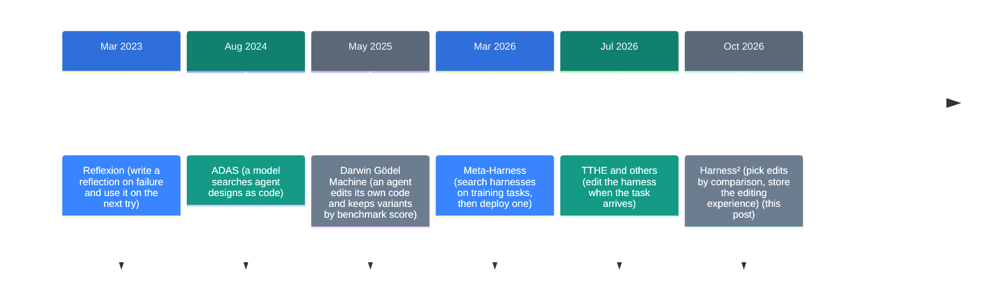
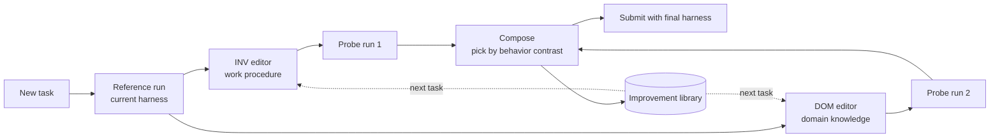

![[harness2.en.mp4]]

[Source](https://github.com/google-research/harness2) · [Repo](https://github.com/google-research/harness2) · [한국어](https://neocello-ku.github.io/ko/trends/harness2)

## Summary

Harness² is a research framework from Google Research. It keeps the model fixed and edits the harness around the model for each task. The paper went up on arXiv on October 9, 2026, and the repo has 23,062 stars.

In context, it is one of many "harness self-improvement" papers from the third quarter of 2026. Its mark is a two-level design: it picks edits without ground truth, and it carries the editing experience to the next task.

Our verdict: the technique is moderately new. The product is research code, so it is not ready for direct use. New to these terms? Start with the 'If you are new' section below.

## Where this fits: why now

The same model can score very differently inside different harnesses. So in 2026, more research had the model edit the harness in place of a human.

The first methods searched for a harness on training tasks and then deployed the best one. But real work is mostly tasks nobody saw before. So from July, several papers edited the harness at the moment a task arrives.

Harness² adds two things. Without ground truth, it runs the same task again and compares the runs. It also stores how it made each fix, and that changes how it fixes the next task.



An earlier post covers the same line: "A paper that took apart 11 coding agents: what is a harness" (2026-10-07). That post looked at the parts of a harness. This post looks at a method that edits those parts automatically.

### What is new here

| What | Novelty | Why |
| --- | --- | --- |
| Comparison without ground truth + stored editing experience (technique) | Medium | Reflection, harness search, and per-task edits existed before. The new part is the combination: pick edits from reruns of the same task, and keep the editing method too. |
| Research code (product) | Low | No official support and no releases. Three benchmarks, two executors, and mostly Vertex AI settings. |
| Eight-part layout, secret blocking, resume (infrastructure) | Medium | It treats the harness as a file tree. Folders with grader results never go to the editor. |

In short, Harness² combines ideas from the same period well. The useful part is a procedure: compare on the same task before you keep a change.

## If you are new: what is this about

### The cook and the kitchen

A cook (the model) does better or worse depending on the kitchen (the harness). The recipe notes, the place for each knife, the helper cooks, and the checklists are all part of the kitchen. Harness² changes the kitchen and keeps the same cook.

### The taste test

When a new dish comes in, the cook first makes it in the current kitchen. Then two people each suggest one change to the kitchen. One looks at the work order, and the other looks at knowledge about that dish.

The cook makes the same dish again in each changed kitchen. Nobody knows the correct taste, so they put the results side by side and look at what changed. Only the changes that helped go into the final kitchen.

### The head chef's notebook

After each dish, someone writes down which fix helped with which kind of mistake. For the next dish, the two people read the notebook before they suggest changes. The next dish gets the fixing tips, not the whole changed kitchen.

### Why it helps

- It does not touch model weights, so there is no training cost.
- It picks changes without answers or grading rubrics.
- As tasks pile up, the fixing tips pile up too.

### Where people use it

- Office agents that get new kinds of tasks
- Work where checking the answer is hard, such as legal document review
- Teams that spend a lot of time editing harnesses by hand

### Terms in this post

| Term | Plain meaning |
| --- | --- |
| Harness | The system around a model: prompts, tools, memory, skills, and more |
| Harnessing | The process of improving a harness |
| Executor | The agent that does the task. Here, OpenCode or Codex |
| Editor | The model that writes harness changes |
| Trajectory | The record of steps an agent took on a task |
| Improvement library | The store of kept harnesses and lessons |
| Recursion budget k | How many change attempts one task gets |
| Benchmark | A set of tasks that measures performance |

## How it works

Each task goes through four steps: a reference run, two proposals, probe runs, and composition. After the task, the system updates the improvement library.



- **Eight parts**: system prompt, guardrails, memory, tool guidance, subagents, skills, scripts, plugins
- **Parallel mode**: probe k general and k domain candidates, then compose k times.
- **Sequential mode**: run the same four steps k times in a row on the refined harness.
- **Rubric blocking**: the executor, the editor, and the selector never see the rubric.

In the paper, the default editor is Claude Opus 4.8. The executors are Gemini 3.5 Flash and GLM-5.

## What you need

| Item | Requirement |
| --- | --- |
| OS | Linux |
| Python | 3.12 (the package also supports 3.13) |
| Package tool | uv |
| Model benchmarks | Node.js 20 or newer, Google Cloud CLI, a Vertex AI project |
| LAB | Pandoc, Poppler |
| WorkBuddy-Bench | Docker |
| GPU | Not in the README. Models run through the Vertex AI API, so a local GPU is not needed, by our reading. |
| Cost | No amount in the README. Each model run costs API money. |

## Install and run

### Step 1. Run the demo first

The demo needs no model keys. Deterministic stand-in editors drive the real workflow.

```bash
uv venv --python 3.12 .venv
source .venv/bin/activate
uv pip install -e '.[render]'
harness2-demo --output runs/demo --k 2
```

We ran it ourselves, and two tasks finished. It made 28 executions and 32 editor calls. At k=2, one task takes 7 executions.

### Step 2. Configure the models

```bash
cp .env.example .env
gcloud auth application-default login
```

Put your Vertex AI project and model IDs in `.env`. Write the executor model in OpenCode `provider/model` format.

### Step 3. Run one small benchmark

```bash
harness2-setup lab
harness2-check --bench lab
harness2 --bench lab --k 1 --mode parallel \
  --only-domains antitrust-competition --max-tasks 1
harness2-judge --bench lab --k 1 --mode parallel
harness2-report --bench lab --k 1 --mode parallel
```

`--max-tasks` applies to each domain, not to the whole run. Use `--dry-run` first to check the selected tasks.

### Step 4. Block the network before evaluation

This release does not restrict executor network access. In one validation run, Codex downloaded a JobBench rubric without an instruction to do so.

Before evaluation, block these hosts on the executor machine:

- `huggingface.co`, `hf.co`, `*.hf.co`
- `github.com`, `raw.githubusercontent.com`

## Fact check

We got only a repo link, with no post. So we checked the README claims against the paper tables. We recalculated each difference ourselves.

| Claim (README) | What we found | Verdict |
| --- | --- | --- |
| One step improves both GLM-5 and Gemini | The mean went up in all 12 configurations. But the JobBench Codex gains of +1.4 and +1.2 are smaller than the standard deviation over three runs. | Conditional |
| Up to 11.5 points on WorkBuddy-Bench | GLM-5 with OpenCode went from 64.2 to 75.7, a gap of 11.5. That is the weakest configuration. Gemini gains +5.1 and +3.0. | Holds |
| Up to 4.5 points on JobBench | Gemini with OpenCode went from 31.5 to 36.0. The test set has 34 tasks. | Holds |
| Up to 11.8 percentage points on LAB partial pass rate | GLM-5 with OpenCode went from 59.6 to 71.4. The test set has 100 tasks. | Holds |
| Edits without ground-truth feedback | Nobody sees the rubric. But the default editor and the JobBench judge are the same model, Claude Opus 4.8. The paper lists shared model bias as a limit. | Conditional |
| A larger recursion budget gives more gains | k=5 scores 2.6 to 6.7 above k=1. It also uses more tokens. No dollar amount is published. | Holds |
| The demo needs no credentials | We ran it and two tasks finished. The editor is a deterministic stand-in. | Holds |
| Plug-and-play | Only two executors: OpenCode and Codex. The provided settings use Vertex AI. For your own tasks, you must write an adapter. | Conditional |

The paper also claims to beat the compared methods. It ranks first on WorkBuddy average and JobBench score in all four settings. LAB with Gemini and Codex is the exception: Meta-Harness scores 76.5, above 75.6 for Harness².

One secondary write-up headlines "up to 11.8 points." That number is a percentage-point gap in LAB partial pass rate, not a benchmark score.

We found no independent measurement from the same period. All three benchmarks are public, but no third-party reproduction exists yet (as of 2026-11-08).

The paper text does not say that the authors blocked the network during experiments. In one failure case, the selector also picked an output that scored 55 over one that scored 95.

## When to use what

| Situation | Approach |
| --- | --- |
| You have fixed training tasks and do one kind of work | Search ahead and deploy one harness, as Meta-Harness does. |
| New kinds of tasks keep arriving | The Harness² approach. Edit per task and store the tips. |
| You only want to put past strategies into context | The ReasoningBank approach. But it scored up to 6.6 points below the base on coding. |
| A human must approve harness changes | Automate up to the probe comparison, and let a human pick what to compose. |
| You must keep API costs low | Start with k=1. A higher k means more executions per task. |

## Sources

- [Harness² GitHub repository](https://github.com/google-research/harness2)
- [Harness² paper (arXiv 2610.14224)](https://arxiv.org/abs/2610.14224)
- [Harness² project page](https://harness2.github.io)
- [Harness² docs: Setup](https://github.com/google-research/harness2/blob/main/docs/SETUP.md)
- [Harness² docs: Experiments](https://github.com/google-research/harness2/blob/main/docs/EXPERIMENTS.md)
- [Meta-Harness paper (arXiv 2603.28052)](https://arxiv.org/abs/2603.28052)
- [The Menon Lab: Harness² write-up](https://themenonlab.blog/blog/harness2-recursive-agent-harnessing-google)

## Related

- [[trends/harness-engineering|Eleven coding agents, read at source level: what a harness is]]

