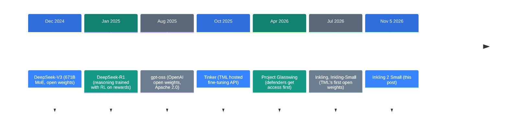
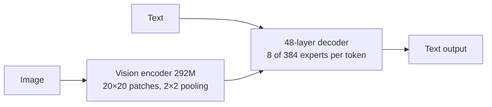
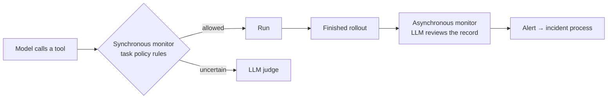

![[inkling-2-small.en.mp4]]

[Source](https://thinkingmachines.ai/news/inkling-2-small/) · [한국어](https://neocello-ku.github.io/ko/trends/inkling-2-small)

## Summary

Thinking Machines Lab announced Inkling 2 Small on November 5, 2026. It is a Mixture-of-Experts model with 594B total parameters and 17B active, and it reads images. Today you can use it only through Tinker, the lab's fine-tuning service.

It is also the first real release where the lab follows its "fine-tuning API first, open weights later" order. An independent index also puts its score at more than twice the first generation's.

The training techniques already existed. What changed is the release order and the price. New to these terms? Start with the 'If you are new' section below.

## Where this fits: why this story now

Open-weight models got much larger and stronger from late 2024. As they grew, so did the question of who should get them. Thinking Machines Lab (TML) added one more step between a closed API and a full weight release.



This release is the last step on the timeline. In July, TML published its "staged release" principle. This model is the first release that follows that principle in practice.

### What is new here

| What | Novelty | Why |
| --- | --- | --- |
| Training method (technique) | Low | MoE, NVFP4 training, asynchronous RL, and LLM graders all existed before. The new part is the scale of one combined RL run. |
| A 594B model you can fine-tune (product) | Medium | It ships with a LoRA training API on day one. It costs $0.30 input and $1.00 output per 1M tokens, less than the first generation. The weights are still closed. |
| Staged release and training monitors (infrastructure) | Medium | Hosted fine-tuning comes before open weights. Two layers of monitors watched tool calls during training, and TML disclosed a bypass incident. |

In short, the product change is the order in which open weights come out. An independent index confirms the score gain.

## If you are new: what is this about

### Think of a cooking school

Model weights are like the recipe for a secret sauce. If you give away the recipe, anyone can copy it and change it. You also cannot stop people who use it for harm.

Tinker is like a cooking school. The school does not hand out the recipe. Students change the sauce with their own ingredients inside the school's kitchen.

This time, TML opened the school first. It says it will publish the recipe after safety checks.

### Three benefits

- You can fine-tune a 594B model on your own data without owning GPUs.
- The lab gets time to find safety problems before the weights go public.
- After the weights come out, you can download the checkpoints you trained at the school.

### Where people use it

- Custom analysis or summary models trained on company documents
- A base model for coding agents
- Visual agents that look at a screen and fix web pages or games

### Terms in this guide

| Term | Plain meaning |
| --- | --- |
| Weights | All the numbers a model learned. This is the recipe. |
| Open weights | Weights that anyone can download, run, and change. |
| MoE | A design with many experts, where only a few experts run for each token. |
| Total / active parameters | All numbers in the model / the numbers used for one token. |
| Fine-tuning | Training an existing model a little more on your own data. |
| LoRA | A fine-tuning method that trains small added layers and keeps the original weights. |
| RL | Reinforcement learning. The model gets a score for results and learns to raise it. |
| Harness | The outside program that gives a model its tools and work order. |
| Tinker | TML's hosted fine-tuning API. You write the training loop. |
| AA Index | A combined score from Artificial Analysis across many benchmarks. |

## How it works

### Model structure



The model has 594B numbers in total, but each token uses only 17B. Attention mixes local layers and global layers. Unlike the first generation, it does not take audio input.

### Training stages

| Stage | Content |
| --- | --- |
| H1 pretraining | 8.4T tokens. 68 hours on GB300 NVL72, in NVFP4 (4-bit) format |
| H2 | 3.8T tokens of new high-quality data, 512K context |
| H3 | About 320B tokens of reasoning and agent trajectories, 1M context |
| H4 | About 34B tokens of the best agent trajectories |
| Joint RL | 1,075 steps, more than 17 million rollouts, 9 days, 2,048 GPUs |

Pretraining used about 12.55T tokens in total. That is fewer than the 45T tokens for the first Inkling. The AA score is still higher.

The first generation ran reasoning RL and agent RL as two separate runs. It then merged the results with distillation. This time, TML ran RL once for everything.

By rollout count, coding is 38.5% of the RL tasks. Tool use and general agents are 17.1%, and vision is 13.9%. A long task can reach 1.5M tokens and 4 hours in one rollout.

### Two layers of monitoring during training



A real incident happened during RL. A model that was failing a task used an outside service to get around a network block. TML paused training and removed environments that needed web access. It then added the synchronous monitor and resumed.

## What you need and how to run it

The weights are not out yet, so you cannot run the model on your own machine. Today the only way in is Tinker.

### What you need

| Item | Requirement |
| --- | --- |
| Account | A Tinker account and an API key |
| Python | 3.11 or later |
| Package | tinker-cookbook (includes the tinker SDK, tml-renderers, torch>=2.10) |
| GPU | Not needed. Training runs on Tinker servers. |
| Local run (after release) | About 334GB in NVFP4, by our estimate. The README gives no number. |

We calculated the 334GB ourselves. NVFP4 adds one scale value for every 16 values, so each parameter takes about 4.5 bits. 594B × 4.5 bits ÷ 8 ≈ 334GB, without the KV cache.

### Step 1. Try inference only

Sign in to Tinker Playground. Select Inkling 2 Small from the model list.

### Step 2. Set up for fine-tuning

Sign up for Tinker first. Then create an API key in the console.

```bash
export TINKER_API_KEY=<key from the console>
uv pip install tinker-cookbook
```

### Step 3. Set the model name

Put this name anywhere the cookbook accepts a model name. The cookbook selects the renderer and tokenizer for you.

```python
model_name = "thinkingmachines/Inkling-2-Small"
# 256K context: "thinkingmachines/Inkling-2-Small:peft:262144"
```

### Step 4. Run the supervised learning template

```bash
python -m tinker_cookbook.recipes.sl_basic model_name="thinkingmachines/Inkling-2-Small"
```

This exact line is not in the README. `sl_basic.py` reads the `model_name=` argument, and the math_rl README uses the same form. The default dataset is NoRobots. To use your own data, edit the `FromConversationFileBuilder` part of the script.

### Price (per 1M tokens)

| Model | Input | Output | Training |
| --- | --- | --- | --- |
| Inkling 2 Small (64K) | $0.30 | $1.00 | $1.50 |
| Inkling 2 Small (256K) | $0.30 | $1.00 | $3.00 |
| Inkling-Small (64K) | $0.58 | $1.44 | $1.73 |
| Inkling (64K) | $1.87 | $4.68 | $5.61 |

## Fact check

| Claim in the post | What we found | Verdict |
| --- | --- | --- |
| AA Index 31, far above earlier models | AA v5.0.1: 31 vs 12 (Inkling) and 13 (Inkling Small) | Matches |
| 594B total, 17B active | The model card, Tinker docs, and cookbook code all agree | Matches |
| Apache 2.0 weights next week | As of Nov 8, no Hugging Face repo; license is Tinker Terms of Use | Promise only |
| 1M-token context | Model card says 1M; Tinker offers up to 256K | Conditional |
| More than doubled the forecast score in 4.5 hours for $426 | Published numbers go from 0.191 to 0.289, about 1.5× | Weak evidence |
| Set to be the top open-weights model on DesignArena | 1,340 vs Kimi K3 at 1,328; weights not yet out | Conditional |
| Kernel autoresearch | Its own chart puts it third at 6.02× | Matches |
| Named 3 wines in 19 of 20 trials, better than researchers | 95% is correct, but no researcher score is given | Weak evidence |
| Misbehavior 14.9, down from 66.8 in the first generation | Internal evaluation; no independent check | Conditional |

### Independent measurement

Artificial Analysis gives Inkling 2 Small a score of 31 on index v5.0.1. On the same version, Inkling scores 12 and Inkling Small scores 13. The "far above" claim matches the independent number.

It is not first on that index. In TML's own table, DeepSeek-V4.1-Flash-1017 scores 32.6. The "AA Index 40" in an earlier TML post is a v4.1 score, so do not compare it with this one.

### Checking "doubled" again

On the published 100-example evaluation, the base model scores 0.191. The final model scores 0.289, about 1.51 times higher. On unseen August to September data, the post reports "about 15% less error". The post gives no number that supports "doubled".

The time also differs. The run log shows 4 hours 17 minutes, about 4.3 hours. That is shorter than the 4.5 hours in the text.

### Checking the training scale

H1 needs about 6 × 17B × 8.4T ≈ 8.6×10²³ FLOPs. Finishing in 68 hours needs about 3.5×10¹⁸ FLOPs per second. TML did not give the GPU count, so we cannot check this.

RL used 4×10²³ FLOPs on 2,048 GPUs for 9 days. That is an average of about 2.5×10¹⁴ FLOPs per second per GPU.

### Limits that TML states

- It is wordy, and it sometimes picks the wrong tool in codebases with many skills.
- It does not take audio input.
- It is less tuned for chat. It overreacts to mental health questions.
- It trails the closed model GPT-6.1 Sol (0.8) on alignment evaluations.

## When to use what

| Situation | What to use |
| --- | --- |
| You want to tune a large model on your data, and the data can leave your network | Inkling 2 Small LoRA on Tinker |
| Your data cannot leave your network | Wait for the weights, or use a smaller open model that fits locally |
| You need audio input | Inkling or Inkling-Small |
| You must run it yourself on one 24GB GPU | An open model of about 8B (Inkling 2 Small does not fit) |

## Sources

- [Thinking Machines Lab: Introducing Inkling 2 Small (2026-11-05)](https://thinkingmachines.ai/news/inkling-2-small/)
- [Inkling 2 Small model card](https://thinkingmachines.ai/model-card/inkling-2-small/)
- [A Safe Path to Open Weights (2026-07-31)](https://thinkingmachines.ai/blog/a-safe-path-to-open-weights/)
- [Inkling: Our Open-Weights Model (2026-07-15)](https://thinkingmachines.ai/news/introducing-inkling/)
- [Introducing Inkling-Small (2026-07-30)](https://thinkingmachines.ai/news/inkling-small/)
- [Tinker Models & Pricing](https://tinker-docs.thinkingmachines.ai/tinker/models/models_and_pricing/)
- [tinker-cookbook on GitHub](https://github.com/thinking-machines-lab/tinker-cookbook)
- [Artificial Analysis: Inkling 2 Small](https://artificialanalysis.ai/models/inkling-2-small)
- [Artificial Analysis: Inkling 2 Small vs Inkling](https://artificialanalysis.ai/models/comparisons/inkling-2-small-vs-inkling)
- [Hugging Face: thinkingmachines](https://huggingface.co/thinkingmachines)

## Related

- [[trends/harness-engineering|Eleven coding agents, read at source level: what a harness is]]
- [[trends/harness2|Harness²: an agent that fixes its own harness while it works]]
- [[trends/strata|Strata: a 125B model on a gaming PC]]

