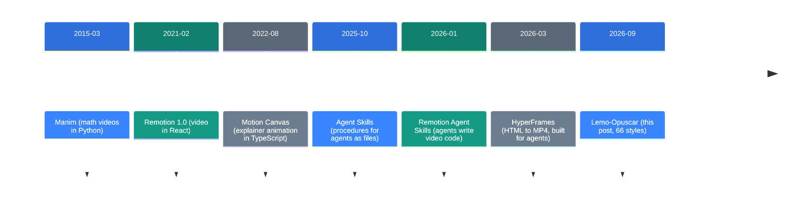
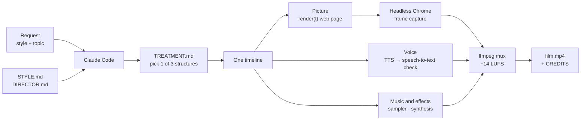

![[lemo-opuscar.en.mp4]]

[Source](https://github.com/lemomo-ai/lemo-opuscar) · [Repo](https://github.com/lemomo-ai/lemo-opuscar) · [한국어](https://neocello-ku.github.io/ko/trends/lemo-opuscar)

## Summary

Lemo-Opuscar is a style library that lets Claude Code make short films with code only. Each of its 66 styles has one style guide and the source of one demo film. It came out on 26 September 2026 and passed 13,000 GitHub stars in six weeks.

In the larger picture, it is the newest step in the "video drawn by code" line that Manim and Remotion started. In 2026, coding agents began to write that code for people. This repo adds art and directing rules on top.

The short answer: the rendering technique is not new. The new part is the product, which writes style and directing down as documents that an agent can follow. New to these terms? Start with the 'If you are new' section below.

## Where it fits: why this matters now

AI video moves along two lines. On one line, a video model paints the pixels itself. On the other, a person or an agent writes code, and a computer turns that code into frames.

The second line is old. Since 2026, though, coding agents write the video code for people.



Lemo-Opuscar sits at the last step. Claude Opus 5.5 came out on 22 September 2026, and this repo opened four days later. The repo says the author tuned its styles for Opus 5.5.

This links to earlier trend notes. "Genie 4" (2026-10-29) is on the line where a model paints the pixels. Lemo-Opuscar is on the opposite line, where code draws every frame.

"LongCat-Video-Avatar 1.5" (2026-05-21) is also on the model line. "CogFree" (2026-10-11) split thinking moves into skill files. Lemo-Opuscar puts each style into one STYLE.md file in the same way.

### What is new here

| What | How new | Why |
| --- | --- | --- |
| Web page, then frame capture, then ffmpeg (technique) | Low | Remotion (2021) and HyperFrames (2026-03) work the same way. |
| 66 styles plus directing guides (product) | Medium | It gives art and directing rules, not API usage. No comparison with other models exists. |
| One timeline for picture, voice and music (infrastructure) | Medium | It checks voice with speech-to-text and checks reading time for text. It is not a new standard. |

In short, Lemo-Opuscar packages an old technique as a product. The interesting part is the guide documents. They tell the agent what to draw and by which rules.

## If you are new: what is this about?

### Hand over a score, not a request to a painter

Say you want a picture. One way is to tell a painter "something like this" and wait. The other way is to write a score that says "at second 3, put this colour here" and let a machine play it.

A video model works the first way. It is fast, but the same request gives a different picture each time. Video drawn by code works the second way. The same score always gives the same video.

Lemo-Opuscar lets an AI agent write that score. It also gives the agent 66 sets of composing rules, such as how to write a watercolour score.

### Why it helps

- The same code gives the same video. You can fix one scene and render it again.
- Numbers and text stay exact, because code draws the data and maps.
- You do not pay for a video model or a GPU server. You pay for agent tokens instead.

### Where people use it

- Videos of 30 seconds to 2 minutes that explain data or a process
- Short product or presentation videos
- Repeated videos that must keep brand colours and fonts (saved as your own style)

### Terms in this post

| Term | Plain meaning |
| --- | --- |
| Coding agent | An AI that writes code and runs it. Here, Claude Code. |
| Skill or plugin | A bundle that gives an agent a work procedure as files. |
| STYLE.md | The fixed rules of one style: texture, colour, type, motion, camera and sound. |
| Rendering | Turning code into real frames on screen. |
| Headless browser | Chrome that runs with no window. It captures a web page as frames. |
| TTS | Text-to-speech, a voice that reads text aloud. The default is Kokoro. |
| LUFS | A unit of loudness. Finished films aim for about −14 LUFS. |

## How it works

One film is one web page. The page has a function `render(t)` that draws the picture for time `t`. One timeline drives the picture, voice, music, sound effects and subtitles together.



The agent writes its own treatment before it looks at the demo. This stops it from copying the demo's story. Before delivery, it compares six points with the demo, and at least four must differ.

The guides set four checks before delivery.

| Check | What it does |
| --- | --- |
| On-screen text | `readcheck.mjs` checks that each text stays long enough to read. |
| Voice | Speech-to-text reads the TTS output back and matches it to the script. |
| Loudness | About −14 LUFS, with no black frames. |
| Fix rounds | Fix all found problems in one round, then check once more. |

## What you need and how to run it

| Item | Requirement |
| --- | --- |
| Agent | Claude Code. The styles are tuned for Opus 5.5. |
| System tools | Node 20+, ffmpeg 7+, Python 3.11+ or uv |
| Operating system | Built on macOS (Apple silicon). For Linux, the docs only say it "should work". On Windows, use Git Bash or WSL. |
| GPU | The docs say 3D and shader styles want a GPU. The README gives no GPU specs. |
| Disk | About 350 MB for the core. Voice adds about 0.55 GB plus a Whisper model. |
| Time | The README says 30 to 60 minutes per film. It gives no token numbers. |

### Step 1. Check your ffmpeg version

```bash
ffmpeg -version
```

On Ubuntu 24.04, the default ffmpeg 6.1 is too old. In that case, get a static build.

### Step 2. Install the plugin

```sh
claude plugin marketplace add lemomo-ai/lemo-opuscar
claude plugin install lemo-opuscar@lemolab
```

On first use, it downloads the guides and tools to `~/lemo-opuscar`. Each film project goes in the folder you started from.

### Step 3. Ask for the film in one line

The README gives this example.

```text
Make a 45-second film in the watercolor style about the coffee farm my family runs. Warm female narrator.
```

Pick a style name from the [style index](https://github.com/lemomo-ai/lemo-opuscar/blob/main/styles/README.md). If you are not sure what to do, type only `/lemo-opuscar:lemo-opuscar`.

### Step 4. Answer one round of questions

The agent asks once, at the start. It asks what it cannot decide about your topic. It asks if you have your own voice or music. It asks if you want a storyboard first.

### Step 5. Check the output

The project folder gets these files.

- `<name>.mp4` and `poster.jpg`
- `<name>.srt` (when the film has narration)
- `TREATMENT.md` (the plan)
- `CREDITS` (third-party assets and their licences)
- The source and `build.sh` (rebuild with one command)

Read `CREDITS`. You are responsible for the material in your film.

### Step 6. Save it as your own style (optional)

```text
I want to change the Ukiyo-e style into my own version.
```

The agent then asks one question at a time to set the changes. When you are happy, it saves the style to `~/lemo-my-styles/<name>/`.

## Fact check

There was no social post, so we checked the README claims against the code and files.

| Claim (README) | What we found | Verdict |
| --- | --- | --- |
| 66 styles ready to use | `styles/` has 66 folders, each with a STYLE.md and demo source. | Matches |
| No video generation, no stock footage | The code calls no video model. But 8 styles cut real archive footage. | Conditional |
| Claude Opus 5.5 wrote every frame in code | The source of all 66 demos exists. "Opus 5.5 wrote it" is the author's word, with no record. | Conditional |
| Music is original scores from free sample libraries | There is sampler code and a script that fetches 5 instrument libraries. | Matches |
| Voice is TTS narration | The default is offline Kokoro. Six demo voice tracks used online TTS and are not CC BY. | Matches |
| A film takes 30 to 60 minutes and a fair amount of tokens | The repo has no measurements or token counts. | No evidence |
| Tuned for Opus 5.5; other models may not reproduce it | There are no results from other models. Read it as a warning. | Conditional |
| OPUSCAR 98: 77 in 2D, 4 in 2.5D, 17 in 3D | It matches the 98 entries in the data file. But 81 styles are on screen for only 2.5 seconds each. | Matches |
| Code is MIT, demo films are CC BY 4.0 | LICENSE is MIT. Third-party assets follow each CREDITS file. | Matches |

### A closer look at "no stock footage"

No video model draws the picture. Canvas, WebGL and three.js code draws each frame. But the 8 Edit & Documentary styles cut real archive footage.

That footage is public domain material, such as films from the US National Archives (NARA). The 3D demos use CC0 models and lighting files from Poly Haven. So "no paid stock library" is the accurate claim.

### OPUSCAR 98, recalculated

77 in 2D + 4 in 2.5D + 17 in 3D = 98, which matches. Here is the screen time per style, added up.

- 81 × 2.5 s = 202.5 s
- 10 × 5 s = 50 s
- 4 × 3.33 s = 13.3 s
- 3 × 6.67 s = 20 s

The total is about 286 seconds, or 4 minutes 46 seconds. In the 6:31 film, most styles appear for 2.5 seconds. These 98 styles are separate from the 66 in `styles/`, and only one frame and a style prompt are public for each.

### Independent measurements from the same period

We found no public benchmark that compares the quality of code-rendered video. We also found no side-by-side test with Remotion Agent Skills or HyperFrames on the same topic. The only way to judge quality is the demo films in the gallery.

## When to use what

| Situation | What to use |
| --- | --- |
| You need a short film with a clear visual style | Pick a style in Lemo-Opuscar. |
| You want to build video like an app, in React | Use Remotion and Remotion Agent Skills. |
| You want HTML and CSS, with fewer licence worries | Use HyperFrames (Apache-2.0). |
| You need math or shape-based explainers | Use Manim. |
| You need photo-real scenes | Use a video generation model. Code rendering does this poorly. |
| You run a model other than Claude | Test a short film first. The repo does not promise the quality. |

## Sources

- Lemo-Opuscar repo: https://github.com/lemomo-ai/lemo-opuscar
- Gallery: https://lemomo-ai.github.io/lemo-opuscar/
- Manim: https://github.com/3b1b/manim
- Remotion v1.0.0 release: https://github.com/remotion-dev/remotion/releases/tag/v1.0.0
- Motion Canvas: https://github.com/motion-canvas/motion-canvas
- Remotion Agent Skills: https://github.com/remotion-dev/skills
- HyperFrames: https://github.com/heygen-com/hyperframes
- Claude Opus 5.5 launch report: https://technews.tw/2026/09/23/anthropic-upgrades-claude-with-new-opus-5-5-model/

## Related

- [[trends/genie-4|Genie 4: a world model that draws, sounds, and talks in real time]]
- [[trends/longcat-avatar-15|LongCat-Video-Avatar 1.5: A Talking Video From One Photo]]
- [[trends/cogfree|CogFree: 28 thinking moves, one file each]]

