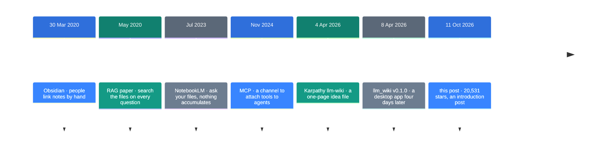
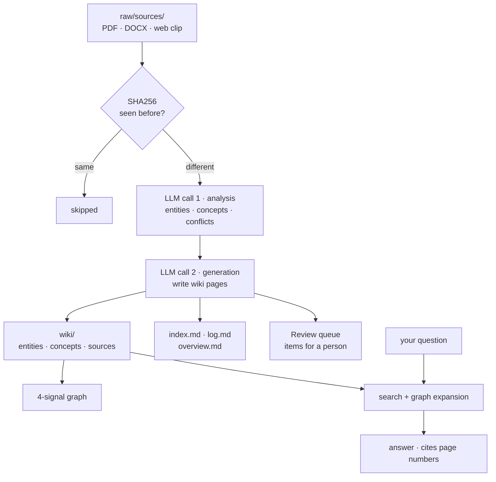

![[llm-wiki.en.mp4]]

[Source](https://x.com/trendtech33566/status/2109412212431565299) · [Repo](https://github.com/nashsu/llm_wiki) · [한국어](https://neocello-ku.github.io/ko/trends/llm-wiki)

## Summary

LLM Wiki is a desktop app. An LLM reads your documents and writes a markdown wiki from them. A Japanese post introduced the app on 11 October 2026.

In context, it is an implementation of a one-page note Karpathy posted on 4 April. The repo appeared four days later.

The method here is old. What changed is the packaging: a copy-paste note became an app you install. The project is also six months old, so this is hardly fresh news. New to these terms? Start with the "If you are new" section below.

## Where this sits in the flow

For five years, the way to ask questions about your own documents was RAG. Each question sends the model back to the files for matching fragments, and the answer leaves nothing behind.

Ask a question that needs five documents joined, and the model redoes that joining from zero every time. Nothing accumulates, which is the weak point.

On 4 April 2026, Karpathy posted a gist with a different order: edit the wiki when a source arrives, instead of searching at answer time.



LLM Wiki starts on the second to last line, with its first release four days after the gist.

### One idea file, three implementations

Three different builds appeared within a week. These numbers come from the GitHub API on 12 October 2026.

| Build | Created | Stars | Form |
| --- | --- | --- | --- |
| lucasastorian/llmwiki | 2026-04-04 | 1,681 | Web app + MCP server |
| Astro-Han/karpathy-llm-wiki | 2026-04-05 | 2,472 | A single agent skill |
| **nashsu/llm_wiki** | 2026-04-08 | **20,531** | Desktop app |

The star counts differ by more than ten times, and the build that started last got the most. The form explains it: only the app you install and open reached people who avoid a terminal.

Stars count attention. Quality is a separate question.

### Earlier notes in this archive

- [Build a research agent: put an evidence ledger at the center](/trends/research-engineering) (2026-10-07)
- [EmbeddingGemma 2: text, images, audio and video in one vector](/trends/embeddinggemma-2) (2026-10-07)
- [Foresight: Google's Mac meeting-note app](/trends/foresight) (2026-10-12)

The evidence ledger in the first note and the source tracking here share one idea. The second note covers a model you can plug into this app's vector search. The third follows the same move toward searching your own files on your own machine.

### What is new here

| What | Novelty | Why |
| --- | --- | --- |
| Wiki accumulation, links, split steps (method) | Low | All of it existed before. The gist described the pattern four days earlier. |
| Copy-paste note to installed app (product) | High | 61 releases in six months and 20,531 stars. It has a three-column window and a settings screen. |
| A channel that opens the wiki to other agents (infrastructure) | Medium | It adds a local HTTP API and an MCP server. MCP itself dates to 2024. |

Nothing here is an invention. A four-day-old pattern reached product form faster than anyone else managed, and that speed is the interesting part. Of the three who read the same page, only the one who built an app got 20,531 stars.

## If you are new: what is this about

### A photocopier and a librarian

There are two ways to keep documents and ask questions about them.

The first is a photocopier. Each question sends you to the shelves to copy the relevant pages. You read the copies and answer. Then you throw the copies away. Tomorrow a similar question sends you back. That is RAG.

The second is a librarian. A new book arrives and the librarian reads it on the spot. Then the librarian edits the index cards. Author cards, subject cards, and notes where the new book contradicts an old card. A question arrives, and the cards are already sorted.

LLM Wiki is the librarian. The work finishes the moment you drop a file in.

### Why this helps

- The wiki grows as sources grow. Pages exist for questions you never asked.
- The LLM marks contradictions between sources at ingest time.
- The output is a plain markdown folder, so Obsidian opens it directly.

### Where people use it

- A months-long study that covers dozens of papers
- Reading notes that build up characters and plot across a book
- A team wiki fed by meeting notes and customer calls

### Names in this guide

| Term | Plain meaning |
| --- | --- |
| RAG | A method that finds matching fragments at question time and hands them to the model. |
| Ingest | The action that reads one source and turns it into wiki pages. |
| Wikilink | A link shaped like `[[name]]`. It joins markdown notes. |
| Frontmatter | The YAML header at the top of a markdown file. The source list goes here. |
| Embedding | A list of numbers that stands for a text. Close meanings give close numbers. |
| Louvain | An algorithm that finds clusters in a graph. |
| MCP | A protocol that attaches outside tools to agents. It arrived in November 2024. |
| Tauri | A framework for desktop apps with a Rust backend. This app sits on it. |

## How it works

One source triggers two LLM calls. The app does not read and write in a single pass.



There are three layers. The app never edits `raw/sources/`. The LLM owns everything in `wiki/`. The files `purpose.md` and `schema.md` hold the rules.

The app remembers each source by its SHA256 hash. It skips unchanged files, which saves tokens.

### The path a question takes

| Step | What happens |
| --- | --- |
| 1 | Token search. Korean, Chinese and Japanese text splits into two-character pairs. A title match adds 10 points. |
| 1.5 | Vector search. This step is optional and off by default. |
| 2 | Graph expansion. Search hits become seeds, and the app walks two hops out. |
| 3 | Budget split. Wiki 60%, chat history 20%, index 5%, system prompt 15%. |
| 4 | Context assembly. Pages get numbers, and the model cites them as `[1]`. |

The 4-signal relevance score weights a shared source at ×4.0 and a direct link at ×3.0. A shared neighbor counts ×1.5, and a matching page type counts ×1.0.

## Requirements and setup

### Requirements

| Item | Value |
| --- | --- |
| OS | macOS (Apple Silicon), Windows, Linux |
| RAM and disk | Not in the README |
| App install | Pre-built files exist, so you need no build tools |
| Source build | Node.js 20+, Rust 1.88+, protoc |
| LLM | An outside API key or a local Ollama. You need one of them |
| License | GNU GPL v3.0 |

The app runs on Tauri and stays light, so the cost sits on the LLM side. Each source costs two calls, and an outside API bills in proportion to the source count.

### Install

The shortest path is the pre-built file.

1. Open the Releases page.
2. Download the file for your OS.
3. Open the app and create a project.
4. Pick an LLM provider and model in Settings.
5. Add documents in the Sources tab.

```
https://github.com/nashsu/llm_wiki/releases
```

To build from source, run the README commands as written.

```bash
git clone https://github.com/nashsu/llm_wiki.git
cd llm_wiki
npm install
npm --prefix mcp-server ci && npm run mcp:build
npm run tauri build
```

### Running it without an API key

The README provider list omits two CLI providers that the code has. The file `src/components/settings/llm-presets.ts` holds a preset named "Claude Code CLI (local)". Its hint reads `Uses the local 'claude' binary — no API key needed`.

The set `PROVIDERS_WITHOUT_KEY` in `src/lib/has-usable-llm.ts` holds four entries.

```
ollama · custom · claude-code · codex-cli
```

If you already pay for Claude Code or Codex, you need no separate key. The README does not document this path. Run the connection test in Settings before you rely on it.

### Opening the wiki to other agents

The app serves a JSON API at `http://127.0.0.1:19828`. A token guards it and it accepts only 127.0.0.1. Turn it on and mint a token under Settings → API + MCP.

| Route | What it does |
| --- | --- |
| `GET /api/v1/projects` | List projects |
| `POST /api/v1/projects/{id}/search` | Hybrid keyword and vector search |
| `GET /api/v1/projects/{id}/graph` | The wikilink graph |
| `GET /api/v1/projects/{id}/reviews` | Items waiting for a person |
| `POST /api/v1/projects/{id}/sources/rescan` | Re-read the source folder |

The MCP server calls the same API. The agent skill lives in a separate repo.

```bash
npx skills add https://github.com/nashsu/llm_wiki_skill.git --skill llm-wiki
```

## Fact check

The original post said this.

> LLM Wiki、⭐️約2万。手持ちの資料からAIが自動でWikiを育てるデスクトップアプリ。
> ・PDFやOffice文書、Web記事をWiki化 ・関連する知識をリンクでつなぐ
> ・資料の追加や変更を検知して更新 ・元の資料をたどりながら質問できる

| Claim | What I found | Verdict |
| --- | --- | --- |
| About 20,000 stars | The count is 20,531. That is the GitHub API value on 12 October 2026. | Correct |
| A desktop app that grows a wiki on its own | Correct. It is a Tauri v2 app, and the two-step ingest writes and edits pages. | Correct |
| Turns PDFs, Office files and web articles into a wiki | Correct. It takes PDF, DOCX, PPTX, XLSX, EPUB/MOBI and a Chrome clipper. | Correct |
| Links related knowledge together | Correct. Wikilinks plus a 4-signal score and Louvain clusters. | Correct |
| Detects added or changed sources and updates | A folder watcher and a SHA256 cache exist. You must turn the watcher on, and it watches only `raw/sources/`. | Correct with conditions |
| You can ask questions and follow the original source | Correct. Every page carries `sources: []` in frontmatter, and a sources-only mode exists. | Correct |
| (Implied) This just came out | No. The repo appeared on 8 April 2026. The newest release is from 28 September, and the repo has been quiet since. | Not news |

### Where the README disagrees with the code

I checked the README on its own terms. Four statements do not hold up against the code and the repo.

| README statement | What the code and repo show | Verdict |
| --- | --- | --- |
| Vector search lifts recall from 58.2% to 71.4% | The repo holds no benchmark code, no query set and no method. | No evidence |
| Two-step ingest improves quality a lot | The repo holds no comparison against a single-step run. | No evidence |
| The interface is English and Chinese | `src/i18n/` holds en, zh, it and ru. Korean is absent. | README is stale |
| Providers are OpenAI, Anthropic, Google, Ollama and Custom | The code holds nine providers. It adds azure, minimax, claude-code and codex-cli. | README undercounts |

The last row is an error in the user's favor. The other two mean you should not trust those numbers.

### How far Korean support goes

The three layers differ, so split them.

- **Interface text**: no. `src/i18n/` has no Korean file.
- **Reading documents**: yes. Search splits Chinese, Japanese and Korean into two-character pairs.
- **Wiki output language**: the README lists English and Chinese only. No documented setting asks the model for Korean.

A Korean README exists. That is separate from the app screen.

## When to use what

| Situation | Approach |
| --- | --- |
| You study one subject for months | LLM Wiki. Accumulation pays off here. |
| You read ten documents once today | A RAG tool such as NotebookLM. No reason to build a wiki. |
| You prefer a terminal and skip installers | The Karpathy gist, or the agent-skill build. |
| Your sources cannot leave the machine | LLM Wiki with Ollama. The model stays local too. |
| You need a Korean interface | Not yet. The screen is English only. |
| You already keep an Obsidian vault | LLM Wiki. The output folder opens as a vault. |
| You want this code inside a commercial product | Check the GPL v3 terms first. |

## Sources

- [Original post (2026-10-11)](https://x.com/trendtech33566/status/2109412212431565299)
- [Repo nashsu/llm_wiki](https://github.com/nashsu/llm_wiki)
- [Karpathy gist llm-wiki.md (2026-04-04)](https://gist.github.com/karpathy/442a6bf555914893e9891c11519de94f)
- [Agent skill repo](https://github.com/nashsu/llm_wiki_skill)
- [Same-week build lucasastorian/llmwiki](https://github.com/lucasastorian/llmwiki)
- [Same-week build Astro-Han/karpathy-llm-wiki](https://github.com/Astro-Han/karpathy-llm-wiki)
- [RAG paper (2020-05)](https://arxiv.org/abs/2005.11401)
- [Obsidian release date](https://en.wikipedia.org/wiki/Obsidian_(software))

## Related

- [[trends/research-engineering|Building a research machine: put the evidence ledger first]]
- [[trends/embeddinggemma-2|EmbeddingGemma 2: text, images, sound, and video in one vector]]
- [[trends/foresight|Foresight: Google's Mac note app that keeps meeting audio on the machine]]

