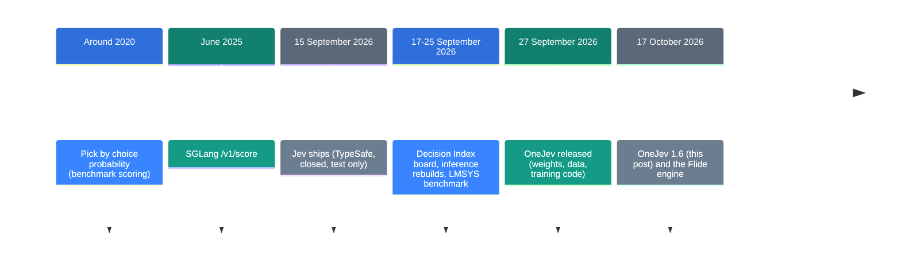
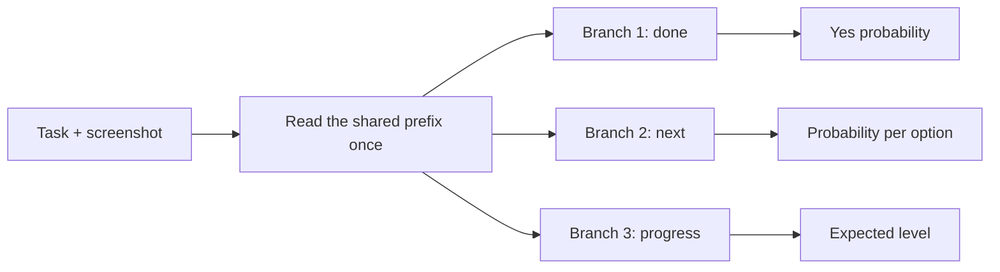

![[onejev.en.mp4]]

[Source](https://github.com/OmniJev/OneJev) · [Repo](https://github.com/OmniJev/OneJev) · [한국어](https://neocello-ku.github.io/ko/trends/onejev)

## Summary

OneJev is an open-weight model that looks at a screen, a photo, a video or text. It answers fixed questions with one probability per option. It takes the "pick, don't write" idea from the closed Jev model and moves it to open weights and images.

The method is old. The product and the inference server are moderately new. On an independent leaderboard its probabilities are well calibrated, but its scores on unseen domains are far below the README numbers.

New to these terms? Start with the 'If you are new' section below.

## Where this sits in the story

On 15 September 2026, TypeSafe shipped Jev, a model that picks answers and writes no prose. Jev has closed weights and reads text only. Over the next two months, open models doing the same job kept appearing.

An earlier post here, [Let a local LLM pick an answer instead of writing one](/trends/jev-local) (6 October 2026), covered the first wave. That article rebuilt only the inference path of Jev. It had no trained weights and no calibration. OneJev releases exactly those missing parts.



This post covers the fifth and sixth steps. By then, projects had moved from copying the inference trick to publishing trained models.

### What is actually new here

| What | Novelty | Why |
| --- | --- | --- |
| Label probabilities + Brier loss + temperature calibration (method) | Low | All three are old (1950, 2017, around 2020). |
| Four open multimodal decision models (product) | Medium | Jev reads text only. OneJev reads screens and video and ships its training code. But open decision models are already common. |
| Branched inference + compatible server (infrastructure) | Medium | It reads the shared prefix once and branches per question. It speaks the Jev API format, so existing SDKs work unchanged. |

OneJev invents no new method. It turns the category that Jev opened into an open-weight product.

## If you are new: what is this about

### A decision model only takes multiple-choice exams

A chat model such as ChatGPT takes essay exams. It gets a question and writes a sentence. A decision model takes only multiple-choice exams. It writes nothing and gives a confidence number for each option.

Ask "Was the invoice paid?" and a decision model says "yes, 92%". Ask "What next?" and it might say "click 70%, type 20%, scroll 8%, stop 2%".

### The probabilities must be honest

Imagine 100 questions where the model said "90% sure". An honest model gets about 90 of them right. We call this property **calibration**. With good calibration, you can trust a rule such as "act automatically above 85%".

### Why it helps

- It is fast. It writes no text, so the model runs only once or twice.
- The answer is always one of the options. You never get a stray sentence.
- You get a confidence number. Your code can decide when a person must check.

### Where people use it

- Check from a screenshot whether a computer-use agent finished its task
- Screen photos before they go live on a site
- Tell which step of a process a video shows

### Names in this post

| Term | Plain meaning |
| --- | --- |
| Decision model | A model that writes no text and returns a probability for each fixed option. |
| Jev | TypeSafe's closed decision model. It reads text only. |
| System One API | The request format Jev uses. The OneJev server accepts the same format. |
| Calibration | Making the stated probability match the real hit rate. |
| ECE | Expected calibration error. The average gap between stated probability and real accuracy. Lower is better. |
| Forward pass | One run of the input through the model. |
| Fine-tuning | Extra training of an existing model on your own data. |
| GGUF | The model file format llama.cpp reads. It runs on Macs and CPUs too. |
| Decision Index | A public leaderboard that scores decision models on the same questions. |

## How it works

OneJev is a fine-tuned Qwen model. It supports three question types.

| Question type | What it returns | Example |
| --- | --- | --- |
| `noul` | One probability of "yes" | Invoice paid? → 0.92 |
| `choice` | One probability per option (up to 255 options) | Next action → click 0.70 … |
| `score` | Expected level (2 to 10 levels) | Progress → 2.4 / 3 |

With several questions, the model reads the screen and the task once. Then it branches per question and reads only the probabilities at the answer position.



One question takes one forward pass. Several questions take one pass for the shared prefix and one batched pass for the branches. The model generates no tokens.

The base models are Qwen3.5-0.8B, 4B and 9B, and Qwen3.8-27B. Training froze the vision tower and ran for one epoch. The loss is cross-entropy plus the Brier score, an old way to grade probability forecasts.

## What you need

| Item | Requirement |
| --- | --- |
| GPU | The README gives no memory figure. See the estimate below. |
| Flide backend | NVIDIA GPU. Text, images and video. |
| llama.cpp backend | GGUF files. Text and images only. Works on a Mac. |
| Python | 3.10 or later (qev); the example uses 3.12 |

The memory estimate counts bf16 weights only: parameter count times 2 bytes.

The 0.8B model needs about 1.7 GB and the 4B model about 9.1 GB. The 9B model needs about 18.8 GB and the 27B model about 54.7 GB. Images and the cache need more memory on top.

## Run it

### Step 1. Start the server (NVIDIA GPU)

```bash
uv venv -p 3.12 && source .venv/bin/activate
uv pip install flide torchvision
flide serve --model OmniJev/OneJev1.6-0.8B --port 8000
```

The first run downloads the model. The server listens on port 8000.

### Step 1 (Mac or GGUF). Start the server with llama.cpp

Install llama.cpp first. On macOS, use `brew install llama.cpp`.

```bash
pip install git+https://github.com/OmniJev/OneJev.git
qev serve --gguf mradermacher/OneJev1.6-0.8B-GGUF:Q8_0 --port 8000
```

This backend does not accept video. For video, use the Flide backend.

### Step 2. Ask questions about one screenshot

Open a second terminal. Put a `screenshot.png` in the folder. Then run this command.

```bash
IMG=$(base64 -w0 screenshot.png)
curl http://localhost:8000/v1/systemone -H "Content-Type: application/json" -d @- <<EOF
{
  "state": {"task": "Pay the open invoice from ACME", "screen": "<image:1>"},
  "media": [{"type": "image", "data": "data:image/png;base64,$IMG"}],
  "questions": {
    "done": {"type": "noul", "instructions": "The invoice has been paid"},
    "next": {"type": "choice", "instructions": "What should the agent do next?",
             "criteria": {"click": "click an element", "type": "type text", "scroll": "scroll", "stop": "stop"}},
    "progress": {"type": "score", "instructions": "How far along is the task?",
                 "criteria": ["not started", "halfway", "almost done", "done"]}
  }
}
EOF
```

`answers.done.noul` is the probability of yes. `answers.next.probabilities` holds one probability per option. `answers.progress.score` is the expected level.

### Step 3 (optional). Train on your own data

```bash
pip install -e ".[train]"
hf download OmniJev/OneJev-Data sample/sample-100.parquet --repo-type dataset --local-dir data/onejev
python -m train.unpack data/onejev --sample
torchrun --nproc-per-node 4 -m train.sft --config train/configs/onejev_4b_full.yaml
```

Run these commands inside the cloned repository. The 4B example uses four GPUs. Set `--nproc-per-node` to your GPU count.

## Fact check

| Claim (README and model card) | What we found | Verdict |
| --- | --- | --- |
| Four sizes: 0.8B, 4B, 9B, 27B | All four are on Hugging Face. A 31B model followed on 8 November, but the README does not list it. | Holds |
| Answers in a single forward pass | One question takes one pass. Several take one prefix pass and one branch pass. No tokens are generated. | Holds |
| Calibrated probabilities | The repository shows no calibration figure. The independent board measures ECE 0.025 for 4B and 0.080 for Jev 1.14. | Holds (independent) |
| Public Decision Index, 4B at 62.01 | The board's raw data shows 61.95 for the public part. All four sizes differ by 0.07 or less. | Holds |
| Gains over 1.5: +6.1, +7.1, +6.3, +5.8 | My own arithmetic gives 6.11, 7.12, 6.28 and 5.85. | Holds |
| First in class (0.8B, 4B, 9B) | This was the public-part rank on 16 October. A recount on the 12 November data gives 17th, 9th and 9th. | Conditional |
| 4B at 64 ms on an H200, 10.4 ms per question | 104 ms ÷ 10 = 10.4 ms, so the arithmetic holds. It is a self-measurement on a different workload. | Holds (self-measured) |
| Training data released | 94,707 questions, or 95.5%, is correct. But that is the first release's data. Version 1.6 trained on about 440,000 questions. | Conditional |

The README leaderboard image shows only the public-part score. The board's headline number is the full score.

The full score uses only private questions. It mixes 60% same-skill tests and 40% new-domain tasks.

On that score, the 4B model drops from 61.95 on the public part to 48.88 overall. On the same board, Jev 1.14 has a full score of 60.24.

| Model | Public part | Full score | New domains (raw) | ECE |
| --- | --- | --- | --- | --- |
| OneJev1.6-0.8B | 48.76 | 29.58 | 9.28 | 0.035 |
| OneJev1.6-4B | 61.95 | 48.88 | 29.56 | 0.025 |
| OneJev1.6-9B | 65.30 | 53.05 | 36.66 | 0.022 |
| OneJev1.6-27B | 69.55 | 61.46 | 46.79 | 0.027 |
| Jev 1.14 (reference) | 60.70 | 60.24 | 48.26 | 0.080 |

The source is the Decision Index board's raw data (generated 12 November 2026, 300 models). OneJev's probabilities are honest, but its accuracy on unseen domains is low.

The model card says training used the training splits of public decision datasets. That may explain the strength on public benchmarks. This is a guess, and we did not confirm the cause.

The README's other benchmark table also shows weak spots. On DecisionBench hard, Qwen3.8-27B in thinking mode scores 91.7. OneJev1.6-27B scores 74.3 on the same set.

## When to use what

| Situation | Use |
| --- | --- |
| Pick a fixed answer from a screen, photo or video | OneJev (Flide backend) |
| Judge text and images on a Mac | OneJev GGUF (llama.cpp backend) |
| Unseen domain where accuracy matters | A larger decision model or a thinking LLM. Measure accuracy on your own data first. |
| Text only, and you want hosted serving | Jev (closed API) |
| You cannot know the answers in advance | A normal generating LLM |

## Sources

- [OmniJev/OneJev on GitHub](https://github.com/OmniJev/OneJev)
- [OneJev 1.6 collection on Hugging Face](https://huggingface.co/collections/OmniJev/onejev16)
- [OneJev1.6-4B model card](https://huggingface.co/OmniJev/OneJev1.6-4B)
- [OneJev-Data dataset](https://huggingface.co/datasets/OmniJev/OneJev-Data)
- [Flide inference engine](https://github.com/OmniJev/Flide)
- [Flide paper (arXiv 2610.42148)](https://arxiv.org/abs/2610.42148)
- [Decision Index board (multimodalart)](https://huggingface.co/spaces/multimodalart/jev-decision-index)
- [7 Best AI Decision Models in 2026 (Pinggy, 19 October 2026)](https://pinggy.io/blog/best_ai_decision_models/)
- [Earlier post: Let a local LLM pick an answer instead of writing one](/trends/jev-local)

## Related

- [[trends/jev-local|Let a local LLM pick an answer instead of writing one]]

