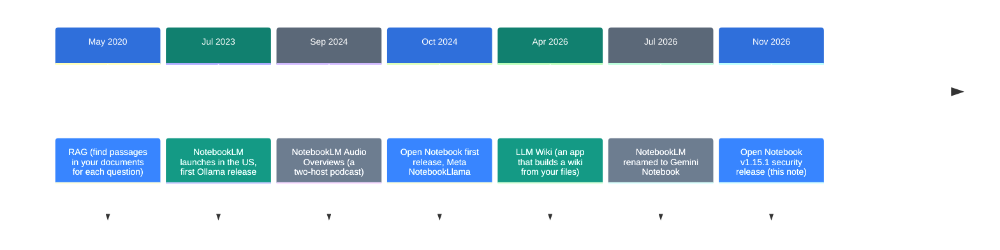
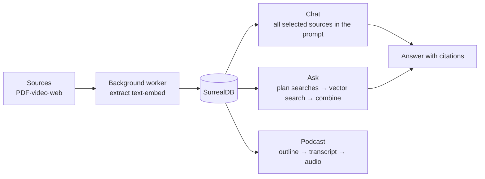

![[open-notebook.en.mp4]]

[Source](https://github.com/lfnovo/open-notebook) · [Repo](https://github.com/lfnovo/open-notebook) · [한국어](https://neocello-ku.github.io/ko/trends/open-notebook)

## Summary

Open Notebook is an open-source app that runs a Google NotebookLM-style notebook on your own server. It first shipped in October 2024 and put out the v1.15.1 security release on November 4, 2026. It has 41,740 GitHub stars.

In the larger timeline, it appeared six weeks after Google launched Audio Overviews. Over two years it grew into a self-hosted notebook that connects to 24 model providers.

The technique is old. The new part is the product: Google's feature set, moved onto your hardware and your choice of models. New to these terms? Start with the 'If you are new' section below.

## Where it fits: why this matters now

The repo is two years old. There are two reasons to look at it now.

First, the thing it copies has changed. On July 16, 2026, Google renamed NotebookLM to Gemini Notebook. Each notebook also got a cloud computer that writes and runs code.

Second, Open Notebook is in a cleanup phase. In v1.15.1 (November 2026) it closed security gaps and rewrote its docs against the code. The docs shrank from about 6,200 lines to about 1,450.



This note sits at the last step. An earlier note on this blog covers the same branch: "LLM Wiki" from October 12, 2026. That app files your sources into a wiki. Open Notebook lets you ask questions about your sources and make podcasts from them.

The October 12, 2026 note on Foresight, Google's Mac meeting-notes app, also connects. Its topic was processing that keeps audio on the device. The October 7, 2026 note on building a research AI covered answers with citations.

### What is new here

| What | How new | Why |
| --- | --- | --- |
| RAG, script-to-speech podcasts (technique) | Low | Both existed between 2020 and 2024. |
| Self-hosted notebook (product) | Medium | It moves NotebookLM features to your server and connects 24 providers. The concept is Google's. |
| Provider abstraction, REST API (infrastructure) | Medium | Every feature is open through the API. The parts already existed. |

Open Notebook rebuilds a Google product as open source. Among builds of that idea, it is the most widely used.

## If you are new: what is this about?

### A tutor who read only your material

Imagine you give your exam material to a tutor. The tutor reads only that material. When you ask a question, the tutor finds the answer and tells you which document it came from.

NotebookLM is that tutor. But your material goes to Google's servers. The tutor's brain is also fixed to Google's models.

Open Notebook puts the same tutor on your computer. You also pick the tutor's brain, the model. If you pick a model on your own computer, your material stays on your computer.

### Turning material into a radio talk

The tutor can also turn your material into a talk show, with one to four hosts discussing it. People use this to review by ear on the commute.

### Why it helps

- You decide where your material lives.
- You can swap models. Send expensive work to an API and repeated work to a local model.
- Every feature has a REST API. Other programs can add sources and ask questions.

### Where people use it

- Reading internal documents that must not leave the company
- Putting several papers in one notebook and comparing them
- Turning lecture notes into a podcast

### Names used in this note

| Term | Plain meaning |
| --- | --- |
| Notebook | A box that holds the sources and notes for one topic |
| Source | One item in a notebook: a PDF, a video, a web page, and so on |
| Insight | A summary or note that a model pulls out of a source |
| Embedding | Text turned into a list of numbers. Similar meaning gives similar numbers. |
| Vector search | A search that measures the distance between embeddings to find similar passages |
| RAG | Finding passages in your material and giving them to the model with your question |
| Provider | A service that supplies models: OpenAI, Anthropic, Ollama on your machine, and others |
| Ollama | A program that serves models from your own computer |
| Self-hosting | Running software on your own server instead of someone else's |
| MCP | A standard for connecting outside tools to AI assistants |

## How it works

There are two ways to ask. Chat reads all of the sources you select. Ask searches all your material and reads the matching passages.



- **Chat**: There is no search step. Every message sends all selected sources. Above about 105,000 tokens, it switches to the large-context model.
- **Ask**: It has three stages. A model plans up to 5 searches. Each search takes the top 10 passages and writes a partial answer. A final model combines the partial answers.
- **Podcast**: It writes an outline, writes a transcript from the speaker settings, and voices each speaker with a text-to-speech model.

Ask needs an embedding model. Chat sends whole sources, so cost grows with the amount of material.

## What you need

| Item | Requirement |
| --- | --- |
| Docker | Docker Desktop (macOS, Windows) or Docker Engine with the Compose plugin (Linux) |
| Models | One provider API key, or a local model server such as Ollama |
| Memory | Not in the README. The local quick-start doc asks for 8 GB of RAM or more. |
| GPU | Not required. Ollama inside Docker needs the NVIDIA Container Toolkit to use an NVIDIA GPU. |

The docs give local model sizes. qwen3 is about 5 GB. A 24 GB GPU such as the A5000 holds qwen3 and an embedding model together. This is an estimate from the doc numbers.

## Install and run

### Step 1. Download the compose file

```bash
mkdir open-notebook && cd open-notebook
curl -o docker-compose.yml https://raw.githubusercontent.com/lfnovo/open-notebook/main/docker-compose.yml
```

### Step 2. Change the encryption key

Find this line in `docker-compose.yml`.

```yaml
- OPEN_NOTEBOOK_ENCRYPTION_KEY=change-me-to-a-secret-string
```

Replace the value with a long secret that you generate. For example: `openssl rand -hex 32`. This key encrypts the API keys you store. Keep it safe.

### Step 3. If other devices can reach this machine, close the ports

The default file opens the UI (8502) and the API (5055) on all network interfaces. There is no password by default. On a server or a shared network, do one of these.

- Change the port lines to `"127.0.0.1:8502:8502"` and `"127.0.0.1:5055:5055"`.
- Add `- OPEN_NOTEBOOK_PASSWORD=your-password` under `environment:`.

### Step 4. Start the services

```bash
docker compose up -d
```

Wait about 30 seconds, then open http://localhost:8502 .

### Step 5. Connect a model

1. In the sidebar, open **Models** (under Manage).
2. Find your provider and click **Add Configuration**.
3. Enter a name and your API key.
4. Click **Test** to check the connection.
5. Add one **Language** model and one **Embedding** model.
6. Click **Auto-assign Defaults**.

Ollama takes a **Base URL** instead of a key. Anthropic and Groq have no embedding models. If you use them, connect embeddings through another provider.

### To run everything locally

Create `docker-compose.override.yml` in the same folder and add an Ollama service.

```yaml
services:
  ollama:
    image: ollama/ollama:latest
    volumes:
      - ./ollama_models:/root/.ollama
    restart: always
```

Start the services, then download two models.

```bash
docker compose up -d
docker compose exec ollama ollama pull qwen3
docker compose exec ollama ollama pull nomic-embed-text
```

The Ollama Base URL is `http://ollama:11434`. The connection fails if you use `localhost`.

Ollama's default context length is 8192 tokens. To send whole sources, raise the **Context Window** value.

Ollama cannot do podcasts or transcription. To keep those local too, add a separate OpenAI-compatible speech server.

## Fact check

The input was a repo link with no post, so this check covers the README's own claims. Dates and numbers are as of November 8, 2026.

| Claim (README) | What we found | Verdict |
| --- | --- | --- |
| More than 20 providers | The README table lists 24. That is 21 for LLMs, 12 for embeddings, 10 for transcription and 12 for speech. | Correct |
| 100% local | True only when you pick local models. Ollama and oMLX do chat and embeddings only. Speech needs a separate server. | Conditional |
| Your data stays under your control | The default file opens the ports on all interfaces with no password. The README warns about this too. | Conditional |
| Podcasts with 1 to 4 speakers; NotebookLM has only 2 | 1 to 4 is correct. NotebookLM grew to four formats in September 2025. We could not confirm its host count from an official source. | Conditional |
| NotebookLM has no API | NotebookLM Enterprise has an API, and it can create Audio Overviews. Only notebooks in personal accounts have no API. | Overstated |
| Answers cite their sources | Correct. But a citation points to a whole item. There are no page numbers or passages. | Conditional |
| MCP integration with Claude Desktop | The docs exist. The MCP server is a third-party package, open-notebook-mcp. It is not in this repo, and its last version is 0.3.0 from December 2025. | Conditional |
| UI in 14 languages | Correct. Korean is not one of them. The README's Korean link is a machine translation. | Correct |

The README comparison table still says "Google Notebook LM". It does not reflect the July 2026 rename or the code-running feature.

eWeek, Android Authority, and DEV reviewed the app independently in 2026. All three present it as a self-hosted alternative. Their shared downside is that it takes more work to install and maintain. We found no numeric benchmark under equal conditions.

## When to use what

| Situation | Option |
| --- | --- |
| Your material must not leave your machine | Open Notebook with Ollama. Bind the ports to 127.0.0.1. |
| You want to start now with no install | Gemini Notebook (formerly NotebookLM) |
| You want to run code on your sources | Gemini Notebook. Open Notebook has no code execution. |
| Another program must add sources and ask questions | The Open Notebook REST API (port 5055) |
| You want a wiki built from your files more than Q&A | LLM Wiki |
| You need page-level citations | In both apps, open the original and check it yourself. Open Notebook cites whole items. |

## Sources

- [Open Notebook GitHub repository](https://github.com/lfnovo/open-notebook)
- [Open Notebook v1.15.1 release (2026-11-04)](https://github.com/lfnovo/open-notebook/releases/tag/v1.15.1)
- [Open Notebook docs: AI Context & RAG](https://github.com/lfnovo/open-notebook/blob/main/docs/2-CORE-CONCEPTS/ai-context-rag.md)
- [Open Notebook docs: Quick Start - Local & Private](https://github.com/lfnovo/open-notebook/blob/main/docs/0-START-HERE/quick-start-local.md)
- [open-notebook-mcp (PyPI)](https://pypi.org/project/open-notebook-mcp/)
- [Google blog: NotebookLM is now Gemini Notebook](https://blog.google/innovation-and-ai/products/gemini-notebook/notebooklm-gemini-notebook/)
- [NotebookLM Enterprise docs: Manage audio overview (API)](https://docs.cloud.google.com/gemini/enterprise/notebooklm-enterprise/docs/api-audio-overview)
- [9to5Google: new NotebookLM Audio Overview formats (2025-09-02)](https://9to5google.com/2025/09/02/notebooklm-audio-overview-debate/)
- [eWeek: 5 NotebookLM Alternatives Worth Considering in 2026](https://www.eweek.com/news/5-notebooklm-alternatives-2026/)
- [Android Authority: Open Notebook hands-on](https://www.androidauthority.com/notebooklm-alternative-open-notebook-hands-on-3677932/)

## Related

- [[trends/llm-wiki|LLM Wiki: an app that files your documents into a wiki for you]]
- [[trends/foresight|Foresight: Google's Mac note app that keeps meeting audio on the machine]]
- [[trends/research-engineering|Building a research machine: put the evidence ledger first]]

