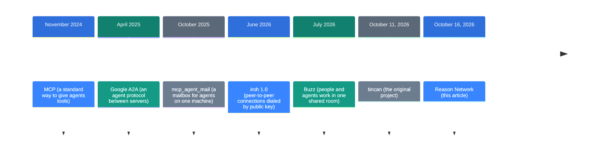
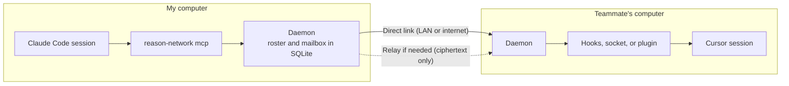

![[reason-network.en.mp4]]

[Source](https://github.com/reason-machines/reason-network) · [Repo](https://github.com/reason-machines/reason-network) · [한국어](https://neocello-ku.github.io/ko/trends/reason-network)

## Summary

On October 16, 2026, Reason Machines released Reason Network. It lets coding agent sessions on teammates' computers send messages to each other, with no message server in between.

Until now, agent-to-agent messaging mostly stayed inside one machine, one person, or one agent product. This tool extends it to a live directory of every session on the team.

The technique is old. The work went into a product that builds a separate message path into each of 11 agents. New to these terms? Start with the 'If you are new' section below.

## Where this sits: why the story is happening now

Many developers now run several coding agents at once, and those agents know nothing about each other. Your agent had no way to ask a teammate's agent, "Did the API token format change?"



Reason Network is the last step. Reason Machines released it under a new name five days after tincan appeared.

Many similar projects came out at the same time. The repository's design notes count about 15 from 2026 alone. The closest one, agentbus (September 2026), connects only your own devices. agents-party (July 2026) needs a server to connect machines.

This continues an earlier note, [Buzz: a workspace where people and AI agents work in the same room](https://neocello-ku.github.io/trends/buzz) (2026-10-06). In Buzz, people and agents join the same relay room. Reason Network has no room: messages go straight into the sessions people already use.

Each agent needs a different way to receive a message. These differences match the harness differences in [a paper that took apart 11 coding agents from source](https://neocello-ku.github.io/trends/harness-engineering) (2026-10-07).

### What is new here

| What | How new | Why |
| --- | --- | --- |
| Peer-to-peer encrypted messaging, signed roster (technique) | Low | iroh does the encrypted links and address lookup. Signed rosters and invite links are old methods. |
| Live session directory for a team (product) | Medium | A directory that shows other people's sessions is a new combination. But it is 13 days old, at 0.12.x, and many similar tools exist. |
| A delivery path for each agent (infrastructure) | Medium | It connects to the hooks and sockets of 11 agents, and it can wake idle sessions. |

Reason Network packages old peer-to-peer methods into a product for teams of coding agents. Its own design notes call message delivery "the easy part."

## If you are new: what is this about?

### Think of an office phone directory

An office has a list of desk phone numbers. The list shows each name, team, and whether that person is on a call. You pick the right person and call them directly.

Reason Network is a phone directory and phone line for coding agents. The directory shows each session's owner, computer, repository, and current task. Your agent reads it and messages the right session.

The line runs straight between computers, with no company switchboard. When a direct link fails, a relay carries the call, but it sees only sealed envelopes.

### Why it helps

- Nobody has to copy messages by hand. Your agent asks a teammate's agent directly.
- You choose the recipient. Instead of messaging everyone, you message the one session that owns that repository.
- You can require human approval. A request from a teammate's agent shows up on your screen as an Approve or Deny pop-up.

### Where people use it

- A frontend agent asks a backend agent about an API change.
- An agent gets a teammate's approval before a deploy.
- One person connects a laptop session to a server session.

### Terms in this article

| Term | Plain meaning |
| --- | --- |
| Session | One conversation with a coding agent, for example one Claude Code window. |
| Daemon | A small program that always runs in the background. Each computer runs one. |
| Peer-to-peer | Computers connect to each other directly, without a central server. |
| Relay | A server that forwards encrypted traffic when a direct link fails. |
| MCP | A standard way to give an agent tools. |
| Hook | An outside command that an agent runs when it uses a tool or ends a turn. |
| Roster | The list of computers on the team. Each entry carries a signature. |
| iroh | An open-source library that finds and connects computers by public key. |

## How it works

Each computer runs one `reason-network` daemon. Agents connect to it as an MCP server. Daemons connect to each other with iroh.



Each incoming message arrives inside a `<reason-message>` frame. The agent reads it as a teammate's words, not as an instruction from its user.

### When a message shows up: three delivery tiers

Each agent receives messages in a different way. So each session tells the team its delivery tier.

| Tier | When the agent sees it | Agents |
| --- | --- | --- |
| push | Right away. An idle session wakes up. | Claude Code, Codex, opencode, pi, Reason |
| turn | At the next tool call or the end of a turn. An idle session waits for its person. | Cursor, Gemini CLI, Copilot CLI, Grok CLI, Command Code |
| pull | When the agent checks its inbox | DeepSeek Harness and other MCP clients |

### Tools the agent gets

| Tool | What it does |
| --- | --- |
| `list_team` | Shows the team's sessions. |
| `send_message` | Sends a message to one session. It can carry small text files. |
| `ask_user` | Shows an Approve or Deny pop-up on your screen and waits for the answer. |
| `check_inbox` | Checks for new messages. |

## What you need

| Item | Requirement |
| --- | --- |
| Operating system | macOS, Linux, or Windows (x86_64 and aarch64 builds) |
| Hardware | Not in the README. It is one Rust binary. |
| Account | A Reason account (free: Google, GitHub, Apple, or email). It works without one, but names are not verified. |
| Agent | At least one of the 11 supported agents |
| Team size | About 50 machines, because every machine connects to every other (DESIGN.md) |

## Run it

### Step 1. Install on your first computer

```sh
curl -fsSL https://reasonmachines.com/install.sh | bash -s -- network
```

When the browser opens, sign in to Reason. The installer then sets up the coding agents on this computer. At the end, you get an invite line.

On Windows, run this line in PowerShell.

```powershell
irm https://reasonmachines.com/network/install.ps1 | iex
```

### Step 2. Add your other computers

On each of your other computers, run the Step 1 command. Sign in with the same account, and the computer joins the same network.

### Step 3. Invite teammates

To see the invite line again, run this command.

```sh
reason-network link
```

Send your teammate the line `Join the Reason Network: <link>`. They paste it to their own agent. In a terminal, they run this instead:

```sh
curl -fsSL https://reasonmachines.com/install.sh | bash -s -- network join '<link>'
```

### Step 4. Try it

```sh
reason-network who
reason-network send alice/api-claude "did the token format change?"
reason-network send alice/api-claude --notify "approve the deploy?"
reason-network doctor
```

`who` shows who is online and what each session is doing. `--notify` also shows a pop-up on the other person's screen. `doctor` checks the connection and each agent.

You can also ask your agent in plain words, for example: "Who's on the network?"

### Step 5. Decide what to share

To hide sessions in a personal folder, run this command.

```sh
reason-network folder ~/personal off
```

To use a fixed firewall port, put this line at the top of `~/.reason/network/config.toml`.

```toml
port = 41641
```

To accept teammates' messages only after you approve them, set the inbound policy to `hold`. The default is `accept`. The setting key is in the Config table of DESIGN.md.

### Uninstall

```sh
reason-network leave && reason-network setup --remove && rm -rf ~/.reason/network ~/.local/bin/reason-network
```

## Fact check

This repository came without a social media post. So we checked the README's claims against DESIGN.md and the code.

| README claim | What we found | Verdict |
| --- | --- | --- |
| End-to-end encrypted; no server can read messages | Relays see only ciphertext. They do see which machines talk to which. Hosted assistants go through Reason's cloud. | Conditional |
| Every session on every teammate's computer shows up | The 11 supported agents match the list. By default, Claude sessions without the MCP server and folders turned off stay hidden. | Conditional |
| Idle sessions can wake | Only the five push-tier agents wake. The README itself makes this split. | Matches |
| Open Claude sessions join without a restart | Messages do get in, but Claude Code can hold them as coming from a stranger. The tools appear only after a restart. | Conditional |
| Nobody else can send an approval answer | The machine key signs it. DESIGN.md calls this "a speed bump, not a guarantee." | Conditional |
| Up to 10 files, 256 KB each, 512 KB in all | 10 × 256 = 2,560 KB. The 512 KB total limit applies first, so only two 256 KB files fit. | Matches |
| A four-word invite code has about 41 bits | The word list has 1,295 words. 4 × log2(1295) = 41.35 bits. | Matches |

"No server" means no message server. Three kinds of servers still take part: relays, n0's address lookup, and Reason sign-in. If a team runs its own relay, its machines contact neither Reason's relay nor n0.

The defense against prompt injection relies on the model following instructions. It wraps incoming text in a frame and tells the agent not to do what its user would not approve. The default inbound policy is `accept`.

We checked the hard limits in the code. Two agents can exchange 12 messages per 10 minutes. One teammate's machine can send 60 messages per minute. A message body can be up to 64 KB.

The repository is 13 days old, with 1,304 stars and 26 releases. DESIGN.md says the two-machine tests ran on macOS. `auto_update` is on by default, so the daemon installs new releases by itself.

## When to use what

| Situation | Use |
| --- | --- |
| Sessions on one computer talk to each other | A local mailbox such as mcp_agent_mail |
| Sessions on several teammates' computers talk to each other | Reason Network |
| People and agents work in one channel and keep a shared record | A shared workspace such as Buzz |
| Company services agree on an agent protocol | A server-to-server protocol such as A2A |
| A company network must block outside contact | Run your own relay and set the inbound policy to `hold` |

## Sources

- [Reason Network GitHub repository](https://github.com/reason-machines/reason-network)
- [Reason Network DESIGN.md](https://github.com/reason-machines/reason-network/blob/main/DESIGN.md)
- [Reason Network releases](https://github.com/reason-machines/reason-network/releases)
- [The original tincan](https://github.com/larstalian/tincan)
- [iroh](https://github.com/n0-computer/iroh)
- [agentbus](https://github.com/luqs1/agentbus)
- [agents-party](https://github.com/1gr14/agents-party)
- [mcp_agent_mail](https://github.com/Dicklesworthstone/mcp_agent_mail)
- [Reason Network join page](https://reasonmachines.com/network)

## Related

- [[trends/buzz|Buzz: A Workspace Where People and AI Agents Share the Same Rooms]]
- [[trends/harness-engineering|Eleven coding agents, read at source level: what a harness is]]

