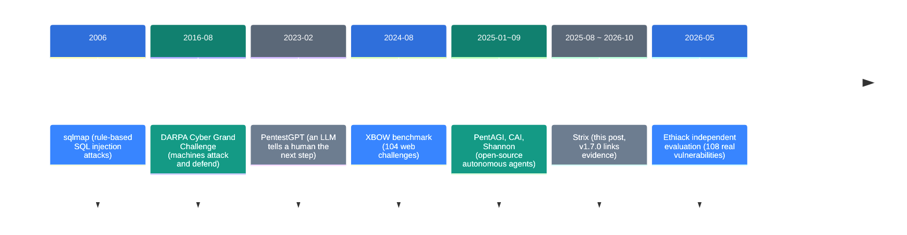
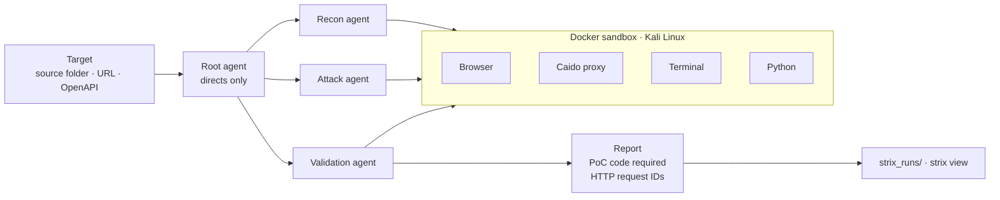

![[strix.en.mp4]]

[Source](https://github.com/usestrix/strix) · [Repo](https://github.com/usestrix/strix) · [한국어](https://neocello-ku.github.io/ko/trends/strix)

## Summary

Strix is an open-source CLI in which several LLM agents attack your app for real. It only reports findings that come with a proof-of-concept (PoC). It first shipped in August 2025 and reached v1.7.0 in October 2026.

In the wider story, it belongs to the "autonomous attack agent" branch that came after rule-based scanners and LLM assistants. PentAGI, CAI, and Shannon sit on the same branch. Strix has the most GitHub stars of them, at about 74,000.

The short verdict: the technique is old. What Strix adds is one CLI that bundles install, CI, and evidence rules. New to these terms? Start with the 'If you are new' section below.

## Where this fits: why now

Coding agents now write code fast, and security review has become the slow step. A human penetration test takes weeks and costs a lot. So from 2025 on, many tools appeared that hand the attacking to agents as well.



Strix sits at the sixth step. In June 2025, the commercial tool XBOW announced the top spot on HackerOne's US leaderboard. After that, open-source tools that do the same job arrived one after another.

Several earlier notes on this site connect to Strix. "Building an AI That Investigates: Put the Evidence Ledger at the Center" (2026-10-07) said to tie every claim to evidence. Strix v1.7.0 now asks each finding to carry HTTP request IDs as evidence.

"A Paper That Took Apart 11 Coding Agents" (2026-10-07) looked at agent harnesses. Strix is a harness built for security attacks. "CLIProxyAPI" (2026-11-04) covered ChatGPT subscription sign-in, and Strix added the same sign-in in v1.4.0.

### What is new here

| What | How new | Why |
| --- | --- | --- |
| LLM + security tools + sub-agents (technique) | Low | PentestGPT (2023) and PentAGI (2025-01) did it first. |
| One-line install, CI, local viewer (product) | Medium | An easy bundle to use. But Shannon ships a similar bundle. |
| Sandbox, evidence-linked reports, budget cap (infrastructure) | Medium | It ties a Kali Linux image to Caido proxy request IDs. It is not a new standard. |

In short, Strix packages old techniques as a product. The part worth watching is how its evidence rules got stricter over one year.

## If you are new: what is this about?

### Hire a burglar to break into your own house

There are two ways to check the security of a house. One is to walk around with a checklist and look at each window and lock. The other is to let a trusted expert, with your permission, actually try to open the doors.

The checklist is fast, but it gives many guesses like "this lock looks weak". Opening the doors is slow, but an open door is a sure problem. We call this kind of permitted, real attack a **penetration test**.

Strix hands the "actually open the doors" job to AI agents. For each door it opens, the agent adds a record of how it did it to the report.

### Why it helps

- You get evidence instead of guesses. Each finding carries attack code.
- Work that takes a human weeks runs in minutes to hours.
- It can run on every PR and check only the changed code.

### Where people use it

- A security check of your web app before release
- A CI security check on every PR
- Groundwork for bug bounty research

### Terms in this post

| Term | Plain meaning |
| --- | --- |
| Penetration test | A check where you attack for real, with permission, to find weak spots. |
| PoC | Proof of concept. Attack code or a request that shows a weak spot is real. |
| False positive | A report that calls something a problem when it is not. |
| Recall | The share of real weak spots that the tool found. |
| Precision | The share of reported items that are real weak spots. |
| Sandbox | A closed space where attack tools run. Strix uses Docker. |
| White-box, black-box | White-box tests read the source code. Black-box tests do not. |
| XBEN | XBOW's benchmark of 104 web security challenges. |

## How it works

The root agent does not attack. It only directs the work. It gives recon, attack, and validation tasks to sub-agents. All tools run inside a Docker sandbox.



The report tool rejects a report when the PoC code is empty. From v1.7.0, a finding checked through the proxy must carry the proxy request IDs.

Strix has three scan modes.

| Mode | Run time (per the docs) | Use |
| --- | --- | --- |
| quick | Minutes | Every PR |
| standard | 30 minutes to 1 hour | Weekly checks |
| deep (default) | 1 to 4 hours | Before a major release |

## Setup and run

> Use it only on targets you may test. Strix attacks the target for real. Run it only on your own systems or on systems with written permission.

| Item | Requirement |
| --- | --- |
| Docker | It must be running. The sandbox image is about 3.8GB (as of v1.3.0). |
| LLM | One API key. The README gives no GPU requirement. |
| Local model | Possible, but the docs warn that models under 70B struggle. |
| Cost | You pay for tokens. The benchmark cost about $337 for 100 challenges. |

### Step 1. Install Strix

```bash
curl -sSL https://strix.ai/install | bash
```

With pip, the package name is `strix-agent`, and it needs Python 3.12 or later.

### Step 2. Pick a model and a key

```bash
export STRIX_LLM="vercel_ai_gateway/zai/glm-5.3"
export LLM_API_KEY="your-api-key"
```

Strix saves the settings in `~/.strix/cli-config.json`. With a ChatGPT subscription, `strix auth login chatgpt` can replace the API key.

### Step 3. Decide on telemetry

Telemetry is on by default. To turn it off, set this value.

```bash
export STRIX_TELEMETRY=0
```

### Step 4. Run a first scan on your code

```bash
strix --target ./app-directory
```

The first run downloads the sandbox image. Results go to `strix_runs/<run-name>`.

### Step 5. Set a budget cap

The default deep mode runs for 1 to 4 hours. Set a cap for your first runs.

```bash
strix --target https://example.com --max-budget 25 --max-turns 300
```

At 90% of the budget, the sub-agents stop first.

### Step 6. View the results

```bash
strix view
```

The viewer binds to `127.0.0.1` and prints a link with a token. Do not share that link.

### Step 7. Add it to CI (optional)

```bash
strix -n -t ./ --scan-mode quick
```

`-n` runs without the interactive screen. It exits with a non-zero code when it finds vulnerabilities. On a PR, quick mode looks only at changed files.

## Fact check

We compared the README claims with the code, the docs, and an independent study from the same period.

| Claim (README) | What we found | Verdict |
| --- | --- | --- |
| Real PoC validation, no false positives like legacy scanners | The code requires a PoC. But in an independent study, Strix also made false positives. | Overstated |
| 100 of 104 XBEN challenges, 96% | The math is right (96.15%). It is v0.4.0's own measurement, with no independent rerun. | Conditional |
| Pentests in hours, not weeks | The docs say minutes for quick and 1 to 4 hours for deep. No evidence shows the same scope as a human test. | Conditional |
| Several agents work together | The code has tools to create, message, and wait for agents. | Matches |
| Free and runs on your machine | It is Apache-2.0. Token costs are separate. | Conditional |
| Nothing leaves your machine in the viewer | The viewer is local. But telemetry is on by default. | Conditional |
| Auto-fix and compliance reports | One-click fix PRs and SOC 2 reports are paid Cloud and Enterprise features. | Conditional |

### Redoing the 96% math

The per-level solves add up to 45 + 49 + 6 = 100. The total is 45 + 51 + 8 = 104. 100 ÷ 104 = 96.15%, which matches the README.

But this number comes from v0.4.0 in November 2025. The benchmark config example uses `openai/gpt-5`. XBOW also says the industry has mostly solved this benchmark.

The cost is $337 ÷ 100 = about $3.37 per challenge. The average solve time is about 19 minutes.

### Independent measurement from the same period: the Ethiack paper (2026-05)

Ethiack researchers ran Strix, PentAGI, and Claude Code on the same targets. There were three public apps with 108 known vulnerabilities. They ran each setup three times.

| Comparison (both on Claude Sonnet 4.6) | Relative difference, Claude Code vs Strix | p-value |
| --- | --- | --- |
| Recall | +18.83% | 0.0047 |
| Precision | −14.19% | 0.0445 |
| F1 | +16.79% | 0.0141 |

Strix finds less, but more of what it finds is real. "Relatively few false positives" is accurate. "No false positives" is not.

The paper also lists its limits. Three runs is a small number, and the answer key may miss some bugs. The targets are public, so training data may contain them.

## When to use what

| Situation | Approach |
| --- | --- |
| You want a fast check on every PR | Add `strix -n -t ./ --scan-mode quick` to CI. |
| You want a deep look before a major release | Use deep mode with `--max-budget`. |
| You want to compare tools that read the source and attack | Run Shannon too. |
| Finding more matters most | In the independent study, Claude Code found more. It also made more duplicates. |
| Code must not leave your network | Use a local model. Keep the 70B-or-larger warning in mind. |
| You want results with no setup | Use the paid Strix Cloud. |

## Sources

- Strix repo (README, docs/, strix/tools/): https://github.com/usestrix/strix
- Strix releases: https://github.com/usestrix/strix/releases
- Strix XBEN run scripts: https://github.com/usestrix/benchmarks/tree/main/XBEN
- XBOW benchmark: https://github.com/xbow-engineering/validation-benchmarks
- Ethiack evaluation paper: https://arxiv.org/abs/2605.10834
- XBOW HackerOne top-spot post: https://xbow.com/blog/top-1-how-xbow-did-it/

## Related

- [[trends/research-engineering|Building a research machine: put the evidence ledger first]]
- [[trends/harness-engineering|Eleven coding agents, read at source level: what a harness is]]
- [[trends/cliproxyapi|CLIProxyAPI: One API Address for Your Coding Subscriptions]]

