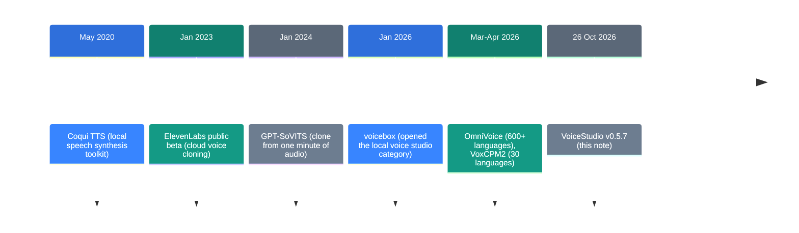
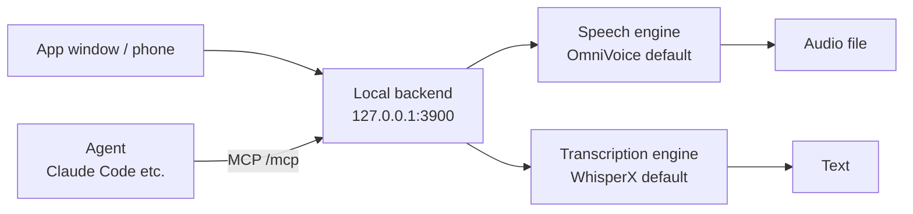

![[voicestudio.en.mp4]]

[Source](https://github.com/debpalash/VoiceStudio) · [Repo](https://github.com/debpalash/VoiceStudio) · [한국어](https://neocello-ku.github.io/ko/trends/voicestudio)

## Summary

VoiceStudio is an open app that clones voices, dubs videos, and transcribes speech on your own computer. It ships no new model. It packages open models such as OmniVoice into one app and moves ElevenLabs-style work onto local hardware.

The verdict: an old technique turned into a product. The technique is not new, and the product and infrastructure layers are moderately new. New to these terms? Start with the 'If you are new' section below.

## Where this fits: why now

Open speech models arrived one after another in spring 2026. As the models improved, a race began to wrap them in one app. VoiceStudio is the app in that race with 92,992 GitHub stars (29 October 2026).



Our earlier note on [VoxCPM2](/trends/voxcpm2) (11 October 2026) covered a single model. VoiceStudio ships that same VoxCPM2 as one of its engines. Its "audio stays on the device" stance matches [Foresight](/trends/foresight) (12 October 2026).

### What is new here

| What | Novelty | Why |
| --- | --- | --- |
| Speech models (technique) | Low | There is no new model. It bundles open models such as OmniVoice, VoxCPM2, and Whisper. |
| One-app bundle (product) | Medium | voicebox opened this category in January 2026. VoiceStudio is wider: 29 engines, dubbing, and phone apps. |
| Local API and MCP (infrastructure) | Medium | Agents can call a voice. The app also picks a model size that fits your hardware. Each piece already existed. |

VoiceStudio packages models that other teams trained. Its strength is breadth, and output quality depends on the model you pick.

## If you are new: what is this about?

### A voice-actor office inside your computer

Picture an office of voice actors. You hand over a script, and an actor reads it. An actor can also imitate another person's voice.

VoiceStudio puts that office inside your computer. The actors are open speech models. The default actor is OmniVoice, and you can switch actors in the Model Manager.

With a service such as ElevenLabs, the office sits on the company's servers. Your recordings and scripts go there. With VoiceStudio, both stay on your device.

### Why it helps

- Recordings and scripts stay on your device. The app sends analytics only after you agree.
- There are no accounts and no API keys. There is no pay-per-use bill.
- Cloning, dubbing, transcription, and audiobooks live in one app.

### Where people use it

- Dubbing a lecture video into another language
- Turning a long text into an audiobook in your own voice
- Transcribing meeting audio without it leaving the machine

### Names in this note

| Term | Plain meaning |
| --- | --- |
| TTS | Text-to-speech. Software that reads text aloud. |
| Voice cloning | Hearing a short recording and saying new sentences in that voice. |
| Voice design | Making a voice from a written description, such as "a low middle-aged male voice", with no recording. |
| Transcription (ASR) | Turning speech into text. |
| Engine | The model inside the app that actually speaks or transcribes. |
| GGUF | A file format that stores a model in a smaller form. It runs on small GPUs. |
| VRAM | Memory on the graphics card. The model loads into it. |
| MCP | A shared protocol that lets AI agents call outside tools. |

## How it works



The app and agents call the same local backend. The backend listens on port 3900. Dubbing chains transcription, translation, and speech generation in order.

The engine follows your hardware. OmniVoice recommends 6 GB or more of VRAM on a dedicated GPU. Below that, use the GGUF build. Q4_K_M is about 659 MB, and Q8_0 is about 945 MB.

## Requirements and setup

| Item | Requirement |
| --- | --- |
| Disk | About 10 GB free |
| GPU | The default engine recommends 6 GB VRAM or more. Without a GPU it runs on the CPU, more slowly. |
| OS | macOS (Apple Silicon), Windows 10/11, Linux, Docker. Phone apps are in Preview. |
| Default model weights | About 2.3 GB, downloaded on first use. |

### Step 1. Read the install script first

The README install command downloads a script and runs it at once. Before you run it, read the [install script guide](https://github.com/debpalash/VoiceStudio/blob/main/docs/install/script.md).

### Step 2. Install the app

On macOS or Linux, run this command.

```sh
curl -fsSL https://voicestudio.sh/install | sh
```

On Windows, run this command in PowerShell.

```powershell
irm https://voicestudio.sh/install.ps1 | iex
```

If you prefer not to pipe a script, download an installer from the [latest release](https://github.com/debpalash/VoiceStudio/releases/latest).

### Step 3. Make your first voice

1. Open the **Voice cloning** screen.
2. Pick a voice, or add a clean reference recording.
3. Type your text and generate.

The app asks before it downloads a model. The first generation is slow because the model loads. Judge speed from the second generation.

### To run it on a server: Docker

If you have a GPU server, you can run the Docker image. First, create an API key.

```bash
export OMNIVOICE_API_KEY="$(python3 -c 'import secrets; print(secrets.token_urlsafe(32))')"
docker run -d --name omnivoice --gpus all \
  -p 127.0.0.1:3900:3900 \
  -e OMNIVOICE_API_KEY="$OMNIVOICE_API_KEY" \
  -v omnivoice-data:/app/omnivoice_data \
  ghcr.io/debpalash/voicestudio:stable
```

This command opens the port on `127.0.0.1` only. To reach it from other devices, follow the reverse proxy steps in the official docs.

### For commercial use: check each model licence

The app code is AGPL-3.0, which allows commercial use. The default OmniVoice weights, however, are CC-BY-NC (non-commercial). Licences differ by model, so check each one in the Model Manager.

## Fact check

| Claim | What we found | Verdict |
| --- | --- | --- |
| Clone, dub, and transcribe in 646 languages (README) | 646 is the language count for OmniVoice speech generation. Transcription uses Whisper-family engines, and the docs say Whisper cannot transcribe Uyghur. | Overstated |
| Quality across 646 languages | By our count, 265 languages have under 10 hours of training data. English has 206,061 hours and Korean has 8,609. | Conditional |
| Nothing leaves your device unless you say yes (README) | Analytics need consent. The app asks before model downloads. If you pick Google for translation, text leaves the device. | Matches |
| AGPL allows commercial use (README) | True for the app code. The default OmniVoice weights are CC-BY-NC. From v0.5.7, the API returns a licence error until you accept. | Conditional |
| Runs on your computer and phone (README) | Phone apps are in Preview. The iPhone build is sideloaded, and a free Apple ID install expires after 7 days. | Conditional |
| Usable without a GPU (README) | It runs on the CPU. The default engine recommends 6 GB VRAM, and a GGUF build exists for small GPUs. | Matches |
| Speed by engine and hardware is documented (README) | The benchmark table has zero verified rows. The only measurements come from one 16 GB M2. | Weak evidence |
| Dozens of other engines (README) | 19 speech engines and 10 transcription engines, 29 entries in total. Three are OmniVoice variants. | Matches |
| Fully local ElevenLabs alternative (repo description) | The features overlap. The repo has no quality comparison. Remote GPU features moved to paid Pro in v0.5.7. | No evidence |

The number 646 is correct, but it belongs to one speech generation model. For transcription and the source language of a dub, the Whisper-family engine sets the limit.

For an independent check from the same period, our VoxCPM2 note lists Seed-TTS-eval English WER: Fish S2 0.99, Qwen3-TTS 1.23, VoxCPM2 1.84. OmniVoice is not in that table.

The "RTF 0.025" in the OmniVoice README is the model authors' own figure. Nothing in the VoiceStudio repo shows the app reaching that speed. Measure quality and speed on your own hardware.

## When to use what

| Situation | Use |
| --- | --- |
| Recordings must not leave the machine | A local app such as VoiceStudio |
| Voice quality matters most, and cloud is fine | A cloud service such as ElevenLabs |
| You only need one model from code | Install the model repo directly (for example, VoxCPM2) |
| You want an agent to speak | The VoiceStudio MCP server |
| You plan to sell the output | Switch to an engine with a clear commercial licence |

## Sources

- [VoiceStudio GitHub repository](https://github.com/debpalash/VoiceStudio)
- [VoiceStudio v0.5.7 release (26 October 2026)](https://github.com/debpalash/VoiceStudio/releases/tag/v0.5.7)
- [VoiceStudio licence notice (LICENSE-NOTICE.md)](https://github.com/debpalash/VoiceStudio/blob/main/LICENSE-NOTICE.md)
- [VoiceStudio supported languages (docs/languages.md)](https://github.com/debpalash/VoiceStudio/blob/main/docs/languages.md)
- [VoiceStudio MCP docs](https://github.com/debpalash/VoiceStudio/blob/main/docs/mcp.md)
- [VoiceStudio benchmarks (docs/benchmarks.md)](https://github.com/debpalash/VoiceStudio/blob/main/docs/benchmarks.md)
- [OmniVoice GitHub repository (k2-fsa)](https://github.com/k2-fsa/OmniVoice)
- [OmniVoice paper (arXiv 2604.00688)](https://arxiv.org/abs/2604.00688)
- [voicebox GitHub repository](https://github.com/jamiepine/voicebox)
- [GPT-SoVITS GitHub repository](https://github.com/RVC-Boss/GPT-SoVITS)
- [Coqui TTS GitHub repository](https://github.com/coqui-ai/TTS)

## Related

- [[trends/voxcpm2|VoxCPM2: One Open Model That Speaks 30 Languages at 48kHz]]
- [[trends/foresight|Foresight: Google's Mac note app that keeps meeting audio on the machine]]

