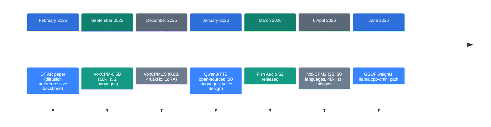
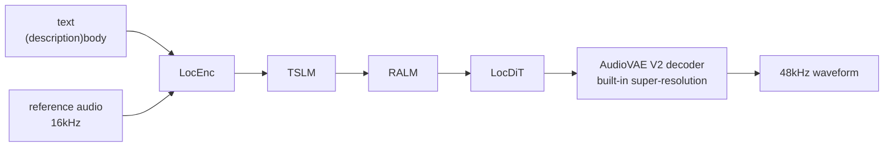

![[voxcpm2.en.mp4]]

[Source](https://x.com/0xGky/status/2109085321635701002) · [Repo](https://github.com/OpenBMB/VoxCPM) · [한국어](https://neocello-ku.github.io/ko/trends/voxcpm2)

## Summary

VoxCPM2 turns text into speech. It is a 2B open model with 30 languages, voice design, voice cloning, and 48kHz output.

The architecture dates to VoxCPM-0.5B in September 2025. What this release adds is reach across far more languages, under a license that lets you sell what you make. So this is a packaging win more than a research one.

New to these terms? Start with the "If you are new" section below.

The source post went up on 11 October 2026. VoxCPM2 shipped on 6 April 2026, so the model is already six months old.

## Where this sits: why the story is here now

Open speech synthesis spent 2025 competing on quality. Several models now read English and Chinese well, so the remaining differences show up in other languages.



The post sits at the sixth step. It arrived in month ten; the model arrived in month four.

In between, what landed in the repository was runtime work. The vLLM-Omni serving doc arrived in April 2026. GGUF weights and the llama.cpp-omni path arrived in June 2026. Where you can run it has changed more this year than the model itself.

[LongCat-Video-Avatar 1.5](https://neocello-ku.github.io/trends/longcat-avatar-15) (2026-10-06) takes audio and makes a talking video. VoxCPM2 makes that audio, one step earlier in the same pipeline. [EmbeddingGemma 2](https://neocello-ku.github.io/trends/embeddinggemma-2) (2026-10-07), another small open model for sound, packs audio into one vector.

### What is actually new

| What | Novelty | Why |
| --- | --- | --- |
| Tokenizer-free diffusion autoregression (method) | Low | VoxCPM-0.5B used this design in September 2025. Version 2 scaled the size and the data. |
| 30 languages plus design plus cloning in one package (product) | High | Fish S2 scores 75.15% CER on Khmer. VoxCPM2 scores 2.05%. No open model covers more languages. |
| 48kHz output and serving paths (infrastructure) | Medium | A 16kHz reference goes in and 48kHz comes out. The serving stack comes from existing projects. |

What is on offer here is packaging: an older method pushed to the widest coverage so far. Qwen3-TTS published voice design first, in January 2026.

## If you are new: what is this about

### Two ways a machine can speak

The old way records a human and glues clips together. Think of a subway announcement. Because the clips are fixed, the system cannot say anything outside the recording.

Modern models build the sound themselves. The model reads the text and draws a waveform from scratch. So it can read any sentence.

### What "tokenizer-free" means

Most speech models first turn sound into numbered tags. Each small piece of sound gets the nearest number from a dictionary. The part that makes those tags is a tokenizer.

Tags cost you detail. A subtle tremor that is not in the dictionary gets rounded to the closest tag. It is like drawing a sunset with 24 crayons.

VoxCPM2 skips the tags and handles sound as continuous values.

### Voice design and voice cloning

The model gets a voice in two ways.

- **Voice design**: you describe the voice in words and give no recording. For example, "a calm woman in her thirties".
- **Voice cloning**: you give a short recording and the model copies the timbre. Add the transcript of that recording for a closer copy.

### Why it helps

- You can make speech in 30 languages without hiring voice actors.
- The Apache-2.0 license lets you ship it in a commercial product.
- You download the weights and run them yourself. Your text stays on your machine.

### Where people use it

- Video dubbing and reading foreign subtitles aloud
- Listening to internal documents or briefings
- Prototype voice prompts for games and apps

### Names in this guide

| Term | Plain meaning |
| --- | --- |
| TTS | Text to speech. |
| Tokenizer | The part that turns sound into a list of numbered tags. |
| Diffusion autoregression | Clearing noise step by step, each piece based on the one before. |
| Voice design | Ordering a voice with a written description. |
| RTF | Time needed per second of audio. At 0.3, one second of audio takes 0.3 seconds. |
| WER / CER | Error rate when the output is transcribed again. Lower is clearer. |
| SIM | How close the timbre is to the reference. Higher is closer. |
| GGUF | A weight file format that C++ inference engines read. |
| VRAM | Memory on the graphics card. |

## How it works

The model works inside a compressed space called AudioVAE V2. Four stages build the values in that space. A decoder then turns them into a waveform.



The last box is where the sample rate changes. A 16kHz input still gives 48kHz output, because the upscaling sits inside the model. There is no separate upsampler to attach.

## What you need

| Item | Requirement |
| --- | --- |
| Python | 3.10 or later, below 3.13 |
| PyTorch | 2.5.0 or later |
| CUDA | 12.0 or later |
| VRAM | About 8 GB, per the README |
| Speed | RTF about 0.30 on an RTX 4090 |

The README gives no figures for other cards. An 8 GB footprint leaves room on a 24 GB card. On a card slower than the RTX 4090, expect an RTF above 0.30.

## Running it

### Step 1. Install the package

```sh
pip install voxcpm
```

### Step 2. Order a voice in words

```bash
voxcpm design \
  --text "VoxCPM2 brings studio-quality multilingual speech synthesis." \
  --control "Young female voice, warm and gentle, slightly smiling" \
  --seed 42 \
  --output out.wav
```

Put the voice description in `--control`. Fix `--seed` to get the same result again.

### Step 3. Clone a timbre from a recording

```bash
voxcpm clone \
  --text "This is a voice cloning demo." \
  --reference-audio path/to/voice.wav \
  --output out.wav
```

For a closer copy, add the transcript of the recording.

```bash
voxcpm clone \
  --text "This is a voice cloning demo." \
  --prompt-audio path/to/voice.wav \
  --prompt-text "reference transcript" \
  --reference-audio path/to/voice.wav \
  --output out.wav
```

### Step 4. Call it from Python

```python
from voxcpm import VoxCPM
import soundfile as sf

model = VoxCPM.from_pretrained("openbmb/VoxCPM2", load_denoiser=False)

wav = model.generate(
    text="(A young woman, gentle and sweet voice)Hello, welcome to VoxCPM2!",
    cfg_value=2.0,
    inference_timesteps=10,
    seed=42,
)
sf.write("voice_design.wav", wav, model.tts_model.sample_rate)
```

The voice description goes in brackets before the sentence. The format is `(description)body`.

### Step 5. Check it in a browser

```bash
python app.py --port 8808
```

Open `http://localhost:8808` in a browser. On a Mac, `--device auto` picks MPS.

## Fact check

| Claim in the post | What I found | Verdict |
| --- | --- | --- |
| 38,000 stars | 38,860 by the API on 2026-10-11 | Correct |
| Number one on GitHub Trending | The README credits VoxCPM1.5 with that rank in December 2025. It records no such rank for VoxCPM2 | Wrong target |
| It is blowing up abroad right now | VoxCPM2 shipped on 2026-04-06. The post came six months later | Wrong timing |
| One line of text makes a voice | Confirmed as the voice design feature | Correct |
| Copies speech habits and pace one to one | You must supply both the reference audio and its transcript. Similarity is 75.3 for English and 79.5 for Chinese | Overstated |
| 48kHz studio quality | The README states 48kHz output with built-in super-resolution | Correct |
| Apache 2.0, free for commercial use | The LICENSE file is Apache-2.0 | Correct |
| You cannot tell it from a real voice | It does not rank first on public benchmarks | Overstated |

The Seed-TTS-eval English test backs up that last verdict. Lower is better.

| Model | test-EN WER (%) |
| --- | --- |
| Fish Audio S2 | 0.99 |
| Qwen3-TTS | 1.23 |
| LongCat-Audio-DiT | 1.50 |
| VoxCPM2 | 1.84 |

On timbre similarity, LongCat-Audio-DiT scores 78.6 against 75.3 for VoxCPM2, so VoxCPM2 leads neither column.

Low-resource languages are where it pulls ahead. These numbers come from the repository's own 30-language test.

| Language | VoxCPM2 | Fish S2-Pro |
| --- | --- | --- |
| Khmer | 2.05% | 75.15% |
| Lao | 1.90% | 87.40% |
| Burmese | 1.42% | 85.27% |

This table is self-reported. Transcription came from the Gemini 3.1 Flash Lite API. That is not an independent check. Still, the gaps are wide enough that the direction looks sound.

## When to use what

| Situation | What to use |
| --- | --- |
| English or Chinese only, and clarity matters most | Fish Audio S2 |
| Southeast Asian or other low-resource languages | VoxCPM2 |
| A new voice without a voice actor | VoxCPM2 voice design |
| An exact copy of one person's timbre | VoxCPM2 ultimate cloning, with the transcript |
| No GPU, running on a Mac or CPU | llama.cpp-omni with GGUF weights |
| Many requests at once | A vLLM-Omni server |

Ultimate cloning reproduces another person's voice. The README forbids use for impersonation and fraud. Mark generated audio as AI output.

## Sources

- [Original X post (2026-10-11)](https://x.com/0xGky/status/2109085321635701002)
- [OpenBMB/VoxCPM on GitHub](https://github.com/OpenBMB/VoxCPM)
- [VoxCPM2 release 2.0.0 (2026-04-06)](https://github.com/OpenBMB/VoxCPM/releases/tag/2.0.0)
- [VoxCPM2 technical report (arXiv 2606.06928)](https://arxiv.org/abs/2606.06928)
- [VoxCPM documentation](https://voxcpm.readthedocs.io/en/latest/)
- [HuggingFace openbmb/VoxCPM2](https://huggingface.co/openbmb/VoxCPM2)
- [VoxCPM2-GGUF weights](https://huggingface.co/DennisHuang648/VoxCPM2-GGUF)
- [llama.cpp-omni repository](https://github.com/tc-mb/llama.cpp-omni)
- [vLLM-Omni repository](https://github.com/vllm-project/vllm-omni)
- [DiTAR paper (arXiv 2502.03930)](https://arxiv.org/abs/2502.03930)

## Related

- [[trends/longcat-avatar-15|LongCat-Video-Avatar 1.5: A Talking Video From One Photo]]
- [[trends/embeddinggemma-2|EmbeddingGemma 2: text, images, sound, and video in one vector]]

